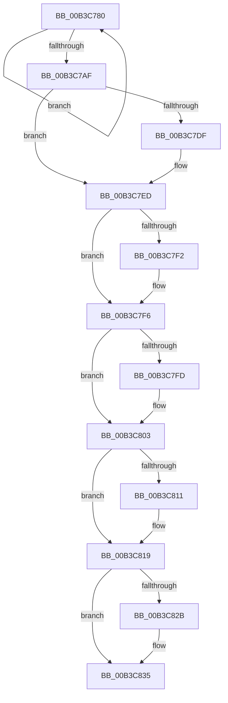

# sub_00B3C780

- RVA: `0x00B3C780`–`0x00B3C83F` (길이 `191` bytes)
- VA: `0x0000000140B3C780`
- 실행 섹션: `PAGE`
- PDB 이름 있음: `아니요`; PDB Function 태그: `아니요`
- unwind 정보 RVA: `0x000B0BAC`
- 디코드: `52`개 명령, `191/191` bytes 표시
- 미해석 바이트: `0` (있으면 어셈블리에 `.byte`로 보존)

> 이 문서는 커널 이미지의 기계어와 PDB 기호를 분석해 생성했습니다. 4번과 5번은 함수 원형과 자료형을 바이너리 사용 방식에서 추정한 C 해석이며 원본 소스 복구 결과는 아닙니다.

## 1. Dependencies

- 직접 호출 지점: **7**; 고유 호출 대상: **7**
- 직접 호출자로 확인된 함수: **0**
- RIP 상대 이미지 참조: **0**

### Outgoing calls
- `0x00B3C798` → [ExWaitForRundownProtectionRelease](../../text/2A/ExWaitForRundownProtectionRelease_function_002A4CB0.md) (function, `0x002A4CB0`)
- `0x00B3C7CF` → [KeAbPreAcquire](../../text/21/KeAbPreAcquire_function_00210230.md) (function, `0x00210230`)
- `0x00B3C7E8` → [ExfAcquirePushLockExclusiveEx](../../text/20/ExfAcquirePushLockExclusiveEx_function_0020FC90.md) (function, `0x0020FC90`)
- `0x00B3C814` → [ExfTryToWakePushLock](../../text/26/ExfTryToWakePushLock_function_00265DD0.md) (function, `0x00265DD0`)
- `0x00B3C81C` → [KeAbPostRelease](../../text/2E/KeAbPostRelease_function_002E1600.md) (function, `0x002E1600`)
- `0x00B3C821` → [KeLeaveCriticalRegion](../../text/25/KeLeaveCriticalRegion_function_0025D8B0.md) (function, `0x0025D8B0`)
- `0x00B3C82E` → [CmSiFreeMemory](../../text/47/CmSiFreeMemory_function_00475D80.md) (function, `0x00475D80`)

### Direct callers
- 이 함수 시작 RVA로 연결되는 직접 call은 확인되지 않았습니다. 간접 호출은 완전히 역산할 수 없습니다.

### Static image references
- 디코드된 RIP-relative 메모리 참조가 없습니다.

## 2. Other-region calls and transfers

- 다른 실행 섹션으로 향하는 call: **7**
  - `0x00B3C798` → [ExWaitForRundownProtectionRelease](../../text/2A/ExWaitForRundownProtectionRelease_function_002A4CB0.md) (`PAGE` → `.text`)
  - `0x00B3C7CF` → [KeAbPreAcquire](../../text/21/KeAbPreAcquire_function_00210230.md) (`PAGE` → `.text`)
  - `0x00B3C7E8` → [ExfAcquirePushLockExclusiveEx](../../text/20/ExfAcquirePushLockExclusiveEx_function_0020FC90.md) (`PAGE` → `.text`)
  - `0x00B3C814` → [ExfTryToWakePushLock](../../text/26/ExfTryToWakePushLock_function_00265DD0.md) (`PAGE` → `.text`)
  - `0x00B3C81C` → [KeAbPostRelease](../../text/2E/KeAbPostRelease_function_002E1600.md) (`PAGE` → `.text`)
  - `0x00B3C821` → [KeLeaveCriticalRegion](../../text/25/KeLeaveCriticalRegion_function_0025D8B0.md) (`PAGE` → `.text`)
  - `0x00B3C82E` → [CmSiFreeMemory](../../text/47/CmSiFreeMemory_function_00475D80.md) (`PAGE` → `.text`)
- call이 아닌 외부 분기/꼬리 이동: **1**
  - `0x00B3C83A` → [SmKmStoreAdd + 0x53](../A5/SmKmStoreAdd_function_00A512D0.md) (`tail-transfer`)

## 3. Assembly (complete function range)

```asm
00B3C780  33 C0                           xor eax, eax
00B3C782  48 89 47 F8                     mov qword ptr [rdi - 8], rax
00B3C786  48 8B CF                        mov rcx, rdi
00B3C789  48 89 47 08                     mov qword ptr [rdi + 8], rax
00B3C78D  48 89 47 10                     mov qword ptr [rdi + 0x10], rax
00B3C791  48 89 47 18                     mov qword ptr [rdi + 0x18], rax
00B3C795  48 89 07                        mov qword ptr [rdi], rax
00B3C798  E8 13 85 76 FF                  call 0x1402a4cb0
00B3C79D  48 83 67 08 00                  and qword ptr [rdi + 8], 0
00B3C7A2  48 83 C7 28                     add rdi, 0x28
00B3C7A6  48 8D 47 F8                     lea rax, [rdi - 8]
00B3C7AA  48 3B C6                        cmp rax, rsi
00B3C7AD  72 D1                           jb 0x140b3c780
00B3C7AF  65 48 8B 04 25 88 01 00 00      mov rax, qword ptr gs:[0x188]
00B3C7B8  49 8D BE A0 01 00 00            lea rdi, [r14 + 0x1a0]
00B3C7BF  45 33 C0                        xor r8d, r8d
00B3C7C2  33 D2                           xor edx, edx
00B3C7C4  48 8B CF                        mov rcx, rdi
00B3C7C7  66 01 98 E4 01 00 00            add word ptr [rax + 0x1e4], bx
00B3C7CE  90                              nop
00B3C7CF  E8 5C 3A 6D FF                  call 0x140210230
00B3C7D4  F0 48 0F BA 2F 00               lock bts qword ptr [rdi], 0
00B3C7DA  48 8B F0                        mov rsi, rax
00B3C7DD  73 0E                           jae 0x140b3c7ed
00B3C7DF  4C 8B C7                        mov r8, rdi
00B3C7E2  48 8B D0                        mov rdx, rax
00B3C7E5  48 8B CF                        mov rcx, rdi
00B3C7E8  E8 A3 34 6D FF                  call 0x14020fc90
00B3C7ED  48 85 F6                        test rsi, rsi
00B3C7F0  74 04                           je 0x140b3c7f6
00B3C7F2  C6 46 0A 01                     mov byte ptr [rsi + 0xa], 1
00B3C7F6  4B 83 3C E6 00                  cmp qword ptr [r14 + r12*8], 0
00B3C7FB  75 06                           jne 0x140b3c803
00B3C7FD  4B 89 2C E6                     mov qword ptr [r14 + r12*8], rbp
00B3C801  33 ED                           xor ebp, ebp
00B3C803  48 8B C3                        mov rax, rbx
00B3C806  F0 48 0F C1 07                  lock xadd qword ptr [rdi], rax
00B3C80B  24 06                           and al, 6
00B3C80D  3C 02                           cmp al, 2
00B3C80F  75 08                           jne 0x140b3c819
00B3C811  48 8B CF                        mov rcx, rdi
00B3C814  E8 B7 95 72 FF                  call 0x140265dd0
00B3C819  48 8B CF                        mov rcx, rdi
00B3C81C  E8 DF 4D 7A FF                  call 0x1402e1600
00B3C821  E8 8A 10 72 FF                  call 0x14025d8b0
00B3C826  48 85 ED                        test rbp, rbp
00B3C829  74 0A                           je 0x140b3c835
00B3C82B  48 8B CD                        mov rcx, rbp
00B3C82E  E8 4D 95 93 FF                  call 0x140475d80
00B3C833  33 ED                           xor ebp, ebp
00B3C835  B9 01 00 00 00                  mov ecx, 1
00B3C83A  E9 E4 4A F1 FF                  jmp 0x140a51323
```

## 4. C-style interpretation (structured pseudocode)

```c
__int64 __fastcall sub_00B3C780(__int64 a1, int a2, int a3)
{
    __int64 result;
    __int64 v_rbp;
    __int64 v_rdi;

    result = 0;
    *(unsigned __int64 *)(v_rdi - 8) = 0;
    *(unsigned __int64 *)(v_rdi + 8) = 0;
    *(unsigned __int64 *)(v_rdi + 16) = 0;
    *(unsigned __int64 *)(v_rdi + 24) = 0;
    *(unsigned __int64 *)(v_rdi) = 0;
    result = ExWaitForRundownProtectionRelease(v_rdi, a2, a3, a4);
    v_rdi = (v_rdi) + (40);
    if ((v_rdi - 8) < v_rsi) goto loc_00B3C780;
    a3 = 0;
    a2 = 0;
    result = KeAbPreAcquire(v_r14 + 416, a2, a3, a4);
    if (!(condition_is_above_or_equal)) {
        a3 = v_r14 + 416;
        a2 = result;
        a1 = v_r14 + 416;
        result = ExfAcquirePushLockExclusiveEx(a1, a2, a3, a4);
    }
    if (result != 0) {
        *(unsigned __int8 *)(result + 10) = 1;
    }
    if ((*(unsigned __int64 *)(v_r14 + v_r12 * 8)) == 0) {
        *(unsigned __int64 *)(v_r14 + v_r12 * 8) = v_rbp;
        v_rbp = 0;
    }
    result = (unsigned __int8)((v_rbx) & (6));
    if (((unsigned __int8)(result)) == 2) {
        a1 = v_r14 + 416;
        result = ExfTryToWakePushLock(a1, a2, a3, a4);
    }
    result = KeAbPostRelease(v_r14 + 416, a2, a3, a4);
    result = KeLeaveCriticalRegion(v_r14 + 416, a2, a3, a4);
    if (0 != 0) {
        a1 = 0;
        result = CmSiFreeMemory(a1, a2, a3, a4);
        v_rbp = 0;
    }
}
```

## 5. (Beta) C Style

```c
int64_t sub_00B3C780(int64_t Arg1, int32_t Arg2, int32_t Arg3)
{
    int64_t result;
    int64_t local_rbp;
    int64_t local_rdi;

    result = 0;
    *(uint64_t *)(local_rdi - 0x8) = 0;
    *(uint64_t *)(local_rdi + 0x8) = 0;
    *(uint64_t *)(local_rdi + 0x10) = 0;
    *(uint64_t *)(local_rdi + 0x18) = 0;
    *(uint64_t *)(local_rdi) = 0;
    result = ExWaitForRundownProtectionRelease(local_rdi, Arg2, Arg3, a4);
    local_rdi = (local_rdi) + (40);
    if ((local_rdi - 8) < local_rsi) goto loc_00B3C780;
    Arg3 = 0;
    Arg2 = 0;
    result = KeAbPreAcquire(local_r14 + 416, Arg2, Arg3, a4);
    if (!(condition_is_above_or_equal)) {
        Arg3 = local_r14 + 416;
        Arg2 = result;
        Arg1 = local_r14 + 416;
        result = ExfAcquirePushLockExclusiveEx(Arg1, Arg2, Arg3, a4);
    }
    if (result != 0) {
        *(uint8_t *)(result + 0xA) = 1;
    }
    if ((*(uint64_t *)(local_r14 + local_r12 * 8)) == 0) {
        *(uint64_t *)(local_r14 + local_r12 * 8) = local_rbp;
        local_rbp = 0;
    }
    result = (uint8_t)((local_rbx) & (6));
    if (((uint8_t)(result)) == 2) {
        Arg1 = local_r14 + 416;
        result = ExfTryToWakePushLock(Arg1, Arg2, Arg3, a4);
    }
    result = KeAbPostRelease(local_r14 + 416, Arg2, Arg3, a4);
    result = KeLeaveCriticalRegion(local_r14 + 416, Arg2, Arg3, a4);
    if (0 != 0) {
        Arg1 = 0;
        result = CmSiFreeMemory(Arg1, Arg2, Arg3, a4);
        local_rbp = 0;
    }
}
```

## 6. Execution-region graph

[열기: 2D/3D 그래프와 함수 탐색 컨트롤 패널](../../../control-panel.html?section=page&rva=0x00B3C780&view=graph)

- 2D 그래프는 위에서 아래로 흐르고, 3D 그래프는 빈 공간을 드래그해 회전합니다. Shift+드래그는 이동, 휠은 확대·축소, 함수 노드 선택은 대상 보고서 이동입니다.

### Static fallback


