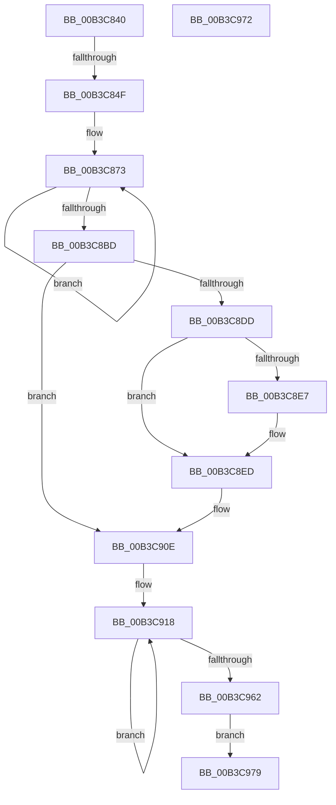

# sub_00B3C840

- RVA: `0x00B3C840`–`0x00B3C988` (길이 `328` bytes)
- VA: `0x0000000140B3C840`
- 실행 섹션: `PAGE`
- PDB 이름 있음: `아니요`; PDB Function 태그: `아니요`
- unwind 정보 RVA: `0x000B0C78`
- 디코드: `83`개 명령, `328/328` bytes 표시
- 미해석 바이트: `0` (있으면 어셈블리에 `.byte`로 보존)

> 이 문서는 커널 이미지의 기계어와 PDB 기호를 분석해 생성했습니다. 4번과 5번은 함수 원형과 자료형을 바이너리 사용 방식에서 추정한 C 해석이며 원본 소스 복구 결과는 아닙니다.

## 1. Dependencies

- 직접 호출 지점: **3**; 고유 호출 대상: **3**
- 직접 호출자로 확인된 함수: **0**
- RIP 상대 이미지 참조: **2**

### Outgoing calls
- `0x00B3C856` → [FsRtlAcquirePushLockShared](../../text/48/FsRtlAcquirePushLockShared_function_0048B034.md) (function, `0x0048B034`)
- `0x00B3C8D2` → [PfLockSharedRelease](../../text/48/PfLockSharedRelease_function_0048DF24.md) (function, `0x0048DF24`)
- `0x00B3C8E7` → [ExRaiseDatatypeMisalignment](../89/ExRaiseDatatypeMisalignment_function_00899FD0.md) (function, `0x00899FD0`)

### Direct callers
- 이 함수 시작 RVA로 연결되는 직접 call은 확인되지 않았습니다. 간접 호출은 완전히 역산할 수 없습니다.

### Static image references
- `0x00B3C84F` → RVA `0x00E670A8` (`.data`; read)
- `0x00B3C860` → RVA `0x00E66F10` (`.data`; read)

## 2. Other-region calls and transfers

- 다른 실행 섹션으로 향하는 call: **2**
  - `0x00B3C856` → [FsRtlAcquirePushLockShared](../../text/48/FsRtlAcquirePushLockShared_function_0048B034.md) (`PAGE` → `.text`)
  - `0x00B3C8D2` → [PfLockSharedRelease](../../text/48/PfLockSharedRelease_function_0048DF24.md) (`PAGE` → `.text`)
- call이 아닌 외부 분기/꼬리 이동: **3**
  - `0x00B3C849` → [PfSnQueryPrefetcherInformation + 0xB5](../A5/PfSnQueryPrefetcherInformation_function_00A51B8C.md) (`tail-transfer`)
  - `0x00B3C974` → [PfSnQueryPrefetcherInformation + 0x8D](../A5/PfSnQueryPrefetcherInformation_function_00A51B8C.md) (`tail-transfer`)
  - `0x00B3C983` → [PfSnQueryPrefetcherInformation + 0x8D](../A5/PfSnQueryPrefetcherInformation_function_00A51B8C.md) (`tail-transfer`)

## 3. Assembly (complete function range)

```asm
00B3C840  BE 98 01 00 00                  mov esi, 0x198
00B3C845  39 74 24 38                     cmp dword ptr [rsp + 0x38], esi
00B3C849  0F 85 F2 53 F1 FF               jne 0x140a51c41
00B3C84F  48 8D 0D 52 A8 32 00            lea rcx, [rip + 0x32a852]
00B3C856  E8 D9 E7 94 FF                  call 0x14048b034
00B3C85B  48 8D 54 24 40                  lea rdx, [rsp + 0x40]
00B3C860  48 8D 05 A9 A6 32 00            lea rax, [rip + 0x32a6a9]
00B3C867  BF 03 00 00 00                  mov edi, 3
00B3C86C  44 8B C7                        mov r8d, edi
00B3C86F  44 8D 7F 7D                     lea r15d, [rdi + 0x7d]
00B3C873  0F 10 00                        movups xmm0, xmmword ptr [rax]
00B3C876  0F 11 02                        movups xmmword ptr [rdx], xmm0
00B3C879  0F 10 48 10                     movups xmm1, xmmword ptr [rax + 0x10]
00B3C87D  0F 11 4A 10                     movups xmmword ptr [rdx + 0x10], xmm1
00B3C881  0F 10 40 20                     movups xmm0, xmmword ptr [rax + 0x20]
00B3C885  0F 11 42 20                     movups xmmword ptr [rdx + 0x20], xmm0
00B3C889  0F 10 48 30                     movups xmm1, xmmword ptr [rax + 0x30]
00B3C88D  0F 11 4A 30                     movups xmmword ptr [rdx + 0x30], xmm1
00B3C891  0F 10 40 40                     movups xmm0, xmmword ptr [rax + 0x40]
00B3C895  0F 11 42 40                     movups xmmword ptr [rdx + 0x40], xmm0
00B3C899  0F 10 48 50                     movups xmm1, xmmword ptr [rax + 0x50]
00B3C89D  0F 11 4A 50                     movups xmmword ptr [rdx + 0x50], xmm1
00B3C8A1  0F 10 40 60                     movups xmm0, xmmword ptr [rax + 0x60]
00B3C8A5  0F 11 42 60                     movups xmmword ptr [rdx + 0x60], xmm0
00B3C8A9  49 03 D7                        add rdx, r15
00B3C8AC  0F 10 48 70                     movups xmm1, xmmword ptr [rax + 0x70]
00B3C8B0  0F 11 4A F0                     movups xmmword ptr [rdx - 0x10], xmm1
00B3C8B4  49 03 C7                        add rax, r15
00B3C8B7  49 83 E8 01                     sub r8, 1
00B3C8BB  75 B6                           jne 0x140b3c873
00B3C8BD  0F 10 00                        movups xmm0, xmmword ptr [rax]
00B3C8C0  0F 11 02                        movups xmmword ptr [rdx], xmm0
00B3C8C3  48 8B 40 10                     mov rax, qword ptr [rax + 0x10]
00B3C8C7  48 89 42 10                     mov qword ptr [rdx + 0x10], rax
00B3C8CB  48 8D 0D D6 A7 32 00            lea rcx, [rip + 0x32a7d6]
00B3C8D2  E8 4D 16 95 FF                  call 0x14048df24
00B3C8D7  90                              nop
00B3C8D8  45 84 F6                        test r14b, r14b
00B3C8DB  74 31                           je 0x140b3c90e
00B3C8DD  48 8B 4C 24 30                  mov rcx, qword ptr [rsp + 0x30]
00B3C8E2  F6 C1 07                        test cl, 7
00B3C8E5  74 06                           je 0x140b3c8ed
00B3C8E7  E8 E4 D6 D5 FF                  call 0x140899fd0
00B3C8EC  CC                              int3
00B3C8ED  48 B8 00 00 FF FF FF 7F 00 00   movabs rax, 0x7fffffff0000
00B3C8F7  48 3B C8                        cmp rcx, rax
00B3C8FA  48 0F 43 C8                     cmovae rcx, rax
00B3C8FE  8A 01                           mov al, byte ptr [rcx]
00B3C900  88 01                           mov byte ptr [rcx], al
00B3C902  8A 81 97 01 00 00               mov al, byte ptr [rcx + 0x197]
00B3C908  88 81 97 01 00 00               mov byte ptr [rcx + 0x197], al
00B3C90E  48 8B 4C 24 30                  mov rcx, qword ptr [rsp + 0x30]
00B3C913  48 8D 44 24 40                  lea rax, [rsp + 0x40]
00B3C918  0F 10 00                        movups xmm0, xmmword ptr [rax]
00B3C91B  0F 11 01                        movups xmmword ptr [rcx], xmm0
00B3C91E  0F 10 48 10                     movups xmm1, xmmword ptr [rax + 0x10]
00B3C922  0F 11 49 10                     movups xmmword ptr [rcx + 0x10], xmm1
00B3C926  0F 10 40 20                     movups xmm0, xmmword ptr [rax + 0x20]
00B3C92A  0F 11 41 20                     movups xmmword ptr [rcx + 0x20], xmm0
00B3C92E  0F 10 48 30                     movups xmm1, xmmword ptr [rax + 0x30]
00B3C932  0F 11 49 30                     movups xmmword ptr [rcx + 0x30], xmm1
00B3C936  0F 10 40 40                     movups xmm0, xmmword ptr [rax + 0x40]
00B3C93A  0F 11 41 40                     movups xmmword ptr [rcx + 0x40], xmm0
00B3C93E  0F 10 48 50                     movups xmm1, xmmword ptr [rax + 0x50]
00B3C942  0F 11 49 50                     movups xmmword ptr [rcx + 0x50], xmm1
00B3C946  0F 10 40 60                     movups xmm0, xmmword ptr [rax + 0x60]
00B3C94A  0F 11 41 60                     movups xmmword ptr [rcx + 0x60], xmm0
00B3C94E  49 03 CF                        add rcx, r15
00B3C951  0F 10 48 70                     movups xmm1, xmmword ptr [rax + 0x70]
00B3C955  0F 11 49 F0                     movups xmmword ptr [rcx - 0x10], xmm1
00B3C959  49 03 C7                        add rax, r15
00B3C95C  48 83 EF 01                     sub rdi, 1
00B3C960  75 B6                           jne 0x140b3c918
00B3C962  0F 10 00                        movups xmm0, xmmword ptr [rax]
00B3C965  0F 11 01                        movups xmmword ptr [rcx], xmm0
00B3C968  48 8B 40 10                     mov rax, qword ptr [rax + 0x10]
00B3C96C  48 89 41 10                     mov qword ptr [rcx + 0x10], rax
00B3C970  EB 07                           jmp 0x140b3c979
00B3C972  8B D8                           mov ebx, eax
00B3C974  E9 A0 52 F1 FF                  jmp 0x140a51c19
00B3C979  48 8B 84 24 10 02 00 00         mov rax, qword ptr [rsp + 0x210]
00B3C981  89 30                           mov dword ptr [rax], esi
00B3C983  E9 91 52 F1 FF                  jmp 0x140a51c19
```

## 4. C-style interpretation (structured pseudocode)

```c
__int64 __fastcall sub_00B3C840(__int64 a1, __int64 a2, __int64 a3, __int64 a4, __int64 a5, __int64 a6, unsigned int a7, __int64 a8, __int64 a9, __int64 a10, __int64 a11, __int64 a12, __int64 a13, __int64 a14, __int64 a15, __int64 a16, __int64 a17, __int64 a18, __int64 a19, __int64 a20, __int64 a21, __int64 a22, __int64 a23, __int64 a24, __int64 a25, __int64 a26, __int64 a27, __int64 a28, __int64 a29, __int64 a30, __int64 a31, __int64 a32, __int64 a33, __int64 a34, __int64 a35, __int64 a36, __int64 a37, __int64 a38, __int64 a39, __int64 a40, __int64 a41, __int64 a42, __int64 a43, __int64 a44, __int64 a45, __int64 a46, __int64 a47, __int64 a48, __int64 a49, __int64 a50, __int64 a51, __int64 a52, __int64 a53, __int64 a54, __int64 a55, __int64 a56, __int64 a57, __int64 a58, __int64 a59, __int64 a60, __int64 a61, __int64 a62, __int64 a63, __int64 a64, __int64 a65, __int64 a66)
{
    __int64 result;
    __int64 v_rdi;

    result = FsRtlAcquirePushLockShared(v_rip + 3319890, a2, a3, a4);
loc_00B3C873:
    *(unsigned __int64 *)(a8) = v_xmm0;
    *(unsigned __int64 *)(a8 + 16) = v_xmm1;
    *(unsigned __int64 *)(a8 + 32) = v_xmm0;
    *(unsigned __int64 *)(a8 + 48) = v_xmm1;
    *(unsigned __int64 *)(a8 + 64) = v_xmm0;
    *(unsigned __int64 *)(a8 + 80) = v_xmm1;
    *(unsigned __int64 *)(a8 + 96) = v_xmm0;
    a2 = (a8) + (3 + 125);
    *(unsigned __int64 *)(a2 - 16) = v_xmm1;
    result = (v_rip + 3319465) + (3 + 125);
    a3 = (3) - (1);
    if (condition_is_not_equal) goto loc_00B3C873;
    *(unsigned __int64 *)(a2) = v_xmm0;
    *(unsigned __int64 *)(a2 + 16) = *(unsigned __int64 *)(result + 16);
    result = PfLockSharedRelease(v_rip + 3319766, a2, a3, a4);
    if ((unsigned __int8)(v_r14) == 0) goto loc_00B3C90E;
    if ((((unsigned __int8)(a6)) & (7)) != 0) {
        result = ExRaiseDatatypeMisalignment(a6, a2, a3, a4);
    }
    if (a6 >= result) { a6 = result; }
    *(unsigned __int8 *)(a6) = (unsigned __int8)(*(unsigned __int8 *)(a6));
    *(unsigned __int8 *)(a6 + 407) = (unsigned __int8)(*(unsigned __int8 *)(a6 + 407));
loc_00B3C90E:
loc_00B3C918:
    *(unsigned __int64 *)(a6) = v_xmm0;
    *(unsigned __int64 *)(a6 + 16) = v_xmm1;
    *(unsigned __int64 *)(a6 + 32) = v_xmm0;
    *(unsigned __int64 *)(a6 + 48) = v_xmm1;
    *(unsigned __int64 *)(a6 + 64) = v_xmm0;
    *(unsigned __int64 *)(a6 + 80) = v_xmm1;
    *(unsigned __int64 *)(a6 + 96) = v_xmm0;
    a1 = (a6) + (3 + 125);
    *(unsigned __int64 *)(a1 - 16) = v_xmm1;
    result = (a8) + (3 + 125);
    v_rdi = (3) - (1);
    if (condition_is_not_equal) goto loc_00B3C918;
    *(unsigned __int64 *)(a1) = v_xmm0;
    *(unsigned __int64 *)(a1 + 16) = *(unsigned __int64 *)(result + 16);
    goto loc_00B3C979;
loc_00B3C979:
    *(unsigned int *)(a66) = 408;
}
```

## 5. (Beta) C Style

```c
int64_t sub_00B3C840(int64_t Arg1, int64_t Arg2, int64_t Arg3, int64_t Arg4, uint64_t Arg5, void *Arg6, uint32_t Arg7, int64_t Arg8, uint64_t Arg9, uint64_t Arg10, uint64_t Arg11, uint64_t Arg12, uint64_t Arg13, uint64_t Arg14, uint64_t Arg15, uint64_t Arg16, uint64_t Arg17, uint64_t Arg18, uint64_t Arg19, uint64_t Arg20, uint64_t Arg21, uint64_t Arg22, uint64_t Arg23, uint64_t Arg24, uint64_t Arg25, uint64_t Arg26, uint64_t Arg27, uint64_t Arg28, uint64_t Arg29, uint64_t Arg30, uint64_t Arg31, uint64_t Arg32, uint64_t Arg33, uint64_t Arg34, uint64_t Arg35, uint64_t Arg36, uint64_t Arg37, uint64_t Arg38, uint64_t Arg39, uint64_t Arg40, uint64_t Arg41, uint64_t Arg42, uint64_t Arg43, uint64_t Arg44, uint64_t Arg45, uint64_t Arg46, uint64_t Arg47, uint64_t Arg48, uint64_t Arg49, uint64_t Arg50, uint64_t Arg51, uint64_t Arg52, uint64_t Arg53, uint64_t Arg54, uint64_t Arg55, uint64_t Arg56, uint64_t Arg57, uint64_t Arg58, uint64_t Arg59, uint64_t Arg60, uint64_t Arg61, uint64_t Arg62, uint64_t Arg63, uint64_t Arg64, uint64_t Arg65, void *Arg66)
{
    uint8_t *arg6 = (uint8_t *)Arg6;
    uint8_t *arg66 = (uint8_t *)Arg66;

    int64_t result;
    int64_t local_rdi;

    result = FsRtlAcquirePushLockShared(v_rip + 3319890, Arg2, Arg3, Arg4);
loc_00B3C873:
    *(uint64_t *)(Arg8) = v_xmm0;
    *(uint64_t *)(Arg8 + 0x10) = v_xmm1;
    *(uint64_t *)(Arg8 + 0x20) = v_xmm0;
    *(uint64_t *)(Arg8 + 0x30) = v_xmm1;
    *(uint64_t *)(Arg8 + 0x40) = v_xmm0;
    *(uint64_t *)(Arg8 + 0x50) = v_xmm1;
    *(uint64_t *)(Arg8 + 0x60) = v_xmm0;
    Arg2 = (Arg8) + (3 + 125);
    *(uint64_t *)(Arg2 - 0x10) = v_xmm1;
    result = (v_rip + 3319465) + (3 + 125);
    Arg3 = (3) - (1);
    if (condition_is_not_equal) goto loc_00B3C873;
    *(uint64_t *)(Arg2) = v_xmm0;
    *(uint64_t *)(Arg2 + 0x10) = *(uint64_t *)(result + 0x10);
    result = PfLockSharedRelease(v_rip + 3319766, Arg2, Arg3, Arg4);
    if ((uint8_t)(local_r14) == 0) goto loc_00B3C90E;
    if ((((uint8_t)(Arg6)) & (7)) != 0) {
        result = ExRaiseDatatypeMisalignment(Arg6, Arg2, Arg3, Arg4);
    }
    if (Arg6 >= result) { Arg6 = result; }
    *(uint8_t *)(arg6) = (uint8_t)(*(uint8_t *)(arg6));
    *(uint8_t *)(arg6 + 0x197) = (uint8_t)(*(uint8_t *)(arg6 + 0x197));
loc_00B3C90E:
loc_00B3C918:
    *(uint64_t *)(arg6) = v_xmm0;
    *(uint64_t *)(arg6 + 0x10) = v_xmm1;
    *(uint64_t *)(arg6 + 0x20) = v_xmm0;
    *(uint64_t *)(arg6 + 0x30) = v_xmm1;
    *(uint64_t *)(arg6 + 0x40) = v_xmm0;
    *(uint64_t *)(arg6 + 0x50) = v_xmm1;
    *(uint64_t *)(arg6 + 0x60) = v_xmm0;
    Arg1 = (Arg6) + (3 + 125);
    *(uint64_t *)(Arg1 - 0x10) = v_xmm1;
    result = (Arg8) + (3 + 125);
    local_rdi = (3) - (1);
    if (condition_is_not_equal) goto loc_00B3C918;
    *(uint64_t *)(Arg1) = v_xmm0;
    *(uint64_t *)(Arg1 + 0x10) = *(uint64_t *)(result + 0x10);
    goto loc_00B3C979;
loc_00B3C979:
    *(uint32_t *)(arg66) = 408;
}
```

### 관측된 메모리 오프셋

구조체 형식이 확인되지 않은 접근은 인자 기준의 오프셋으로만 기록했습니다.

| 기준 인자 | 오프셋 표현 | 폭 (bit) | 접근 |
|---|---:|---:|---|
| `Arg6` | `- 0x10` | `128` | `R` |
| `Arg6` | `+ 0x0` | `128` | `R` |
| `Arg6` | `+ 0x10` | `64` | `W` |
| `Arg6` | `+ 0x10` | `128` | `R` |
| `Arg6` | `+ 0x20` | `128` | `R` |
| `Arg6` | `+ 0x30` | `128` | `R` |
| `Arg6` | `+ 0x40` | `128` | `R` |
| `Arg6` | `+ 0x50` | `128` | `R` |
| `Arg6` | `+ 0x60` | `128` | `R` |
| `Arg66` | `+ 0x0` | `32` | `W` |

## 6. Execution-region graph

[열기: 2D/3D 그래프와 함수 탐색 컨트롤 패널](../../../control-panel.html?section=page&rva=0x00B3C840&view=graph)

- 2D 그래프는 위에서 아래로 흐르고, 3D 그래프는 빈 공간을 드래그해 회전합니다. Shift+드래그는 이동, 휠은 확대·축소, 함수 노드 선택은 대상 보고서 이동입니다.

### Static fallback


