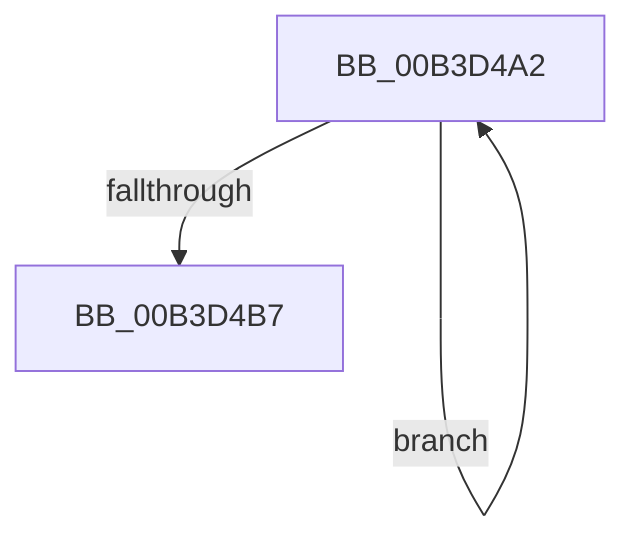

# sub_00B3D4A2

- RVA: `0x00B3D4A2`–`0x00B3D4BC` (길이 `26` bytes)
- VA: `0x0000000140B3D4A2`
- 실행 섹션: `PAGE`
- PDB 이름 있음: `아니요`; PDB Function 태그: `아니요`
- unwind 정보 RVA: `0x000B0FF0`
- 디코드: `7`개 명령, `26/26` bytes 표시
- 미해석 바이트: `0` (있으면 어셈블리에 `.byte`로 보존)

> 이 문서는 커널 이미지의 기계어와 PDB 기호를 분석해 생성했습니다. 4번과 5번은 함수 원형과 자료형을 바이너리 사용 방식에서 추정한 C 해석이며 원본 소스 복구 결과는 아닙니다.

## 1. Dependencies

- 직접 호출 지점: **0**; 고유 호출 대상: **0**
- 직접 호출자로 확인된 함수: **0**
- RIP 상대 이미지 참조: **0**

### Outgoing calls
- 직접 디코드된 call 명령이 없습니다.

### Direct callers
- 이 함수 시작 RVA로 연결되는 직접 call은 확인되지 않았습니다. 간접 호출은 완전히 역산할 수 없습니다.

### Static image references
- 디코드된 RIP-relative 메모리 참조가 없습니다.

## 2. Other-region calls and transfers

- 다른 실행 섹션으로 향하는 call: **0**
- call이 아닌 외부 분기/꼬리 이동: **1**
  - `0x00B3D4B7` → [EtwpEnableStackCaching + 0xBE](../A5/EtwpEnableStackCaching_function_00A53C6C.md) (`tail-transfer`)

## 3. Assembly (complete function range)

```asm
00B3D4A2  48 89 58 10                     mov qword ptr [rax + 0x10], rbx
00B3D4A6  48 89 40 08                     mov qword ptr [rax + 8], rax
00B3D4AA  48 89 00                        mov qword ptr [rax], rax
00B3D4AD  48 83 C0 18                     add rax, 0x18
00B3D4B1  48 83 E9 01                     sub rcx, 1
00B3D4B5  75 EB                           jne 0x140b3d4a2
00B3D4B7  E9 6E 68 F1 FF                  jmp 0x140a53d2a
```

## 4. C-style interpretation (structured pseudocode)

```c
__int64 __fastcall sub_00B3D4A2(__int64 a1)
{
    __int64 result;

    *(unsigned __int64 *)(result + 16) = v_rbx;
    *(unsigned __int64 *)(result + 8) = result;
    *(unsigned __int64 *)(result) = result;
    result = (result) + (24);
    a1 = (a1) - (1);
    if (condition_is_not_equal) goto loc_00B3D4A2;
}
```

## 5. (Beta) C Style

```c
int64_t sub_00B3D4A2(int64_t Arg1)
{
    int64_t result;

    *(uint64_t *)(result + 0x10) = local_rbx;
    *(uint64_t *)(result + 0x8) = result;
    *(uint64_t *)(result) = result;
    result = (result) + (24);
    Arg1 = (Arg1) - (1);
    if (condition_is_not_equal) goto loc_00B3D4A2;
}
```

## 6. Execution-region graph

[열기: 2D/3D 그래프와 함수 탐색 컨트롤 패널](../../../control-panel.html?section=page&rva=0x00B3D4A2&view=graph)

- 2D 그래프는 위에서 아래로 흐르고, 3D 그래프는 빈 공간을 드래그해 회전합니다. Shift+드래그는 이동, 휠은 확대·축소, 함수 노드 선택은 대상 보고서 이동입니다.

### Static fallback


