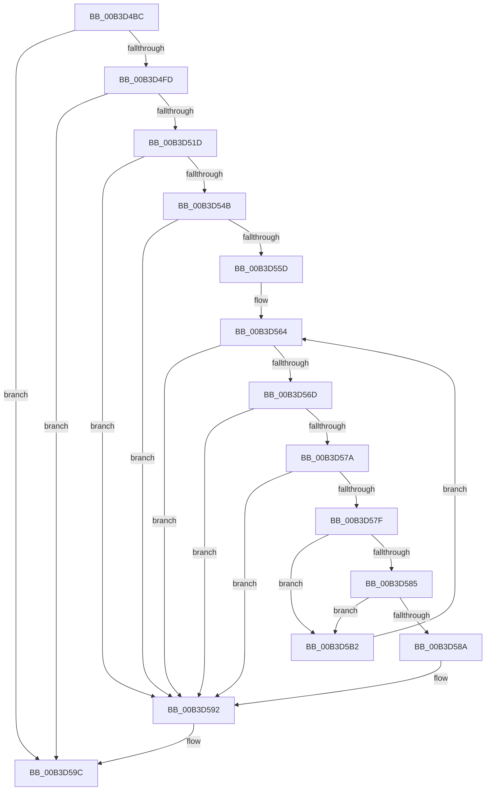

# sub_00B3D4BC

- RVA: `0x00B3D4BC`–`0x00B3D5B7` (길이 `251` bytes)
- VA: `0x0000000140B3D4BC`
- 실행 섹션: `PAGE`
- PDB 이름 있음: `아니요`; PDB Function 태그: `아니요`
- unwind 정보 RVA: `0x000B1088`
- 디코드: `65`개 명령, `251/251` bytes 표시
- 미해석 바이트: `0` (있으면 어셈블리에 `.byte`로 보존)

> 이 문서는 커널 이미지의 기계어와 PDB 기호를 분석해 생성했습니다. 4번과 5번은 함수 원형과 자료형을 바이너리 사용 방식에서 추정한 C 해석이며 원본 소스 복구 결과는 아닙니다.

## 1. Dependencies

- 직접 호출 지점: **4**; 고유 호출 대상: **3**
- 직접 호출자로 확인된 함수: **0**
- RIP 상대 이미지 참조: **2**

### Outgoing calls
- `0x00B3D4ED` → [ExpGetSystemFirmwareTableInformation](../A3/ExpGetSystemFirmwareTableInformation_function_00A38A2C.md) (function, `0x00A38A2C`)
- `0x00B3D510` → [ExAllocatePool2](../../poolcode/B8/ExAllocatePool2_function_00B820F0.md) (function, `0x00B820F0`)
- `0x00B3D542` → [ExpGetSystemFirmwareTableInformation](../A3/ExpGetSystemFirmwareTableInformation_function_00A38A2C.md) (function, `0x00A38A2C`)
- `0x00B3D597` → [ExFreePoolWithTag](../../poolcode/B8/ExFreePoolWithTag_function_00B82870.md) (function, `0x00B82870`)

### Direct callers
- 이 함수 시작 RVA로 연결되는 직접 call은 확인되지 않았습니다. 간접 호출은 완전히 역산할 수 없습니다.

### Static image references
- `0x00B3D59C` → RVA `0x00E68538` (`.data`; write)
- `0x00B3D5A3` → RVA `0x00E68540` (`.data`; write)

## 2. Other-region calls and transfers

- 다른 실행 섹션으로 향하는 call: **2**
  - `0x00B3D510` → [ExAllocatePool2](../../poolcode/B8/ExAllocatePool2_function_00B820F0.md) (`PAGE` → `POOLCODE`)
  - `0x00B3D597` → [ExFreePoolWithTag](../../poolcode/B8/ExFreePoolWithTag_function_00B82870.md) (`PAGE` → `POOLCODE`)
- call이 아닌 외부 분기/꼬리 이동: **1**
  - `0x00B3D5AD` → [ExpGetSystemFlushInformation + 0x93](../A5/ExpGetSystemFlushInformation_function_00A540A4.md) (`tail-transfer`)

## 3. Assembly (complete function range)

```asm
00B3D4BC  4C 8B FB                        mov r15, rbx
00B3D4BF  48 83 64 24 44 00               and qword ptr [rsp + 0x44], 0
00B3D4C5  89 5C 24 28                     mov dword ptr [rsp + 0x28], ebx
00B3D4C9  C7 44 24 38 49 50 43 41         mov dword ptr [rsp + 0x38], 0x41435049
00B3D4D1  89 74 24 3C                     mov dword ptr [rsp + 0x3c], esi
00B3D4D5  C7 44 24 40 4E 46 49 54         mov dword ptr [rsp + 0x40], 0x5449464e
00B3D4DD  4C 8D 4C 24 28                  lea r9, [rsp + 0x28]
00B3D4E2  33 D2                           xor edx, edx
00B3D4E4  44 8D 42 14                     lea r8d, [rdx + 0x14]
00B3D4E8  48 8D 4C 24 38                  lea rcx, [rsp + 0x38]
00B3D4ED  E8 3A B5 EF FF                  call 0x140a38a2c
00B3D4F2  3D 23 00 00 C0                  cmp eax, 0xc0000023
00B3D4F7  0F 85 9F 00 00 00               jne 0x140b3d59c
00B3D4FD  44 8B 6C 24 28                  mov r13d, dword ptr [rsp + 0x28]
00B3D502  41 8B D5                        mov edx, r13d
00B3D505  B9 00 01 00 00                  mov ecx, 0x100
00B3D50A  41 B8 57 50 42 54               mov r8d, 0x54425057
00B3D510  E8 DB 4B 04 00                  call 0x140b820f0
00B3D515  4C 8B F0                        mov r14, rax
00B3D518  48 85 C0                        test rax, rax
00B3D51B  74 7F                           je 0x140b3d59c
00B3D51D  C7 00 49 50 43 41               mov dword ptr [rax], 0x41435049
00B3D523  89 70 04                        mov dword ptr [rax + 4], esi
00B3D526  C7 40 08 4E 46 49 54            mov dword ptr [rax + 8], 0x5449464e
00B3D52D  41 8D 45 F0                     lea eax, [r13 - 0x10]
00B3D531  41 89 46 0C                     mov dword ptr [r14 + 0xc], eax
00B3D535  4C 8D 4C 24 28                  lea r9, [rsp + 0x28]
00B3D53A  45 8B C5                        mov r8d, r13d
00B3D53D  33 D2                           xor edx, edx
00B3D53F  49 8B CE                        mov rcx, r14
00B3D542  E8 E5 B4 EF FF                  call 0x140a38a2c
00B3D547  85 C0                           test eax, eax
00B3D549  78 47                           js 0x140b3d592
00B3D54B  49 8D 4E 10                     lea rcx, [r14 + 0x10]
00B3D54F  8B 51 04                        mov edx, dword ptr [rcx + 4]
00B3D552  8B 44 24 28                     mov eax, dword ptr [rsp + 0x28]
00B3D556  83 C0 F0                        add eax, -0x10
00B3D559  3B D0                           cmp edx, eax
00B3D55B  72 35                           jb 0x140b3d592
00B3D55D  48 03 D1                        add rdx, rcx
00B3D560  48 83 C1 28                     add rcx, 0x28
00B3D564  48 8D 41 04                     lea rax, [rcx + 4]
00B3D568  48 3B C2                        cmp rax, rdx
00B3D56B  77 25                           ja 0x140b3d592
00B3D56D  0F B7 41 02                     movzx eax, word ptr [rcx + 2]
00B3D571  4C 8D 04 08                     lea r8, [rax + rcx]
00B3D575  4C 3B C2                        cmp r8, rdx
00B3D578  77 18                           ja 0x140b3d592
00B3D57A  66 85 C0                        test ax, ax
00B3D57D  74 13                           je 0x140b3d592
00B3D57F  66 83 39 07                     cmp word ptr [rcx], 7
00B3D583  75 2D                           jne 0x140b3d5b2
00B3D585  83 F8 10                        cmp eax, 0x10
00B3D588  72 28                           jb 0x140b3d5b2
00B3D58A  40 84 71 08                     test byte ptr [rcx + 8], sil
00B3D58E  4C 0F 45 FE                     cmovne r15, rsi
00B3D592  33 D2                           xor edx, edx
00B3D594  49 8B CE                        mov rcx, r14
00B3D597  E8 D4 52 04 00                  call 0x140b82870
00B3D59C  4C 89 3D 95 AF 32 00            mov qword ptr [rip + 0x32af95], r15
00B3D5A3  40 88 35 96 AF 32 00            mov byte ptr [rip + 0x32af96], sil
00B3D5AA  44 8B C3                        mov r8d, ebx
00B3D5AD  E9 85 6B F1 FF                  jmp 0x140a54137
00B3D5B2  49 8B C8                        mov rcx, r8
00B3D5B5  EB AD                           jmp 0x140b3d564
```

## 4. C-style interpretation (structured pseudocode)

```c
__int64 __fastcall sub_00B3D4BC(__int64 a1, int a2, __int64 a3, __int64 a4, unsigned int a5, __int64 a6, __int64 a7)
{
    __int64 result;
    __int64 v_r15;
    unsigned int v_stack_p28;
    unsigned int v_stack_p38;
    unsigned int v_stack_p3C;
    unsigned int v_stack_p40;
    unsigned __int64 v_stack_p44;

    v_stack_p28 = (unsigned int)(v_rbx);
    v_stack_p38 = 0x41435049ULL;
    v_stack_p3C = (unsigned int)(v_rsi);
    v_stack_p40 = 0x5449464EULL;
    a2 = 0;
    result = ExpGetSystemFirmwareTableInformation(a7, a2, a2 + 20, a5);
    if (((unsigned int)(result)) != 0xC0000023ULL) goto loc_00B3D59C;
    result = ExAllocatePool2(256, (unsigned int)((unsigned int)((unsigned int)(a5))), (unsigned int)(0x54425057ULL), a5);
    if (result == 0) goto loc_00B3D59C;
    *(unsigned int *)(result) = 0x41435049ULL;
    *(unsigned int *)(result + 4) = (unsigned int)(v_rsi);
    *(unsigned int *)(result + 8) = 0x5449464EULL;
    *(unsigned int *)(result + 12) = (unsigned int)((unsigned int)(a5) - 16);
    a2 = 0;
    result = ExpGetSystemFirmwareTableInformation(result, a2, (unsigned int)((unsigned int)((unsigned int)(a5))), a5);
    if (sign_flag) goto loc_00B3D592;
    result = (unsigned int)(((unsigned int)(a5)) + (-16));
    if (((unsigned int)((unsigned int)(*(unsigned int *)(result + 16 + 4)))) < ((unsigned int)(result))) goto loc_00B3D592;
    a2 = ((unsigned int)(*(unsigned int *)(result + 16 + 4))) + (result + 16);
    a1 = (result + 16) + (40);
loc_00B3D564:
    if ((a1 + 4) > a2) goto loc_00B3D592;
    if ((*(unsigned __int16 *)(a1 + 2) + a1 * 1) > a2) goto loc_00B3D592;
    if ((unsigned __int16)(*(unsigned __int16 *)(a1 + 2)) == 0) goto loc_00B3D592;
    if ((*(unsigned __int16 *)(a1)) != 7) goto loc_00B3D5B2;
    if (((unsigned int)(*(unsigned __int16 *)(a1 + 2))) < 16) goto loc_00B3D5B2;
    v_r15 = v_rbx;
    if (((*(unsigned __int8 *)(a1 + 8)) & ((unsigned __int8)(v_rsi))) != 0) { v_r15 = v_rsi; }
loc_00B3D592:
    a2 = 0;
    result = ExFreePoolWithTag(result, a2, *(unsigned __int16 *)(a1 + 2) + a1 * 1, a5);
loc_00B3D59C:
    *(unsigned __int64 *)(v_rip + 3321749) = v_r15;
    *(unsigned __int8 *)(v_rip + 3321750) = (unsigned __int8)(v_rsi);
loc_00B3D5B2:
    goto loc_00B3D564;
}
```

## 5. (Beta) C Style

```c
int64_t sub_00B3D4BC(int64_t Arg1, int32_t Arg2, int64_t Arg3, int64_t Arg4, void *Arg5, uint64_t Arg6, int64_t Arg7)
{
    uint8_t *arg5 = (uint8_t *)Arg5;

    int64_t result;
    int64_t local_r15;
    uint32_t v_stack_p28;
    uint32_t v_stack_p38;
    uint32_t v_stack_p3C;
    uint32_t v_stack_p40;
    uint64_t v_stack_p44;

    v_stack_p28 = (uint32_t)(local_rbx);
    v_stack_p38 = 0x41435049ULL;
    v_stack_p3C = (uint32_t)(local_rsi);
    v_stack_p40 = 0x5449464EULL;
    Arg2 = 0;
    result = ExpGetSystemFirmwareTableInformation(Arg7, Arg2, Arg2 + 20, Arg5);
    if (((uint32_t)(result)) != 0xC0000023ULL) goto loc_00B3D59C;
    result = ExAllocatePool2(256, (uint32_t)((uint32_t)((uint32_t)(Arg5))), (uint32_t)(0x54425057ULL), Arg5);
    if (result == 0) goto loc_00B3D59C;
    *(uint32_t *)(result) = 0x41435049ULL;
    *(uint32_t *)(result + 0x4) = (uint32_t)(local_rsi);
    *(uint32_t *)(result + 0x8) = 0x5449464EULL;
    *(uint32_t *)(result + 0xC) = (uint32_t)((uint32_t)(Arg5) - 16);
    Arg2 = 0;
    result = ExpGetSystemFirmwareTableInformation(result, Arg2, (uint32_t)((uint32_t)((uint32_t)(Arg5))), Arg5);
    if (sign_flag) goto loc_00B3D592;
    result = (uint32_t)(((uint32_t)(Arg5)) + (-16));
    if (((uint32_t)((uint32_t)(*(uint32_t *)(result + 0x10 + 0x4)))) < ((uint32_t)(result))) goto loc_00B3D592;
    Arg2 = ((uint32_t)(*(uint32_t *)(result + 0x10 + 0x4))) + (result + 16);
    Arg1 = (result + 16) + (40);
loc_00B3D564:
    if ((Arg1 + 4) > Arg2) goto loc_00B3D592;
    if ((*(uint16_t *)(Arg1 + 0x2) + Arg1 * 1) > Arg2) goto loc_00B3D592;
    if ((uint16_t)(*(uint16_t *)(Arg1 + 0x2)) == 0) goto loc_00B3D592;
    if ((*(uint16_t *)(Arg1)) != 7) goto loc_00B3D5B2;
    if (((uint32_t)(*(uint16_t *)(Arg1 + 0x2))) < 16) goto loc_00B3D5B2;
    local_r15 = local_rbx;
    if (((*(uint8_t *)(Arg1 + 0x8)) & ((uint8_t)(local_rsi))) != 0) { local_r15 = local_rsi; }
loc_00B3D592:
    Arg2 = 0;
    result = ExFreePoolWithTag(result, Arg2, *(uint16_t *)(Arg1 + 0x2) + Arg1 * 1, Arg5);
loc_00B3D59C:
    *(uint64_t *)(v_rip + 0x32AF95) = local_r15;
    *(uint8_t *)(v_rip + 0x32AF96) = (uint8_t)(local_rsi);
loc_00B3D5B2:
    goto loc_00B3D564;
}
```

### 관측된 메모리 오프셋

구조체 형식이 확인되지 않은 접근은 인자 기준의 오프셋으로만 기록했습니다.

| 기준 인자 | 오프셋 표현 | 폭 (bit) | 접근 |
|---|---:|---:|---|
| `Arg5` | `- 0x10` | `32` | `R` |

## 6. Execution-region graph

[열기: 2D/3D 그래프와 함수 탐색 컨트롤 패널](../../../control-panel.html?section=page&rva=0x00B3D4BC&view=graph)

- 2D 그래프는 위에서 아래로 흐르고, 3D 그래프는 빈 공간을 드래그해 회전합니다. Shift+드래그는 이동, 휠은 확대·축소, 함수 노드 선택은 대상 보고서 이동입니다.

### Static fallback


