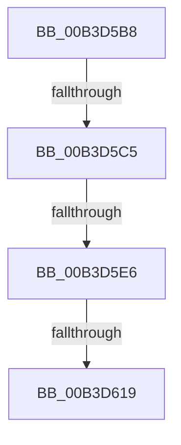

# sub_00B3D5B8

- RVA: `0x00B3D5B8`–`0x00B3D632` (길이 `122` bytes)
- VA: `0x0000000140B3D5B8`
- 실행 섹션: `PAGE`
- PDB 이름 있음: `아니요`; PDB Function 태그: `아니요`
- unwind 정보 RVA: `0x000B10D4`
- 디코드: `30`개 명령, `122/122` bytes 표시
- 미해석 바이트: `0` (있으면 어셈블리에 `.byte`로 보존)

> 이 문서는 커널 이미지의 기계어와 PDB 기호를 분석해 생성했습니다. 4번과 5번은 함수 원형과 자료형을 바이너리 사용 방식에서 추정한 C 해석이며 원본 소스 복구 결과는 아닙니다.

## 1. Dependencies

- 직접 호출 지점: **4**; 고유 호출 대상: **4**
- 직접 호출자로 확인된 함수: **0**
- RIP 상대 이미지 참조: **0**

### Outgoing calls
- `0x00B3D5D5` → [CmpAllocatePool](../../text/3C/CmpAllocatePool_function_003CD504.md) (function, `0x003CD504`)
- `0x00B3D60A` → [CmpPrepareDiscardAndReplaceKcbAndUnbackedHigherLayers](../7F/CmpPrepareDiscardAndReplaceKcbAndUnbackedHigherLayers_function_007F1610.md) (function, `0x007F1610`)
- `0x00B3D61F` → [CmpCleanupDiscardReplaceContext](../A5/CmpCleanupDiscardReplaceContext_function_00A54FF8.md) (function, `0x00A54FF8`)
- `0x00B3D627` → [CmSiFreeMemory](../../text/47/CmSiFreeMemory_function_00475D80.md) (function, `0x00475D80`)

### Direct callers
- 이 함수 시작 RVA로 연결되는 직접 call은 확인되지 않았습니다. 간접 호출은 완전히 역산할 수 없습니다.

### Static image references
- 디코드된 RIP-relative 메모리 참조가 없습니다.

## 2. Other-region calls and transfers

- 다른 실행 섹션으로 향하는 call: **2**
  - `0x00B3D5D5` → [CmpAllocatePool](../../text/3C/CmpAllocatePool_function_003CD504.md) (`PAGE` → `.text`)
  - `0x00B3D627` → [CmSiFreeMemory](../../text/47/CmSiFreeMemory_function_00475D80.md) (`PAGE` → `.text`)
- call이 아닌 외부 분기/꼬리 이동: **4**
  - `0x00B3D5BF` → [CmpLightWeightPrepareDeleteKeyUoW + 0xDD](../A5/CmpLightWeightPrepareDeleteKeyUoW_function_00A54494.md) (`tail-transfer`)
  - `0x00B3D5E0` → [CmpLightWeightPrepareDeleteKeyUoW + 0x160](../A5/CmpLightWeightPrepareDeleteKeyUoW_function_00A54494.md) (`tail-transfer`)
  - `0x00B3D613` → [CmpLightWeightPrepareDeleteKeyUoW + 0xDD](../A5/CmpLightWeightPrepareDeleteKeyUoW_function_00A54494.md) (`tail-transfer`)
  - `0x00B3D62D` → [CmpLightWeightPrepareDeleteKeyUoW + 0x13A](../A5/CmpLightWeightPrepareDeleteKeyUoW_function_00A54494.md) (`tail-transfer`)

## 3. Assembly (complete function range)

```asm
00B3D5B8  48 83 C0 20                     add rax, 0x20
00B3D5BC  48 39 00                        cmp qword ptr [rax], rax
00B3D5BF  0F 84 AC 6F F1 FF               je 0x140a54571
00B3D5C5  BA 20 00 00 00                  mov edx, 0x20
00B3D5CA  B9 00 01 00 00                  mov ecx, 0x100
00B3D5CF  41 B8 43 4D 37 31               mov r8d, 0x31374d43
00B3D5D5  E8 2A FF 88 FF                  call 0x1403cd504
00B3D5DA  48 8B F0                        mov rsi, rax
00B3D5DD  48 85 C0                        test rax, rax
00B3D5E0  0F 84 0E 70 F1 FF               je 0x140a545f4
00B3D5E6  4C 89 38                        mov qword ptr [rax], r15
00B3D5E9  48 8B D6                        mov rdx, rsi
00B3D5EC  44 89 78 0C                     mov dword ptr [rax + 0xc], r15d
00B3D5F0  4C 89 78 18                     mov qword ptr [rax + 0x18], r15
00B3D5F4  C7 40 08 01 00 00 C0            mov dword ptr [rax + 8], 0xc0000001
00B3D5FB  48 83 C0 10                     add rax, 0x10
00B3D5FF  48 89 40 08                     mov qword ptr [rax + 8], rax
00B3D603  48 89 00                        mov qword ptr [rax], rax
00B3D606  49 8B 4E 30                     mov rcx, qword ptr [r14 + 0x30]
00B3D60A  E8 01 40 CB FF                  call 0x1407f1610
00B3D60F  8B D8                           mov ebx, eax
00B3D611  85 C0                           test eax, eax
00B3D613  0F 89 58 6F F1 FF               jns 0x140a54571
00B3D619  49 8B D5                        mov rdx, r13
00B3D61C  48 8B CE                        mov rcx, rsi
00B3D61F  E8 D4 79 F1 FF                  call 0x140a54ff8
00B3D624  48 8B CE                        mov rcx, rsi
00B3D627  E8 54 87 93 FF                  call 0x140475d80
00B3D62C  90                              nop
00B3D62D  E9 9C 6F F1 FF                  jmp 0x140a545ce
```

## 4. C-style interpretation (structured pseudocode)

```c
__int64 __fastcall sub_00B3D5B8(void)
{
    __int64 result;

    result = (result) + (32);
    result = CmpAllocatePool(256, 32, (unsigned int)(0x31374D43ULL), a4);
    *(unsigned __int64 *)(result) = v_r15;
    *(unsigned int *)(result + 12) = (unsigned int)(v_r15);
    *(unsigned __int64 *)(result + 24) = v_r15;
    *(unsigned int *)(result + 8) = 0xC0000001ULL;
    result = (result) + (16);
    *(unsigned __int64 *)(result + 8) = result;
    *(unsigned __int64 *)(result) = result;
    result = CmpPrepareDiscardAndReplaceKcbAndUnbackedHigherLayers(*(unsigned __int64 *)(v_r14 + 48), result, (unsigned int)(0x31374D43ULL), a4);
    result = CmpCleanupDiscardReplaceContext(result, v_r13, (unsigned int)(0x31374D43ULL), a4);
    result = CmSiFreeMemory(result, v_r13, (unsigned int)(0x31374D43ULL), a4);
}
```

## 5. (Beta) C Style

```c
void sub_00B3D5B8(void)
{
    int64_t result;

    result = (result) + (32);
    result = CmpAllocatePool(256, 32, (uint32_t)(0x31374D43ULL), a4);
    *(uint64_t *)(result) = local_r15;
    *(uint32_t *)(result + 0xC) = (uint32_t)(local_r15);
    *(uint64_t *)(result + 0x18) = local_r15;
    *(uint32_t *)(result + 0x8) = 0xC0000001ULL;
    result = (result) + (16);
    *(uint64_t *)(result + 0x8) = result;
    *(uint64_t *)(result) = result;
    result = CmpPrepareDiscardAndReplaceKcbAndUnbackedHigherLayers(*(uint64_t *)(local_r14 + 0x30), result, (uint32_t)(0x31374D43ULL), a4);
    result = CmpCleanupDiscardReplaceContext(result, local_r13, (uint32_t)(0x31374D43ULL), a4);
    result = CmSiFreeMemory(result, local_r13, (uint32_t)(0x31374D43ULL), a4);
}
```

## 6. Execution-region graph

[열기: 2D/3D 그래프와 함수 탐색 컨트롤 패널](../../../control-panel.html?section=page&rva=0x00B3D5B8&view=graph)

- 2D 그래프는 위에서 아래로 흐르고, 3D 그래프는 빈 공간을 드래그해 회전합니다. Shift+드래그는 이동, 휠은 확대·축소, 함수 노드 선택은 대상 보고서 이동입니다.

### Static fallback


