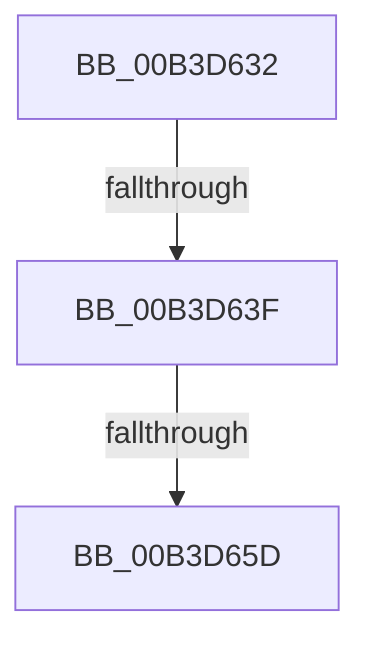

# sub_00B3D632

- RVA: `0x00B3D632`–`0x00B3D6B6` (길이 `132` bytes)
- VA: `0x0000000140B3D632`
- 실행 섹션: `PAGE`
- PDB 이름 있음: `아니요`; PDB Function 태그: `아니요`
- unwind 정보 RVA: `0x000B110C`
- 디코드: `26`개 명령, `132/132` bytes 표시
- 미해석 바이트: `0` (있으면 어셈블리에 `.byte`로 보존)

> 이 문서는 커널 이미지의 기계어와 PDB 기호를 분석해 생성했습니다. 4번과 5번은 함수 원형과 자료형을 바이너리 사용 방식에서 추정한 C 해석이며 원본 소스 복구 결과는 아닙니다.

## 1. Dependencies

- 직접 호출 지점: **2**; 고유 호출 대상: **2**
- 직접 호출자로 확인된 함수: **0**
- RIP 상대 이미지 참조: **2**

### Outgoing calls
- `0x00B3D650` → [tlgKeywordOn](../../text/42/tlgKeywordOn_function_0042EAA0.md) (function, `0x0042EAA0`)
- `0x00B3D6AB` → [tlgWriteTransfer_EtwWriteTransfer](../../text/42/tlgWriteTransfer_EtwWriteTransfer_function_004260E0.md) (function, `0x004260E0`)

### Direct callers
- 이 함수 시작 RVA로 연결되는 직접 call은 확인되지 않았습니다. 간접 호출은 완전히 역산할 수 없습니다.

### Static image references
- `0x00B3D632` → RVA `0x00E09F58` (`.data`; read)
- `0x00B3D6A4` → RVA `0x00057687` (`.rdata`; read)

## 2. Other-region calls and transfers

- 다른 실행 섹션으로 향하는 call: **2**
  - `0x00B3D650` → [tlgKeywordOn](../../text/42/tlgKeywordOn_function_0042EAA0.md) (`PAGE` → `.text`)
  - `0x00B3D6AB` → [tlgWriteTransfer_EtwWriteTransfer](../../text/42/tlgWriteTransfer_EtwWriteTransfer_function_004260E0.md) (`PAGE` → `.text`)
- call이 아닌 외부 분기/꼬리 이동: **3**
  - `0x00B3D639` → [CmpLightWeightCommitDeleteKeyUoW + 0x61](../A5/CmpLightWeightCommitDeleteKeyUoW_function_00A54610.md) (`tail-transfer`)
  - `0x00B3D657` → [CmpLightWeightCommitDeleteKeyUoW + 0x61](../A5/CmpLightWeightCommitDeleteKeyUoW_function_00A54610.md) (`tail-transfer`)
  - `0x00B3D6B1` → [CmpLightWeightCommitDeleteKeyUoW + 0x61](../A5/CmpLightWeightCommitDeleteKeyUoW_function_00A54610.md) (`tail-transfer`)

## 3. Assembly (complete function range)

```asm
00B3D632  83 3D 1F C9 2C 00 05            cmp dword ptr [rip + 0x2cc91f], 5
00B3D639  0F 86 32 70 F1 FF               jbe 0x140a54671
00B3D63F  48 BA 00 00 00 00 00 20 00 00   movabs rdx, 0x200000000000
00B3D649  48 8D 0D 08 C9 2C 00            lea rcx, [rip + 0x2cc908]
00B3D650  E8 4B 14 8F FF                  call 0x14042eaa0
00B3D655  84 C0                           test al, al
00B3D657  0F 84 14 70 F1 FF               je 0x140a54671
00B3D65D  BA 04 00 00 00                  mov edx, 4
00B3D662  44 89 45 BF                     mov dword ptr [rbp - 0x41], r8d
00B3D666  48 8D 45 BF                     lea rax, [rbp - 0x41]
00B3D66A  48 89 55 FF                     mov qword ptr [rbp - 1], rdx
00B3D66E  48 89 45 F7                     mov qword ptr [rbp - 9], rax
00B3D672  48 8D 0D DF C8 2C 00            lea rcx, [rip + 0x2cc8df]
00B3D679  48 8D 45 C7                     lea rax, [rbp - 0x39]
00B3D67D  48 C7 45 C7 00 00 00 01         mov qword ptr [rbp - 0x39], 0x1000000
00B3D685  48 89 45 07                     mov qword ptr [rbp + 7], rax
00B3D689  45 33 C9                        xor r9d, r9d
00B3D68C  48 8D 45 D7                     lea rax, [rbp - 0x29]
00B3D690  48 C7 45 0F 08 00 00 00         mov qword ptr [rbp + 0xf], 8
00B3D698  48 89 44 24 28                  mov qword ptr [rsp + 0x28], rax
00B3D69D  45 33 C0                        xor r8d, r8d
00B3D6A0  89 54 24 20                     mov dword ptr [rsp + 0x20], edx
00B3D6A4  48 8D 15 DC 9F 51 FF            lea rdx, [rip - 0xae6024]
00B3D6AB  E8 30 8A 8E FF                  call 0x1404260e0
00B3D6B0  90                              nop
00B3D6B1  E9 BB 6F F1 FF                  jmp 0x140a54671
```

## 4. C-style interpretation (structured pseudocode)

```c
__int64 __fastcall sub_00B3D632(__int64 a1, __int64 a2, int a3, int a4)
{
    __int64 result;
    unsigned int v_stack_p20;
    unsigned __int64 v_stack_p28;

    result = tlgKeywordOn(v_rip + 2935048, a2, a3, a4);
    *(unsigned int *)(v_rbp - 65) = a3;
    *(unsigned __int64 *)(v_rbp - 1) = 4;
    *(unsigned __int64 *)(v_rbp - 9) = v_rbp - 65;
    *(unsigned __int64 *)(v_rbp - 57) = 0x1000000ULL;
    *(unsigned __int64 *)(v_rbp + 7) = v_rbp - 57;
    a4 = 0;
    *(unsigned __int64 *)(v_rbp + 15) = 8;
    v_stack_p28 = v_rbp - 41;
    a3 = 0;
    v_stack_p20 = 4;
    result = tlgWriteTransfer_EtwWriteTransfer(v_rip + 2935007, v_rip - 11427876, a3, a4);
}
```

## 5. (Beta) C Style

```c
int64_t sub_00B3D632(int64_t Arg1, int64_t Arg2, int32_t Arg3, int32_t Arg4)
{
    int64_t result;
    uint32_t v_stack_p20;
    uint64_t v_stack_p28;

    result = tlgKeywordOn(v_rip + 2935048, Arg2, Arg3, Arg4);
    *(uint32_t *)(local_rbp - 0x41) = Arg3;
    *(uint64_t *)(local_rbp - 0x1) = 4;
    *(uint64_t *)(local_rbp - 0x9) = local_rbp - 65;
    *(uint64_t *)(local_rbp - 0x39) = 0x1000000ULL;
    *(uint64_t *)(local_rbp + 0x7) = local_rbp - 57;
    Arg4 = 0;
    *(uint64_t *)(local_rbp + 0xF) = 8;
    v_stack_p28 = local_rbp - 41;
    Arg3 = 0;
    v_stack_p20 = 4;
    result = tlgWriteTransfer_EtwWriteTransfer(v_rip + 2935007, v_rip - 11427876, Arg3, Arg4);
}
```

## 6. Execution-region graph

[열기: 2D/3D 그래프와 함수 탐색 컨트롤 패널](../../../control-panel.html?section=page&rva=0x00B3D632&view=graph)

- 2D 그래프는 위에서 아래로 흐르고, 3D 그래프는 빈 공간을 드래그해 회전합니다. Shift+드래그는 이동, 휠은 확대·축소, 함수 노드 선택은 대상 보고서 이동입니다.

### Static fallback


