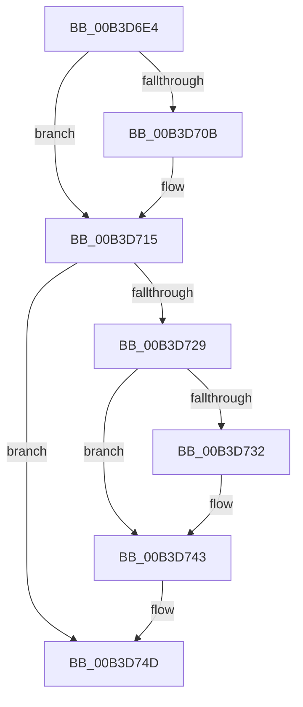

# sub_00B3D6E4

- RVA: `0x00B3D6E4`–`0x00B3D755` (길이 `113` bytes)
- VA: `0x0000000140B3D6E4`
- 실행 섹션: `PAGE`
- PDB 이름 있음: `아니요`; PDB Function 태그: `아니요`
- unwind 정보 RVA: `0x000B1320`
- 디코드: `32`개 명령, `113/113` bytes 표시
- 미해석 바이트: `0` (있으면 어셈블리에 `.byte`로 보존)

> 이 문서는 커널 이미지의 기계어와 PDB 기호를 분석해 생성했습니다. 4번과 5번은 함수 원형과 자료형을 바이너리 사용 방식에서 추정한 C 해석이며 원본 소스 복구 결과는 아닙니다.

## 1. Dependencies

- 직접 호출 지점: **6**; 고유 호출 대상: **6**
- 직접 호출자로 확인된 함수: **0**
- RIP 상대 이미지 참조: **0**

### Outgoing calls
- `0x00B3D710` → [ExfTryToWakePushLock](../../text/26/ExfTryToWakePushLock_function_00265DD0.md) (function, `0x00265DD0`)
- `0x00B3D71A` → [KeAbPostRelease](../../text/2E/KeAbPostRelease_function_002E1600.md) (function, `0x002E1600`)
- `0x00B3D71F` → [KeLeaveCriticalRegion](../../text/25/KeLeaveCriticalRegion_function_0025D8B0.md) (function, `0x0025D8B0`)
- `0x00B3D735` → [ExRemoveLowBoxAtomReferences](../../text/47/ExRemoveLowBoxAtomReferences_function_004790C8.md) (function, `0x004790C8`)
- `0x00B3D73E` → [RtlDereferenceAtomTable](../../text/5E/RtlDereferenceAtomTable_function_005E6EE0.md) (function, `0x005E6EE0`)
- `0x00B3D748` → [ExFreePoolWithTag](../../poolcode/B8/ExFreePoolWithTag_function_00B82870.md) (function, `0x00B82870`)

### Direct callers
- 이 함수 시작 RVA로 연결되는 직접 call은 확인되지 않았습니다. 간접 호출은 완전히 역산할 수 없습니다.

### Static image references
- 디코드된 RIP-relative 메모리 참조가 없습니다.

## 2. Other-region calls and transfers

- 다른 실행 섹션으로 향하는 call: **6**
  - `0x00B3D710` → [ExfTryToWakePushLock](../../text/26/ExfTryToWakePushLock_function_00265DD0.md) (`PAGE` → `.text`)
  - `0x00B3D71A` → [KeAbPostRelease](../../text/2E/KeAbPostRelease_function_002E1600.md) (`PAGE` → `.text`)
  - `0x00B3D71F` → [KeLeaveCriticalRegion](../../text/25/KeLeaveCriticalRegion_function_0025D8B0.md) (`PAGE` → `.text`)
  - `0x00B3D735` → [ExRemoveLowBoxAtomReferences](../../text/47/ExRemoveLowBoxAtomReferences_function_004790C8.md) (`PAGE` → `.text`)
  - `0x00B3D73E` → [RtlDereferenceAtomTable](../../text/5E/RtlDereferenceAtomTable_function_005E6EE0.md) (`PAGE` → `.text`)
  - `0x00B3D748` → [ExFreePoolWithTag](../../poolcode/B8/ExFreePoolWithTag_function_00B82870.md) (`PAGE` → `POOLCODE`)
- call이 아닌 외부 분기/꼬리 이동: **1**
  - `0x00B3D750` → [SepDereferenceLowBoxNumberEntry + 0xCF](../A5/SepDereferenceLowBoxNumberEntry_function_00A55DBC.md) (`tail-transfer`)

## 3. Assembly (complete function range)

```asm
00B3D6E4  8B 56 28                        mov edx, dword ptr [rsi + 0x28]
00B3D6E7  FF CA                           dec edx
00B3D6E9  8B CA                           mov ecx, edx
00B3D6EB  83 E2 07                        and edx, 7
00B3D6EE  48 C1 E9 03                     shr rcx, 3
00B3D6F2  48 03 4F 10                     add rcx, qword ptr [rdi + 0x10]
00B3D6F6  0F BE 01                        movsx eax, byte ptr [rcx]
00B3D6F9  0F B3 D0                        btr eax, edx
00B3D6FC  88 01                           mov byte ptr [rcx], al
00B3D6FE  F0 48 0F C1 1F                  lock xadd qword ptr [rdi], rbx
00B3D703  80 E3 06                        and bl, 6
00B3D706  80 FB 02                        cmp bl, 2
00B3D709  75 0A                           jne 0x140b3d715
00B3D70B  48 8B 4C 24 70                  mov rcx, qword ptr [rsp + 0x70]
00B3D710  E8 BB 86 72 FF                  call 0x140265dd0
00B3D715  48 8B 4C 24 70                  mov rcx, qword ptr [rsp + 0x70]
00B3D71A  E8 E1 3E 7A FF                  call 0x1402e1600
00B3D71F  E8 8C 01 72 FF                  call 0x14025d8b0
00B3D724  40 84 ED                        test bpl, bpl
00B3D727  74 24                           je 0x140b3d74d
00B3D729  48 8B 4E 30                     mov rcx, qword ptr [rsi + 0x30]
00B3D72D  48 85 C9                        test rcx, rcx
00B3D730  74 11                           je 0x140b3d743
00B3D732  8B 56 28                        mov edx, dword ptr [rsi + 0x28]
00B3D735  E8 8E B9 93 FF                  call 0x1404790c8
00B3D73A  48 8B 4E 30                     mov rcx, qword ptr [rsi + 0x30]
00B3D73E  E8 9D 97 AA FF                  call 0x1405e6ee0
00B3D743  33 D2                           xor edx, edx
00B3D745  48 8B CE                        mov rcx, rsi
00B3D748  E8 23 51 04 00                  call 0x140b82870
00B3D74D  41 8B C6                        mov eax, r14d
00B3D750  E9 36 87 F1 FF                  jmp 0x140a55e8b
```

## 4. C-style interpretation (structured pseudocode)

```c
__int64 __fastcall sub_00B3D6E4(__int64 a1, __int64 a2, __int64 a3, __int64 a4, __int64 a5, __int64 a6, __int64 a7, __int64 a8, __int64 a9, __int64 a10, __int64 a11, __int64 a12, __int64 a13, __int64 a14)
{
    __int64 result;
    __int64 v_rbx;

    a2 = (unsigned int)(((unsigned int)(*(unsigned int *)(v_rsi + 40))) - 1);
    a2 = (unsigned int)((a2) & (7));
    a1 = ((unsigned int)((unsigned int)(a2))) >> (3);
    a1 = (a1) + (*(unsigned __int64 *)(v_rdi + 16));
    *(unsigned __int8 *)(a1) = (unsigned __int8)((__int8)(*(unsigned __int8 *)(a1)));
    v_rbx = (unsigned __int8)((v_rbx) & (6));
    result = (__int8)(*(unsigned __int8 *)(a1));
    if (((unsigned __int8)(v_rbx)) == 2) {
        a1 = a14;
        result = ExfTryToWakePushLock(a1, a2, a3, a4);
    }
    result = KeAbPostRelease(a14, a2, a3, a4);
    result = KeLeaveCriticalRegion(a14, a2, a3, a4);
    if ((unsigned __int8)(v_rbp) == 0) goto loc_00B3D74D;
    if (*(unsigned __int64 *)(v_rsi + 48) != 0) {
        a2 = *(unsigned int *)(v_rsi + 40);
        result = ExRemoveLowBoxAtomReferences(*(unsigned __int64 *)(v_rsi + 48), a2, a3, a4);
        a1 = *(unsigned __int64 *)(v_rsi + 48);
        result = RtlDereferenceAtomTable(a1, a2, a3, a4);
    }
    a2 = 0;
    result = ExFreePoolWithTag(v_rsi, a2, a3, a4);
loc_00B3D74D:
}
```

## 5. (Beta) C Style

```c
int64_t sub_00B3D6E4(int64_t Arg1, int64_t Arg2, int64_t Arg3, int64_t Arg4, uint64_t Arg5, uint64_t Arg6, uint64_t Arg7, uint64_t Arg8, uint64_t Arg9, uint64_t Arg10, uint64_t Arg11, uint64_t Arg12, uint64_t Arg13, int64_t Arg14)
{
    int64_t result;
    int64_t local_rbx;

    Arg2 = (uint32_t)(((uint32_t)(*(uint32_t *)(local_rsi + 0x28))) - 1);
    Arg2 = (uint32_t)((Arg2) & (7));
    Arg1 = ((uint32_t)((uint32_t)(Arg2))) >> (3);
    Arg1 = (Arg1) + (*(uint64_t *)(local_rdi + 0x10));
    *(uint8_t *)(Arg1) = (uint8_t)((int8_t)(*(uint8_t *)(Arg1)));
    local_rbx = (uint8_t)((local_rbx) & (6));
    result = (int8_t)(*(uint8_t *)(Arg1));
    if (((uint8_t)(local_rbx)) == 2) {
        Arg1 = Arg14;
        result = ExfTryToWakePushLock(Arg1, Arg2, Arg3, Arg4);
    }
    result = KeAbPostRelease(Arg14, Arg2, Arg3, Arg4);
    result = KeLeaveCriticalRegion(Arg14, Arg2, Arg3, Arg4);
    if ((uint8_t)(local_rbp) == 0) goto loc_00B3D74D;
    if (*(uint64_t *)(local_rsi + 0x30) != 0) {
        Arg2 = *(uint32_t *)(local_rsi + 0x28);
        result = ExRemoveLowBoxAtomReferences(*(uint64_t *)(local_rsi + 0x30), Arg2, Arg3, Arg4);
        Arg1 = *(uint64_t *)(local_rsi + 0x30);
        result = RtlDereferenceAtomTable(Arg1, Arg2, Arg3, Arg4);
    }
    Arg2 = 0;
    result = ExFreePoolWithTag(local_rsi, Arg2, Arg3, Arg4);
loc_00B3D74D:
}
```

## 6. Execution-region graph

[열기: 2D/3D 그래프와 함수 탐색 컨트롤 패널](../../../control-panel.html?section=page&rva=0x00B3D6E4&view=graph)

- 2D 그래프는 위에서 아래로 흐르고, 3D 그래프는 빈 공간을 드래그해 회전합니다. Shift+드래그는 이동, 휠은 확대·축소, 함수 노드 선택은 대상 보고서 이동입니다.

### Static fallback


