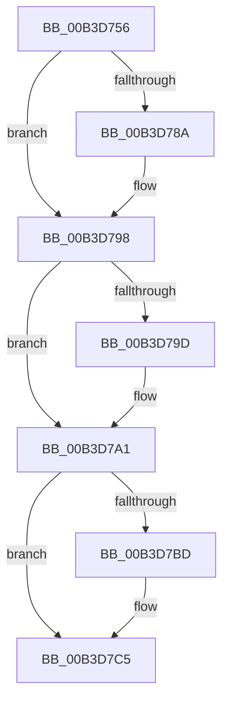

# sub_00B3D756

- RVA: `0x00B3D756`–`0x00B3D7D8` (길이 `130` bytes)
- VA: `0x0000000140B3D756`
- 실행 섹션: `PAGE`
- PDB 이름 있음: `아니요`; PDB Function 태그: `아니요`
- unwind 정보 RVA: `0x000B14B4`
- 디코드: `33`개 명령, `130/130` bytes 표시
- 미해석 바이트: `0` (있으면 어셈블리에 `.byte`로 보존)

> 이 문서는 커널 이미지의 기계어와 PDB 기호를 분석해 생성했습니다. 4번과 5번은 함수 원형과 자료형을 바이너리 사용 방식에서 추정한 C 해석이며 원본 소스 복구 결과는 아닙니다.

## 1. Dependencies

- 직접 호출 지점: **6**; 고유 호출 대상: **6**
- 직접 호출자로 확인된 함수: **0**
- RIP 상대 이미지 참조: **2**

### Outgoing calls
- `0x00B3D77A` → [KeAbPreAcquire](../../text/21/KeAbPreAcquire_function_00210230.md) (function, `0x00210230`)
- `0x00B3D793` → [ExfAcquirePushLockExclusiveEx](../../text/20/ExfAcquirePushLockExclusiveEx_function_0020FC90.md) (function, `0x0020FC90`)
- `0x00B3D7A7` → [WheapPfaMemoryCheck](../7D/WheapPfaMemoryCheck_function_007D9214.md) (function, `0x007D9214`)
- `0x00B3D7C0` → [ExfTryToWakePushLock](../../text/26/ExfTryToWakePushLock_function_00265DD0.md) (function, `0x00265DD0`)
- `0x00B3D7C8` → [KeAbPostRelease](../../text/2E/KeAbPostRelease_function_002E1600.md) (function, `0x002E1600`)
- `0x00B3D7CD` → [KeLeaveCriticalRegion](../../text/25/KeLeaveCriticalRegion_function_0025D8B0.md) (function, `0x0025D8B0`)

### Direct callers
- 이 함수 시작 RVA로 연결되는 직접 call은 확인되지 않았습니다. 간접 호출은 완전히 역산할 수 없습니다.

### Static image references
- `0x00B3D75F` → RVA `0x00EEFB18` (`.data`; read)
- `0x00B3D7AC` → RVA `0x00EEFB18` (`.data`; read/write)

## 2. Other-region calls and transfers

- 다른 실행 섹션으로 향하는 call: **5**
  - `0x00B3D77A` → [KeAbPreAcquire](../../text/21/KeAbPreAcquire_function_00210230.md) (`PAGE` → `.text`)
  - `0x00B3D793` → [ExfAcquirePushLockExclusiveEx](../../text/20/ExfAcquirePushLockExclusiveEx_function_0020FC90.md) (`PAGE` → `.text`)
  - `0x00B3D7C0` → [ExfTryToWakePushLock](../../text/26/ExfTryToWakePushLock_function_00265DD0.md) (`PAGE` → `.text`)
  - `0x00B3D7C8` → [KeAbPostRelease](../../text/2E/KeAbPostRelease_function_002E1600.md) (`PAGE` → `.text`)
  - `0x00B3D7CD` → [KeLeaveCriticalRegion](../../text/25/KeLeaveCriticalRegion_function_0025D8B0.md) (`PAGE` → `.text`)
- call이 아닌 외부 분기/꼬리 이동: **1**
  - `0x00B3D7D3` → [WheapPredictiveFailureAnalysis + 0xE7](../A5/WheapPredictiveFailureAnalysis_function_00A564AC.md) (`tail-transfer`)

## 3. Assembly (complete function range)

```asm
00B3D756  65 48 8B 04 25 88 01 00 00      mov rax, qword ptr gs:[0x188]
00B3D75F  4C 8D 3D B2 23 3B 00            lea r15, [rip + 0x3b23b2]
00B3D766  48 83 CB FF                     or rbx, 0xffffffffffffffff
00B3D76A  45 33 C0                        xor r8d, r8d
00B3D76D  33 D2                           xor edx, edx
00B3D76F  49 8B CF                        mov rcx, r15
00B3D772  66 01 98 E4 01 00 00            add word ptr [rax + 0x1e4], bx
00B3D779  90                              nop
00B3D77A  E8 B1 2A 6D FF                  call 0x140210230
00B3D77F  F0 49 0F BA 2F 00               lock bts qword ptr [r15], 0
00B3D785  48 8B F0                        mov rsi, rax
00B3D788  73 0E                           jae 0x140b3d798
00B3D78A  4D 8B C7                        mov r8, r15
00B3D78D  48 8B D0                        mov rdx, rax
00B3D790  49 8B CF                        mov rcx, r15
00B3D793  E8 F8 24 6D FF                  call 0x14020fc90
00B3D798  48 85 F6                        test rsi, rsi
00B3D79B  74 04                           je 0x140b3d7a1
00B3D79D  C6 46 0A 01                     mov byte ptr [rsi + 0xa], 1
00B3D7A1  4C 8B C5                        mov r8, rbp
00B3D7A4  48 8B D7                        mov rdx, rdi
00B3D7A7  E8 68 BA C9 FF                  call 0x1407d9214
00B3D7AC  F0 48 0F C1 1D 63 23 3B 00      lock xadd qword ptr [rip + 0x3b2363], rbx
00B3D7B5  80 E3 06                        and bl, 6
00B3D7B8  80 FB 02                        cmp bl, 2
00B3D7BB  75 08                           jne 0x140b3d7c5
00B3D7BD  49 8B CF                        mov rcx, r15
00B3D7C0  E8 0B 86 72 FF                  call 0x140265dd0
00B3D7C5  49 8B CF                        mov rcx, r15
00B3D7C8  E8 33 3E 7A FF                  call 0x1402e1600
00B3D7CD  E8 DE 00 72 FF                  call 0x14025d8b0
00B3D7D2  90                              nop
00B3D7D3  E9 BB 8D F1 FF                  jmp 0x140a56593
```

## 4. C-style interpretation (structured pseudocode)

```c
__int64 __fastcall sub_00B3D756(__int64 a1, int a2, int a3)
{
    __int64 result;
    __int64 v_rbx;

    v_rbx = (v_rbx) | (-1);
    a3 = 0;
    a2 = 0;
    result = KeAbPreAcquire(v_rip + 3875762, a2, a3, a4);
    if (!(condition_is_above_or_equal)) {
        a3 = v_rip + 3875762;
        a2 = result;
        a1 = v_rip + 3875762;
        result = ExfAcquirePushLockExclusiveEx(a1, a2, a3, a4);
    }
    if (result != 0) {
        *(unsigned __int8 *)(result + 10) = 1;
    }
    result = WheapPfaMemoryCheck(a1, v_rdi, v_rbp, a4);
    v_rbx = (unsigned __int8)((v_rbx) & (6));
    if (((unsigned __int8)(v_rbx)) == 2) {
        a1 = v_rip + 3875762;
        result = ExfTryToWakePushLock(a1, v_rdi, v_rbp, a4);
    }
    result = KeAbPostRelease(v_rip + 3875762, v_rdi, v_rbp, a4);
    result = KeLeaveCriticalRegion(v_rip + 3875762, v_rdi, v_rbp, a4);
}
```

## 5. (Beta) C Style

```c
int64_t sub_00B3D756(int64_t Arg1, int32_t Arg2, int32_t Arg3)
{
    int64_t result;
    int64_t local_rbx;

    local_rbx = (local_rbx) | (-1);
    Arg3 = 0;
    Arg2 = 0;
    result = KeAbPreAcquire(v_rip + 3875762, Arg2, Arg3, a4);
    if (!(condition_is_above_or_equal)) {
        Arg3 = v_rip + 3875762;
        Arg2 = result;
        Arg1 = v_rip + 3875762;
        result = ExfAcquirePushLockExclusiveEx(Arg1, Arg2, Arg3, a4);
    }
    if (result != 0) {
        *(uint8_t *)(result + 0xA) = 1;
    }
    result = WheapPfaMemoryCheck(Arg1, local_rdi, local_rbp, a4);
    local_rbx = (uint8_t)((local_rbx) & (6));
    if (((uint8_t)(local_rbx)) == 2) {
        Arg1 = v_rip + 3875762;
        result = ExfTryToWakePushLock(Arg1, local_rdi, local_rbp, a4);
    }
    result = KeAbPostRelease(v_rip + 3875762, local_rdi, local_rbp, a4);
    result = KeLeaveCriticalRegion(v_rip + 3875762, local_rdi, local_rbp, a4);
}
```

## 6. Execution-region graph

[열기: 2D/3D 그래프와 함수 탐색 컨트롤 패널](../../../control-panel.html?section=page&rva=0x00B3D756&view=graph)

- 2D 그래프는 위에서 아래로 흐르고, 3D 그래프는 빈 공간을 드래그해 회전합니다. Shift+드래그는 이동, 휠은 확대·축소, 함수 노드 선택은 대상 보고서 이동입니다.

### Static fallback


