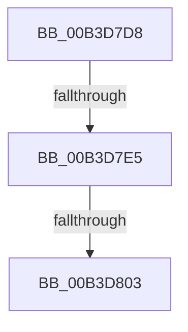

# sub_00B3D7D8

- RVA: `0x00B3D7D8`–`0x00B3D875` (길이 `157` bytes)
- VA: `0x0000000140B3D7D8`
- 실행 섹션: `PAGE`
- PDB 이름 있음: `아니요`; PDB Function 태그: `아니요`
- unwind 정보 RVA: `0x000B156C`
- 디코드: `28`개 명령, `157/157` bytes 표시
- 미해석 바이트: `0` (있으면 어셈블리에 `.byte`로 보존)

> 이 문서는 커널 이미지의 기계어와 PDB 기호를 분석해 생성했습니다. 4번과 5번은 함수 원형과 자료형을 바이너리 사용 방식에서 추정한 C 해석이며 원본 소스 복구 결과는 아닙니다.

## 1. Dependencies

- 직접 호출 지점: **2**; 고유 호출 대상: **2**
- 직접 호출자로 확인된 함수: **0**
- RIP 상대 이미지 참조: **3**

### Outgoing calls
- `0x00B3D7F6` → [tlgKeywordOn](../../text/42/tlgKeywordOn_function_0042EAA0.md) (function, `0x0042EAA0`)
- `0x00B3D86A` → [tlgWriteTransfer_EtwWriteTransfer](../../text/42/tlgWriteTransfer_EtwWriteTransfer_function_004260E0.md) (function, `0x004260E0`)

### Direct callers
- 이 함수 시작 RVA로 연결되는 직접 call은 확인되지 않았습니다. 간접 호출은 완전히 역산할 수 없습니다.

### Static image references
- `0x00B3D7D8` → RVA `0x00E07748` (`.data`; read)
- `0x00B3D803` → RVA `0x00E0B800` (`.data`; read)
- `0x00B3D809` → RVA `0x0004C2FC` (`.rdata`; read)

## 2. Other-region calls and transfers

- 다른 실행 섹션으로 향하는 call: **2**
  - `0x00B3D7F6` → [tlgKeywordOn](../../text/42/tlgKeywordOn_function_0042EAA0.md) (`PAGE` → `.text`)
  - `0x00B3D86A` → [tlgWriteTransfer_EtwWriteTransfer](../../text/42/tlgWriteTransfer_EtwWriteTransfer_function_004260E0.md) (`PAGE` → `.text`)
- call이 아닌 외부 분기/꼬리 이동: **3**
  - `0x00B3D7DF` → [PpmHeteroComputeMinRelativePerformane + 0xC2](../A5/PpmHeteroComputeMinRelativePerformane_function_00A56A90.md) (`tail-transfer`)
  - `0x00B3D7FD` → [PpmHeteroComputeMinRelativePerformane + 0xC2](../A5/PpmHeteroComputeMinRelativePerformane_function_00A56A90.md) (`tail-transfer`)
  - `0x00B3D870` → [PpmHeteroComputeMinRelativePerformane + 0xC2](../A5/PpmHeteroComputeMinRelativePerformane_function_00A56A90.md) (`tail-transfer`)

## 3. Assembly (complete function range)

```asm
00B3D7D8  83 3D 69 9F 2C 00 05            cmp dword ptr [rip + 0x2c9f69], 5
00B3D7DF  0F 86 6D 93 F1 FF               jbe 0x140a56b52
00B3D7E5  48 BA 00 00 00 00 00 40 00 00   movabs rdx, 0x400000000000
00B3D7EF  48 8D 0D 52 9F 2C 00            lea rcx, [rip + 0x2c9f52]
00B3D7F6  E8 A5 12 8F FF                  call 0x14042eaa0
00B3D7FB  84 C0                           test al, al
00B3D7FD  0F 84 4F 93 F1 FF               je 0x140a56b52
00B3D803  8A 05 F7 DF 2C 00               mov al, byte ptr [rip + 0x2cdff7]
00B3D809  48 8D 15 EC EA 50 FF            lea rdx, [rip - 0xaf1514]
00B3D810  83 64 24 6C 00                  and dword ptr [rsp + 0x6c], 0
00B3D815  48 8D 0D 2C 9F 2C 00            lea rcx, [rip + 0x2c9f2c]
00B3D81C  83 64 24 7C 00                  and dword ptr [rsp + 0x7c], 0
00B3D821  45 33 C9                        xor r9d, r9d
00B3D824  88 44 24 30                     mov byte ptr [rsp + 0x30], al
00B3D828  45 33 C0                        xor r8d, r8d
00B3D82B  48 8D 44 24 30                  lea rax, [rsp + 0x30]
00B3D830  C7 44 24 68 01 00 00 00         mov dword ptr [rsp + 0x68], 1
00B3D838  48 89 44 24 60                  mov qword ptr [rsp + 0x60], rax
00B3D83D  48 8D 44 24 38                  lea rax, [rsp + 0x38]
00B3D842  48 89 44 24 70                  mov qword ptr [rsp + 0x70], rax
00B3D847  48 8D 44 24 40                  lea rax, [rsp + 0x40]
00B3D84C  48 89 44 24 28                  mov qword ptr [rsp + 0x28], rax
00B3D851  C7 44 24 20 04 00 00 00         mov dword ptr [rsp + 0x20], 4
00B3D859  48 C7 44 24 38 00 00 00 01      mov qword ptr [rsp + 0x38], 0x1000000
00B3D862  C7 44 24 78 08 00 00 00         mov dword ptr [rsp + 0x78], 8
00B3D86A  E8 71 88 8E FF                  call 0x1404260e0
00B3D86F  90                              nop
00B3D870  E9 DD 92 F1 FF                  jmp 0x140a56b52
```

## 4. C-style interpretation (structured pseudocode)

```c
__int64 __fastcall sub_00B3D7D8(__int64 a1, __int64 a2, int a3, int a4, __int64 a5, __int64 a6, __int64 a7, __int64 a8)
{
    __int64 result;
    unsigned int v_stack_p20;
    unsigned __int64 v_stack_p28;
    unsigned __int8 v_stack_p30;
    unsigned __int64 v_stack_p38;
    unsigned __int64 v_stack_p60;
    unsigned int v_stack_p68;
    unsigned int v_stack_p6C;
    unsigned __int64 v_stack_p70;
    unsigned int v_stack_p78;
    unsigned int v_stack_p7C;

    result = tlgKeywordOn(v_rip + 2924370, a2, a3, a4);
    a4 = 0;
    v_stack_p30 = (unsigned __int8)(*(unsigned __int8 *)(v_rip + 2940919));
    a3 = 0;
    v_stack_p68 = 1;
    v_stack_p60 = a6;
    v_stack_p70 = a7;
    v_stack_p28 = a8;
    v_stack_p20 = 4;
    v_stack_p38 = 0x1000000ULL;
    v_stack_p78 = 8;
    result = tlgWriteTransfer_EtwWriteTransfer(v_rip + 2924332, v_rip - 11474196, a3, a4);
}
```

## 5. (Beta) C Style

```c
int64_t sub_00B3D7D8(int64_t Arg1, int64_t Arg2, int32_t Arg3, int32_t Arg4, uint64_t Arg5, int64_t Arg6, int64_t Arg7, int64_t Arg8)
{
    int64_t result;
    uint32_t v_stack_p20;
    uint64_t v_stack_p28;
    uint8_t v_stack_p30;
    uint64_t v_stack_p38;
    uint64_t v_stack_p60;
    uint32_t v_stack_p68;
    uint32_t v_stack_p6C;
    uint64_t v_stack_p70;
    uint32_t v_stack_p78;
    uint32_t v_stack_p7C;

    result = tlgKeywordOn(v_rip + 2924370, Arg2, Arg3, Arg4);
    Arg4 = 0;
    v_stack_p30 = (uint8_t)(*(uint8_t *)(v_rip + 0x2CDFF7));
    Arg3 = 0;
    v_stack_p68 = 1;
    v_stack_p60 = Arg6;
    v_stack_p70 = Arg7;
    v_stack_p28 = Arg8;
    v_stack_p20 = 4;
    v_stack_p38 = 0x1000000ULL;
    v_stack_p78 = 8;
    result = tlgWriteTransfer_EtwWriteTransfer(v_rip + 2924332, v_rip - 11474196, Arg3, Arg4);
}
```

## 6. Execution-region graph

[열기: 2D/3D 그래프와 함수 탐색 컨트롤 패널](../../../control-panel.html?section=page&rva=0x00B3D7D8&view=graph)

- 2D 그래프는 위에서 아래로 흐르고, 3D 그래프는 빈 공간을 드래그해 회전합니다. Shift+드래그는 이동, 휠은 확대·축소, 함수 노드 선택은 대상 보고서 이동입니다.

### Static fallback


