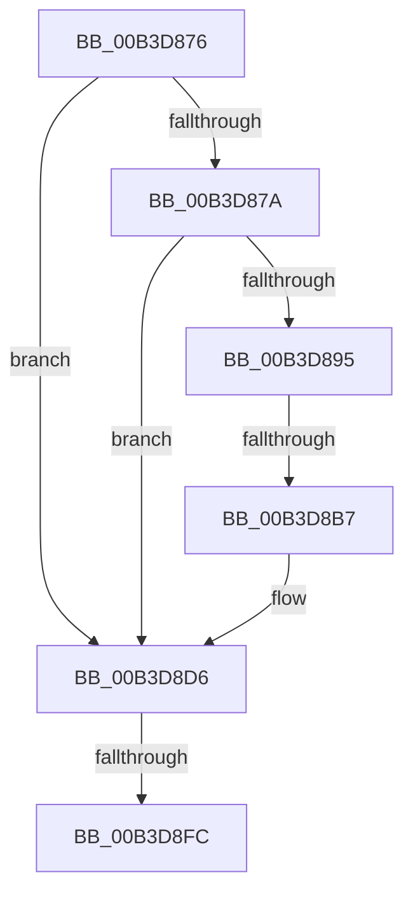

# sub_00B3D876

- RVA: `0x00B3D876`–`0x00B3D91E` (길이 `168` bytes)
- VA: `0x0000000140B3D876`
- 실행 섹션: `PAGE`
- PDB 이름 있음: `아니요`; PDB Function 태그: `아니요`
- unwind 정보 RVA: `0x000B159C`
- 디코드: `38`개 명령, `168/168` bytes 표시
- 미해석 바이트: `0` (있으면 어셈블리에 `.byte`로 보존)

> 이 문서는 커널 이미지의 기계어와 PDB 기호를 분석해 생성했습니다. 4번과 5번은 함수 원형과 자료형을 바이너리 사용 방식에서 추정한 C 해석이며 원본 소스 복구 결과는 아닙니다.

## 1. Dependencies

- 직접 호출 지점: **4**; 고유 호출 대상: **4**
- 직접 호출자로 확인된 함수: **0**
- RIP 상대 이미지 참조: **0**

### Outgoing calls
- `0x00B3D8A6` → [guard_dispatch_icall](../../text/6B/guard_dispatch_icall_function_006BAAD0.md) (function, `0x006BAAD0`)
- `0x00B3D8C2` → [memset](../../text/6C/memset_function_006C6C40.md) (function, `0x006C6C40`)
- `0x00B3D8EF` → [HvpAllocateMap](../9B/HvpAllocateMap_function_009BA14C.md) (function, `0x009BA14C`)
- `0x00B3D913` → [HvpFreeMap](../A6/HvpFreeMap_function_00A68674.md) (function, `0x00A68674`)

### Direct callers
- 이 함수 시작 RVA로 연결되는 직접 call은 확인되지 않았습니다. 간접 호출은 완전히 역산할 수 없습니다.

### Static image references
- 디코드된 RIP-relative 메모리 참조가 없습니다.

## 2. Other-region calls and transfers

- 다른 실행 섹션으로 향하는 call: **2**
  - `0x00B3D8A6` → [guard_dispatch_icall](../../text/6B/guard_dispatch_icall_function_006BAAD0.md) (`PAGE` → `.text`)
  - `0x00B3D8C2` → [memset](../../text/6C/memset_function_006C6C40.md) (`PAGE` → `.text`)
- call이 아닌 외부 분기/꼬리 이동: **3**
  - `0x00B3D8B1` → [HvpExpandMap + 0xBF](../A5/HvpExpandMap_function_00A56B90.md) (`tail-transfer`)
  - `0x00B3D8F6` → [HvpExpandMap + 0x4D](../A5/HvpExpandMap_function_00A56B90.md) (`tail-transfer`)
  - `0x00B3D919` → [HvpExpandMap + 0x4D](../A5/HvpExpandMap_function_00A56B90.md) (`tail-transfer`)

## 3. Assembly (complete function range)

```asm
00B3D876  85 FF                           test edi, edi
00B3D878  75 5C                           jne 0x140b3d8d6
00B3D87A  4C 69 F0 78 02 00 00            imul r14, rax, 0x278
00B3D881  4C 8D AE 28 01 00 00            lea r13, [rsi + 0x128]
00B3D888  4D 03 EE                        add r13, r14
00B3D88B  4D 39 AC 36 20 01 00 00         cmp qword ptr [r14 + rsi + 0x120], r13
00B3D893  75 41                           jne 0x140b3d8d6
00B3D895  48 8B 46 18                     mov rax, qword ptr [rsi + 0x18]
00B3D899  33 D2                           xor edx, edx
00B3D89B  B9 00 20 00 00                  mov ecx, 0x2000
00B3D8A0  41 B8 43 4D 31 38               mov r8d, 0x38314d43
00B3D8A6  E8 25 D2 B7 FF                  call 0x1406baad0
00B3D8AB  4C 8B F8                        mov r15, rax
00B3D8AE  48 85 C0                        test rax, rax
00B3D8B1  0F 84 98 93 F1 FF               je 0x140a56c4f
00B3D8B7  33 D2                           xor edx, edx
00B3D8B9  41 B8 00 20 00 00               mov r8d, 0x2000
00B3D8BF  48 8B C8                        mov rcx, rax
00B3D8C2  E8 79 93 B8 FF                  call 0x1406c6c40
00B3D8C7  49 8B 45 00                     mov rax, qword ptr [r13]
00B3D8CB  49 89 07                        mov qword ptr [r15], rax
00B3D8CE  4D 89 BC 36 20 01 00 00         mov qword ptr [r14 + rsi + 0x120], r15
00B3D8D6  4D 69 F4 78 02 00 00            imul r14, r12, 0x278
00B3D8DD  44 8B CD                        mov r9d, ebp
00B3D8E0  44 8D 47 01                     lea r8d, [rdi + 1]
00B3D8E4  48 8B CE                        mov rcx, rsi
00B3D8E7  49 8B 94 36 20 01 00 00         mov rdx, qword ptr [r14 + rsi + 0x120]
00B3D8EF  E8 58 C8 E7 FF                  call 0x1409ba14c
00B3D8F4  84 C0                           test al, al
00B3D8F6  0F 85 E1 92 F1 FF               jne 0x140a56bdd
00B3D8FC  49 8B 94 36 20 01 00 00         mov rdx, qword ptr [r14 + rsi + 0x120]
00B3D904  44 8D 47 01                     lea r8d, [rdi + 1]
00B3D908  44 8B CD                        mov r9d, ebp
00B3D90B  48 8B CE                        mov rcx, rsi
00B3D90E  BB 17 00 00 C0                  mov ebx, 0xc0000017
00B3D913  E8 5C AD F2 FF                  call 0x140a68674
00B3D918  90                              nop
00B3D919  E9 BF 92 F1 FF                  jmp 0x140a56bdd
```

## 4. C-style interpretation (structured pseudocode)

```c
__int64 __fastcall sub_00B3D876(__int64 a1, int a2)
{
    __int64 result;
    __int64 v_r13;
    __int64 v_r14;

    if ((unsigned int)(v_rdi) != 0) goto loc_00B3D8D6;
    v_r14 = (v_r14) * (result);
    v_r13 = (v_rsi + 296) + (v_r14);
    if ((*(unsigned __int64 *)(v_r14 + v_rsi * 1 + 288)) != v_r13) goto loc_00B3D8D6;
    a2 = 0;
    result = guard_dispatch_icall((unsigned int)(0x2000ULL), a2, (unsigned int)(0x38314D43ULL), a4);
    a2 = 0;
    result = memset(result, a2, (unsigned int)(0x2000ULL), a4);
    *(unsigned __int64 *)(result) = *(unsigned __int64 *)(v_r13);
    *(unsigned __int64 *)(v_r14 + v_rsi * 1 + 288) = result;
loc_00B3D8D6:
    v_r14 = (v_r14) * (v_r12);
    result = HvpAllocateMap(v_rsi, *(unsigned __int64 *)(v_r14 + v_rsi * 1 + 288), v_rdi + 1, (unsigned int)((unsigned int)(v_rbp)));
    result = HvpFreeMap(v_rsi, *(unsigned __int64 *)(v_r14 + v_rsi * 1 + 288), v_rdi + 1, (unsigned int)((unsigned int)(v_rbp)));
}
```

## 5. (Beta) C Style

```c
int64_t sub_00B3D876(int64_t Arg1, int32_t Arg2)
{
    int64_t result;
    int64_t local_r13;
    int64_t local_r14;

    if ((uint32_t)(local_rdi) != 0) goto loc_00B3D8D6;
    local_r14 = (local_r14) * (result);
    local_r13 = (local_rsi + 296) + (local_r14);
    if ((*(uint64_t *)(local_r14 + local_rsi * 1 + 0x120)) != local_r13) goto loc_00B3D8D6;
    Arg2 = 0;
    result = guard_dispatch_icall((uint32_t)(0x2000ULL), Arg2, (uint32_t)(0x38314D43ULL), a4);
    Arg2 = 0;
    result = memset(result, Arg2, (uint32_t)(0x2000ULL), a4);
    *(uint64_t *)(result) = *(uint64_t *)(local_r13);
    *(uint64_t *)(local_r14 + local_rsi * 1 + 0x120) = result;
loc_00B3D8D6:
    local_r14 = (local_r14) * (local_r12);
    result = HvpAllocateMap(local_rsi, *(uint64_t *)(local_r14 + local_rsi * 1 + 0x120), local_rdi + 1, (uint32_t)((uint32_t)(local_rbp)));
    result = HvpFreeMap(local_rsi, *(uint64_t *)(local_r14 + local_rsi * 1 + 0x120), local_rdi + 1, (uint32_t)((uint32_t)(local_rbp)));
}
```

## 6. Execution-region graph

[열기: 2D/3D 그래프와 함수 탐색 컨트롤 패널](../../../control-panel.html?section=page&rva=0x00B3D876&view=graph)

- 2D 그래프는 위에서 아래로 흐르고, 3D 그래프는 빈 공간을 드래그해 회전합니다. Shift+드래그는 이동, 휠은 확대·축소, 함수 노드 선택은 대상 보고서 이동입니다.

### Static fallback


