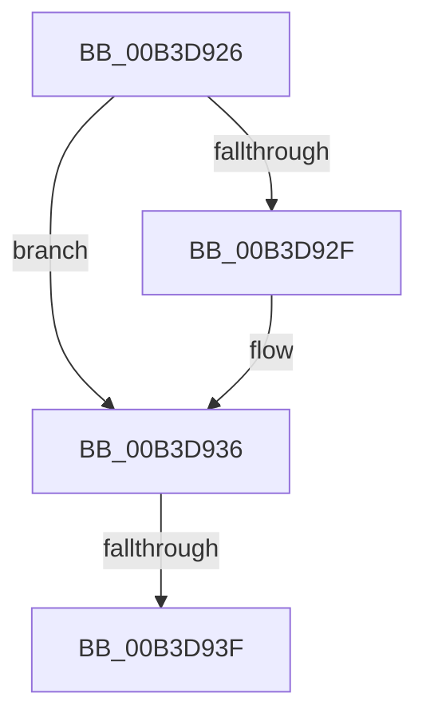

# sub_00B3D926

- RVA: `0x00B3D926`–`0x00B3D94F` (길이 `41` bytes)
- VA: `0x0000000140B3D926`
- 실행 섹션: `PAGE`
- PDB 이름 있음: `아니요`; PDB Function 태그: `아니요`
- unwind 정보 RVA: `0x000B15E4`
- 디코드: `12`개 명령, `41/41` bytes 표시
- 미해석 바이트: `0` (있으면 어셈블리에 `.byte`로 보존)

> 이 문서는 커널 이미지의 기계어와 PDB 기호를 분석해 생성했습니다. 4번과 5번은 함수 원형과 자료형을 바이너리 사용 방식에서 추정한 C 해석이며 원본 소스 복구 결과는 아닙니다.

## 1. Dependencies

- 직접 호출 지점: **2**; 고유 호출 대상: **1**
- 직접 호출자로 확인된 함수: **0**
- RIP 상대 이미지 참조: **0**

### Outgoing calls
- `0x00B3D931` → [ExFreePoolWithTag](../../poolcode/B8/ExFreePoolWithTag_function_00B82870.md) (function, `0x00B82870`)
- `0x00B3D944` → [ExFreePoolWithTag](../../poolcode/B8/ExFreePoolWithTag_function_00B82870.md) (function, `0x00B82870`)

### Direct callers
- 이 함수 시작 RVA로 연결되는 직접 call은 확인되지 않았습니다. 간접 호출은 완전히 역산할 수 없습니다.

### Static image references
- 디코드된 RIP-relative 메모리 참조가 없습니다.

## 2. Other-region calls and transfers

- 다른 실행 섹션으로 향하는 call: **2**
  - `0x00B3D931` → [ExFreePoolWithTag](../../poolcode/B8/ExFreePoolWithTag_function_00B82870.md) (`PAGE` → `POOLCODE`)
  - `0x00B3D944` → [ExFreePoolWithTag](../../poolcode/B8/ExFreePoolWithTag_function_00B82870.md) (`PAGE` → `POOLCODE`)
- call이 아닌 외부 분기/꼬리 이동: **2**
  - `0x00B3D939` → [SepGetLogonSessionAccountInfo + 0x13F](../A5/SepGetLogonSessionAccountInfo_function_00A56F18.md) (`tail-transfer`)
  - `0x00B3D94A` → [SepGetLogonSessionAccountInfo + 0x13F](../A5/SepGetLogonSessionAccountInfo_function_00A56F18.md) (`tail-transfer`)

## 3. Assembly (complete function range)

```asm
00B3D926  49 8B 4F 08                     mov rcx, qword ptr [r15 + 8]
00B3D92A  48 85 C9                        test rcx, rcx
00B3D92D  74 07                           je 0x140b3d936
00B3D92F  33 D2                           xor edx, edx
00B3D931  E8 3A 4F 04 00                  call 0x140b82870
00B3D936  48 85 F6                        test rsi, rsi
00B3D939  0F 84 18 97 F1 FF               je 0x140a57057
00B3D93F  33 D2                           xor edx, edx
00B3D941  48 8B CE                        mov rcx, rsi
00B3D944  E8 27 4F 04 00                  call 0x140b82870
00B3D949  90                              nop
00B3D94A  E9 08 97 F1 FF                  jmp 0x140a57057
```

## 4. C-style interpretation (structured pseudocode)

```c
__int64 __fastcall sub_00B3D926(__int64 a1, int a2)
{
    __int64 result;

    if (*(unsigned __int64 *)(v_r15 + 8) != 0) {
        a2 = 0;
        result = ExFreePoolWithTag(*(unsigned __int64 *)(v_r15 + 8), a2, a3, a4);
    }
    a2 = 0;
    result = ExFreePoolWithTag(v_rsi, a2, a3, a4);
}
```

## 5. (Beta) C Style

```c
int64_t sub_00B3D926(int64_t Arg1, int32_t Arg2)
{
    int64_t result;

    if (*(uint64_t *)(local_r15 + 0x8) != 0) {
        Arg2 = 0;
        result = ExFreePoolWithTag(*(uint64_t *)(local_r15 + 0x8), Arg2, a3, a4);
    }
    Arg2 = 0;
    result = ExFreePoolWithTag(local_rsi, Arg2, a3, a4);
}
```

## 6. Execution-region graph

[열기: 2D/3D 그래프와 함수 탐색 컨트롤 패널](../../../control-panel.html?section=page&rva=0x00B3D926&view=graph)

- 2D 그래프는 위에서 아래로 흐르고, 3D 그래프는 빈 공간을 드래그해 회전합니다. Shift+드래그는 이동, 휠은 확대·축소, 함수 노드 선택은 대상 보고서 이동입니다.

### Static fallback


