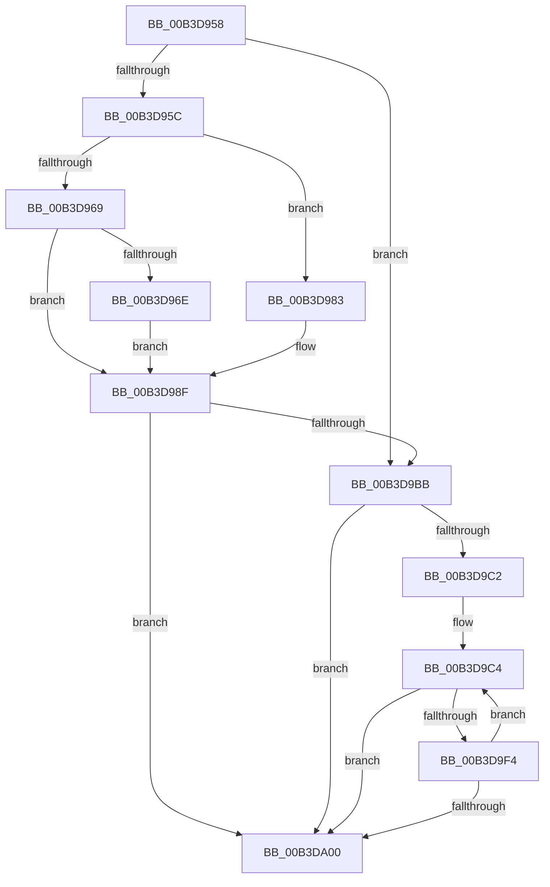

# sub_00B3D958

- RVA: `0x00B3D958`–`0x00B3DA11` (길이 `185` bytes)
- VA: `0x0000000140B3D958`
- 실행 섹션: `PAGE`
- PDB 이름 있음: `아니요`; PDB Function 태그: `아니요`
- unwind 정보 RVA: `0x000B16F0`
- 디코드: `46`개 명령, `185/185` bytes 표시
- 미해석 바이트: `0` (있으면 어셈블리에 `.byte`로 보존)

> 이 문서는 커널 이미지의 기계어와 PDB 기호를 분석해 생성했습니다. 4번과 5번은 함수 원형과 자료형을 바이너리 사용 방식에서 추정한 C 해석이며 원본 소스 복구 결과는 아닙니다.

## 1. Dependencies

- 직접 호출 지점: **3**; 고유 호출 대상: **3**
- 직접 호출자로 확인된 함수: **0**
- RIP 상대 이미지 참조: **0**

### Outgoing calls
- `0x00B3D9B0` → [ZwAllocateVirtualMemory](../../text/6A/ZwAllocateVirtualMemory_function_006AD3D0.md) (function, `0x006AD3D0`)
- `0x00B3D9E9` → [ZwAllocateVirtualMemoryEx](../../text/6A/ZwAllocateVirtualMemoryEx_function_006ADFD0.md) (function, `0x006ADFD0`)
- `0x00B3DA05` → [KiUnstackDetachProcess](../../text/21/KiUnstackDetachProcess_function_00217D30.md) (function, `0x00217D30`)

### Direct callers
- 이 함수 시작 RVA로 연결되는 직접 call은 확인되지 않았습니다. 간접 호출은 완전히 역산할 수 없습니다.

### Static image references
- 디코드된 RIP-relative 메모리 참조가 없습니다.

## 2. Other-region calls and transfers

- 다른 실행 섹션으로 향하는 call: **3**
  - `0x00B3D9B0` → [ZwAllocateVirtualMemory](../../text/6A/ZwAllocateVirtualMemory_function_006AD3D0.md) (`PAGE` → `.text`)
  - `0x00B3D9E9` → [ZwAllocateVirtualMemoryEx](../../text/6A/ZwAllocateVirtualMemoryEx_function_006ADFD0.md) (`PAGE` → `.text`)
  - `0x00B3DA05` → [KiUnstackDetachProcess](../../text/21/KiUnstackDetachProcess_function_00217D30.md) (`PAGE` → `.text`)
- call이 아닌 외부 분기/꼬리 이동: **1**
  - `0x00B3DA0C` → [PspSetupReservedUserMappings + 0x46](../A5/PspSetupReservedUserMappings_function_00A575F0.md) (`tail-transfer`)

## 3. Assembly (complete function range)

```asm
00B3D958  85 FF                           test edi, edi
00B3D95A  74 5F                           je 0x140b3d9bb
00B3D95C  4C 89 BC 24 98 00 00 00         mov qword ptr [rsp + 0x98], r15
00B3D964  83 FF 20                        cmp edi, 0x20
00B3D967  74 1A                           je 0x140b3d983
00B3D969  83 FF 40                        cmp edi, 0x40
00B3D96C  75 21                           jne 0x140b3d98f
00B3D96E  48 C7 84 24 90 00 00 00 00 FF FF 00  mov qword ptr [rsp + 0x90], 0xffff00
00B3D97A  49 8D B6 00 01 00 00            lea rsi, [r14 + 0x100]
00B3D981  EB 0C                           jmp 0x140b3d98f
00B3D983  48 C7 84 24 90 00 00 00 00 FF 0F 00  mov qword ptr [rsp + 0x90], 0xfff00
00B3D98F  44 89 7C 24 28                  mov dword ptr [rsp + 0x28], r15d
00B3D994  4C 8D 8C 24 90 00 00 00         lea r9, [rsp + 0x90]
00B3D99C  45 33 C0                        xor r8d, r8d
00B3D99F  44 89 6C 24 20                  mov dword ptr [rsp + 0x20], r13d
00B3D9A4  48 8D 94 24 98 00 00 00         lea rdx, [rsp + 0x98]
00B3D9AC  48 83 C9 FF                     or rcx, 0xffffffffffffffff
00B3D9B0  E8 1B FA B6 FF                  call 0x1406ad3d0
00B3D9B5  8B E8                           mov ebp, eax
00B3D9B7  85 C0                           test eax, eax
00B3D9B9  78 45                           js 0x140b3da00
00B3D9BB  33 FF                           xor edi, edi
00B3D9BD  48 39 3B                        cmp qword ptr [rbx], rdi
00B3D9C0  76 3E                           jbe 0x140b3da00
00B3D9C2  33 DB                           xor ebx, ebx
00B3D9C4  49 8B 96 18 01 00 00            mov rdx, qword ptr [r14 + 0x118]
00B3D9CB  45 8B CD                        mov r9d, r13d
00B3D9CE  83 64 24 30 00                  and dword ptr [rsp + 0x30], 0
00B3D9D3  48 03 D3                        add rdx, rbx
00B3D9D6  48 83 64 24 28 00               and qword ptr [rsp + 0x28], 0
00B3D9DC  48 83 C9 FF                     or rcx, 0xffffffffffffffff
00B3D9E0  44 89 7C 24 20                  mov dword ptr [rsp + 0x20], r15d
00B3D9E5  4C 8D 42 08                     lea r8, [rdx + 8]
00B3D9E9  E8 E2 05 B7 FF                  call 0x1406adfd0
00B3D9EE  8B E8                           mov ebp, eax
00B3D9F0  85 C0                           test eax, eax
00B3D9F2  78 0C                           js 0x140b3da00
00B3D9F4  48 FF C7                        inc rdi
00B3D9F7  48 83 C3 10                     add rbx, 0x10
00B3D9FB  48 3B 3E                        cmp rdi, qword ptr [rsi]
00B3D9FE  72 C4                           jb 0x140b3d9c4
00B3DA00  33 D2                           xor edx, edx
00B3DA02  49 8B CC                        mov rcx, r12
00B3DA05  E8 26 A3 6D FF                  call 0x140217d30
00B3DA0A  8B C5                           mov eax, ebp
00B3DA0C  E9 25 9C F1 FF                  jmp 0x140a57636
```

## 4. C-style interpretation (structured pseudocode)

```c
__int64 __fastcall sub_00B3D958(__int64 a1, __int64 a2, int a3, __int64 a4, __int64 a5, unsigned int a6, __int64 a7, __int64 a8, __int64 a9, __int64 a10, __int64 a11, __int64 a12, __int64 a13, __int64 a14, __int64 a15, __int64 a16, __int64 a17, __int64 a18, __int64 a19)
{
    __int64 result;
    __int64 v_rbx;
    __int64 v_rdi;
    unsigned int v_stack_p20;
    unsigned int v_stack_p28;
    unsigned __int64 v_stack_p90;
    unsigned __int64 v_stack_p98;

    if ((unsigned int)(v_rdi) == 0) goto loc_00B3D9BB;
    v_stack_p98 = v_r15;
    if (((unsigned int)(v_rdi)) == 32) goto loc_00B3D983;
    if (((unsigned int)(v_rdi)) != 64) goto loc_00B3D98F;
    v_stack_p90 = 0xFFFF00ULL;
    goto loc_00B3D98F;
loc_00B3D983:
    v_stack_p90 = 0xFFF00ULL;
loc_00B3D98F:
    v_stack_p28 = (unsigned int)(v_r15);
    a3 = 0;
    v_stack_p20 = (unsigned int)(v_r13);
    a1 = (a1) | (-1);
    result = ZwAllocateVirtualMemory(a1, a19, a3, a18);
    if (sign_flag) goto loc_00B3DA00;
loc_00B3D9BB:
    v_rdi = 0;
    if ((*(unsigned __int64 *)(v_rbx)) <= 0) goto loc_00B3DA00;
    v_rbx = 0;
loc_00B3D9C4:
    a2 = (*(unsigned __int64 *)(v_r14 + 280)) + (0);
    a1 = (a1) | (-1);
    v_stack_p20 = (unsigned int)(v_r15);
    result = ZwAllocateVirtualMemoryEx(a1, a2, a2 + 8, (unsigned int)((unsigned int)(v_r13)));
    if (sign_flag) goto loc_00B3DA00;
    v_rdi = (v_rdi) + 1;
    v_rbx = (v_rbx) + (16);
    if (v_rdi < (*(unsigned __int64 *)(v_r14 + 256))) goto loc_00B3D9C4;
loc_00B3DA00:
    a2 = 0;
    result = KiUnstackDetachProcess(v_r12, a2, a2 + 8, (unsigned int)((unsigned int)(v_r13)));
}
```

## 5. (Beta) C Style

```c
int64_t sub_00B3D958(int64_t Arg1, int64_t Arg2, int32_t Arg3, int64_t Arg4, int64_t Arg5, uint32_t Arg6, uint64_t Arg7, uint64_t Arg8, uint64_t Arg9, uint64_t Arg10, uint64_t Arg11, uint64_t Arg12, uint64_t Arg13, uint64_t Arg14, uint64_t Arg15, uint64_t Arg16, uint64_t Arg17, int64_t Arg18, int64_t Arg19)
{
    int64_t result;
    int64_t local_rbx;
    int64_t local_rdi;
    uint32_t v_stack_p20;
    uint32_t v_stack_p28;
    uint64_t v_stack_p90;
    uint64_t v_stack_p98;

    if ((uint32_t)(local_rdi) == 0) goto loc_00B3D9BB;
    v_stack_p98 = local_r15;
    if (((uint32_t)(local_rdi)) == 32) goto loc_00B3D983;
    if (((uint32_t)(local_rdi)) != 64) goto loc_00B3D98F;
    v_stack_p90 = 0xFFFF00ULL;
    goto loc_00B3D98F;
loc_00B3D983:
    v_stack_p90 = 0xFFF00ULL;
loc_00B3D98F:
    v_stack_p28 = (uint32_t)(local_r15);
    Arg3 = 0;
    v_stack_p20 = (uint32_t)(local_r13);
    Arg1 = (Arg1) | (-1);
    result = ZwAllocateVirtualMemory(Arg1, Arg19, Arg3, Arg18);
    if (sign_flag) goto loc_00B3DA00;
loc_00B3D9BB:
    local_rdi = 0;
    if ((*(uint64_t *)(local_rbx)) <= 0) goto loc_00B3DA00;
    local_rbx = 0;
loc_00B3D9C4:
    Arg2 = (*(uint64_t *)(local_r14 + 0x118)) + (0);
    Arg1 = (Arg1) | (-1);
    v_stack_p20 = (uint32_t)(local_r15);
    result = ZwAllocateVirtualMemoryEx(Arg1, Arg2, Arg2 + 8, (uint32_t)((uint32_t)(local_r13)));
    if (sign_flag) goto loc_00B3DA00;
    local_rdi = (local_rdi) + 1;
    local_rbx = (local_rbx) + (16);
    if (local_rdi < (*(uint64_t *)(local_r14 + 0x100))) goto loc_00B3D9C4;
loc_00B3DA00:
    Arg2 = 0;
    result = KiUnstackDetachProcess(local_r12, Arg2, Arg2 + 8, (uint32_t)((uint32_t)(local_r13)));
}
```

## 6. Execution-region graph

[열기: 2D/3D 그래프와 함수 탐색 컨트롤 패널](../../../control-panel.html?section=page&rva=0x00B3D958&view=graph)

- 2D 그래프는 위에서 아래로 흐르고, 3D 그래프는 빈 공간을 드래그해 회전합니다. Shift+드래그는 이동, 휠은 확대·축소, 함수 노드 선택은 대상 보고서 이동입니다.

### Static fallback


