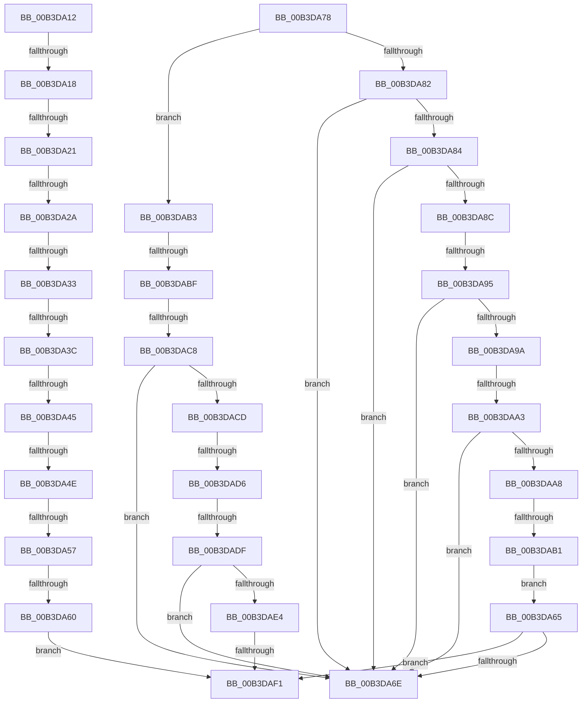

# sub_00B3DA12

- RVA: `0x00B3DA12`–`0x00B3DAFB` (길이 `233` bytes)
- VA: `0x0000000140B3DA12`
- 실행 섹션: `PAGE`
- PDB 이름 있음: `아니요`; PDB Function 태그: `아니요`
- unwind 정보 RVA: `0x000B1724`
- 디코드: `56`개 명령, `233/233` bytes 표시
- 미해석 바이트: `0` (있으면 어셈블리에 `.byte`로 보존)

> 이 문서는 커널 이미지의 기계어와 PDB 기호를 분석해 생성했습니다. 4번과 5번은 함수 원형과 자료형을 바이너리 사용 방식에서 추정한 C 해석이며 원본 소스 복구 결과는 아닙니다.

## 1. Dependencies

- 직접 호출 지점: **0**; 고유 호출 대상: **0**
- 직접 호출자로 확인된 함수: **0**
- RIP 상대 이미지 참조: **0**

### Outgoing calls
- 직접 디코드된 call 명령이 없습니다.

### Direct callers
- 이 함수 시작 RVA로 연결되는 직접 call은 확인되지 않았습니다. 간접 호출은 완전히 역산할 수 없습니다.

### Static image references
- 디코드된 RIP-relative 메모리 참조가 없습니다.

## 2. Other-region calls and transfers

- 다른 실행 섹션으로 향하는 call: **0**
- call이 아닌 외부 분기/꼬리 이동: **19**
  - `0x00B3DA12` → [NtQuerySystemInformationEx + 0xD6](../A5/NtQuerySystemInformationEx_function_00A57690.md) (`tail-transfer`)
  - `0x00B3DA1B` → [NtQuerySystemInformationEx + 0x51](../A5/NtQuerySystemInformationEx_function_00A57690.md) (`tail-transfer`)
  - `0x00B3DA24` → [NtQuerySystemInformationEx + 0x51](../A5/NtQuerySystemInformationEx_function_00A57690.md) (`tail-transfer`)
  - `0x00B3DA2D` → [NtQuerySystemInformationEx + 0x51](../A5/NtQuerySystemInformationEx_function_00A57690.md) (`tail-transfer`)
  - `0x00B3DA36` → [NtQuerySystemInformationEx + 0x51](../A5/NtQuerySystemInformationEx_function_00A57690.md) (`tail-transfer`)
  - `0x00B3DA3F` → [NtQuerySystemInformationEx + 0xD6](../A5/NtQuerySystemInformationEx_function_00A57690.md) (`tail-transfer`)
  - `0x00B3DA48` → [NtQuerySystemInformationEx + 0x51](../A5/NtQuerySystemInformationEx_function_00A57690.md) (`tail-transfer`)
  - `0x00B3DA51` → [NtQuerySystemInformationEx + 0x51](../A5/NtQuerySystemInformationEx_function_00A57690.md) (`tail-transfer`)
  - `0x00B3DA5A` → [NtQuerySystemInformationEx + 0x51](../A5/NtQuerySystemInformationEx_function_00A57690.md) (`tail-transfer`)
  - `0x00B3DA73` → [NtQuerySystemInformationEx + 0x56](../A5/NtQuerySystemInformationEx_function_00A57690.md) (`tail-transfer`)
  - `0x00B3DA8F` → [NtQuerySystemInformationEx + 0xD6](../A5/NtQuerySystemInformationEx_function_00A57690.md) (`tail-transfer`)
  - `0x00B3DA9D` → [NtQuerySystemInformationEx + 0xD6](../A5/NtQuerySystemInformationEx_function_00A57690.md) (`tail-transfer`)
  - `0x00B3DAAB` → [NtQuerySystemInformationEx + 0xD6](../A5/NtQuerySystemInformationEx_function_00A57690.md) (`tail-transfer`)
  - `0x00B3DAB9` → [NtQuerySystemInformationEx + 0xD6](../A5/NtQuerySystemInformationEx_function_00A57690.md) (`tail-transfer`)
  - `0x00B3DAC2` → [NtQuerySystemInformationEx + 0xD6](../A5/NtQuerySystemInformationEx_function_00A57690.md) (`tail-transfer`)
  - `0x00B3DAD0` → [NtQuerySystemInformationEx + 0xD6](../A5/NtQuerySystemInformationEx_function_00A57690.md) (`tail-transfer`)
  - `0x00B3DAD9` → [NtQuerySystemInformationEx + 0xD6](../A5/NtQuerySystemInformationEx_function_00A57690.md) (`tail-transfer`)
  - `0x00B3DAEB` → [NtQuerySystemInformationEx + 0xD6](../A5/NtQuerySystemInformationEx_function_00A57690.md) (`tail-transfer`)
  - `0x00B3DAF6` → [NtQuerySystemInformationEx + 0x14](../A5/NtQuerySystemInformationEx_function_00A57690.md) (`tail-transfer`)

## 3. Assembly (complete function range)

```asm
00B3DA12  0F 84 4E 9D F1 FF               je 0x140a57766
00B3DA18  83 E9 08                        sub ecx, 8
00B3DA1B  0F 84 C0 9C F1 FF               je 0x140a576e1
00B3DA21  83 E9 0F                        sub ecx, 0xf
00B3DA24  0F 84 B7 9C F1 FF               je 0x140a576e1
00B3DA2A  83 E9 13                        sub ecx, 0x13
00B3DA2D  0F 84 AE 9C F1 FF               je 0x140a576e1
00B3DA33  83 E9 13                        sub ecx, 0x13
00B3DA36  0F 84 A5 9C F1 FF               je 0x140a576e1
00B3DA3C  83 E9 0B                        sub ecx, 0xb
00B3DA3F  0F 84 21 9D F1 FF               je 0x140a57766
00B3DA45  83 E9 01                        sub ecx, 1
00B3DA48  0F 84 93 9C F1 FF               je 0x140a576e1
00B3DA4E  83 E9 0A                        sub ecx, 0xa
00B3DA51  0F 84 8A 9C F1 FF               je 0x140a576e1
00B3DA57  83 F9 11                        cmp ecx, 0x11
00B3DA5A  0F 84 81 9C F1 FF               je 0x140a576e1
00B3DA60  E9 8C 00 00 00                  jmp 0x140b3daf1
00B3DA65  83 F9 01                        cmp ecx, 1
00B3DA68  0F 85 83 00 00 00               jne 0x140b3daf1
00B3DA6E  BA 08 00 00 00                  mov edx, 8
00B3DA73  E9 6E 9C F1 FF                  jmp 0x140a576e6
00B3DA78  B8 E6 00 00 00                  mov eax, 0xe6
00B3DA7D  44 3B D0                        cmp r10d, eax
00B3DA80  7F 31                           jg 0x140b3dab3
00B3DA82  74 EA                           je 0x140b3da6e
00B3DA84  81 E9 B5 00 00 00               sub ecx, 0xb5
00B3DA8A  74 E2                           je 0x140b3da6e
00B3DA8C  83 E9 0D                        sub ecx, 0xd
00B3DA8F  0F 84 D1 9C F1 FF               je 0x140a57766
00B3DA95  83 E9 0F                        sub ecx, 0xf
00B3DA98  74 D4                           je 0x140b3da6e
00B3DA9A  83 E9 01                        sub ecx, 1
00B3DA9D  0F 84 C3 9C F1 FF               je 0x140a57766
00B3DAA3  83 E9 01                        sub ecx, 1
00B3DAA6  74 C6                           je 0x140b3da6e
00B3DAA8  83 E9 0B                        sub ecx, 0xb
00B3DAAB  0F 84 B5 9C F1 FF               je 0x140a57766
00B3DAB1  EB B2                           jmp 0x140b3da65
00B3DAB3  81 E9 E7 00 00 00               sub ecx, 0xe7
00B3DAB9  0F 84 A7 9C F1 FF               je 0x140a57766
00B3DABF  83 E9 01                        sub ecx, 1
00B3DAC2  0F 84 9E 9C F1 FF               je 0x140a57766
00B3DAC8  83 E9 06                        sub ecx, 6
00B3DACB  74 A1                           je 0x140b3da6e
00B3DACD  83 E9 01                        sub ecx, 1
00B3DAD0  0F 84 90 9C F1 FF               je 0x140a57766
00B3DAD6  83 E9 01                        sub ecx, 1
00B3DAD9  0F 84 87 9C F1 FF               je 0x140a57766
00B3DADF  83 E9 0E                        sub ecx, 0xe
00B3DAE2  74 8A                           je 0x140b3da6e
00B3DAE4  BA 02 00 00 00                  mov edx, 2
00B3DAE9  3B CA                           cmp ecx, edx
00B3DAEB  0F 84 75 9C F1 FF               je 0x140a57766
00B3DAF1  B8 03 00 00 C0                  mov eax, 0xc0000003
00B3DAF6  E9 A9 9B F1 FF                  jmp 0x140a576a4
```

## 4. C-style interpretation (structured pseudocode)

```c
__int64 __fastcall sub_00B3DA12(int a1)
{
    a1 = (unsigned int)((a1) - (8));
    a1 = (unsigned int)((a1) - (15));
    a1 = (unsigned int)((a1) - (19));
    a1 = (unsigned int)((a1) - (19));
    a1 = (unsigned int)((a1) - (11));
    a1 = (unsigned int)((a1) - (1));
    a1 = (unsigned int)((a1) - (10));
    goto loc_00B3DAF1;
loc_00B3DAF1:
}
```

## 5. (Beta) C Style

```c
int64_t sub_00B3DA12(int32_t Arg1)
{
    Arg1 = (uint32_t)((Arg1) - (8));
    Arg1 = (uint32_t)((Arg1) - (15));
    Arg1 = (uint32_t)((Arg1) - (19));
    Arg1 = (uint32_t)((Arg1) - (19));
    Arg1 = (uint32_t)((Arg1) - (11));
    Arg1 = (uint32_t)((Arg1) - (1));
    Arg1 = (uint32_t)((Arg1) - (10));
    goto loc_00B3DAF1;
loc_00B3DAF1:
}
```

## 6. Execution-region graph

[열기: 2D/3D 그래프와 함수 탐색 컨트롤 패널](../../../control-panel.html?section=page&rva=0x00B3DA12&view=graph)

- 2D 그래프는 위에서 아래로 흐르고, 3D 그래프는 빈 공간을 드래그해 회전합니다. Shift+드래그는 이동, 휠은 확대·축소, 함수 노드 선택은 대상 보고서 이동입니다.

### Static fallback


