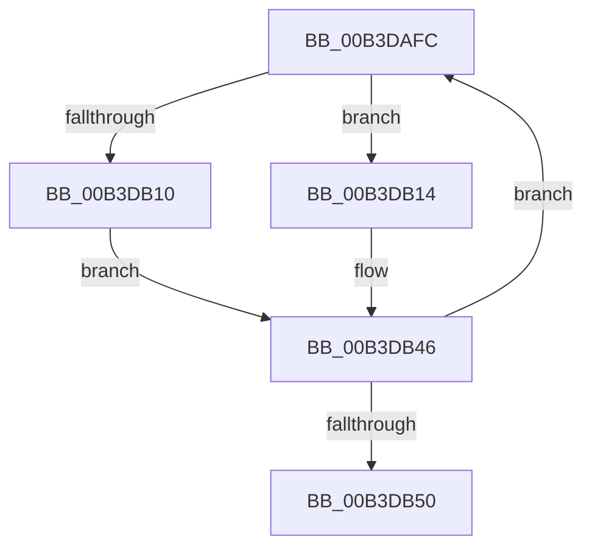

# sub_00B3DAFC

- RVA: `0x00B3DAFC`–`0x00B3DB55` (길이 `89` bytes)
- VA: `0x0000000140B3DAFC`
- 실행 섹션: `PAGE`
- PDB 이름 있음: `아니요`; PDB Function 태그: `아니요`
- unwind 정보 RVA: `0x000B2678`
- 디코드: `25`개 명령, `89/89` bytes 표시
- 미해석 바이트: `0` (있으면 어셈블리에 `.byte`로 보존)

> 이 문서는 커널 이미지의 기계어와 PDB 기호를 분석해 생성했습니다. 4번과 5번은 함수 원형과 자료형을 바이너리 사용 방식에서 추정한 C 해석이며 원본 소스 복구 결과는 아닙니다.

## 1. Dependencies

- 직접 호출 지점: **2**; 고유 호출 대상: **2**
- 직접 호출자로 확인된 함수: **0**
- RIP 상대 이미지 참조: **0**

### Outgoing calls
- `0x00B3DB07` → [WdipSemGetGuidKey](../7B/WdipSemGetGuidKey_function_007B16C8.md) (function, `0x007B16C8`)
- `0x00B3DB3A` → [WdipSemSqmAddToStream](../7B/WdipSemSqmAddToStream_function_007B1C94.md) (function, `0x007B1C94`)

### Direct callers
- 이 함수 시작 RVA로 연결되는 직접 call은 확인되지 않았습니다. 간접 호출은 완전히 역산할 수 없습니다.

### Static image references
- 디코드된 RIP-relative 메모리 참조가 없습니다.

## 2. Other-region calls and transfers

- 다른 실행 섹션으로 향하는 call: **0**
- call이 아닌 외부 분기/꼬리 이동: **1**
  - `0x00B3DB50` → [WdipSemSqmLogInflightLimitExceededDataPoints + 0x81](../A5/WdipSemSqmLogInflightLimitExceededDataPoints_function_00A5BA80.md) (`tail-transfer`)

## 3. Assembly (complete function range)

```asm
00B3DAFC  48 8B 1E                        mov rbx, qword ptr [rsi]
00B3DAFF  48 8D 54 24 20                  lea rdx, [rsp + 0x20]
00B3DB04  48 8B CB                        mov rcx, rbx
00B3DB07  E8 BC 3B C7 FF                  call 0x1407b16c8
00B3DB0C  85 C0                           test eax, eax
00B3DB0E  79 04                           jns 0x140b3db14
00B3DB10  8B DD                           mov ebx, ebp
00B3DB12  EB 32                           jmp 0x140b3db46
00B3DB14  8B 44 24 20                     mov eax, dword ptr [rsp + 0x20]
00B3DB18  4C 8D 44 24 28                  lea r8, [rsp + 0x28]
00B3DB1D  89 44 24 28                     mov dword ptr [rsp + 0x28], eax
00B3DB21  BA 03 00 00 00                  mov edx, 3
00B3DB26  0F B7 43 10                     movzx eax, word ptr [rbx + 0x10]
00B3DB2A  B9 26 04 00 00                  mov ecx, 0x426
00B3DB2F  89 44 24 2C                     mov dword ptr [rsp + 0x2c], eax
00B3DB33  8B 43 14                        mov eax, dword ptr [rbx + 0x14]
00B3DB36  89 44 24 30                     mov dword ptr [rsp + 0x30], eax
00B3DB3A  E8 55 41 C7 FF                  call 0x1407b1c94
00B3DB3F  85 C0                           test eax, eax
00B3DB41  8B D8                           mov ebx, eax
00B3DB43  0F 48 DD                        cmovs ebx, ebp
00B3DB46  48 83 C6 08                     add rsi, 8
00B3DB4A  48 83 EF 01                     sub rdi, 1
00B3DB4E  75 AC                           jne 0x140b3dafc
00B3DB50  E9 AC DF F1 FF                  jmp 0x140a5bb01
```

## 4. C-style interpretation (structured pseudocode)

```c
__int64 __fastcall sub_00B3DAFC(__int64 a1, __int64 a2, __int64 a3, __int64 a4, __int64 a5)
{
    __int64 result;
    __int64 v_rbx;
    __int64 v_rdi;
    __int64 v_rsi;
    unsigned __int64 v_stack_p20;
    unsigned int v_stack_p28;
    unsigned int v_stack_p2C;
    unsigned int v_stack_p30;

    result = WdipSemGetGuidKey(*(unsigned __int64 *)(v_rsi), v_stack_p20, a3, a4);
    if (!sign_flag) goto loc_00B3DB14;
    goto loc_00B3DB46;
loc_00B3DB14:
    v_stack_p28 = (unsigned int)((unsigned int)(v_stack_p20));
    v_stack_p2C = (unsigned int)(*(unsigned __int16 *)((unsigned int)((unsigned int)(v_rbp)) + 16));
    v_stack_p30 = (unsigned int)((unsigned int)(*(unsigned int *)((unsigned int)((unsigned int)(v_rbp)) + 20)));
    result = WdipSemSqmAddToStream((unsigned int)(0x426ULL), 3, a5, a4);
    v_rbx = (unsigned int)((unsigned int)(result));
    if (sign_flag) { v_rbx = (unsigned int)(v_rbp); }
loc_00B3DB46:
    v_rsi = (v_rsi) + (8);
    v_rdi = (v_rdi) - (1);
    if (condition_is_not_equal) goto loc_00B3DAFC;
}
```

## 5. (Beta) C Style

```c
int64_t sub_00B3DAFC(int64_t Arg1, int64_t Arg2, int64_t Arg3, int64_t Arg4, int64_t Arg5)
{
    int64_t result;
    int64_t local_rbx;
    int64_t local_rdi;
    int64_t local_rsi;
    uint64_t v_stack_p20;
    uint32_t v_stack_p28;
    uint32_t v_stack_p2C;
    uint32_t v_stack_p30;

    result = WdipSemGetGuidKey(*(uint64_t *)(local_rsi), v_stack_p20, Arg3, Arg4);
    if (!sign_flag) goto loc_00B3DB14;
    goto loc_00B3DB46;
loc_00B3DB14:
    v_stack_p28 = (uint32_t)((uint32_t)(v_stack_p20));
    v_stack_p2C = (uint32_t)(*(uint16_t *)((uint32_t)((uint32_t)(local_rbp)) + 0x10));
    v_stack_p30 = (uint32_t)((uint32_t)(*(uint32_t *)((uint32_t)((uint32_t)(local_rbp)) + 0x14)));
    result = WdipSemSqmAddToStream((uint32_t)(0x426ULL), 3, Arg5, Arg4);
    local_rbx = (uint32_t)((uint32_t)(result));
    if (sign_flag) { local_rbx = (uint32_t)(local_rbp); }
loc_00B3DB46:
    local_rsi = (local_rsi) + (8);
    local_rdi = (local_rdi) - (1);
    if (condition_is_not_equal) goto loc_00B3DAFC;
}
```

## 6. Execution-region graph

[열기: 2D/3D 그래프와 함수 탐색 컨트롤 패널](../../../control-panel.html?section=page&rva=0x00B3DAFC&view=graph)

- 2D 그래프는 위에서 아래로 흐르고, 3D 그래프는 빈 공간을 드래그해 회전합니다. Shift+드래그는 이동, 휠은 확대·축소, 함수 노드 선택은 대상 보고서 이동입니다.

### Static fallback


