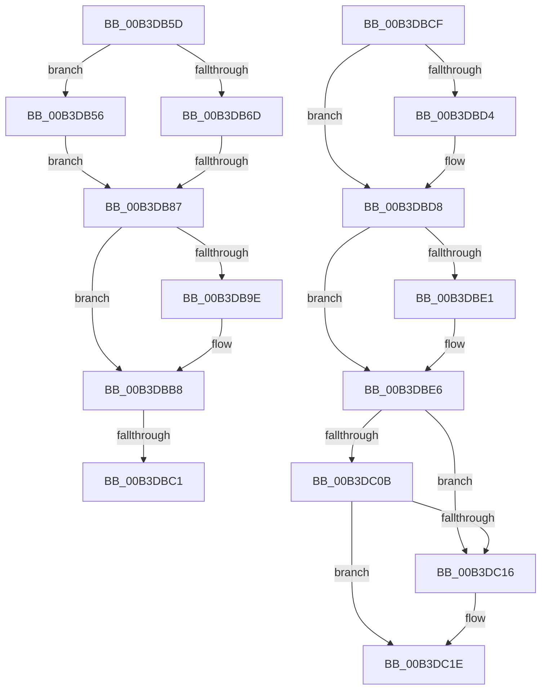

# sub_00B3DB56

- RVA: `0x00B3DB56`–`0x00B3DC31` (길이 `219` bytes)
- VA: `0x0000000140B3DB56`
- 실행 섹션: `PAGE`
- PDB 이름 있음: `아니요`; PDB Function 태그: `아니요`
- unwind 정보 RVA: `0x000B26A8`
- 디코드: `55`개 명령, `219/219` bytes 표시
- 미해석 바이트: `0` (있으면 어셈블리에 `.byte`로 보존)

> 이 문서는 커널 이미지의 기계어와 PDB 기호를 분석해 생성했습니다. 4번과 5번은 함수 원형과 자료형을 바이너리 사용 방식에서 추정한 C 해석이며 원본 소스 복구 결과는 아닙니다.

## 1. Dependencies

- 직접 호출 지점: **9**; 고유 호출 대상: **9**
- 직접 호출자로 확인된 함수: **0**
- RIP 상대 이미지 참조: **4**

### Outgoing calls
- `0x00B3DB60` → [WdipSemMarkInstanceForDeletion](../7B/WdipSemMarkInstanceForDeletion_function_007B0C84.md) (function, `0x007B0C84`)
- `0x00B3DB78` → [WdipSemValidateEndEvent](../AD/WdipSemValidateEndEvent_function_00AD74DC.md) (function, `0x00AD74DC`)
- `0x00B3DB95` → [EtwEventEnabled](../../text/39/EtwEventEnabled_function_00392450.md) (function, `0x00392450`)
- `0x00B3DBB3` → [WdipSemWriteSemFailureEvent](../7B/WdipSemWriteSemFailureEvent_function_007B1634.md) (function, `0x007B1634`)
- `0x00B3DBC4` → [WdipSemActivateInstance](../A5/WdipSemActivateInstance_function_00A5CAA0.md) (function, `0x00A5CAA0`)
- `0x00B3DBE1` → [WdipSemShutdown](../7B/WdipSemShutdown_function_007B0954.md) (function, `0x007B0954`)
- `0x00B3DC19` → [ExfReleasePushLock](../../text/26/ExfReleasePushLock_function_002638D0.md) (function, `0x002638D0`)
- `0x00B3DC21` → [KeAbPostRelease](../../text/2E/KeAbPostRelease_function_002E1600.md) (function, `0x002E1600`)
- `0x00B3DC26` → [KeLeaveCriticalRegion](../../text/25/KeLeaveCriticalRegion_function_0025D8B0.md) (function, `0x0025D8B0`)

### Direct callers
- 이 함수 시작 RVA로 연결되는 직접 call은 확인되지 않았습니다. 간접 호출은 완전히 역산할 수 없습니다.

### Static image references
- `0x00B3DB87` → RVA `0x00F01DD0` (`.data`; read)
- `0x00B3DB8E` → RVA `0x00021D58` (`.rdata`; read)
- `0x00B3DBD8` → RVA `0x00F01E18` (`.data`; read)
- `0x00B3DBE6` → RVA `0x00F01E08` (`.data`; read)

## 2. Other-region calls and transfers

- 다른 실행 섹션으로 향하는 call: **4**
  - `0x00B3DB95` → [EtwEventEnabled](../../text/39/EtwEventEnabled_function_00392450.md) (`PAGE` → `.text`)
  - `0x00B3DC19` → [ExfReleasePushLock](../../text/26/ExfReleasePushLock_function_002638D0.md) (`PAGE` → `.text`)
  - `0x00B3DC21` → [KeAbPostRelease](../../text/2E/KeAbPostRelease_function_002E1600.md) (`PAGE` → `.text`)
  - `0x00B3DC26` → [KeLeaveCriticalRegion](../../text/25/KeLeaveCriticalRegion_function_0025D8B0.md) (`PAGE` → `.text`)
- call이 아닌 외부 분기/꼬리 이동: **4**
  - `0x00B3DB81` → [WdipSemDisableScenario + 0xB8](../A5/WdipSemDisableScenario_function_00A5BC00.md) (`tail-transfer`)
  - `0x00B3DBBB` → [WdipSemDisableScenario + 0xE1](../A5/WdipSemDisableScenario_function_00A5BC00.md) (`tail-transfer`)
  - `0x00B3DBCA` → [WdipSemDisableScenario + 0xE1](../A5/WdipSemDisableScenario_function_00A5BC00.md) (`tail-transfer`)
  - `0x00B3DC2C` → [WdipSemDisableScenario + 0x123](../A5/WdipSemDisableScenario_function_00A5BC00.md) (`tail-transfer`)

## 3. Assembly (complete function range)

```asm
00B3DB56  BB 01 00 00 C0                  mov ebx, 0xc0000001
00B3DB5B  EB 2A                           jmp 0x140b3db87
00B3DB5D  48 8B CD                        mov rcx, rbp
00B3DB60  E8 1F 31 C7 FF                  call 0x1407b0c84
00B3DB65  48 8B F8                        mov rdi, rax
00B3DB68  48 85 C0                        test rax, rax
00B3DB6B  74 E9                           je 0x140b3db56
00B3DB6D  4C 8B 40 20                     mov r8, qword ptr [rax + 0x20]
00B3DB71  41 0F B7 D7                     movzx edx, r15w
00B3DB75  49 8B CE                        mov rcx, r14
00B3DB78  E8 5F 99 F9 FF                  call 0x140ad74dc
00B3DB7D  8B D8                           mov ebx, eax
00B3DB7F  85 C0                           test eax, eax
00B3DB81  0F 89 31 E1 F1 FF               jns 0x140a5bcb8
00B3DB87  48 8B 0D 42 42 3C 00            mov rcx, qword ptr [rip + 0x3c4242]
00B3DB8E  48 8D 15 C3 41 4E FF            lea rdx, [rip - 0xb1be3d]
00B3DB95  E8 B6 48 85 FF                  call 0x140392450
00B3DB9A  84 C0                           test al, al
00B3DB9C  74 1A                           je 0x140b3dbb8
00B3DB9E  4C 8B CD                        mov r9, rbp
00B3DBA1  89 5C 24 20                     mov dword ptr [rsp + 0x20], ebx
00B3DBA5  45 0F B7 C7                     movzx r8d, r15w
00B3DBA9  48 8D 0D A8 41 4E FF            lea rcx, [rip - 0xb1be58]
00B3DBB0  49 8B D6                        mov rdx, r14
00B3DBB3  E8 7C 3A C7 FF                  call 0x1407b1634
00B3DBB8  48 85 FF                        test rdi, rdi
00B3DBBB  0F 84 20 E1 F1 FF               je 0x140a5bce1
00B3DBC1  48 8B CF                        mov rcx, rdi
00B3DBC4  E8 D7 EE F1 FF                  call 0x140a5caa0
00B3DBC9  90                              nop
00B3DBCA  E9 12 E1 F1 FF                  jmp 0x140a5bce1
00B3DBCF  48 85 FF                        test rdi, rdi
00B3DBD2  74 04                           je 0x140b3dbd8
00B3DBD4  C6 47 0A 01                     mov byte ptr [rdi + 0xa], 1
00B3DBD8  44 38 25 39 42 3C 00            cmp byte ptr [rip + 0x3c4239], r12b
00B3DBDF  74 05                           je 0x140b3dbe6
00B3DBE1  E8 6E 2D C7 FF                  call 0x1407b0954
00B3DBE6  0F 0D 0D 1B 42 3C 00            prefetchw byte ptr [rip + 0x3c421b]
00B3DBED  48 8B 05 14 42 3C 00            mov rax, qword ptr [rip + 0x3c4214]
00B3DBF4  48 8B C8                        mov rcx, rax
00B3DBF7  48 83 E1 F0                     and rcx, 0xfffffffffffffff0
00B3DBFB  48 83 F9 10                     cmp rcx, 0x10
00B3DBFF  48 8D 50 F0                     lea rdx, [rax - 0x10]
00B3DC03  49 0F 46 D4                     cmovbe rdx, r12
00B3DC07  A8 02                           test al, 2
00B3DC09  75 0B                           jne 0x140b3dc16
00B3DC0B  F0 48 0F B1 15 F4 41 3C 00      lock cmpxchg qword ptr [rip + 0x3c41f4], rdx
00B3DC14  74 08                           je 0x140b3dc1e
00B3DC16  49 8B CD                        mov rcx, r13
00B3DC19  E8 B2 5C 72 FF                  call 0x1402638d0
00B3DC1E  49 8B CD                        mov rcx, r13
00B3DC21  E8 DA 39 7A FF                  call 0x1402e1600
00B3DC26  E8 85 FC 71 FF                  call 0x14025d8b0
00B3DC2B  90                              nop
00B3DC2C  E9 F2 E0 F1 FF                  jmp 0x140a5bd23
```

## 4. C-style interpretation (structured pseudocode)

```c
__int64 __fastcall sub_00B3DB56(void)
{
    __int64 result;
    unsigned int v_stack_p20;

    goto loc_00B3DB87;
loc_00B3DB87:
    result = EtwEventEnabled(*(unsigned __int64 *)(v_rip + 3949122), v_rip - 11648573, a3, a4);
    if ((unsigned __int8)(result) != 0) {
        a4 = v_rbp;
        v_stack_p20 = (unsigned int)((unsigned int)(0xC0000001ULL));
        a3 = (unsigned __int16)(v_r15);
        a1 = v_rip - 11648600;
        a2 = v_r14;
        result = WdipSemWriteSemFailureEvent(a1, a2, a3, a4);
    }
    result = WdipSemActivateInstance(v_rdi, a2, a3, a4);
}
```

## 5. (Beta) C Style

```c
void sub_00B3DB56(void)
{
    int64_t result;
    uint32_t v_stack_p20;

    goto loc_00B3DB87;
loc_00B3DB87:
    result = EtwEventEnabled(*(uint64_t *)(v_rip + 0x3C4242), v_rip - 11648573, a3, a4);
    if ((uint8_t)(result) != 0) {
        a4 = local_rbp;
        v_stack_p20 = (uint32_t)((uint32_t)(0xC0000001ULL));
        a3 = (uint16_t)(local_r15);
        a1 = v_rip - 11648600;
        a2 = local_r14;
        result = WdipSemWriteSemFailureEvent(a1, a2, a3, a4);
    }
    result = WdipSemActivateInstance(local_rdi, a2, a3, a4);
}
```

## 6. Execution-region graph

[열기: 2D/3D 그래프와 함수 탐색 컨트롤 패널](../../../control-panel.html?section=page&rva=0x00B3DB56&view=graph)

- 2D 그래프는 위에서 아래로 흐르고, 3D 그래프는 빈 공간을 드래그해 회전합니다. Shift+드래그는 이동, 휠은 확대·축소, 함수 노드 선택은 대상 보고서 이동입니다.

### Static fallback


