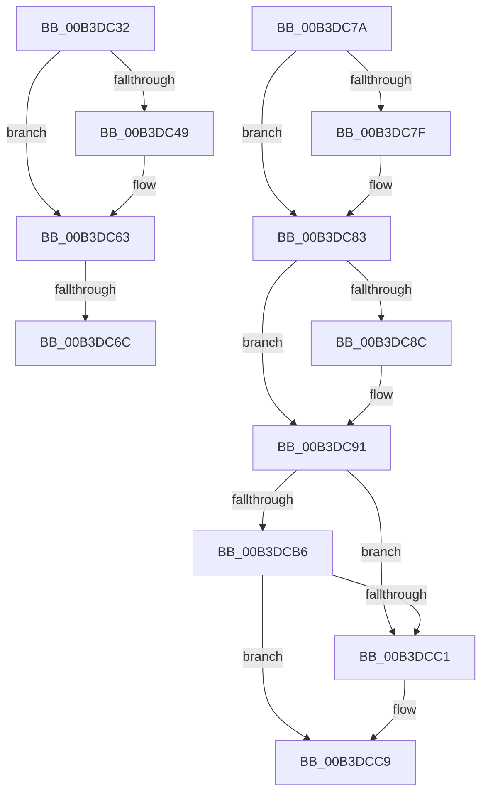

# sub_00B3DC32

- RVA: `0x00B3DC32`–`0x00B3DCDC` (길이 `170` bytes)
- VA: `0x0000000140B3DC32`
- 실행 섹션: `PAGE`
- PDB 이름 있음: `아니요`; PDB Function 태그: `아니요`
- unwind 정보 RVA: `0x000B2764`
- 디코드: `41`개 명령, `170/170` bytes 표시
- 미해석 바이트: `0` (있으면 어셈블리에 `.byte`로 보존)

> 이 문서는 커널 이미지의 기계어와 PDB 기호를 분석해 생성했습니다. 4번과 5번은 함수 원형과 자료형을 바이너리 사용 방식에서 추정한 C 해석이며 원본 소스 복구 결과는 아닙니다.

## 1. Dependencies

- 직접 호출 지점: **7**; 고유 호출 대상: **7**
- 직접 호출자로 확인된 함수: **0**
- RIP 상대 이미지 참조: **4**

### Outgoing calls
- `0x00B3DC40` → [EtwEventEnabled](../../text/39/EtwEventEnabled_function_00392450.md) (function, `0x00392450`)
- `0x00B3DC5E` → [WdipSemWriteSemFailureEvent](../7B/WdipSemWriteSemFailureEvent_function_007B1634.md) (function, `0x007B1634`)
- `0x00B3DC6F` → [WdipSemDeleteTransitionalInstance](../A5/WdipSemDeleteTransitionalInstance_function_00A5BE28.md) (function, `0x00A5BE28`)
- `0x00B3DC8C` → [WdipSemShutdown](../7B/WdipSemShutdown_function_007B0954.md) (function, `0x007B0954`)
- `0x00B3DCC4` → [ExfReleasePushLock](../../text/26/ExfReleasePushLock_function_002638D0.md) (function, `0x002638D0`)
- `0x00B3DCCC` → [KeAbPostRelease](../../text/2E/KeAbPostRelease_function_002E1600.md) (function, `0x002E1600`)
- `0x00B3DCD1` → [KeLeaveCriticalRegion](../../text/25/KeLeaveCriticalRegion_function_0025D8B0.md) (function, `0x0025D8B0`)

### Direct callers
- 이 함수 시작 RVA로 연결되는 직접 call은 확인되지 않았습니다. 간접 호출은 완전히 역산할 수 없습니다.

### Static image references
- `0x00B3DC32` → RVA `0x00F01DD0` (`.data`; read)
- `0x00B3DC39` → RVA `0x00022D40` (`.rdata`; read)
- `0x00B3DC83` → RVA `0x00F01E18` (`.data`; read)
- `0x00B3DC91` → RVA `0x00F01E08` (`.data`; read)

## 2. Other-region calls and transfers

- 다른 실행 섹션으로 향하는 call: **4**
  - `0x00B3DC40` → [EtwEventEnabled](../../text/39/EtwEventEnabled_function_00392450.md) (`PAGE` → `.text`)
  - `0x00B3DCC4` → [ExfReleasePushLock](../../text/26/ExfReleasePushLock_function_002638D0.md) (`PAGE` → `.text`)
  - `0x00B3DCCC` → [KeAbPostRelease](../../text/2E/KeAbPostRelease_function_002E1600.md) (`PAGE` → `.text`)
  - `0x00B3DCD1` → [KeLeaveCriticalRegion](../../text/25/KeLeaveCriticalRegion_function_0025D8B0.md) (`PAGE` → `.text`)
- call이 아닌 외부 분기/꼬리 이동: **3**
  - `0x00B3DC66` → [WdipSemEnableScenario + 0x107](../A5/WdipSemEnableScenario_function_00A5C424.md) (`tail-transfer`)
  - `0x00B3DC75` → [WdipSemEnableScenario + 0x107](../A5/WdipSemEnableScenario_function_00A5C424.md) (`tail-transfer`)
  - `0x00B3DCD7` → [WdipSemEnableScenario + 0x149](../A5/WdipSemEnableScenario_function_00A5C424.md) (`tail-transfer`)

## 3. Assembly (complete function range)

```asm
00B3DC32  48 8B 0D 97 41 3C 00            mov rcx, qword ptr [rip + 0x3c4197]
00B3DC39  48 8D 15 00 51 4E FF            lea rdx, [rip - 0xb1af00]
00B3DC40  E8 0B 48 85 FF                  call 0x140392450
00B3DC45  84 C0                           test al, al
00B3DC47  74 1A                           je 0x140b3dc63
00B3DC49  4D 8B CE                        mov r9, r14
00B3DC4C  89 5C 24 20                     mov dword ptr [rsp + 0x20], ebx
00B3DC50  45 0F B7 C7                     movzx r8d, r15w
00B3DC54  48 8D 0D E5 50 4E FF            lea rcx, [rip - 0xb1af1b]
00B3DC5B  48 8B D5                        mov rdx, rbp
00B3DC5E  E8 D1 39 C7 FF                  call 0x1407b1634
00B3DC63  48 85 FF                        test rdi, rdi
00B3DC66  0F 84 BF E8 F1 FF               je 0x140a5c52b
00B3DC6C  48 8B CF                        mov rcx, rdi
00B3DC6F  E8 B4 E1 F1 FF                  call 0x140a5be28
00B3DC74  90                              nop
00B3DC75  E9 B1 E8 F1 FF                  jmp 0x140a5c52b
00B3DC7A  48 85 FF                        test rdi, rdi
00B3DC7D  74 04                           je 0x140b3dc83
00B3DC7F  C6 47 0A 01                     mov byte ptr [rdi + 0xa], 1
00B3DC83  44 38 25 8E 41 3C 00            cmp byte ptr [rip + 0x3c418e], r12b
00B3DC8A  74 05                           je 0x140b3dc91
00B3DC8C  E8 C3 2C C7 FF                  call 0x1407b0954
00B3DC91  0F 0D 0D 70 41 3C 00            prefetchw byte ptr [rip + 0x3c4170]
00B3DC98  48 8B 05 69 41 3C 00            mov rax, qword ptr [rip + 0x3c4169]
00B3DC9F  48 8B C8                        mov rcx, rax
00B3DCA2  48 83 E1 F0                     and rcx, 0xfffffffffffffff0
00B3DCA6  48 83 F9 10                     cmp rcx, 0x10
00B3DCAA  48 8D 50 F0                     lea rdx, [rax - 0x10]
00B3DCAE  49 0F 46 D4                     cmovbe rdx, r12
00B3DCB2  A8 02                           test al, 2
00B3DCB4  75 0B                           jne 0x140b3dcc1
00B3DCB6  F0 48 0F B1 15 49 41 3C 00      lock cmpxchg qword ptr [rip + 0x3c4149], rdx
00B3DCBF  74 08                           je 0x140b3dcc9
00B3DCC1  49 8B CD                        mov rcx, r13
00B3DCC4  E8 07 5C 72 FF                  call 0x1402638d0
00B3DCC9  49 8B CD                        mov rcx, r13
00B3DCCC  E8 2F 39 7A FF                  call 0x1402e1600
00B3DCD1  E8 DA FB 71 FF                  call 0x14025d8b0
00B3DCD6  90                              nop
00B3DCD7  E9 91 E8 F1 FF                  jmp 0x140a5c56d
```

## 4. C-style interpretation (structured pseudocode)

```c
__int64 __fastcall sub_00B3DC32(void)
{
    __int64 result;
    unsigned int v_stack_p20;

    result = EtwEventEnabled(*(unsigned __int64 *)(v_rip + 3948951), v_rip - 11644672, a3, a4);
    if ((unsigned __int8)(result) != 0) {
        a4 = v_r14;
        v_stack_p20 = (unsigned int)(v_rbx);
        a3 = (unsigned __int16)(v_r15);
        a1 = v_rip - 11644699;
        a2 = v_rbp;
        result = WdipSemWriteSemFailureEvent(a1, a2, a3, a4);
    }
    result = WdipSemDeleteTransitionalInstance(v_rdi, a2, a3, a4);
}
```

## 5. (Beta) C Style

```c
void sub_00B3DC32(void)
{
    int64_t result;
    uint32_t v_stack_p20;

    result = EtwEventEnabled(*(uint64_t *)(v_rip + 0x3C4197), v_rip - 11644672, a3, a4);
    if ((uint8_t)(result) != 0) {
        a4 = local_r14;
        v_stack_p20 = (uint32_t)(local_rbx);
        a3 = (uint16_t)(local_r15);
        a1 = v_rip - 11644699;
        a2 = local_rbp;
        result = WdipSemWriteSemFailureEvent(a1, a2, a3, a4);
    }
    result = WdipSemDeleteTransitionalInstance(local_rdi, a2, a3, a4);
}
```

## 6. Execution-region graph

[열기: 2D/3D 그래프와 함수 탐색 컨트롤 패널](../../../control-panel.html?section=page&rva=0x00B3DC32&view=graph)

- 2D 그래프는 위에서 아래로 흐르고, 3D 그래프는 빈 공간을 드래그해 회전합니다. Shift+드래그는 이동, 휠은 확대·축소, 함수 노드 선택은 대상 보고서 이동입니다.

### Static fallback


