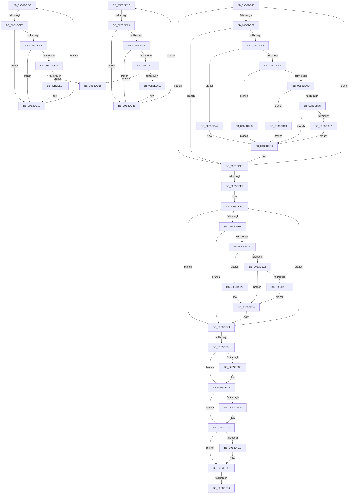

# sub_00B3DCDC

- RVA: `0x00B3DCDC`–`0x00B3DF8C` (길이 `688` bytes)
- VA: `0x0000000140B3DCDC`
- 실행 섹션: `PAGE`
- PDB 이름 있음: `아니요`; PDB Function 태그: `아니요`
- unwind 정보 RVA: `0x000B27B4`
- 디코드: `188`개 명령, `688/688` bytes 표시
- 미해석 바이트: `0` (있으면 어셈블리에 `.byte`로 보존)

> 이 문서는 커널 이미지의 기계어와 PDB 기호를 분석해 생성했습니다. 4번과 5번은 함수 원형과 자료형을 바이너리 사용 방식에서 추정한 C 해석이며 원본 소스 복구 결과는 아닙니다.

## 1. Dependencies

- 직접 호출 지점: **5**; 고유 호출 대상: **1**
- 직접 호출자로 확인된 함수: **0**
- RIP 상대 이미지 참조: **0**

### Outgoing calls
- `0x00B3DDD8` → [memcpy](../../text/6C/memcpy_function_006C6840.md) (function, `0x006C6840`)
- `0x00B3DE60` → [memcpy](../../text/6C/memcpy_function_006C6840.md) (function, `0x006C6840`)
- `0x00B3DEB5` → [memcpy](../../text/6C/memcpy_function_006C6840.md) (function, `0x006C6840`)
- `0x00B3DEF7` → [memcpy](../../text/6C/memcpy_function_006C6840.md) (function, `0x006C6840`)
- `0x00B3DF39` → [memcpy](../../text/6C/memcpy_function_006C6840.md) (function, `0x006C6840`)

### Direct callers
- 이 함수 시작 RVA로 연결되는 직접 call은 확인되지 않았습니다. 간접 호출은 완전히 역산할 수 없습니다.

### Static image references
- 디코드된 RIP-relative 메모리 참조가 없습니다.

## 2. Other-region calls and transfers

- 다른 실행 섹션으로 향하는 call: **5**
  - `0x00B3DDD8` → [memcpy](../../text/6C/memcpy_function_006C6840.md) (`PAGE` → `.text`)
  - `0x00B3DE60` → [memcpy](../../text/6C/memcpy_function_006C6840.md) (`PAGE` → `.text`)
  - `0x00B3DEB5` → [memcpy](../../text/6C/memcpy_function_006C6840.md) (`PAGE` → `.text`)
  - `0x00B3DEF7` → [memcpy](../../text/6C/memcpy_function_006C6840.md) (`PAGE` → `.text`)
  - `0x00B3DF39` → [memcpy](../../text/6C/memcpy_function_006C6840.md) (`PAGE` → `.text`)
- call이 아닌 외부 분기/꼬리 이동: **5**
  - `0x00B3DCE0` → [EtwpEnableTrace + 0x46](../A5/EtwpEnableTrace_function_00A5C8EC.md) (`tail-transfer`)
  - `0x00B3DD1A` → [EtwpEnableTrace + 0xE1](../A5/EtwpEnableTrace_function_00A5C8EC.md) (`tail-transfer`)
  - `0x00B3DD22` → [EtwpEnableTrace + 0x57](../A5/EtwpEnableTrace_function_00A5C8EC.md) (`tail-transfer`)
  - `0x00B3DF52` → [EtwpEnableTrace + 0x159](../A5/EtwpEnableTrace_function_00A5C8EC.md) (`tail-transfer`)
  - `0x00B3DF87` → [EtwpEnableTrace + 0x159](../A5/EtwpEnableTrace_function_00A5C8EC.md) (`tail-transfer`)

## 3. Assembly (complete function range)

```asm
00B3DCDC  41 83 FA 04                     cmp r10d, 4
00B3DCE0  0F 83 4C EC F1 FF               jae 0x140a5c932
00B3DCE6  41 8B C2                        mov eax, r10d
00B3DCE9  48 03 C0                        add rax, rax
00B3DCEC  41 0F B7 0C C7                  movzx ecx, word ptr [r15 + rax*8]
00B3DCF1  66 85 C9                        test cx, cx
00B3DCF4  74 1A                           je 0x140b3dd10
00B3DCF6  4D 39 74 C7 08                  cmp qword ptr [r15 + rax*8 + 8], r14
00B3DCFB  74 13                           je 0x140b3dd10
00B3DCFD  B8 00 04 00 00                  mov eax, 0x400
00B3DD02  66 3B C8                        cmp cx, ax
00B3DD05  77 0E                           ja 0x140b3dd15
00B3DD07  FF C3                           inc ebx
00B3DD09  41 83 C3 02                     add r11d, 2
00B3DD0D  44 03 D9                        add r11d, ecx
00B3DD10  41 FF C2                        inc r10d
00B3DD13  EB C7                           jmp 0x140b3dcdc
00B3DD15  BB 0D 00 00 C0                  mov ebx, 0xc000000d
00B3DD1A  E9 AE EC F1 FF                  jmp 0x140a5c9cd
00B3DD1F  83 F9 02                        cmp ecx, 2
00B3DD22  0F 83 1B EC F1 FF               jae 0x140a5c943
00B3DD28  8B C1                           mov eax, ecx
00B3DD2A  49 8B 04 C4                     mov rax, qword ptr [r12 + rax*8]
00B3DD2E  48 85 C0                        test rax, rax
00B3DD31  74 18                           je 0x140b3dd4b
00B3DD33  0F B7 40 02                     movzx eax, word ptr [rax + 2]
00B3DD37  66 85 C0                        test ax, ax
00B3DD3A  74 0F                           je 0x140b3dd4b
00B3DD3C  83 F8 40                        cmp eax, 0x40
00B3DD3F  77 D4                           ja 0x140b3dd15
00B3DD41  FF C3                           inc ebx
00B3DD43  45 8D 1C 43                     lea r11d, [r11 + rax*2]
00B3DD47  41 83 C3 04                     add r11d, 4
00B3DD4B  FF C1                           inc ecx
00B3DD4D  EB D0                           jmp 0x140b3dd1f
00B3DD4F  66 41 39 17                     cmp word ptr [r15], dx
00B3DD53  0F 86 8F 00 00 00               jbe 0x140b3dde8
00B3DD59  49 39 57 08                     cmp qword ptr [r15 + 8], rdx
00B3DD5D  0F 84 85 00 00 00               je 0x140b3dde8
00B3DD63  41 8B C5                        mov eax, r13d
00B3DD66  45 85 ED                        test r13d, r13d
00B3DD69  74 3C                           je 0x140b3dda7
00B3DD6B  83 E8 01                        sub eax, 1
00B3DD6E  74 28                           je 0x140b3dd98
00B3DD70  83 E8 01                        sub eax, 1
00B3DD73  74 14                           je 0x140b3dd89
00B3DD75  83 F8 01                        cmp eax, 1
00B3DD78  75 3A                           jne 0x140b3ddb4
00B3DD7A  8B C5                           mov eax, ebp
00B3DD7C  48 03 C0                        add rax, rax
00B3DD7F  C7 44 C7 0C 00 80 00 80         mov dword ptr [rdi + rax*8 + 0xc], 0x80008000
00B3DD87  EB 2B                           jmp 0x140b3ddb4
00B3DD89  8B C5                           mov eax, ebp
00B3DD8B  48 03 C0                        add rax, rax
00B3DD8E  C7 44 C7 0C 20 00 00 80         mov dword ptr [rdi + rax*8 + 0xc], 0x80000020
00B3DD96  EB 1C                           jmp 0x140b3ddb4
00B3DD98  8B C5                           mov eax, ebp
00B3DD9A  48 03 C0                        add rax, rax
00B3DD9D  C7 44 C7 0C 10 00 00 80         mov dword ptr [rdi + rax*8 + 0xc], 0x80000010
00B3DDA5  EB 0D                           jmp 0x140b3ddb4
00B3DDA7  8B C5                           mov eax, ebp
00B3DDA9  48 03 C0                        add rax, rax
00B3DDAC  C7 44 C7 0C 08 00 00 80         mov dword ptr [rdi + rax*8 + 0xc], 0x80000008
00B3DDB4  41 0F B7 0F                     movzx ecx, word ptr [r15]
00B3DDB8  48 8B C6                        mov rax, rsi
00B3DDBB  83 C1 02                        add ecx, 2
00B3DDBE  8B DD                           mov ebx, ebp
00B3DDC0  48 03 DB                        add rbx, rbx
00B3DDC3  44 8B C1                        mov r8d, ecx
00B3DDC6  49 2B C6                        sub rax, r14
00B3DDC9  89 4C DF 08                     mov dword ptr [rdi + rbx*8 + 8], ecx
00B3DDCD  48 8B CE                        mov rcx, rsi
00B3DDD0  48 89 04 DF                     mov qword ptr [rdi + rbx*8], rax
00B3DDD4  49 8B 57 08                     mov rdx, qword ptr [r15 + 8]
00B3DDD8  E8 63 8A B8 FF                  call 0x1406c6840
00B3DDDD  8B 44 DF 08                     mov eax, dword ptr [rdi + rbx*8 + 8]
00B3DDE1  FF C5                           inc ebp
00B3DDE3  48 03 F0                        add rsi, rax
00B3DDE6  33 D2                           xor edx, edx
00B3DDE8  41 FF C5                        inc r13d
00B3DDEB  49 83 C7 10                     add r15, 0x10
00B3DDEF  41 83 FD 04                     cmp r13d, 4
00B3DDF3  0F 82 56 FF FF FF               jb 0x140b3dd4f
00B3DDF9  44 8B FA                        mov r15d, edx
00B3DDFC  49 8B 04 24                     mov rax, qword ptr [r12]
00B3DE00  48 85 C0                        test rax, rax
00B3DE03  74 6B                           je 0x140b3de70
00B3DE05  66 39 50 02                     cmp word ptr [rax + 2], dx
00B3DE09  76 65                           jbe 0x140b3de70
00B3DE0B  41 8B C7                        mov eax, r15d
00B3DE0E  45 85 FF                        test r15d, r15d
00B3DE11  74 14                           je 0x140b3de27
00B3DE13  83 F8 01                        cmp eax, 1
00B3DE16  75 1C                           jne 0x140b3de34
00B3DE18  8B C5                           mov eax, ebp
00B3DE1A  48 03 C0                        add rax, rax
00B3DE1D  C7 44 C7 0C 00 10 00 80         mov dword ptr [rdi + rax*8 + 0xc], 0x80001000
00B3DE25  EB 0D                           jmp 0x140b3de34
00B3DE27  8B C5                           mov eax, ebp
00B3DE29  48 03 C0                        add rax, rax
00B3DE2C  C7 44 C7 0C 00 02 00 80         mov dword ptr [rdi + rax*8 + 0xc], 0x80000200
00B3DE34  49 8B 04 24                     mov rax, qword ptr [r12]
00B3DE38  8B DD                           mov ebx, ebp
00B3DE3A  48 03 DB                        add rbx, rbx
00B3DE3D  0F B7 48 02                     movzx ecx, word ptr [rax + 2]
00B3DE41  48 8B C6                        mov rax, rsi
00B3DE44  49 2B C6                        sub rax, r14
00B3DE47  48 89 04 DF                     mov qword ptr [rdi + rbx*8], rax
00B3DE4B  8D 0C 4D 04 00 00 00            lea ecx, [rcx*2 + 4]
00B3DE52  89 4C DF 08                     mov dword ptr [rdi + rbx*8 + 8], ecx
00B3DE56  49 8B 14 24                     mov rdx, qword ptr [r12]
00B3DE5A  44 8B C1                        mov r8d, ecx
00B3DE5D  48 8B CE                        mov rcx, rsi
00B3DE60  E8 DB 89 B8 FF                  call 0x1406c6840
00B3DE65  8B 44 DF 08                     mov eax, dword ptr [rdi + rbx*8 + 8]
00B3DE69  FF C5                           inc ebp
00B3DE6B  48 03 F0                        add rsi, rax
00B3DE6E  33 D2                           xor edx, edx
00B3DE70  41 FF C7                        inc r15d
00B3DE73  49 83 C4 08                     add r12, 8
00B3DE77  41 83 FF 02                     cmp r15d, 2
00B3DE7B  0F 82 7B FF FF FF               jb 0x140b3ddfc
00B3DE81  8B 8C 24 B0 00 00 00            mov ecx, dword ptr [rsp + 0xb0]
00B3DE88  85 C9                           test ecx, ecx
00B3DE8A  74 37                           je 0x140b3dec3
00B3DE8C  48 8B 94 24 A8 00 00 00         mov rdx, qword ptr [rsp + 0xa8]
00B3DE94  44 8B C1                        mov r8d, ecx
00B3DE97  8B DD                           mov ebx, ebp
00B3DE99  48 8B C6                        mov rax, rsi
00B3DE9C  48 03 DB                        add rbx, rbx
00B3DE9F  49 2B C6                        sub rax, r14
00B3DEA2  89 4C DF 08                     mov dword ptr [rdi + rbx*8 + 8], ecx
00B3DEA6  48 8B CE                        mov rcx, rsi
00B3DEA9  C7 44 DF 0C 00 04 00 80         mov dword ptr [rdi + rbx*8 + 0xc], 0x80000400
00B3DEB1  48 89 04 DF                     mov qword ptr [rdi + rbx*8], rax
00B3DEB5  E8 86 89 B8 FF                  call 0x1406c6840
00B3DEBA  8B 44 DF 08                     mov eax, dword ptr [rdi + rbx*8 + 8]
00B3DEBE  48 03 F0                        add rsi, rax
00B3DEC1  FF C5                           inc ebp
00B3DEC3  8B 8C 24 C0 00 00 00            mov ecx, dword ptr [rsp + 0xc0]
00B3DECA  85 C9                           test ecx, ecx
00B3DECC  74 37                           je 0x140b3df05
00B3DECE  48 8B 94 24 B8 00 00 00         mov rdx, qword ptr [rsp + 0xb8]
00B3DED6  44 8B C1                        mov r8d, ecx
00B3DED9  8B DD                           mov ebx, ebp
00B3DEDB  48 8B C6                        mov rax, rsi
00B3DEDE  48 03 DB                        add rbx, rbx
00B3DEE1  49 2B C6                        sub rax, r14
00B3DEE4  89 4C DF 08                     mov dword ptr [rdi + rbx*8 + 8], ecx
00B3DEE8  48 8B CE                        mov rcx, rsi
00B3DEEB  C7 44 DF 0C 00 20 00 80         mov dword ptr [rdi + rbx*8 + 0xc], 0x80002000
00B3DEF3  48 89 04 DF                     mov qword ptr [rdi + rbx*8], rax
00B3DEF7  E8 44 89 B8 FF                  call 0x1406c6840
00B3DEFC  8B 44 DF 08                     mov eax, dword ptr [rdi + rbx*8 + 8]
00B3DF00  48 03 F0                        add rsi, rax
00B3DF03  FF C5                           inc ebp
00B3DF05  8B 8C 24 D0 00 00 00            mov ecx, dword ptr [rsp + 0xd0]
00B3DF0C  85 C9                           test ecx, ecx
00B3DF0E  74 37                           je 0x140b3df47
00B3DF10  48 8B 94 24 C8 00 00 00         mov rdx, qword ptr [rsp + 0xc8]
00B3DF18  44 8B C1                        mov r8d, ecx
00B3DF1B  8B DD                           mov ebx, ebp
00B3DF1D  48 8B C6                        mov rax, rsi
00B3DF20  48 03 DB                        add rbx, rbx
00B3DF23  49 2B C6                        sub rax, r14
00B3DF26  89 4C DF 08                     mov dword ptr [rdi + rbx*8 + 8], ecx
00B3DF2A  48 8B CE                        mov rcx, rsi
00B3DF2D  C7 44 DF 0C 00 00 00 80         mov dword ptr [rdi + rbx*8 + 0xc], 0x80000000
00B3DF35  48 89 04 DF                     mov qword ptr [rdi + rbx*8], rax
00B3DF39  E8 02 89 B8 FF                  call 0x1406c6840
00B3DF3E  8B 44 DF 08                     mov eax, dword ptr [rdi + rbx*8 + 8]
00B3DF42  48 03 F0                        add rsi, rax
00B3DF45  FF C5                           inc ebp
00B3DF47  48 8B 94 24 D8 00 00 00         mov rdx, qword ptr [rsp + 0xd8]
00B3DF4F  48 85 D2                        test rdx, rdx
00B3DF52  0F 84 ED EA F1 FF               je 0x140a5ca45
00B3DF58  8B CD                           mov ecx, ebp
00B3DF5A  48 8B C6                        mov rax, rsi
00B3DF5D  48 03 C9                        add rcx, rcx
00B3DF60  49 2B C6                        sub rax, r14
00B3DF63  C7 44 CF 0C 00 40 00 80         mov dword ptr [rdi + rcx*8 + 0xc], 0x80004000
00B3DF6B  C7 44 CF 08 18 00 00 00         mov dword ptr [rdi + rcx*8 + 8], 0x18
00B3DF73  48 89 04 CF                     mov qword ptr [rdi + rcx*8], rax
00B3DF77  0F 10 02                        movups xmm0, xmmword ptr [rdx]
00B3DF7A  0F 11 06                        movups xmmword ptr [rsi], xmm0
00B3DF7D  F2 0F 10 4A 10                  movsd xmm1, qword ptr [rdx + 0x10]
00B3DF82  F2 0F 11 4E 10                  movsd qword ptr [rsi + 0x10], xmm1
00B3DF87  E9 B9 EA F1 FF                  jmp 0x140a5ca45
```

## 4. C-style interpretation (structured pseudocode)

```c
__int64 __fastcall sub_00B3DCDC(__int64 a1, __int64 a2)
{
    __int64 result;
    __int64 v_r10;
    __int64 v_r11;
    __int64 v_rbx;
    unsigned __int64 v_stack_pA8;
    unsigned int v_stack_pB0;
    unsigned __int64 v_stack_pB8;
    unsigned int v_stack_pC0;
    unsigned __int64 v_stack_pC8;
    unsigned int v_stack_pD0;
    unsigned __int64 v_stack_pD8;

    result = ((unsigned int)((unsigned int)(v_r10))) + ((unsigned int)((unsigned int)(v_r10)));
    if ((unsigned __int16)(*(unsigned __int16 *)(v_r15 + result * 8)) == 0) goto loc_00B3DD10;
    if ((*(unsigned __int64 *)(v_r15 + result * 8 + 8)) == v_r14) goto loc_00B3DD10;
    if (((unsigned __int16)(*(unsigned __int16 *)(v_r15 + result * 8))) > ((unsigned __int16)((unsigned int)(0x400ULL)))) goto loc_00B3DD15;
    v_rbx = (unsigned int)((v_rbx) + 1);
    v_r11 = (unsigned int)((v_r11) + (2));
    v_r11 = (unsigned int)((v_r11) + ((unsigned int)(*(unsigned __int16 *)(v_r15 + result * 8))));
loc_00B3DD10:
    v_r10 = (unsigned int)((v_r10) + 1);
    goto loc_00B3DCDC;
loc_00B3DD15:
}
```

## 5. (Beta) C Style

```c
int64_t sub_00B3DCDC(int64_t Arg1, int64_t Arg2)
{
    int64_t result;
    int64_t local_r10;
    int64_t local_r11;
    int64_t local_rbx;
    uint64_t v_stack_pA8;
    uint32_t v_stack_pB0;
    uint64_t v_stack_pB8;
    uint32_t v_stack_pC0;
    uint64_t v_stack_pC8;
    uint32_t v_stack_pD0;
    uint64_t v_stack_pD8;

    result = ((uint32_t)((uint32_t)(local_r10))) + ((uint32_t)((uint32_t)(local_r10)));
    if ((uint16_t)(*(uint16_t *)(local_r15 + result * 8)) == 0) goto loc_00B3DD10;
    if ((*(uint64_t *)(local_r15 + result * 8 + 0x8)) == local_r14) goto loc_00B3DD10;
    if (((uint16_t)(*(uint16_t *)(local_r15 + result * 8))) > ((uint16_t)((uint32_t)(0x400ULL)))) goto loc_00B3DD15;
    local_rbx = (uint32_t)((local_rbx) + 1);
    local_r11 = (uint32_t)((local_r11) + (2));
    local_r11 = (uint32_t)((local_r11) + ((uint32_t)(*(uint16_t *)(local_r15 + result * 8))));
loc_00B3DD10:
    local_r10 = (uint32_t)((local_r10) + 1);
    goto loc_00B3DCDC;
loc_00B3DD15:
}
```

## 6. Execution-region graph

[열기: 2D/3D 그래프와 함수 탐색 컨트롤 패널](../../../control-panel.html?section=page&rva=0x00B3DCDC&view=graph)

- 2D 그래프는 위에서 아래로 흐르고, 3D 그래프는 빈 공간을 드래그해 회전합니다. Shift+드래그는 이동, 휠은 확대·축소, 함수 노드 선택은 대상 보고서 이동입니다.

### Static fallback


