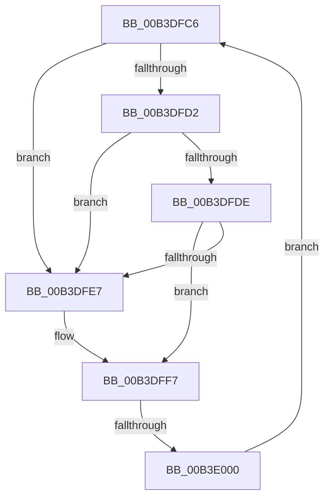

# sub_00B3DFC6

- RVA: `0x00B3DFC6`–`0x00B3E005` (길이 `63` bytes)
- VA: `0x0000000140B3DFC6`
- 실행 섹션: `PAGE`
- PDB 이름 있음: `아니요`; PDB Function 태그: `아니요`
- unwind 정보 RVA: `0x000B28C4`
- 디코드: `18`개 명령, `63/63` bytes 표시
- 미해석 바이트: `0` (있으면 어셈블리에 `.byte`로 보존)

> 이 문서는 커널 이미지의 기계어와 PDB 기호를 분석해 생성했습니다. 4번과 5번은 함수 원형과 자료형을 바이너리 사용 방식에서 추정한 C 해석이며 원본 소스 복구 결과는 아닙니다.

## 1. Dependencies

- 직접 호출 지점: **3**; 고유 호출 대상: **3**
- 직접 호출자로 확인된 함수: **0**
- RIP 상대 이미지 참조: **1**

### Outgoing calls
- `0x00B3DFC6` → [CmpGetNextHive](../84/CmpGetNextHive_function_0084E330.md) (function, `0x0084E330`)
- `0x00B3DFEA` → [HvUnlockHiveFlusherExclusive](../../pagecmrc/BC/HvUnlockHiveFlusherExclusive_function_00BC9C34.md) (function, `0x00BC9C34`)
- `0x00B3DFF2` → [CmpDereferenceHive](../86/CmpDereferenceHive_function_008632B0.md) (function, `0x008632B0`)

### Direct callers
- 이 함수 시작 RVA로 연결되는 직접 call은 확인되지 않았습니다. 간접 호출은 완전히 역산할 수 없습니다.

### Static image references
- `0x00B3DFDE` → RVA `0x00FD9A90` (`PAGEDATA`; read)

## 2. Other-region calls and transfers

- 다른 실행 섹션으로 향하는 call: **1**
  - `0x00B3DFEA` → [HvUnlockHiveFlusherExclusive](../../pagecmrc/BC/HvUnlockHiveFlusherExclusive_function_00BC9C34.md) (`PAGE` → `PAGECMRC`)
- call이 아닌 외부 분기/꼬리 이동: **1**
  - `0x00B3DFFA` → [CmpUnblockHiveWrites + 0x21](../A5/CmpUnblockHiveWrites_function_00A5E4B0.md) (`tail-transfer`)

## 3. Assembly (complete function range)

```asm
00B3DFC6  E8 65 03 D1 FF                  call 0x14084e330
00B3DFCB  48 8B D8                        mov rbx, rax
00B3DFCE  85 FF                           test edi, edi
00B3DFD0  74 15                           je 0x140b3dfe7
00B3DFD2  8B 80 10 10 00 00               mov eax, dword ptr [rax + 0x1010]
00B3DFD8  23 C7                           and eax, edi
00B3DFDA  3B C7                           cmp eax, edi
00B3DFDC  74 09                           je 0x140b3dfe7
00B3DFDE  48 3B 1D AB BA 49 00            cmp rbx, qword ptr [rip + 0x49baab]
00B3DFE5  75 10                           jne 0x140b3dff7
00B3DFE7  48 8B CB                        mov rcx, rbx
00B3DFEA  E8 45 BC 08 00                  call 0x140bc9c34
00B3DFEF  48 8B CB                        mov rcx, rbx
00B3DFF2  E8 B9 52 D2 FF                  call 0x1408632b0
00B3DFF7  48 3B DE                        cmp rbx, rsi
00B3DFFA  0F 84 D1 04 F2 FF               je 0x140a5e4d1
00B3E000  48 8B CB                        mov rcx, rbx
00B3E003  EB C1                           jmp 0x140b3dfc6
```

## 4. C-style interpretation (structured pseudocode)

```c
__int64 __fastcall sub_00B3DFC6(void)
{
    __int64 result;

    result = CmpGetNextHive(a1, a2, a3, a4);
    if ((unsigned int)(v_rdi) == 0) goto loc_00B3DFE7;
    result = (unsigned int)(((unsigned int)(*(unsigned int *)(result + 4112))) & ((unsigned int)(v_rdi)));
    if (((unsigned int)(result)) == ((unsigned int)(v_rdi))) goto loc_00B3DFE7;
    if (result == (*(unsigned __int64 *)(v_rip + 4831915))) {
        a1 = result;
        result = HvUnlockHiveFlusherExclusive(a1, a2, a3, a4);
        a1 = result;
        result = CmpDereferenceHive(a1, a2, a3, a4);
    }
    goto loc_00B3DFC6;
}
```

## 5. (Beta) C Style

```c
void sub_00B3DFC6(void)
{
    int64_t result;

    result = CmpGetNextHive(a1, a2, a3, a4);
    if ((uint32_t)(local_rdi) == 0) goto loc_00B3DFE7;
    result = (uint32_t)(((uint32_t)(*(uint32_t *)(result + 0x1010))) & ((uint32_t)(local_rdi)));
    if (((uint32_t)(result)) == ((uint32_t)(local_rdi))) goto loc_00B3DFE7;
    if (result == (*(uint64_t *)(v_rip + 0x49BAAB))) {
        a1 = result;
        result = HvUnlockHiveFlusherExclusive(a1, a2, a3, a4);
        a1 = result;
        result = CmpDereferenceHive(a1, a2, a3, a4);
    }
    goto loc_00B3DFC6;
}
```

## 6. Execution-region graph

[열기: 2D/3D 그래프와 함수 탐색 컨트롤 패널](../../../control-panel.html?section=page&rva=0x00B3DFC6&view=graph)

- 2D 그래프는 위에서 아래로 흐르고, 3D 그래프는 빈 공간을 드래그해 회전합니다. Shift+드래그는 이동, 휠은 확대·축소, 함수 노드 선택은 대상 보고서 이동입니다.

### Static fallback


