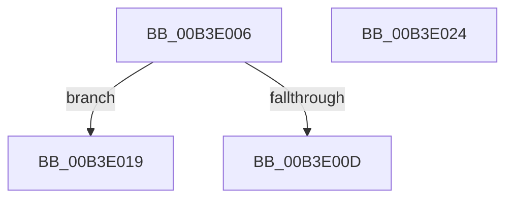

# sub_00B3E006

- RVA: `0x00B3E006`–`0x00B3E0C1` (길이 `187` bytes)
- VA: `0x0000000140B3E006`
- 실행 섹션: `PAGE`
- PDB 이름 있음: `아니요`; PDB Function 태그: `아니요`
- unwind 정보 RVA: `0x000B28FC`
- 디코드: `41`개 명령, `187/187` bytes 표시
- 미해석 바이트: `0` (있으면 어셈블리에 `.byte`로 보존)

> 이 문서는 커널 이미지의 기계어와 PDB 기호를 분석해 생성했습니다. 4번과 5번은 함수 원형과 자료형을 바이너리 사용 방식에서 추정한 C 해석이며 원본 소스 복구 결과는 아닙니다.

## 1. Dependencies

- 직접 호출 지점: **4**; 고유 호출 대상: **4**
- 직접 호출자로 확인된 함수: **0**
- RIP 상대 이미지 참조: **1**

### Outgoing calls
- `0x00B3E02E` → [RtlCreateAcl](../91/RtlCreateAcl_function_00916F00.md) (function, `0x00916F00`)
- `0x00B3E04D` → [RtlAddMandatoryAce](../92/RtlAddMandatoryAce_function_00929BA0.md) (function, `0x00929BA0`)
- `0x00B3E05C` → [RtlCreateSecurityDescriptor](../9F/RtlCreateSecurityDescriptor_function_009F1DF0.md) (function, `0x009F1DF0`)
- `0x00B3E06F` → [RtlSetSaclSecurityDescriptor](../A1/RtlSetSaclSecurityDescriptor_function_00A18B80.md) (function, `0x00A18B80`)

### Direct callers
- 이 함수 시작 RVA로 연결되는 직접 call은 확인되지 않았습니다. 간접 호출은 완전히 역산할 수 없습니다.

### Static image references
- `0x00B3E096` → RVA `0x00F0F650` (`.data`; read)

## 2. Other-region calls and transfers

- 다른 실행 섹션으로 향하는 call: **0**
- call이 아닌 외부 분기/꼬리 이동: **3**
  - `0x00B3E014` → [ObpVerifyAccessToBoundaryEntry + 0x199](../A5/ObpVerifyAccessToBoundaryEntry_function_00A5E500.md) (`tail-transfer`)
  - `0x00B3E01F` → [ObpVerifyAccessToBoundaryEntry + 0x1D5](../A5/ObpVerifyAccessToBoundaryEntry_function_00A5E500.md) (`tail-transfer`)
  - `0x00B3E0BC` → [ObpVerifyAccessToBoundaryEntry + 0x180](../A5/ObpVerifyAccessToBoundaryEntry_function_00A5E500.md) (`tail-transfer`)

## 3. Assembly (complete function range)

```asm
00B3E006  8B 47 34                        mov eax, dword ptr [rdi + 0x34]
00B3E009  A8 01                           test al, 1
00B3E00B  74 0C                           je 0x140b3e019
00B3E00D  C7 47 30 0D 00 00 C0            mov dword ptr [rdi + 0x30], 0xc000000d
00B3E014  E9 80 06 F2 FF                  jmp 0x140a5e699
00B3E019  83 C8 01                        or eax, 1
00B3E01C  89 47 34                        mov dword ptr [rdi + 0x34], eax
00B3E01F  E9 B1 06 F2 FF                  jmp 0x140a5e6d5
00B3E024  45 8B C7                        mov r8d, r15d
00B3E027  48 8D 4D 90                     lea rcx, [rbp - 0x70]
00B3E02B  41 8B D4                        mov edx, r12d
00B3E02E  E8 CD 8E DD FF                  call 0x140916f00
00B3E033  4C 8B CE                        mov r9, rsi
00B3E036  C7 44 24 28 07 00 00 00         mov dword ptr [rsp + 0x28], 7
00B3E03E  45 33 C0                        xor r8d, r8d
00B3E041  C6 44 24 20 11                  mov byte ptr [rsp + 0x20], 0x11
00B3E046  41 8B D7                        mov edx, r15d
00B3E049  48 8D 4D 90                     lea rcx, [rbp - 0x70]
00B3E04D  E8 4E BB DE FF                  call 0x140929ba0
00B3E052  BA 01 00 00 00                  mov edx, 1
00B3E057  48 8D 4C 24 68                  lea rcx, [rsp + 0x68]
00B3E05C  E8 8F 3D EB FF                  call 0x1409f1df0
00B3E061  45 33 C9                        xor r9d, r9d
00B3E064  4C 8D 45 90                     lea r8, [rbp - 0x70]
00B3E068  B2 01                           mov dl, 1
00B3E06A  48 8D 4C 24 68                  lea rcx, [rsp + 0x68]
00B3E06F  E8 0C AB ED FF                  call 0x140a18b80
00B3E074  65 48 8B 04 25 88 01 00 00      mov rax, qword ptr gs:[0x188]
00B3E07D  48 8D 4F 30                     lea rcx, [rdi + 0x30]
00B3E081  48 89 4C 24 50                  mov qword ptr [rsp + 0x50], rcx
00B3E086  48 8D 4C 24 60                  lea rcx, [rsp + 0x60]
00B3E08B  48 89 4C 24 48                  mov qword ptr [rsp + 0x48], rcx
00B3E090  8A 90 32 02 00 00               mov dl, byte ptr [rax + 0x232]
00B3E096  48 8B 05 B3 15 3D 00            mov rax, qword ptr [rip + 0x3d15b3]
00B3E09D  88 54 24 40                     mov byte ptr [rsp + 0x40], dl
00B3E0A1  48 83 C0 4C                     add rax, 0x4c
00B3E0A5  48 89 44 24 38                  mov qword ptr [rsp + 0x38], rax
00B3E0AA  4C 89 74 24 30                  mov qword ptr [rsp + 0x30], r14
00B3E0AF  44 89 74 24 28                  mov dword ptr [rsp + 0x28], r14d
00B3E0B4  C7 44 24 20 0F 00 0F 00         mov dword ptr [rsp + 0x20], 0xf000f
00B3E0BC  E9 BF 05 F2 FF                  jmp 0x140a5e680
```

## 4. C-style interpretation (structured pseudocode)

```c
__int64 __fastcall sub_00B3E006(void)
{
    __int64 result;
    unsigned __int8 v_stack_p20;
    unsigned int v_stack_p28;
    unsigned __int64 v_stack_p30;
    unsigned __int64 v_stack_p38;
    unsigned __int8 v_stack_p40;
    unsigned __int64 v_stack_p48;
    unsigned __int64 v_stack_p50;
    unsigned __int64 v_stack_p60;
    unsigned __int64 v_stack_p68;

    if ((((unsigned __int8)((unsigned int)(*(unsigned int *)(v_rdi + 52)))) & (1)) == 0) goto loc_00B3E019;
    *(unsigned int *)(v_rdi + 48) = 0xC000000DULL;
loc_00B3E019:
    result = (unsigned int)(((unsigned int)(*(unsigned int *)(v_rdi + 52))) | (1));
    *(unsigned int *)(v_rdi + 52) = (unsigned int)(result);
}
```

## 5. (Beta) C Style

```c
void sub_00B3E006(void)
{
    int64_t result;
    uint8_t v_stack_p20;
    uint32_t v_stack_p28;
    uint64_t v_stack_p30;
    uint64_t v_stack_p38;
    uint8_t v_stack_p40;
    uint64_t v_stack_p48;
    uint64_t v_stack_p50;
    uint64_t v_stack_p60;
    uint64_t v_stack_p68;

    if ((((uint8_t)((uint32_t)(*(uint32_t *)(local_rdi + 0x34)))) & (1)) == 0) goto loc_00B3E019;
    *(uint32_t *)(local_rdi + 0x30) = 0xC000000DULL;
loc_00B3E019:
    result = (uint32_t)(((uint32_t)(*(uint32_t *)(local_rdi + 0x34))) | (1));
    *(uint32_t *)(local_rdi + 0x34) = (uint32_t)(result);
}
```

## 6. Execution-region graph

[열기: 2D/3D 그래프와 함수 탐색 컨트롤 패널](../../../control-panel.html?section=page&rva=0x00B3E006&view=graph)

- 2D 그래프는 위에서 아래로 흐르고, 3D 그래프는 빈 공간을 드래그해 회전합니다. Shift+드래그는 이동, 휠은 확대·축소, 함수 노드 선택은 대상 보고서 이동입니다.

### Static fallback


