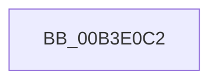

# sub_00B3E0C2

- RVA: `0x00B3E0C2`–`0x00B3E113` (길이 `81` bytes)
- VA: `0x0000000140B3E0C2`
- 실행 섹션: `PAGE`
- PDB 이름 있음: `아니요`; PDB Function 태그: `아니요`
- unwind 정보 RVA: `0x000B2A44`
- 디코드: `20`개 명령, `81/81` bytes 표시
- 미해석 바이트: `0` (있으면 어셈블리에 `.byte`로 보존)

> 이 문서는 커널 이미지의 기계어와 PDB 기호를 분석해 생성했습니다. 4번과 5번은 함수 원형과 자료형을 바이너리 사용 방식에서 추정한 C 해석이며 원본 소스 복구 결과는 아닙니다.

## 1. Dependencies

- 직접 호출 지점: **2**; 고유 호출 대상: **2**
- 직접 호출자로 확인된 함수: **0**
- RIP 상대 이미지 참조: **1**

### Outgoing calls
- `0x00B3E0F8` → [KeInitializeApc](../../text/42/KeInitializeApc_function_00428510.md) (function, `0x00428510`)
- `0x00B3E108` → [KeInsertQueueApc](../../text/20/KeInsertQueueApc_function_00203F10.md) (function, `0x00203F10`)

### Direct callers
- 이 함수 시작 RVA로 연결되는 직접 call은 확인되지 않았습니다. 간접 호출은 완전히 역산할 수 없습니다.

### Static image references
- `0x00B3E0D0` → RVA `0x007D0A70` (`ExSvmUpdateThreadPasidMsrApc`; read)

## 2. Other-region calls and transfers

- 다른 실행 섹션으로 향하는 call: **2**
  - `0x00B3E0F8` → [KeInitializeApc](../../text/42/KeInitializeApc_function_00428510.md) (`PAGE` → `.text`)
  - `0x00B3E108` → [KeInsertQueueApc](../../text/20/KeInsertQueueApc_function_00203F10.md) (`PAGE` → `.text`)
- call이 아닌 외부 분기/꼬리 이동: **1**
  - `0x00B3E10E` → [PspRecheckThreadPasidMsrState + 0x1D](../A5/PspRecheckThreadPasidMsrState_function_00A5EA5C.md) (`tail-transfer`)

## 3. Assembly (complete function range)

```asm
00B3E0C2  48 8D 58 08                     lea rbx, [rax + 8]
00B3E0C6  48 89 7C 24 38                  mov qword ptr [rsp + 0x38], rdi
00B3E0CB  40 88 7C 24 30                  mov byte ptr [rsp + 0x30], dil
00B3E0D0  4C 8D 0D 99 29 C9 FF            lea r9, [rip - 0x36d667]
00B3E0D7  48 89 7C 24 28                  mov qword ptr [rsp + 0x28], rdi
00B3E0DC  48 8B CB                        mov rcx, rbx
00B3E0DF  45 33 C0                        xor r8d, r8d
00B3E0E2  48 89 7C 24 20                  mov qword ptr [rsp + 0x20], rdi
00B3E0E7  48 8B D6                        mov rdx, rsi
00B3E0EA  48 89 73 58                     mov qword ptr [rbx + 0x58], rsi
00B3E0EE  48 89 43 60                     mov qword ptr [rbx + 0x60], rax
00B3E0F2  C7 00 01 00 00 00               mov dword ptr [rax], 1
00B3E0F8  E8 13 A4 8E FF                  call 0x140428510
00B3E0FD  45 33 C9                        xor r9d, r9d
00B3E100  45 33 C0                        xor r8d, r8d
00B3E103  33 D2                           xor edx, edx
00B3E105  48 8B CB                        mov rcx, rbx
00B3E108  E8 03 5E 6C FF                  call 0x140203f10
00B3E10D  90                              nop
00B3E10E  E9 66 09 F2 FF                  jmp 0x140a5ea79
```

## 4. C-style interpretation (structured pseudocode)

```c
__int64 __fastcall sub_00B3E0C2(__int64 a1, __int64 a2, int a3)
{
    __int64 result;
    unsigned __int64 v_stack_p20;
    unsigned __int64 v_stack_p28;
    unsigned __int8 v_stack_p30;
    unsigned __int64 v_stack_p38;

    v_stack_p38 = v_rdi;
    v_stack_p30 = (unsigned __int8)(v_rdi);
    v_stack_p28 = v_rdi;
    a3 = 0;
    v_stack_p20 = v_rdi;
    *(unsigned __int64 *)(result + 8 + 88) = v_rsi;
    *(unsigned __int64 *)(result + 8 + 96) = result;
    *(unsigned int *)(result) = 1;
    result = KeInitializeApc(result + 8, v_rsi, a3, v_rip - 3593831);
    a4 = 0;
    a3 = 0;
    a2 = 0;
    result = KeInsertQueueApc(result + 8, a2, a3, a4);
}
```

## 5. (Beta) C Style

```c
int64_t sub_00B3E0C2(int64_t Arg1, int64_t Arg2, int32_t Arg3)
{
    int64_t result;
    uint64_t v_stack_p20;
    uint64_t v_stack_p28;
    uint8_t v_stack_p30;
    uint64_t v_stack_p38;

    v_stack_p38 = local_rdi;
    v_stack_p30 = (uint8_t)(local_rdi);
    v_stack_p28 = local_rdi;
    Arg3 = 0;
    v_stack_p20 = local_rdi;
    *(uint64_t *)(result + 0x8 + 0x58) = local_rsi;
    *(uint64_t *)(result + 0x8 + 0x60) = result;
    *(uint32_t *)(result) = 1;
    result = KeInitializeApc(result + 8, local_rsi, Arg3, v_rip - 3593831);
    a4 = 0;
    Arg3 = 0;
    Arg2 = 0;
    result = KeInsertQueueApc(result + 8, Arg2, Arg3, a4);
}
```

## 6. Execution-region graph

[열기: 2D/3D 그래프와 함수 탐색 컨트롤 패널](../../../control-panel.html?section=page&rva=0x00B3E0C2&view=graph)

- 2D 그래프는 위에서 아래로 흐르고, 3D 그래프는 빈 공간을 드래그해 회전합니다. Shift+드래그는 이동, 휠은 확대·축소, 함수 노드 선택은 대상 보고서 이동입니다.

### Static fallback


