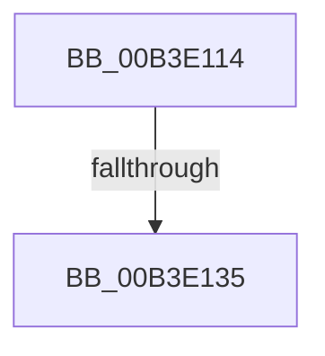

# sub_00B3E114

- RVA: `0x00B3E114`–`0x00B3E16B` (길이 `87` bytes)
- VA: `0x0000000140B3E114`
- 실행 섹션: `PAGE`
- PDB 이름 있음: `아니요`; PDB Function 태그: `아니요`
- unwind 정보 RVA: `0x000B2C70`
- 디코드: `20`개 명령, `87/87` bytes 표시
- 미해석 바이트: `0` (있으면 어셈블리에 `.byte`로 보존)

> 이 문서는 커널 이미지의 기계어와 PDB 기호를 분석해 생성했습니다. 4번과 5번은 함수 원형과 자료형을 바이너리 사용 방식에서 추정한 C 해석이며 원본 소스 복구 결과는 아닙니다.

## 1. Dependencies

- 직접 호출 지점: **3**; 고유 호출 대상: **3**
- 직접 호출자로 확인된 함수: **0**
- RIP 상대 이미지 참조: **1**

### Outgoing calls
- `0x00B3E124` → [ExAllocatePool2](../../poolcode/B8/ExAllocatePool2_function_00B820F0.md) (function, `0x00B820F0`)
- `0x00B3E13D` → [ObfReferenceObjectWithTag](../../text/21/ObfReferenceObjectWithTag_function_00210710.md) (function, `0x00210710`)
- `0x00B3E160` → [ExQueueWorkItem](../../text/2F/ExQueueWorkItem_function_002F9520.md) (function, `0x002F9520`)

### Direct callers
- 이 함수 시작 RVA로 연결되는 직접 call은 확인되지 않았습니다. 간접 호출은 완전히 역산할 수 없습니다.

### Static image references
- `0x00B3E146` → RVA `0x005E3F30` (`PspTimerDelayWorkerRoutine`; read)

## 2. Other-region calls and transfers

- 다른 실행 섹션으로 향하는 call: **3**
  - `0x00B3E124` → [ExAllocatePool2](../../poolcode/B8/ExAllocatePool2_function_00B820F0.md) (`PAGE` → `POOLCODE`)
  - `0x00B3E13D` → [ObfReferenceObjectWithTag](../../text/21/ObfReferenceObjectWithTag_function_00210710.md) (`PAGE` → `.text`)
  - `0x00B3E160` → [ExQueueWorkItem](../../text/2F/ExQueueWorkItem_function_002F9520.md) (`PAGE` → `.text`)
- call이 아닌 외부 분기/꼬리 이동: **2**
  - `0x00B3E12F` → [PsSetProcessWin32Process + 0x4A](../A5/PsSetProcessWin32Process_function_00A5F4F0.md) (`tail-transfer`)
  - `0x00B3E166` → [PsSetProcessWin32Process + 0x4A](../A5/PsSetProcessWin32Process_function_00A5F4F0.md) (`tail-transfer`)

## 3. Assembly (complete function range)

```asm
00B3E114  BA 28 00 00 00                  mov edx, 0x28
00B3E119  B9 00 01 00 00                  mov ecx, 0x100
00B3E11E  41 B8 54 69 44 65               mov r8d, 0x65446954
00B3E124  E8 C7 3F 04 00                  call 0x140b820f0
00B3E129  48 8B F0                        mov rsi, rax
00B3E12C  48 85 C0                        test rax, rax
00B3E12F  0F 84 05 14 F2 FF               je 0x140a5f53a
00B3E135  BA 50 73 4A 62                  mov edx, 0x624a7350
00B3E13A  48 8B CB                        mov rcx, rbx
00B3E13D  E8 CE 25 6D FF                  call 0x140210710
00B3E142  48 89 5E 20                     mov qword ptr [rsi + 0x20], rbx
00B3E146  48 8D 05 E3 5D AA FF            lea rax, [rip - 0x55a21d]
00B3E14D  BA 03 00 00 00                  mov edx, 3
00B3E152  48 89 46 10                     mov qword ptr [rsi + 0x10], rax
00B3E156  48 8B CE                        mov rcx, rsi
00B3E159  48 89 76 18                     mov qword ptr [rsi + 0x18], rsi
00B3E15D  48 89 3E                        mov qword ptr [rsi], rdi
00B3E160  E8 BB B3 7B FF                  call 0x1402f9520
00B3E165  90                              nop
00B3E166  E9 CF 13 F2 FF                  jmp 0x140a5f53a
```

## 4. C-style interpretation (structured pseudocode)

```c
__int64 __fastcall sub_00B3E114(void)
{
    __int64 result;

    result = ExAllocatePool2(256, 40, (unsigned int)(0x65446954ULL), a4);
    result = ObfReferenceObjectWithTag(v_rbx, (unsigned int)(0x624A7350ULL), (unsigned int)(0x65446954ULL), a4);
    *(unsigned __int64 *)(result + 32) = v_rbx;
    *(unsigned __int64 *)(result + 16) = v_rip - 5612061;
    *(unsigned __int64 *)(result + 24) = result;
    *(unsigned __int64 *)(result) = v_rdi;
    result = ExQueueWorkItem(result, 3, (unsigned int)(0x65446954ULL), a4);
}
```

## 5. (Beta) C Style

```c
void sub_00B3E114(void)
{
    int64_t result;

    result = ExAllocatePool2(256, 40, (uint32_t)(0x65446954ULL), a4);
    result = ObfReferenceObjectWithTag(local_rbx, (uint32_t)(0x624A7350ULL), (uint32_t)(0x65446954ULL), a4);
    *(uint64_t *)(result + 0x20) = local_rbx;
    *(uint64_t *)(result + 0x10) = v_rip - 5612061;
    *(uint64_t *)(result + 0x18) = result;
    *(uint64_t *)(result) = local_rdi;
    result = ExQueueWorkItem(result, 3, (uint32_t)(0x65446954ULL), a4);
}
```

## 6. Execution-region graph

[열기: 2D/3D 그래프와 함수 탐색 컨트롤 패널](../../../control-panel.html?section=page&rva=0x00B3E114&view=graph)

- 2D 그래프는 위에서 아래로 흐르고, 3D 그래프는 빈 공간을 드래그해 회전합니다. Shift+드래그는 이동, 휠은 확대·축소, 함수 노드 선택은 대상 보고서 이동입니다.

### Static fallback


