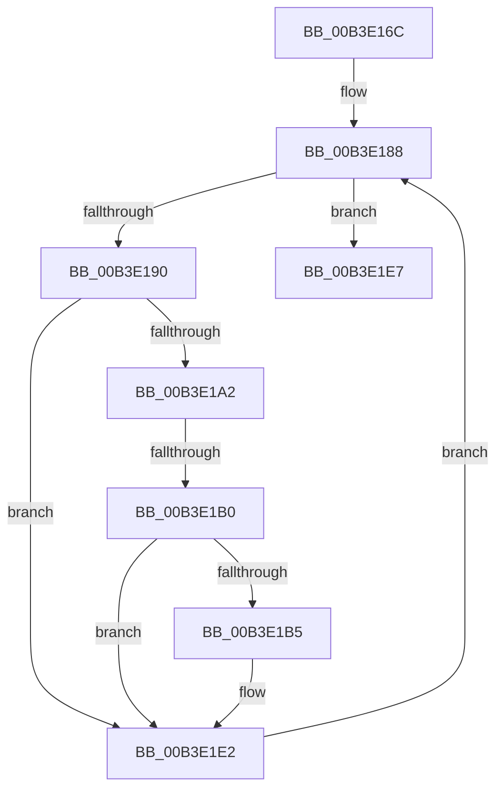

# sub_00B3E16C

- RVA: `0x00B3E16C`–`0x00B3E1FA` (길이 `142` bytes)
- VA: `0x0000000140B3E16C`
- 실행 섹션: `PAGE`
- PDB 이름 있음: `아니요`; PDB Function 태그: `아니요`
- unwind 정보 RVA: `0x000B2D14`
- 디코드: `35`개 명령, `142/142` bytes 표시
- 미해석 바이트: `0` (있으면 어셈블리에 `.byte`로 보존)

> 이 문서는 커널 이미지의 기계어와 PDB 기호를 분석해 생성했습니다. 4번과 5번은 함수 원형과 자료형을 바이너리 사용 방식에서 추정한 C 해석이며 원본 소스 복구 결과는 아닙니다.

## 1. Dependencies

- 직접 호출 지점: **0**; 고유 호출 대상: **0**
- 직접 호출자로 확인된 함수: **0**
- RIP 상대 이미지 참조: **1**

### Outgoing calls
- 직접 디코드된 call 명령이 없습니다.

### Direct callers
- 이 함수 시작 RVA로 연결되는 직접 call은 확인되지 않았습니다. 간접 호출은 완전히 역산할 수 없습니다.

### Static image references
- `0x00B3E181` → RVA `0x00B4C360` (`EtwpUmglProviders`; read)

## 2. Other-region calls and transfers

- 다른 실행 섹션으로 향하는 call: **0**
- call이 아닌 외부 분기/꼬리 이동: **2**
  - `0x00B3E1AA` → [EtwpEnumerateTraceGuids + 0x7E](../A5/EtwpEnumerateTraceGuids_function_00A5F6FC.md) (`tail-transfer`)
  - `0x00B3E1F5` → [EtwpEnumerateTraceGuids + 0x86](../A5/EtwpEnumerateTraceGuids_function_00A5F6FC.md) (`tail-transfer`)

## 3. Assembly (complete function range)

```asm
00B3E16C  48 8B 46 08                     mov rax, qword ptr [rsi + 8]
00B3E170  48 8B 90 08 05 00 00            mov rdx, qword ptr [rax + 0x508]
00B3E177  48 81 C2 26 02 00 00            add rdx, 0x226
00B3E17E  44 8B C3                        mov r8d, ebx
00B3E181  4C 8D 1D D8 E1 00 00            lea r11, [rip + 0xe1d8]
00B3E188  8B C7                           mov eax, edi
00B3E18A  41 83 F8 0A                     cmp r8d, 0xa
00B3E18E  73 57                           jae 0x140b3e1e7
00B3E190  45 8B C8                        mov r9d, r8d
00B3E193  4D 03 C9                        add r9, r9
00B3E196  47 0F B6 54 CB 08               movzx r10d, byte ptr [r11 + r9*8 + 8]
00B3E19C  42 38 1C 52                     cmp byte ptr [rdx + r10*2], bl
00B3E1A0  74 40                           je 0x140b3e1e2
00B3E1A2  FF C7                           inc edi
00B3E1A4  81 FF C7 71 1C 07               cmp edi, 0x71c71c7
00B3E1AA  0F 87 CA 15 F2 FF               ja 0x140a5f77a
00B3E1B0  41 3B FF                        cmp edi, r15d
00B3E1B3  77 2D                           ja 0x140b3e1e2
00B3E1B5  48 8D 0C C0                     lea rcx, [rax + rax*8]
00B3E1B9  4B 8B 04 CB                     mov rax, qword ptr [r11 + r9*8]
00B3E1BD  0F 10 00                        movups xmm0, xmmword ptr [rax]
00B3E1C0  F3 0F 7F 44 8D 00               movdqu xmmword ptr [rbp + rcx*4], xmm0
00B3E1C6  42 0F B6 04 52                  movzx eax, byte ptr [rdx + r10*2]
00B3E1CB  89 44 8D 14                     mov dword ptr [rbp + rcx*4 + 0x14], eax
00B3E1CF  42 0F B6 44 52 01               movzx eax, byte ptr [rdx + r10*2 + 1]
00B3E1D5  89 44 8D 1C                     mov dword ptr [rbp + rcx*4 + 0x1c], eax
00B3E1D9  89 5C 8D 18                     mov dword ptr [rbp + rcx*4 + 0x18], ebx
00B3E1DD  C6 44 8D 20 01                  mov byte ptr [rbp + rcx*4 + 0x20], 1
00B3E1E2  41 FF C0                        inc r8d
00B3E1E5  EB A1                           jmp 0x140b3e188
00B3E1E7  41 3B C7                        cmp eax, r15d
00B3E1EA  41 89 06                        mov dword ptr [r14], eax
00B3E1ED  B9 23 00 00 C0                  mov ecx, 0xc0000023
00B3E1F2  0F 47 D9                        cmova ebx, ecx
00B3E1F5  E9 88 15 F2 FF                  jmp 0x140a5f782
```

## 4. C-style interpretation (structured pseudocode)

```c
__int64 __fastcall sub_00B3E16C(void)
{
    __int64 result;
    __int64 v_rbx;
    __int64 v_rdi;

    a2 = (*(unsigned __int64 *)(*(unsigned __int64 *)(v_rsi + 8) + 1288)) + (550);
loc_00B3E188:
    if (((unsigned int)((unsigned int)((unsigned int)(v_rbx)))) >= 10) goto loc_00B3E1E7;
    a4 = ((unsigned int)((unsigned int)((unsigned int)((unsigned int)(v_rbx))))) + ((unsigned int)((unsigned int)((unsigned int)((unsigned int)(v_rbx)))));
    if ((*(unsigned __int8 *)(a2 + *(unsigned __int8 *)(v_rip + 57816 + a4 * 8 + 8) * 2)) == ((unsigned __int8)(v_rbx))) goto loc_00B3E1E2;
    v_rdi = (unsigned int)((v_rdi) + 1);
    result = (unsigned int)((unsigned int)(v_rdi));
    if (((unsigned int)(v_rdi)) <= ((unsigned int)(v_r15))) {
        a1 = (unsigned int)((unsigned int)(v_rdi)) + (unsigned int)((unsigned int)(v_rdi)) * 8;
        result = *(unsigned __int64 *)(v_rip + 57816 + a4 * 8);
        *(unsigned __int64 *)(v_rbp + a1 * 4) = v_xmm0;
        result = *(unsigned __int8 *)(a2 + *(unsigned __int8 *)(v_rip + 57816 + a4 * 8 + 8) * 2);
        *(unsigned int *)(v_rbp + a1 * 4 + 20) = (unsigned int)(result);
        result = *(unsigned __int8 *)(a2 + *(unsigned __int8 *)(v_rip + 57816 + a4 * 8 + 8) * 2 + 1);
        *(unsigned int *)(v_rbp + a1 * 4 + 28) = (unsigned int)(result);
        *(unsigned int *)(v_rbp + a1 * 4 + 24) = (unsigned int)(v_rbx);
        *(unsigned __int8 *)(v_rbp + a1 * 4 + 32) = 1;
    }
    a3 = (unsigned int)(((unsigned int)((unsigned int)(v_rbx))) + 1);
    goto loc_00B3E188;
loc_00B3E1E7:
    *(unsigned int *)(v_r14) = (unsigned int)(result);
    if (((unsigned int)(result)) > ((unsigned int)(v_r15))) { v_rbx = (unsigned int)((unsigned int)(0xC0000023ULL)); }
}
```

## 5. (Beta) C Style

```c
void sub_00B3E16C(void)
{
    int64_t result;
    int64_t local_rbx;
    int64_t local_rdi;

    a2 = (*(uint64_t *)(*(uint64_t *)(local_rsi + 0x8) + 0x508)) + (550);
loc_00B3E188:
    if (((uint32_t)((uint32_t)((uint32_t)(local_rbx)))) >= 10) goto loc_00B3E1E7;
    a4 = ((uint32_t)((uint32_t)((uint32_t)((uint32_t)(local_rbx))))) + ((uint32_t)((uint32_t)((uint32_t)((uint32_t)(local_rbx)))));
    if ((*(uint8_t *)(a2 + *(uint8_t *)(v_rip + 0xE1D8 + a4 * 8 + 0x8) * 2)) == ((uint8_t)(local_rbx))) goto loc_00B3E1E2;
    local_rdi = (uint32_t)((local_rdi) + 1);
    result = (uint32_t)((uint32_t)(local_rdi));
    if (((uint32_t)(local_rdi)) <= ((uint32_t)(local_r15))) {
        a1 = (uint32_t)((uint32_t)(local_rdi)) + (uint32_t)((uint32_t)(local_rdi)) * 8;
        result = *(uint64_t *)(v_rip + 0xE1D8 + a4 * 8);
        *(uint64_t *)(local_rbp + a1 * 4) = v_xmm0;
        result = *(uint8_t *)(a2 + *(uint8_t *)(v_rip + 0xE1D8 + a4 * 8 + 0x8) * 2);
        *(uint32_t *)(local_rbp + a1 * 4 + 0x14) = (uint32_t)(result);
        result = *(uint8_t *)(a2 + *(uint8_t *)(v_rip + 0xE1D8 + a4 * 8 + 0x8) * 2 + 0x1);
        *(uint32_t *)(local_rbp + a1 * 4 + 0x1C) = (uint32_t)(result);
        *(uint32_t *)(local_rbp + a1 * 4 + 0x18) = (uint32_t)(local_rbx);
        *(uint8_t *)(local_rbp + a1 * 4 + 0x20) = 1;
    }
    a3 = (uint32_t)(((uint32_t)((uint32_t)(local_rbx))) + 1);
    goto loc_00B3E188;
loc_00B3E1E7:
    *(uint32_t *)(local_r14) = (uint32_t)(result);
    if (((uint32_t)(result)) > ((uint32_t)(local_r15))) { local_rbx = (uint32_t)((uint32_t)(0xC0000023ULL)); }
}
```

## 6. Execution-region graph

[열기: 2D/3D 그래프와 함수 탐색 컨트롤 패널](../../../control-panel.html?section=page&rva=0x00B3E16C&view=graph)

- 2D 그래프는 위에서 아래로 흐르고, 3D 그래프는 빈 공간을 드래그해 회전합니다. Shift+드래그는 이동, 휠은 확대·축소, 함수 노드 선택은 대상 보고서 이동입니다.

### Static fallback


