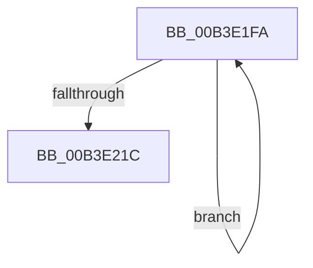

# sub_00B3E1FA

- RVA: `0x00B3E1FA`–`0x00B3E22E` (길이 `52` bytes)
- VA: `0x0000000140B3E1FA`
- 실행 섹션: `PAGE`
- PDB 이름 있음: `아니요`; PDB Function 태그: `아니요`
- unwind 정보 RVA: `0x000B2DAC`
- 디코드: `15`개 명령, `52/52` bytes 표시
- 미해석 바이트: `0` (있으면 어셈블리에 `.byte`로 보존)

> 이 문서는 커널 이미지의 기계어와 PDB 기호를 분석해 생성했습니다. 4번과 5번은 함수 원형과 자료형을 바이너리 사용 방식에서 추정한 C 해석이며 원본 소스 복구 결과는 아닙니다.

## 1. Dependencies

- 직접 호출 지점: **2**; 고유 호출 대상: **2**
- 직접 호출자로 확인된 함수: **0**
- RIP 상대 이미지 참조: **0**

### Outgoing calls
- `0x00B3E20D` → [DbgkPostEnclaveModuleMessages](../../text/57/DbgkPostEnclaveModuleMessages_function_0057FCDC.md) (function, `0x0057FCDC`)
- `0x00B3E223` → [PsFreeEnclaveModuleInfo](../../text/4C/PsFreeEnclaveModuleInfo_function_004CA520.md) (function, `0x004CA520`)

### Direct callers
- 이 함수 시작 RVA로 연결되는 직접 call은 확인되지 않았습니다. 간접 호출은 완전히 역산할 수 없습니다.

### Static image references
- 디코드된 RIP-relative 메모리 참조가 없습니다.

## 2. Other-region calls and transfers

- 다른 실행 섹션으로 향하는 call: **2**
  - `0x00B3E20D` → [DbgkPostEnclaveModuleMessages](../../text/57/DbgkPostEnclaveModuleMessages_function_0057FCDC.md) (`PAGE` → `.text`)
  - `0x00B3E223` → [PsFreeEnclaveModuleInfo](../../text/4C/PsFreeEnclaveModuleInfo_function_004CA520.md) (`PAGE` → `.text`)
- call이 아닌 외부 분기/꼬리 이동: **1**
  - `0x00B3E229` → [DbgkpPostModuleMessages + 0x190](../A5/DbgkpPostModuleMessages_function_00A5F86C.md) (`tail-transfer`)

## 3. Assembly (complete function range)

```asm
00B3E1FA  8B 46 08                        mov eax, dword ptr [rsi + 8]
00B3E1FD  89 44 24 20                     mov dword ptr [rsp + 0x20], eax
00B3E201  4C 8B 0E                        mov r9, qword ptr [rsi]
00B3E204  4D 8B C6                        mov r8, r14
00B3E207  49 8B D7                        mov rdx, r15
00B3E20A  48 8B CB                        mov rcx, rbx
00B3E20D  E8 CA 1A A4 FF                  call 0x14057fcdc
00B3E212  48 8D 76 10                     lea rsi, [rsi + 0x10]
00B3E216  49 83 EC 01                     sub r12, 1
00B3E21A  75 DE                           jne 0x140b3e1fa
00B3E21C  8B D7                           mov edx, edi
00B3E21E  48 8B 4C 24 48                  mov rcx, qword ptr [rsp + 0x48]
00B3E223  E8 F8 C2 98 FF                  call 0x1404ca520
00B3E228  90                              nop
00B3E229  E9 CE 17 F2 FF                  jmp 0x140a5f9fc
```

## 4. C-style interpretation (structured pseudocode)

```c
__int64 __fastcall sub_00B3E1FA(__int64 a1, __int64 a2, __int64 a3, __int64 a4, __int64 a5, __int64 a6, __int64 a7, __int64 a8, __int64 a9)
{
    __int64 result;
    __int64 v_r12;
    unsigned int v_stack_p20;

    v_stack_p20 = (unsigned int)((unsigned int)(*(unsigned int *)(v_rsi + 8)));
    result = DbgkPostEnclaveModuleMessages(v_rbx, v_r15, v_r14, *(unsigned __int64 *)(v_rsi));
    v_r12 = (v_r12) - (1);
    if (condition_is_not_equal) goto loc_00B3E1FA;
    result = PsFreeEnclaveModuleInfo(a9, (unsigned int)((unsigned int)(v_rdi)), v_r14, *(unsigned __int64 *)(v_rsi));
}
```

## 5. (Beta) C Style

```c
int64_t sub_00B3E1FA(int64_t Arg1, int64_t Arg2, int64_t Arg3, int64_t Arg4, uint64_t Arg5, uint64_t Arg6, uint64_t Arg7, uint64_t Arg8, int64_t Arg9)
{
    int64_t result;
    int64_t local_r12;
    uint32_t v_stack_p20;

    v_stack_p20 = (uint32_t)((uint32_t)(*(uint32_t *)(local_rsi + 0x8)));
    result = DbgkPostEnclaveModuleMessages(local_rbx, local_r15, local_r14, *(uint64_t *)(local_rsi));
    local_r12 = (local_r12) - (1);
    if (condition_is_not_equal) goto loc_00B3E1FA;
    result = PsFreeEnclaveModuleInfo(Arg9, (uint32_t)((uint32_t)(local_rdi)), local_r14, *(uint64_t *)(local_rsi));
}
```

## 6. Execution-region graph

[열기: 2D/3D 그래프와 함수 탐색 컨트롤 패널](../../../control-panel.html?section=page&rva=0x00B3E1FA&view=graph)

- 2D 그래프는 위에서 아래로 흐르고, 3D 그래프는 빈 공간을 드래그해 회전합니다. Shift+드래그는 이동, 휠은 확대·축소, 함수 노드 선택은 대상 보고서 이동입니다.

### Static fallback


