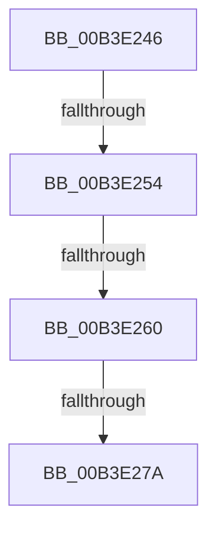

# sub_00B3E246

- RVA: `0x00B3E246`–`0x00B3E2A4` (길이 `94` bytes)
- VA: `0x0000000140B3E246`
- 실행 섹션: `PAGE`
- PDB 이름 있음: `아니요`; PDB Function 태그: `아니요`
- unwind 정보 RVA: `0x000B3014`
- 디코드: `21`개 명령, `94/94` bytes 표시
- 미해석 바이트: `0` (있으면 어셈블리에 `.byte`로 보존)

> 이 문서는 커널 이미지의 기계어와 PDB 기호를 분석해 생성했습니다. 4번과 5번은 함수 원형과 자료형을 바이너리 사용 방식에서 추정한 C 해석이며 원본 소스 복구 결과는 아닙니다.

## 1. Dependencies

- 직접 호출 지점: **2**; 고유 호출 대상: **2**
- 직접 호출자로 확인된 함수: **0**
- RIP 상대 이미지 참조: **4**

### Outgoing calls
- `0x00B3E26C` → [ExAllocatePool2](../../poolcode/B8/ExAllocatePool2_function_00B820F0.md) (function, `0x00B820F0`)
- `0x00B3E299` → [ExQueueWorkItem](../../text/2F/ExQueueWorkItem_function_002F9520.md) (function, `0x002F9520`)

### Direct callers
- 이 함수 시작 RVA로 연결되는 직접 call은 확인되지 않았습니다. 간접 호출은 완전히 역산할 수 없습니다.

### Static image references
- `0x00B3E248` → RVA `0x00FD9A76` (`PAGEDATA`; read)
- `0x00B3E254` → RVA `0x00E685D0` (`.data`; read)
- `0x00B3E27A` → RVA `0x007E2360` (`CmpQuotaWarningWorker`; read)
- `0x00B3E281` → RVA `0x00FD9A76` (`PAGEDATA`; write)

## 2. Other-region calls and transfers

- 다른 실행 섹션으로 향하는 call: **2**
  - `0x00B3E26C` → [ExAllocatePool2](../../poolcode/B8/ExAllocatePool2_function_00B820F0.md) (`PAGE` → `POOLCODE`)
  - `0x00B3E299` → [ExQueueWorkItem](../../text/2F/ExQueueWorkItem_function_002F9520.md) (`PAGE` → `.text`)
- call이 아닌 외부 분기/꼬리 이동: **4**
  - `0x00B3E24E` → [CmpCanGrowHive + 0x5C](../A6/CmpCanGrowHive_function_00A60C38.md) (`tail-transfer`)
  - `0x00B3E25A` → [CmpCanGrowHive + 0x5C](../A6/CmpCanGrowHive_function_00A60C38.md) (`tail-transfer`)
  - `0x00B3E274` → [CmpCanGrowHive + 0x5C](../A6/CmpCanGrowHive_function_00A60C38.md) (`tail-transfer`)
  - `0x00B3E29F` → [CmpCanGrowHive + 0x5C](../A6/CmpCanGrowHive_function_00A60C38.md) (`tail-transfer`)

## 3. Assembly (complete function range)

```asm
00B3E246  33 DB                           xor ebx, ebx
00B3E248  38 1D 28 B8 49 00               cmp byte ptr [rip + 0x49b828], bl
00B3E24E  0F 85 40 2A F2 FF               jne 0x140a60c94
00B3E254  38 1D 76 A3 32 00               cmp byte ptr [rip + 0x32a376], bl
00B3E25A  0F 84 34 2A F2 FF               je 0x140a60c94
00B3E260  8D 53 20                        lea edx, [rbx + 0x20]
00B3E263  41 B8 43 4D 20 20               mov r8d, 0x20204d43
00B3E269  8D 4B 40                        lea ecx, [rbx + 0x40]
00B3E26C  E8 7F 3E 04 00                  call 0x140b820f0
00B3E271  48 85 C0                        test rax, rax
00B3E274  0F 84 1A 2A F2 FF               je 0x140a60c94
00B3E27A  48 8D 0D DF 40 CA FF            lea rcx, [rip - 0x35bf21]
00B3E281  C6 05 EE B7 49 00 01            mov byte ptr [rip + 0x49b7ee], 1
00B3E288  48 89 48 10                     mov qword ptr [rax + 0x10], rcx
00B3E28C  8D 53 01                        lea edx, [rbx + 1]
00B3E28F  48 8B C8                        mov rcx, rax
00B3E292  48 89 40 18                     mov qword ptr [rax + 0x18], rax
00B3E296  48 89 18                        mov qword ptr [rax], rbx
00B3E299  E8 82 B2 7B FF                  call 0x1402f9520
00B3E29E  90                              nop
00B3E29F  E9 F0 29 F2 FF                  jmp 0x140a60c94
```

## 4. C-style interpretation (structured pseudocode)

```c
__int64 __fastcall sub_00B3E246(void)
{
    __int64 result;
    __int64 v_rbx;

    v_rbx = 0;
    result = ExAllocatePool2(v_rbx + 64, v_rbx + 32, (unsigned int)(0x20204D43ULL), a4);
    *(unsigned __int8 *)(v_rip + 4831214) = 1;
    *(unsigned __int64 *)(result + 16) = v_rip - 3522337;
    *(unsigned __int64 *)(result + 24) = result;
    *(unsigned __int64 *)(result) = 0;
    result = ExQueueWorkItem(result, v_rbx + 1, (unsigned int)(0x20204D43ULL), a4);
}
```

## 5. (Beta) C Style

```c
void sub_00B3E246(void)
{
    int64_t result;
    int64_t local_rbx;

    local_rbx = 0;
    result = ExAllocatePool2(local_rbx + 64, local_rbx + 32, (uint32_t)(0x20204D43ULL), a4);
    *(uint8_t *)(v_rip + 0x49B7EE) = 1;
    *(uint64_t *)(result + 0x10) = v_rip - 3522337;
    *(uint64_t *)(result + 0x18) = result;
    *(uint64_t *)(result) = 0;
    result = ExQueueWorkItem(result, local_rbx + 1, (uint32_t)(0x20204D43ULL), a4);
}
```

## 6. Execution-region graph

[열기: 2D/3D 그래프와 함수 탐색 컨트롤 패널](../../../control-panel.html?section=page&rva=0x00B3E246&view=graph)

- 2D 그래프는 위에서 아래로 흐르고, 3D 그래프는 빈 공간을 드래그해 회전합니다. Shift+드래그는 이동, 휠은 확대·축소, 함수 노드 선택은 대상 보고서 이동입니다.

### Static fallback


