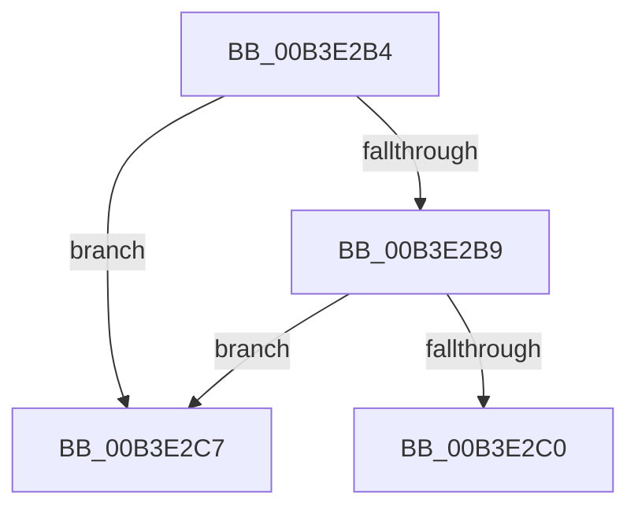

# sub_00B3E2B4

- RVA: `0x00B3E2B4`–`0x00B3E2CF` (길이 `27` bytes)
- VA: `0x0000000140B3E2B4`
- 실행 섹션: `PAGE`
- PDB 이름 있음: `아니요`; PDB Function 태그: `아니요`
- unwind 정보 RVA: `0x000B331C`
- 디코드: `8`개 명령, `27/27` bytes 표시
- 미해석 바이트: `0` (있으면 어셈블리에 `.byte`로 보존)

> 이 문서는 커널 이미지의 기계어와 PDB 기호를 분석해 생성했습니다. 4번과 5번은 함수 원형과 자료형을 바이너리 사용 방식에서 추정한 C 해석이며 원본 소스 복구 결과는 아닙니다.

## 1. Dependencies

- 직접 호출 지점: **0**; 고유 호출 대상: **0**
- 직접 호출자로 확인된 함수: **0**
- RIP 상대 이미지 참조: **0**

### Outgoing calls
- 직접 디코드된 call 명령이 없습니다.

### Direct callers
- 이 함수 시작 RVA로 연결되는 직접 call은 확인되지 않았습니다. 간접 호출은 완전히 역산할 수 없습니다.

### Static image references
- 디코드된 RIP-relative 메모리 참조가 없습니다.

## 2. Other-region calls and transfers

- 다른 실행 섹션으로 향하는 call: **0**
- call이 아닌 외부 분기/꼬리 이동: **2**
  - `0x00B3E2C2` → [PiDqActionDataGetChangedProperties + 0x2F2](../A6/PiDqActionDataGetChangedProperties_function_00A61F10.md) (`tail-transfer`)
  - `0x00B3E2CA` → [PiDqActionDataGetChangedProperties + 0x16A](../A6/PiDqActionDataGetChangedProperties_function_00A61F10.md) (`tail-transfer`)

## 3. Assembly (complete function range)

```asm
00B3E2B4  48 85 C9                        test rcx, rcx
00B3E2B7  75 0E                           jne 0x140b3e2c7
00B3E2B9  46 3B 5C 0A 14                  cmp r11d, dword ptr [rdx + r9 + 0x14]
00B3E2BE  75 07                           jne 0x140b3e2c7
00B3E2C0  33 F6                           xor esi, esi
00B3E2C2  E9 3B 3F F2 FF                  jmp 0x140a62202
00B3E2C7  41 FF C0                        inc r8d
00B3E2CA  E9 AB 3D F2 FF                  jmp 0x140a6207a
```

## 4. C-style interpretation (structured pseudocode)

```c
void __fastcall sub_00B3E2B4(__int64 a1, __int64 a2, int a3, __int64 a4)
{
    __int64 v_rsi;

    if (a1 != 0) goto loc_00B3E2C7;
    if (((unsigned int)(v_r11)) != (*(unsigned int *)(a2 + a4 * 1 + 20))) goto loc_00B3E2C7;
    v_rsi = 0;
loc_00B3E2C7:
    a3 = (unsigned int)((a3) + 1);
}
```

## 5. (Beta) C Style

```c
void sub_00B3E2B4(int64_t Arg1, void *Arg2, int32_t Arg3, int64_t Arg4)
{
    uint8_t *arg2 = (uint8_t *)Arg2;

    int64_t local_rsi;

    if (Arg1 != 0) goto loc_00B3E2C7;
    if (((uint32_t)(local_r11)) != (*(uint32_t *)(arg2 + Arg4 * 1 + 0x14))) goto loc_00B3E2C7;
    local_rsi = 0;
loc_00B3E2C7:
    Arg3 = (uint32_t)((Arg3) + 1);
}
```

### 관측된 메모리 오프셋

구조체 형식이 확인되지 않은 접근은 인자 기준의 오프셋으로만 기록했습니다.

| 기준 인자 | 오프셋 표현 | 폭 (bit) | 접근 |
|---|---:|---:|---|
| `Arg2` | `+ 0x14 + r9*1` | `32` | `R` |

## 6. Execution-region graph

[열기: 2D/3D 그래프와 함수 탐색 컨트롤 패널](../../../control-panel.html?section=page&rva=0x00B3E2B4&view=graph)

- 2D 그래프는 위에서 아래로 흐르고, 3D 그래프는 빈 공간을 드래그해 회전합니다. Shift+드래그는 이동, 휠은 확대·축소, 함수 노드 선택은 대상 보고서 이동입니다.

### Static fallback


