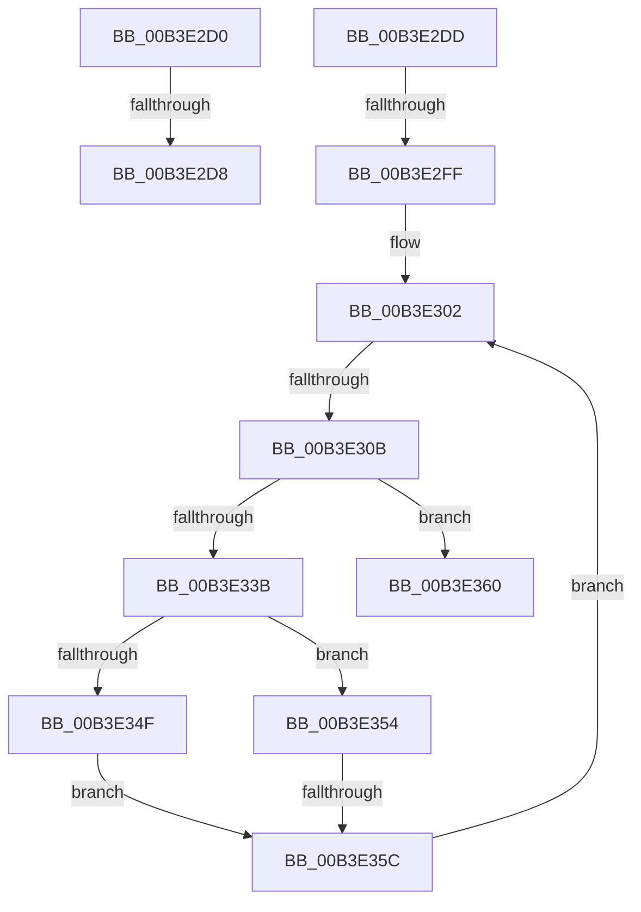

# sub_00B3E2D0

- RVA: `0x00B3E2D0`–`0x00B3E36F` (길이 `159` bytes)
- VA: `0x0000000140B3E2D0`
- 실행 섹션: `PAGE`
- PDB 이름 있음: `아니요`; PDB Function 태그: `아니요`
- unwind 정보 RVA: `0x000B339C`
- 디코드: `42`개 명령, `159/159` bytes 표시
- 미해석 바이트: `0` (있으면 어셈블리에 `.byte`로 보존)

> 이 문서는 커널 이미지의 기계어와 PDB 기호를 분석해 생성했습니다. 4번과 5번은 함수 원형과 자료형을 바이너리 사용 방식에서 추정한 C 해석이며 원본 소스 복구 결과는 아닙니다.

## 1. Dependencies

- 직접 호출 지점: **3**; 고유 호출 대상: **3**
- 직접 호출자로 확인된 함수: **0**
- RIP 상대 이미지 참조: **0**

### Outgoing calls
- `0x00B3E2EE` → [ExAllocatePool2](../../poolcode/B8/ExAllocatePool2_function_00B820F0.md) (function, `0x00B820F0`)
- `0x00B3E330` → [PnpCtxRegEnumValue](../99/PnpCtxRegEnumValue_function_0099364C.md) (function, `0x0099364C`)
- `0x00B3E341` → [PnpCtxRegDeleteValue](../8F/PnpCtxRegDeleteValue_function_008FE5E0.md) (function, `0x008FE5E0`)

### Direct callers
- 이 함수 시작 RVA로 연결되는 직접 call은 확인되지 않았습니다. 간접 호출은 완전히 역산할 수 없습니다.

### Static image references
- 디코드된 RIP-relative 메모리 참조가 없습니다.

## 2. Other-region calls and transfers

- 다른 실행 섹션으로 향하는 call: **1**
  - `0x00B3E2EE` → [ExAllocatePool2](../../poolcode/B8/ExAllocatePool2_function_00B820F0.md) (`PAGE` → `POOLCODE`)
- call이 아닌 외부 분기/꼬리 이동: **6**
  - `0x00B3E2D2` → [DrvDbSetDeviceIdDriverInfMatches + 0x1DF](../A6/DrvDbSetDeviceIdDriverInfMatches_function_00A6251C.md) (`tail-transfer`)
  - `0x00B3E2D8` → [DrvDbSetDeviceIdDriverInfMatches + 0x18E](../A6/DrvDbSetDeviceIdDriverInfMatches_function_00A6251C.md) (`tail-transfer`)
  - `0x00B3E2F9` → [DrvDbSetDeviceIdDriverInfMatches + 0x265](../A6/DrvDbSetDeviceIdDriverInfMatches_function_00A6251C.md) (`tail-transfer`)
  - `0x00B3E305` → [DrvDbSetDeviceIdDriverInfMatches + 0x1DF](../A6/DrvDbSetDeviceIdDriverInfMatches_function_00A6251C.md) (`tail-transfer`)
  - `0x00B3E356` → [DrvDbSetDeviceIdDriverInfMatches + 0x1DF](../A6/DrvDbSetDeviceIdDriverInfMatches_function_00A6251C.md) (`tail-transfer`)
  - `0x00B3E36A` → [DrvDbSetDeviceIdDriverInfMatches + 0x1DF](../A6/DrvDbSetDeviceIdDriverInfMatches_function_00A6251C.md) (`tail-transfer`)

## 3. Assembly (complete function range)

```asm
00B3E2D0  85 C0                           test eax, eax
00B3E2D2  0F 88 23 44 F2 FF               js 0x140a626fb
00B3E2D8  E9 CD 43 F2 FF                  jmp 0x140a626aa
00B3E2DD  41 8B D4                        mov edx, r12d
00B3E2E0  B9 00 01 00 00                  mov ecx, 0x100
00B3E2E5  48 03 D2                        add rdx, rdx
00B3E2E8  41 B8 50 44 44 42               mov r8d, 0x42444450
00B3E2EE  E8 FD 3D 04 00                  call 0x140b820f0
00B3E2F3  48 8B F8                        mov rdi, rax
00B3E2F6  48 85 C0                        test rax, rax
00B3E2F9  0F 84 82 44 F2 FF               je 0x140a62781
00B3E2FF  41 8B F7                        mov esi, r15d
00B3E302  41 3B F6                        cmp esi, r14d
00B3E305  0F 83 F0 43 F2 FF               jae 0x140a626fb
00B3E30B  4C 89 7C 24 38                  mov qword ptr [rsp + 0x38], r15
00B3E310  48 8D 45 60                     lea rax, [rbp + 0x60]
00B3E314  4C 89 7C 24 30                  mov qword ptr [rsp + 0x30], r15
00B3E319  4C 8B CF                        mov r9, rdi
00B3E31C  4C 89 7C 24 28                  mov qword ptr [rsp + 0x28], r15
00B3E321  44 8B C6                        mov r8d, esi
00B3E324  49 8B D5                        mov rdx, r13
00B3E327  48 89 44 24 20                  mov qword ptr [rsp + 0x20], rax
00B3E32C  44 89 65 60                     mov dword ptr [rbp + 0x60], r12d
00B3E330  E8 17 53 E5 FF                  call 0x14099364c
00B3E335  8B D8                           mov ebx, eax
00B3E337  85 C0                           test eax, eax
00B3E339  78 25                           js 0x140b3e360
00B3E33B  4C 8B C7                        mov r8, rdi
00B3E33E  49 8B D5                        mov rdx, r13
00B3E341  E8 9A 02 DC FF                  call 0x1408fe5e0
00B3E346  8B D8                           mov ebx, eax
00B3E348  3D 34 00 00 C0                  cmp eax, 0xc0000034
00B3E34D  75 05                           jne 0x140b3e354
00B3E34F  41 8B DF                        mov ebx, r15d
00B3E352  EB 08                           jmp 0x140b3e35c
00B3E354  85 C0                           test eax, eax
00B3E356  0F 88 9F 43 F2 FF               js 0x140a626fb
00B3E35C  FF C6                           inc esi
00B3E35E  EB A2                           jmp 0x140b3e302
00B3E360  81 FB 1A 00 00 80               cmp ebx, 0x8000001a
00B3E366  41 0F 44 DF                     cmove ebx, r15d
00B3E36A  E9 8C 43 F2 FF                  jmp 0x140a626fb
```

## 4. C-style interpretation (structured pseudocode)

```c
__int64 __fastcall sub_00B3E2D0(void)
{
    unsigned __int64 v_stack_p20;
    unsigned __int64 v_stack_p28;
    unsigned __int64 v_stack_p30;
    unsigned __int64 v_stack_p38;
}
```

## 5. (Beta) C Style

```c
void sub_00B3E2D0(void)
{
    uint64_t v_stack_p20;
    uint64_t v_stack_p28;
    uint64_t v_stack_p30;
    uint64_t v_stack_p38;
}
```

## 6. Execution-region graph

[열기: 2D/3D 그래프와 함수 탐색 컨트롤 패널](../../../control-panel.html?section=page&rva=0x00B3E2D0&view=graph)

- 2D 그래프는 위에서 아래로 흐르고, 3D 그래프는 빈 공간을 드래그해 회전합니다. Shift+드래그는 이동, 휠은 확대·축소, 함수 노드 선택은 대상 보고서 이동입니다.

### Static fallback


