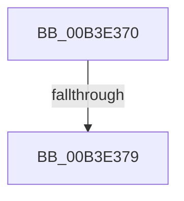

# sub_00B3E370

- RVA: `0x00B3E370`–`0x00B3E38E` (길이 `30` bytes)
- VA: `0x0000000140B3E370`
- 실행 섹션: `PAGE`
- PDB 이름 있음: `아니요`; PDB Function 태그: `아니요`
- unwind 정보 RVA: `0x000B346C`
- 디코드: `7`개 명령, `30/30` bytes 표시
- 미해석 바이트: `0` (있으면 어셈블리에 `.byte`로 보존)

> 이 문서는 커널 이미지의 기계어와 PDB 기호를 분석해 생성했습니다. 4번과 5번은 함수 원형과 자료형을 바이너리 사용 방식에서 추정한 C 해석이며 원본 소스 복구 결과는 아닙니다.

## 1. Dependencies

- 직접 호출 지점: **1**; 고유 호출 대상: **1**
- 직접 호출자로 확인된 함수: **0**
- RIP 상대 이미지 참조: **1**

### Outgoing calls
- `0x00B3E383` → [RtlInitUnicodeString](../../text/42/RtlInitUnicodeString_function_0042A780.md) (function, `0x0042A780`)

### Direct callers
- 이 함수 시작 RVA로 연결되는 직접 call은 확인되지 않았습니다. 간접 호출은 완전히 역산할 수 없습니다.

### Static image references
- `0x00B3E379` → RVA `0x0001A748` (`.rdata`; read)

## 2. Other-region calls and transfers

- 다른 실행 섹션으로 향하는 call: **1**
  - `0x00B3E383` → [RtlInitUnicodeString](../../text/42/RtlInitUnicodeString_function_0042A780.md) (`PAGE` → `.text`)
- call이 아닌 외부 분기/꼬리 이동: **2**
  - `0x00B3E373` → [AdtpBuildPrivilegeAuditString + 0x168](../A6/AdtpBuildPrivilegeAuditString_function_00A62AE8.md) (`tail-transfer`)
  - `0x00B3E389` → [AdtpBuildPrivilegeAuditString + 0x168](../A6/AdtpBuildPrivilegeAuditString_function_00A62AE8.md) (`tail-transfer`)

## 3. Assembly (complete function range)

```asm
00B3E370  4D 85 FF                        test r15, r15
00B3E373  0F 84 D7 48 F2 FF               je 0x140a62c50
00B3E379  48 8D 15 C8 C3 4D FF            lea rdx, [rip - 0xb23c38]
00B3E380  49 8B CF                        mov rcx, r15
00B3E383  E8 F8 C3 8E FF                  call 0x14042a780
00B3E388  90                              nop
00B3E389  E9 C2 48 F2 FF                  jmp 0x140a62c50
```

## 4. C-style interpretation (structured pseudocode)

```c
__int64 __fastcall sub_00B3E370(void)
{
    __int64 result;

    result = RtlInitUnicodeString(v_r15, v_rip - 11680824, a3, a4);
}
```

## 5. (Beta) C Style

```c
void sub_00B3E370(void)
{
    int64_t result;

    result = RtlInitUnicodeString(local_r15, v_rip - 11680824, a3, a4);
}
```

## 6. Execution-region graph

[열기: 2D/3D 그래프와 함수 탐색 컨트롤 패널](../../../control-panel.html?section=page&rva=0x00B3E370&view=graph)

- 2D 그래프는 위에서 아래로 흐르고, 3D 그래프는 빈 공간을 드래그해 회전합니다. Shift+드래그는 이동, 휠은 확대·축소, 함수 노드 선택은 대상 보고서 이동입니다.

### Static fallback


