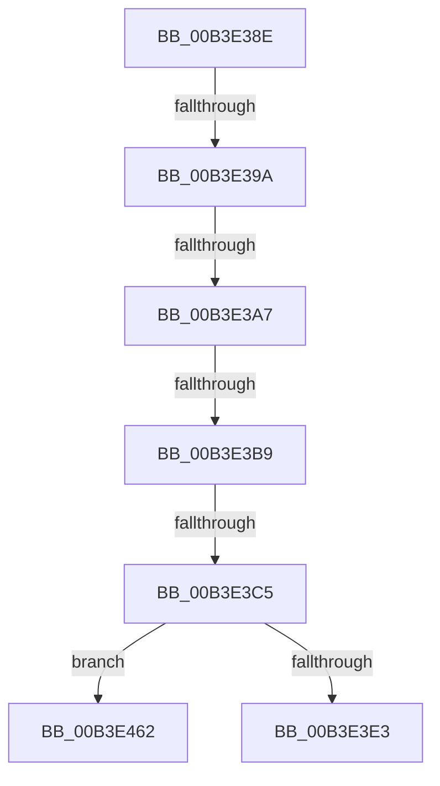

# sub_00B3E38E

- RVA: `0x00B3E38E`–`0x00B3E471` (길이 `227` bytes)
- VA: `0x0000000140B3E38E`
- 실행 섹션: `PAGE`
- PDB 이름 있음: `아니요`; PDB Function 태그: `아니요`
- unwind 정보 RVA: `0x000B3540`
- 디코드: `44`개 명령, `227/227` bytes 표시
- 미해석 바이트: `0` (있으면 어셈블리에 `.byte`로 보존)

> 이 문서는 커널 이미지의 기계어와 PDB 기호를 분석해 생성했습니다. 4번과 5번은 함수 원형과 자료형을 바이너리 사용 방식에서 추정한 C 해석이며 원본 소스 복구 결과는 아닙니다.

## 1. Dependencies

- 직접 호출 지점: **3**; 고유 호출 대상: **3**
- 직접 호출자로 확인된 함수: **0**
- RIP 상대 이미지 참조: **4**

### Outgoing calls
- `0x00B3E3D6` → [HalpCmciInit](../../pagelk/B7/HalpCmciInit_function_00B7C348.md) (function, `0x00B7C348`)
- `0x00B3E3ED` → [KeCancelTimer](../../text/23/KeCancelTimer_function_002327E0.md) (function, `0x002327E0`)
- `0x00B3E457` → [WheaLogInternalEvent](../../text/66/WheaLogInternalEvent_function_006605B0.md) (function, `0x006605B0`)

### Direct callers
- 이 함수 시작 RVA로 연결되는 직접 call은 확인되지 않았습니다. 간접 호출은 완전히 역산할 수 없습니다.

### Static image references
- `0x00B3E3C5` → RVA `0x00E0F6C8` (`.data`; read)
- `0x00B3E3CC` → RVA `0x00E0F6A0` (`.data`; write)
- `0x00B3E3DB` → RVA `0x00E0FC00` (`.data`; read)
- `0x00B3E409` → RVA `0x00E0F6D8` (`.data`; write)

## 2. Other-region calls and transfers

- 다른 실행 섹션으로 향하는 call: **3**
  - `0x00B3E3D6` → [HalpCmciInit](../../pagelk/B7/HalpCmciInit_function_00B7C348.md) (`PAGE` → `PAGELK`)
  - `0x00B3E3ED` → [KeCancelTimer](../../text/23/KeCancelTimer_function_002327E0.md) (`PAGE` → `.text`)
  - `0x00B3E457` → [WheaLogInternalEvent](../../text/66/WheaLogInternalEvent_function_006605B0.md) (`PAGE` → `.text`)
- call이 아닌 외부 분기/꼬리 이동: **6**
  - `0x00B3E394` → [HalpCmcWorkerRoutine + 0x118](../A6/HalpCmcWorkerRoutine_function_00A637B0.md) (`tail-transfer`)
  - `0x00B3E3A1` → [HalpCmcWorkerRoutine + 0x118](../A6/HalpCmcWorkerRoutine_function_00A637B0.md) (`tail-transfer`)
  - `0x00B3E3B3` → [HalpCmcWorkerRoutine + 0x118](../A6/HalpCmcWorkerRoutine_function_00A637B0.md) (`tail-transfer`)
  - `0x00B3E3BF` → [HalpCmcWorkerRoutine + 0x118](../A6/HalpCmcWorkerRoutine_function_00A637B0.md) (`tail-transfer`)
  - `0x00B3E45D` → [HalpCmcWorkerRoutine + 0x118](../A6/HalpCmcWorkerRoutine_function_00A637B0.md) (`tail-transfer`)
  - `0x00B3E46C` → [HalpCmcWorkerRoutine + 0x118](../A6/HalpCmcWorkerRoutine_function_00A637B0.md) (`tail-transfer`)

## 3. Assembly (complete function range)

```asm
00B3E38E  38 9F AC 00 00 00               cmp byte ptr [rdi + 0xac], bl
00B3E394  0F 84 2E 55 F2 FF               je 0x140a638c8
00B3E39A  83 BF B8 00 00 00 01            cmp dword ptr [rdi + 0xb8], 1
00B3E3A1  0F 86 21 55 F2 FF               jbe 0x140a638c8
00B3E3A7  8B 87 B4 00 00 00               mov eax, dword ptr [rdi + 0xb4]
00B3E3AD  39 87 BC 00 00 00               cmp dword ptr [rdi + 0xbc], eax
00B3E3B3  0F 83 0F 55 F2 FF               jae 0x140a638c8
00B3E3B9  3B B7 B0 00 00 00               cmp esi, dword ptr [rdi + 0xb0]
00B3E3BF  0F 83 03 55 F2 FF               jae 0x140a638c8
00B3E3C5  48 8B 05 FC 12 2D 00            mov rax, qword ptr [rip + 0x2d12fc]
00B3E3CC  89 1D CE 12 2D 00               mov dword ptr [rip + 0x2d12ce], ebx
00B3E3D2  C6 40 30 05                     mov byte ptr [rax + 0x30], 5
00B3E3D6  E8 6D DF 03 00                  call 0x140b7c348
00B3E3DB  38 1D 1F 18 2D 00               cmp byte ptr [rip + 0x2d181f], bl
00B3E3E1  75 7F                           jne 0x140b3e462
00B3E3E3  FF 87 BC 00 00 00               inc dword ptr [rdi + 0xbc]
00B3E3E9  48 8D 4F 08                     lea rcx, [rdi + 8]
00B3E3ED  E8 EE 43 6F FF                  call 0x1402327e0
00B3E3F2  8B 8F BC 00 00 00               mov ecx, dword ptr [rdi + 0xbc]
00B3E3F8  8B 97 B4 00 00 00               mov edx, dword ptr [rdi + 0xb4]
00B3E3FE  3B CA                           cmp ecx, edx
00B3E400  89 4D D0                        mov dword ptr [rbp - 0x30], ecx
00B3E403  48 8D 4D B0                     lea rcx, [rbp - 0x50]
00B3E407  1B C0                           sbb eax, eax
00B3E409  88 1D C9 12 2D 00               mov byte ptr [rip + 0x2d12c9], bl
00B3E40F  05 1C 00 00 80                  add eax, 0x8000001c
00B3E414  89 9F B8 00 00 00               mov dword ptr [rdi + 0xb8], ebx
00B3E41A  89 45 C4                        mov dword ptr [rbp - 0x3c], eax
00B3E41D  8B 87 B0 00 00 00               mov eax, dword ptr [rdi + 0xb0]
00B3E423  89 45 DC                        mov dword ptr [rbp - 0x24], eax
00B3E426  C7 45 B0 57 68 4C 67            mov dword ptr [rbp - 0x50], 0x674c6857
00B3E42D  C7 45 B4 01 00 00 00            mov dword ptr [rbp - 0x4c], 1
00B3E434  48 C7 45 B8 30 00 00 00         mov qword ptr [rbp - 0x48], 0x30
00B3E43C  C7 45 C0 48 41 4C 20            mov dword ptr [rbp - 0x40], 0x204c4148
00B3E443  C7 45 C8 02 00 00 00            mov dword ptr [rbp - 0x38], 2
00B3E44A  C7 45 CC 10 00 00 00            mov dword ptr [rbp - 0x34], 0x10
00B3E451  89 55 D4                        mov dword ptr [rbp - 0x2c], edx
00B3E454  89 75 D8                        mov dword ptr [rbp - 0x28], esi
00B3E457  E8 54 21 B2 FF                  call 0x1406605b0
00B3E45C  90                              nop
00B3E45D  E9 66 54 F2 FF                  jmp 0x140a638c8
00B3E462  48 8B 05 5F 12 2D 00            mov rax, qword ptr [rip + 0x2d125f]
00B3E469  88 58 30                        mov byte ptr [rax + 0x30], bl
00B3E46C  E9 57 54 F2 FF                  jmp 0x140a638c8
```

## 4. C-style interpretation (structured pseudocode)

```c
__int64 __fastcall sub_00B3E38E(void)
{
    __int64 result;

    *(unsigned int *)(v_rip + 2953934) = (unsigned int)(v_rbx);
    *(unsigned __int8 *)(*(unsigned __int64 *)(v_rip + 2953980) + 48) = 5;
    result = HalpCmciInit(a1, a2, a3, a4);
    if ((*(unsigned __int8 *)(v_rip + 2955295)) != ((unsigned __int8)(v_rbx))) goto loc_00B3E462;
    result = KeCancelTimer(v_rdi + 8, a2, a3, a4);
    *(unsigned int *)(v_rbp - 48) = (unsigned int)((unsigned int)(*(unsigned int *)(v_rdi + 188)));
    *(unsigned __int8 *)(v_rip + 2953929) = (unsigned __int8)(v_rbx);
    result = (unsigned int)((result) + (0x8000001CULL));
    *(unsigned int *)(v_rdi + 184) = (unsigned int)(v_rbx);
    *(unsigned int *)(v_rbp - 60) = (unsigned int)(result);
    *(unsigned int *)(v_rbp - 36) = (unsigned int)((unsigned int)(*(unsigned int *)(v_rdi + 176)));
    *(unsigned int *)(v_rbp - 80) = 0x674C6857ULL;
    *(unsigned int *)(v_rbp - 76) = 1;
    *(unsigned __int64 *)(v_rbp - 72) = 48;
    *(unsigned int *)(v_rbp - 64) = 0x204C4148ULL;
    *(unsigned int *)(v_rbp - 56) = 2;
    *(unsigned int *)(v_rbp - 52) = 16;
    *(unsigned int *)(v_rbp - 44) = (unsigned int)((unsigned int)(*(unsigned int *)(v_rdi + 180)));
    *(unsigned int *)(v_rbp - 40) = (unsigned int)(v_rsi);
    result = WheaLogInternalEvent(v_rbp - 80, (unsigned int)(*(unsigned int *)(v_rdi + 180)), a3, a4);
loc_00B3E462:
    *(unsigned __int8 *)(*(unsigned __int64 *)(v_rip + 2953823) + 48) = (unsigned __int8)(v_rbx);
}
```

## 5. (Beta) C Style

```c
void sub_00B3E38E(void)
{
    int64_t result;

    *(uint32_t *)(v_rip + 0x2D12CE) = (uint32_t)(local_rbx);
    *(uint8_t *)(*(uint64_t *)(v_rip + 0x2D12FC) + 0x30) = 5;
    result = HalpCmciInit(a1, a2, a3, a4);
    if ((*(uint8_t *)(v_rip + 0x2D181F)) != ((uint8_t)(local_rbx))) goto loc_00B3E462;
    result = KeCancelTimer(local_rdi + 8, a2, a3, a4);
    *(uint32_t *)(local_rbp - 0x30) = (uint32_t)((uint32_t)(*(uint32_t *)(local_rdi + 0xBC)));
    *(uint8_t *)(v_rip + 0x2D12C9) = (uint8_t)(local_rbx);
    result = (uint32_t)((result) + (0x8000001CULL));
    *(uint32_t *)(local_rdi + 0xB8) = (uint32_t)(local_rbx);
    *(uint32_t *)(local_rbp - 0x3C) = (uint32_t)(result);
    *(uint32_t *)(local_rbp - 0x24) = (uint32_t)((uint32_t)(*(uint32_t *)(local_rdi + 0xB0)));
    *(uint32_t *)(local_rbp - 0x50) = 0x674C6857ULL;
    *(uint32_t *)(local_rbp - 0x4C) = 1;
    *(uint64_t *)(local_rbp - 0x48) = 48;
    *(uint32_t *)(local_rbp - 0x40) = 0x204C4148ULL;
    *(uint32_t *)(local_rbp - 0x38) = 2;
    *(uint32_t *)(local_rbp - 0x34) = 16;
    *(uint32_t *)(local_rbp - 0x2C) = (uint32_t)((uint32_t)(*(uint32_t *)(local_rdi + 0xB4)));
    *(uint32_t *)(local_rbp - 0x28) = (uint32_t)(local_rsi);
    result = WheaLogInternalEvent(local_rbp - 80, (uint32_t)(*(uint32_t *)(local_rdi + 0xB4)), a3, a4);
loc_00B3E462:
    *(uint8_t *)(*(uint64_t *)(v_rip + 0x2D125F) + 0x30) = (uint8_t)(local_rbx);
}
```

## 6. Execution-region graph

[열기: 2D/3D 그래프와 함수 탐색 컨트롤 패널](../../../control-panel.html?section=page&rva=0x00B3E38E&view=graph)

- 2D 그래프는 위에서 아래로 흐르고, 3D 그래프는 빈 공간을 드래그해 회전합니다. Shift+드래그는 이동, 휠은 확대·축소, 함수 노드 선택은 대상 보고서 이동입니다.

### Static fallback


