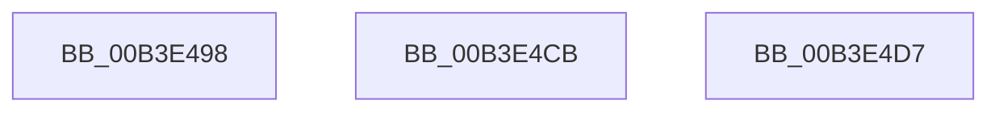

# sub_00B3E498

- RVA: `0x00B3E498`–`0x00B3E4DF` (길이 `71` bytes)
- VA: `0x0000000140B3E498`
- 실행 섹션: `PAGE`
- PDB 이름 있음: `아니요`; PDB Function 태그: `아니요`
- unwind 정보 RVA: `0x000B36D4`
- 디코드: `13`개 명령, `71/71` bytes 표시
- 미해석 바이트: `0` (있으면 어셈블리에 `.byte`로 보존)

> 이 문서는 커널 이미지의 기계어와 PDB 기호를 분석해 생성했습니다. 4번과 5번은 함수 원형과 자료형을 바이너리 사용 방식에서 추정한 C 해석이며 원본 소스 복구 결과는 아닙니다.

## 1. Dependencies

- 직접 호출 지점: **0**; 고유 호출 대상: **0**
- 직접 호출자로 확인된 함수: **0**
- RIP 상대 이미지 참조: **0**

### Outgoing calls
- 직접 디코드된 call 명령이 없습니다.

### Direct callers
- 이 함수 시작 RVA로 연결되는 직접 call은 확인되지 않았습니다. 간접 호출은 완전히 역산할 수 없습니다.

### Static image references
- 디코드된 RIP-relative 메모리 참조가 없습니다.

## 2. Other-region calls and transfers

- 다른 실행 섹션으로 향하는 call: **0**
- call이 아닌 외부 분기/꼬리 이동: **3**
  - `0x00B3E4C6` → [IopRaiseHardError + 0x124](../A6/IopRaiseHardError_function_00A64260.md) (`tail-transfer`)
  - `0x00B3E4D2` → [IopRaiseHardError + 0x175](../A6/IopRaiseHardError_function_00A64260.md) (`tail-transfer`)
  - `0x00B3E4DA` → [IopRaiseHardError + 0x17D](../A6/IopRaiseHardError_function_00A64260.md) (`tail-transfer`)

## 3. Assembly (complete function range)

```asm
00B3E498  65 48 8B 04 25 88 01 00 00      mov rax, qword ptr gs:[0x188]
00B3E4A1  41 BB 02 00 00 00               mov r11d, 2
00B3E4A7  48 83 65 0F 00                  and qword ptr [rbp + 0xf], 0
00B3E4AC  4C 89 75 FF                     mov qword ptr [rbp - 1], r14
00B3E4B0  48 8B 88 B8 00 00 00            mov rcx, qword ptr [rax + 0xb8]
00B3E4B7  45 8D 43 FF                     lea r8d, [r11 - 1]
00B3E4BB  48 8B 81 D0 01 00 00            mov rax, qword ptr [rcx + 0x1d0]
00B3E4C2  48 89 45 07                     mov qword ptr [rbp + 7], rax
00B3E4C6  E9 B9 5E F2 FF                  jmp 0x140a64384
00B3E4CB  C7 43 30 40 02 00 C0            mov dword ptr [rbx + 0x30], 0xc0000240
00B3E4D2  E9 FE 5E F2 FF                  jmp 0x140a643d5
00B3E4D7  89 73 30                        mov dword ptr [rbx + 0x30], esi
00B3E4DA  E9 FE 5E F2 FF                  jmp 0x140a643dd
```

## 4. C-style interpretation (structured pseudocode)

```c
__int64 __fastcall sub_00B3E498(void)
{
    *(unsigned __int64 *)(v_rbp - 1) = v_r14;
    *(unsigned __int64 *)(v_rbp + 7) = *(unsigned __int64 *)(*(unsigned __int64 *)(*(unsigned __int64 *)(gs_base + (0 + 392)) + 184) + 464);
}
```

## 5. (Beta) C Style

```c
void sub_00B3E498(void)
{
    *(uint64_t *)(local_rbp - 0x1) = local_r14;
    *(uint64_t *)(local_rbp + 0x7) = *(uint64_t *)(*(uint64_t *)(*(uint64_t *)(gs_base + (0 + 0x188)) + 0xB8) + 0x1D0);
}
```

## 6. Execution-region graph

[열기: 2D/3D 그래프와 함수 탐색 컨트롤 패널](../../../control-panel.html?section=page&rva=0x00B3E498&view=graph)

- 2D 그래프는 위에서 아래로 흐르고, 3D 그래프는 빈 공간을 드래그해 회전합니다. Shift+드래그는 이동, 휠은 확대·축소, 함수 노드 선택은 대상 보고서 이동입니다.

### Static fallback


