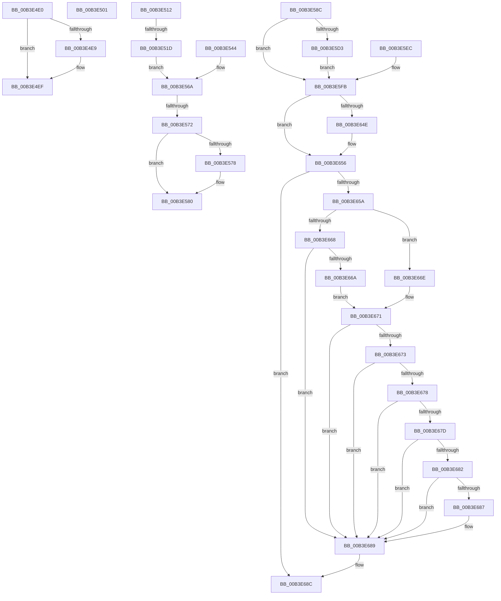

# sub_00B3E4E0

- RVA: `0x00B3E4E0`–`0x00B3E693` (길이 `435` bytes)
- VA: `0x0000000140B3E4E0`
- 실행 섹션: `PAGE`
- PDB 이름 있음: `아니요`; PDB Function 태그: `아니요`
- unwind 정보 RVA: `0x000B37AC`
- 디코드: `98`개 명령, `435/435` bytes 표시
- 미해석 바이트: `0` (있으면 어셈블리에 `.byte`로 보존)

> 이 문서는 커널 이미지의 기계어와 PDB 기호를 분석해 생성했습니다. 4번과 5번은 함수 원형과 자료형을 바이너리 사용 방식에서 추정한 C 해석이며 원본 소스 복구 결과는 아닙니다.

## 1. Dependencies

- 직접 호출 지점: **5**; 고유 호출 대상: **4**
- 직접 호출자로 확인된 함수: **0**
- RIP 상대 이미지 참조: **1**

### Outgoing calls
- `0x00B3E4E0` → [PsIsCurrentThreadInServerSilo](../../text/43/PsIsCurrentThreadInServerSilo_function_004362E0.md) (function, `0x004362E0`)
- `0x00B3E57B` → [ObfDereferenceObject](../../text/2F/ObfDereferenceObject_function_002F9350.md) (function, `0x002F9350`)
- `0x00B3E5E5` → [memcpy](../../text/6C/memcpy_function_006C6840.md) (function, `0x006C6840`)
- `0x00B3E641` → [LpcSendWaitReceivePort](../92/LpcSendWaitReceivePort_function_00921F50.md) (function, `0x00921F50`)
- `0x00B3E651` → [ObfDereferenceObject](../../text/2F/ObfDereferenceObject_function_002F9350.md) (function, `0x002F9350`)

### Direct callers
- 이 함수 시작 RVA로 연결되는 직접 call은 확인되지 않았습니다. 간접 호출은 완전히 역산할 수 없습니다.

### Static image references
- `0x00B3E4E9` → RVA `0x00E685D0` (`.data`; write)

## 2. Other-region calls and transfers

- 다른 실행 섹션으로 향하는 call: **4**
  - `0x00B3E4E0` → [PsIsCurrentThreadInServerSilo](../../text/43/PsIsCurrentThreadInServerSilo_function_004362E0.md) (`PAGE` → `.text`)
  - `0x00B3E57B` → [ObfDereferenceObject](../../text/2F/ObfDereferenceObject_function_002F9350.md) (`PAGE` → `.text`)
  - `0x00B3E5E5` → [memcpy](../../text/6C/memcpy_function_006C6840.md) (`PAGE` → `.text`)
  - `0x00B3E651` → [ObfDereferenceObject](../../text/2F/ObfDereferenceObject_function_002F9350.md) (`PAGE` → `.text`)
- call이 아닌 외부 분기/꼬리 이동: **6**
  - `0x00B3E4FC` → [ExpRaiseHardError + 0x94](../A6/ExpRaiseHardError_function_00A64AD4.md) (`tail-transfer`)
  - `0x00B3E50D` → [ExpRaiseHardError + 0x135](../A6/ExpRaiseHardError_function_00A64AD4.md) (`tail-transfer`)
  - `0x00B3E517` → [ExpRaiseHardError + 0x13E](../A6/ExpRaiseHardError_function_00A64AD4.md) (`tail-transfer`)
  - `0x00B3E56C` → [ExpRaiseHardError + 0x143](../A6/ExpRaiseHardError_function_00A64AD4.md) (`tail-transfer`)
  - `0x00B3E587` → [ExpRaiseHardError + 0x143](../A6/ExpRaiseHardError_function_00A64AD4.md) (`tail-transfer`)
  - `0x00B3E68E` → [ExpRaiseHardError + 0x152](../A6/ExpRaiseHardError_function_00A64AD4.md) (`tail-transfer`)

## 3. Assembly (complete function range)

```asm
00B3E4E0  E8 FB 7D 8F FF                  call 0x1404362e0
00B3E4E5  84 C0                           test al, al
00B3E4E7  75 06                           jne 0x140b3e4ef
00B3E4E9  88 05 E1 A0 32 00               mov byte ptr [rip + 0x32a0e1], al
00B3E4EF  41 C7 86 60 03 00 00 02 00 00 00  mov dword ptr [r14 + 0x360], 2
00B3E4FA  B2 01                           mov dl, 1
00B3E4FC  E9 67 66 F2 FF                  jmp 0x140a64b68
00B3E501  49 8B 9E 58 03 00 00            mov rbx, qword ptr [r14 + 0x358]
00B3E508  48 89 5C 24 48                  mov qword ptr [rsp + 0x48], rbx
00B3E50D  E9 F7 66 F2 FF                  jmp 0x140a64c09
00B3E512  33 C0                           xor eax, eax
00B3E514  48 85 C0                        test rax, rax
00B3E517  0F 84 F5 66 F2 FF               je 0x140a64c12
00B3E51D  C7 44 24 40 00 00 00 00         mov dword ptr [rsp + 0x40], 0
00B3E525  F6 80 B0 16 00 00 10            test byte ptr [rax + 0x16b0], 0x10
00B3E52C  B8 00 00 00 00                  mov eax, 0
00B3E531  B9 01 00 00 C0                  mov ecx, 0xc0000001
00B3E536  0F 45 C1                        cmovne eax, ecx
00B3E539  89 44 24 40                     mov dword ptr [rsp + 0x40], eax
00B3E53D  4C 8B 74 24 60                  mov r14, qword ptr [rsp + 0x60]
00B3E542  EB 26                           jmp 0x140b3e56a
00B3E544  8B 44 24 40                     mov eax, dword ptr [rsp + 0x40]
00B3E548  48 8B 5C 24 48                  mov rbx, qword ptr [rsp + 0x48]
00B3E54D  40 8A 7C 24 30                  mov dil, byte ptr [rsp + 0x30]
00B3E552  8B 74 24 38                     mov esi, dword ptr [rsp + 0x38]
00B3E556  44 8B 64 24 50                  mov r12d, dword ptr [rsp + 0x50]
00B3E55B  4C 8B 74 24 68                  mov r14, qword ptr [rsp + 0x68]
00B3E560  44 8B 6C 24 58                  mov r13d, dword ptr [rsp + 0x58]
00B3E565  4C 8B 7C 24 70                  mov r15, qword ptr [rsp + 0x70]
00B3E56A  85 C0                           test eax, eax
00B3E56C  0F 89 A5 66 F2 FF               jns 0x140a64c17
00B3E572  40 80 FF 01                     cmp dil, 1
00B3E576  75 08                           jne 0x140b3e580
00B3E578  48 8B CB                        mov rcx, rbx
00B3E57B  E8 D0 AD 7B FF                  call 0x1402f9350
00B3E580  33 DB                           xor ebx, ebx
00B3E582  48 89 5C 24 48                  mov qword ptr [rsp + 0x48], rbx
00B3E587  E9 8B 66 F2 FF                  jmp 0x140a64c17
00B3E58C  C7 84 24 80 00 00 00 48 00 70 00  mov dword ptr [rsp + 0x80], 0x700048
00B3E597  C7 84 24 84 00 00 00 09 00 00 00  mov dword ptr [rsp + 0x84], 9
00B3E5A2  0F BA F6 1C                     btr esi, 0x1c
00B3E5A6  89 B4 24 A8 00 00 00            mov dword ptr [rsp + 0xa8], esi
00B3E5AD  8B 84 24 A8 03 00 00            mov eax, dword ptr [rsp + 0x3a8]
00B3E5B4  89 84 24 B8 00 00 00            mov dword ptr [rsp + 0xb8], eax
00B3E5BB  44 89 AC 24 C4 00 00 00         mov dword ptr [rsp + 0xc4], r13d
00B3E5C3  8B 44 24 5C                     mov eax, dword ptr [rsp + 0x5c]
00B3E5C7  89 84 24 C0 00 00 00            mov dword ptr [rsp + 0xc0], eax
00B3E5CE  4D 85 F6                        test r14, r14
00B3E5D1  74 28                           je 0x140b3e5fb
00B3E5D3  45 8B C4                        mov r8d, r12d
00B3E5D6  49 C1 E0 03                     shl r8, 3
00B3E5DA  49 8B D6                        mov rdx, r14
00B3E5DD  48 8D 8C 24 C8 00 00 00         lea rcx, [rsp + 0xc8]
00B3E5E5  E8 56 82 B8 FF                  call 0x1406c6840
00B3E5EA  EB 0F                           jmp 0x140b3e5fb
00B3E5EC  48 8B 5C 24 48                  mov rbx, qword ptr [rsp + 0x48]
00B3E5F1  40 8A 7C 24 30                  mov dil, byte ptr [rsp + 0x30]
00B3E5F6  4C 8B 7C 24 70                  mov r15, qword ptr [rsp + 0x70]
00B3E5FB  48 B8 14 00 00 00 80 F7 FF FF   movabs rax, 0xfffff78000000014
00B3E605  48 8B 00                        mov rax, qword ptr [rax]
00B3E608  48 89 84 24 B0 00 00 00         mov qword ptr [rsp + 0xb0], rax
00B3E610  48 C7 44 24 68 B0 02 00 00      mov qword ptr [rsp + 0x68], 0x2b0
00B3E619  48 83 64 24 28 00               and qword ptr [rsp + 0x28], 0
00B3E61F  48 8D 44 24 68                  lea rax, [rsp + 0x68]
00B3E624  48 89 44 24 20                  mov qword ptr [rsp + 0x20], rax
00B3E629  4C 8D 8C 24 80 00 00 00         lea r9, [rsp + 0x80]
00B3E631  4C 8D 84 24 80 00 00 00         lea r8, [rsp + 0x80]
00B3E639  BA 00 00 02 00                  mov edx, 0x20000
00B3E63E  48 8B CB                        mov rcx, rbx
00B3E641  E8 0A 39 DE FF                  call 0x140921f50
00B3E646  8B F0                           mov esi, eax
00B3E648  40 80 FF 01                     cmp dil, 1
00B3E64C  75 08                           jne 0x140b3e656
00B3E64E  48 8B CB                        mov rcx, rbx
00B3E651  E8 FA AC 7B FF                  call 0x1402f9350
00B3E656  85 F6                           test esi, esi
00B3E658  78 32                           js 0x140b3e68c
00B3E65A  8B 8C 24 BC 00 00 00            mov ecx, dword ptr [rsp + 0xbc]
00B3E661  8B C1                           mov eax, ecx
00B3E663  83 F9 05                        cmp ecx, 5
00B3E666  77 06                           ja 0x140b3e66e
00B3E668  74 1F                           je 0x140b3e689
00B3E66A  85 C9                           test ecx, ecx
00B3E66C  EB 03                           jmp 0x140b3e671
00B3E66E  83 E9 06                        sub ecx, 6
00B3E671  74 16                           je 0x140b3e689
00B3E673  83 E9 01                        sub ecx, 1
00B3E676  74 11                           je 0x140b3e689
00B3E678  83 E9 01                        sub ecx, 1
00B3E67B  74 0C                           je 0x140b3e689
00B3E67D  83 E9 01                        sub ecx, 1
00B3E680  74 07                           je 0x140b3e689
00B3E682  83 F9 01                        cmp ecx, 1
00B3E685  74 02                           je 0x140b3e689
00B3E687  33 C0                           xor eax, eax
00B3E689  41 89 07                        mov dword ptr [r15], eax
00B3E68C  8B C6                           mov eax, esi
00B3E68E  E9 93 65 F2 FF                  jmp 0x140a64c26
```

## 4. C-style interpretation (structured pseudocode)

```c
__int64 __fastcall sub_00B3E4E0(void)
{
    __int64 result;
    unsigned __int64 v_stack_p20;
    unsigned __int64 v_stack_p28;
    unsigned __int8 v_stack_p30;
    unsigned int v_stack_p38;
    unsigned int v_stack_p3A8;
    unsigned int v_stack_p40;
    unsigned __int64 v_stack_p48;
    unsigned int v_stack_p50;
    unsigned int v_stack_p58;
    unsigned int v_stack_p5C;
    unsigned __int64 v_stack_p60;
    unsigned __int64 v_stack_p68;
    unsigned __int64 v_stack_p70;
    unsigned int v_stack_p80;
    unsigned int v_stack_p84;
    unsigned int v_stack_pA8;
    unsigned __int64 v_stack_pB0;
    unsigned int v_stack_pB8;
    unsigned int v_stack_pBC;
    unsigned int v_stack_pC0;
    unsigned int v_stack_pC4;
    unsigned __int64 v_stack_pC8;

    result = PsIsCurrentThreadInServerSilo(a1, a2, a3, a4);
    if ((unsigned __int8)(result) == 0) {
        *(unsigned __int8 *)(v_rip + 3317985) = (unsigned __int8)(result);
    }
    *(unsigned int *)(v_r14 + 864) = 2;
}
```

## 5. (Beta) C Style

```c
void sub_00B3E4E0(void)
{
    int64_t result;
    uint64_t v_stack_p20;
    uint64_t v_stack_p28;
    uint8_t v_stack_p30;
    uint32_t v_stack_p38;
    uint32_t v_stack_p3A8;
    uint32_t v_stack_p40;
    uint64_t v_stack_p48;
    uint32_t v_stack_p50;
    uint32_t v_stack_p58;
    uint32_t v_stack_p5C;
    uint64_t v_stack_p60;
    uint64_t v_stack_p68;
    uint64_t v_stack_p70;
    uint32_t v_stack_p80;
    uint32_t v_stack_p84;
    uint32_t v_stack_pA8;
    uint64_t v_stack_pB0;
    uint32_t v_stack_pB8;
    uint32_t v_stack_pBC;
    uint32_t v_stack_pC0;
    uint32_t v_stack_pC4;
    uint64_t v_stack_pC8;

    result = PsIsCurrentThreadInServerSilo(a1, a2, a3, a4);
    if ((uint8_t)(result) == 0) {
        *(uint8_t *)(v_rip + 0x32A0E1) = (uint8_t)(result);
    }
    *(uint32_t *)(local_r14 + 0x360) = 2;
}
```

## 6. Execution-region graph

[열기: 2D/3D 그래프와 함수 탐색 컨트롤 패널](../../../control-panel.html?section=page&rva=0x00B3E4E0&view=graph)

- 2D 그래프는 위에서 아래로 흐르고, 3D 그래프는 빈 공간을 드래그해 회전합니다. Shift+드래그는 이동, 휠은 확대·축소, 함수 노드 선택은 대상 보고서 이동입니다.

### Static fallback


