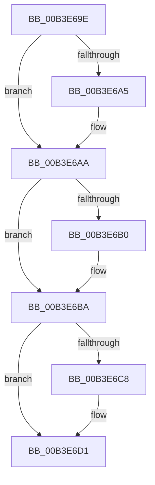

# sub_00B3E69E

- RVA: `0x00B3E69E`–`0x00B3E6EA` (길이 `76` bytes)
- VA: `0x0000000140B3E69E`
- 실행 섹션: `PAGE`
- PDB 이름 있음: `아니요`; PDB Function 태그: `아니요`
- unwind 정보 RVA: `0x000B383C`
- 디코드: `22`개 명령, `76/76` bytes 표시
- 미해석 바이트: `0` (있으면 어셈블리에 `.byte`로 보존)

> 이 문서는 커널 이미지의 기계어와 PDB 기호를 분석해 생성했습니다. 4번과 5번은 함수 원형과 자료형을 바이너리 사용 방식에서 추정한 C 해석이며 원본 소스 복구 결과는 아닙니다.

## 1. Dependencies

- 직접 호출 지점: **4**; 고유 호출 대상: **4**
- 직접 호출자로 확인된 함수: **0**
- RIP 상대 이미지 참조: **0**

### Outgoing calls
- `0x00B3E6B3` → [SepInitializeLowBoxNumberTable](../7A/SepInitializeLowBoxNumberTable_function_007A31E4.md) (function, `0x007A31E4`)
- `0x00B3E6CC` → [ExfTryToWakePushLock](../../text/26/ExfTryToWakePushLock_function_00265DD0.md) (function, `0x00265DD0`)
- `0x00B3E6D5` → [KeAbPostRelease](../../text/2E/KeAbPostRelease_function_002E1600.md) (function, `0x002E1600`)
- `0x00B3E6DA` → [KeLeaveCriticalRegion](../../text/25/KeLeaveCriticalRegion_function_0025D8B0.md) (function, `0x0025D8B0`)

### Direct callers
- 이 함수 시작 RVA로 연결되는 직접 call은 확인되지 않았습니다. 간접 호출은 완전히 역산할 수 없습니다.

### Static image references
- 디코드된 RIP-relative 메모리 참조가 없습니다.

## 2. Other-region calls and transfers

- 다른 실행 섹션으로 향하는 call: **3**
  - `0x00B3E6CC` → [ExfTryToWakePushLock](../../text/26/ExfTryToWakePushLock_function_00265DD0.md) (`PAGE` → `.text`)
  - `0x00B3E6D5` → [KeAbPostRelease](../../text/2E/KeAbPostRelease_function_002E1600.md) (`PAGE` → `.text`)
  - `0x00B3E6DA` → [KeLeaveCriticalRegion](../../text/25/KeLeaveCriticalRegion_function_0025D8B0.md) (`PAGE` → `.text`)
- call이 아닌 외부 분기/꼬리 이동: **1**
  - `0x00B3E6E5` → [SepSetTokenLowboxNumber + 0x61](../A6/SepSetTokenLowboxNumber_function_00A64D6C.md) (`tail-transfer`)

## 3. Assembly (complete function range)

```asm
00B3E69E  33 C0                           xor eax, eax
00B3E6A0  4D 85 FF                        test r15, r15
00B3E6A3  74 05                           je 0x140b3e6aa
00B3E6A5  41 C6 47 0A 01                  mov byte ptr [r15 + 0xa], 1
00B3E6AA  41 38 46 20                     cmp byte ptr [r14 + 0x20], al
00B3E6AE  75 0A                           jne 0x140b3e6ba
00B3E6B0  48 8B CF                        mov rcx, rdi
00B3E6B3  E8 2C 4B C6 FF                  call 0x1407a31e4
00B3E6B8  8B F0                           mov esi, eax
00B3E6BA  48 8B C3                        mov rax, rbx
00B3E6BD  F0 48 0F C1 07                  lock xadd qword ptr [rdi], rax
00B3E6C2  24 06                           and al, 6
00B3E6C4  3C 02                           cmp al, 2
00B3E6C6  75 09                           jne 0x140b3e6d1
00B3E6C8  48 8B 4D 60                     mov rcx, qword ptr [rbp + 0x60]
00B3E6CC  E8 FF 76 72 FF                  call 0x140265dd0
00B3E6D1  48 8B 4D 60                     mov rcx, qword ptr [rbp + 0x60]
00B3E6D5  E8 26 2F 7A FF                  call 0x1402e1600
00B3E6DA  E8 D1 F1 71 FF                  call 0x14025d8b0
00B3E6DF  4C 8B 7D 48                     mov r15, qword ptr [rbp + 0x48]
00B3E6E3  33 D2                           xor edx, edx
00B3E6E5  E9 E3 66 F2 FF                  jmp 0x140a64dcd
```

## 4. C-style interpretation (structured pseudocode)

```c
__int64 __fastcall sub_00B3E69E(__int64 a1, int a2)
{
    __int64 result;
    __int64 v_rsi;

    result = 0;
    if (v_r15 != 0) {
        *(unsigned __int8 *)(v_r15 + 10) = 1;
    }
    if ((*(unsigned __int8 *)(v_r14 + 32)) == 0) {
        a1 = v_rdi;
        result = SepInitializeLowBoxNumberTable(a1, a2, a3, a4);
        v_rsi = (unsigned int)(result);
    }
    result = (unsigned __int8)((v_rbx) & (6));
    if (((unsigned __int8)(result)) == 2) {
        a1 = *(unsigned __int64 *)(v_rbp + 96);
        result = ExfTryToWakePushLock(a1, a2, a3, a4);
    }
    result = KeAbPostRelease(*(unsigned __int64 *)(v_rbp + 96), a2, a3, a4);
    result = KeLeaveCriticalRegion(*(unsigned __int64 *)(v_rbp + 96), a2, a3, a4);
    a2 = 0;
}
```

## 5. (Beta) C Style

```c
int64_t sub_00B3E69E(int64_t Arg1, int32_t Arg2)
{
    int64_t result;
    int64_t local_rsi;

    result = 0;
    if (local_r15 != 0) {
        *(uint8_t *)(local_r15 + 0xA) = 1;
    }
    if ((*(uint8_t *)(local_r14 + 0x20)) == 0) {
        Arg1 = local_rdi;
        result = SepInitializeLowBoxNumberTable(Arg1, Arg2, a3, a4);
        local_rsi = (uint32_t)(result);
    }
    result = (uint8_t)((local_rbx) & (6));
    if (((uint8_t)(result)) == 2) {
        Arg1 = *(uint64_t *)(local_rbp + 0x60);
        result = ExfTryToWakePushLock(Arg1, Arg2, a3, a4);
    }
    result = KeAbPostRelease(*(uint64_t *)(local_rbp + 0x60), Arg2, a3, a4);
    result = KeLeaveCriticalRegion(*(uint64_t *)(local_rbp + 0x60), Arg2, a3, a4);
    Arg2 = 0;
}
```

## 6. Execution-region graph

[열기: 2D/3D 그래프와 함수 탐색 컨트롤 패널](../../../control-panel.html?section=page&rva=0x00B3E69E&view=graph)

- 2D 그래프는 위에서 아래로 흐르고, 3D 그래프는 빈 공간을 드래그해 회전합니다. Shift+드래그는 이동, 휠은 확대·축소, 함수 노드 선택은 대상 보고서 이동입니다.

### Static fallback


