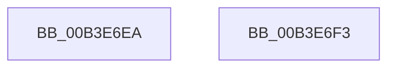

# sub_00B3E6EA

- RVA: `0x00B3E6EA`–`0x00B3E706` (길이 `28` bytes)
- VA: `0x0000000140B3E6EA`
- 실행 섹션: `PAGE`
- PDB 이름 있음: `아니요`; PDB Function 태그: `아니요`
- unwind 정보 RVA: `0x000B38F0`
- 디코드: `8`개 명령, `28/28` bytes 표시
- 미해석 바이트: `0` (있으면 어셈블리에 `.byte`로 보존)

> 이 문서는 커널 이미지의 기계어와 PDB 기호를 분석해 생성했습니다. 4번과 5번은 함수 원형과 자료형을 바이너리 사용 방식에서 추정한 C 해석이며 원본 소스 복구 결과는 아닙니다.

## 1. Dependencies

- 직접 호출 지점: **1**; 고유 호출 대상: **1**
- 직접 호출자로 확인된 함수: **0**
- RIP 상대 이미지 참조: **0**

### Outgoing calls
- `0x00B3E6FA` → [CmpUnlockHashEntryByIndex](../86/CmpUnlockHashEntryByIndex_function_00862460.md) (function, `0x00862460`)

### Direct callers
- 이 함수 시작 RVA로 연결되는 직접 call은 확인되지 않았습니다. 간접 호출은 완전히 역산할 수 없습니다.

### Static image references
- 디코드된 RIP-relative 메모리 참조가 없습니다.

## 2. Other-region calls and transfers

- 다른 실행 섹션으로 향하는 call: **0**
- call이 아닌 외부 분기/꼬리 이동: **2**
  - `0x00B3E6EE` → [CmpSearchKeyControlBlockTreeEx + 0x9B](../A6/CmpSearchKeyControlBlockTreeEx_function_00A65548.md) (`tail-transfer`)
  - `0x00B3E701` → [CmpSearchKeyControlBlockTreeEx + 0x146](../A6/CmpSearchKeyControlBlockTreeEx_function_00A65548.md) (`tail-transfer`)

## 3. Assembly (complete function range)

```asm
00B3E6EA  4D 89 75 00                     mov qword ptr [r13], r14
00B3E6EE  E9 F0 6E F2 FF                  jmp 0x140a655e3
00B3E6F3  B3 01                           mov bl, 1
00B3E6F5  8B D5                           mov edx, ebp
00B3E6F7  49 8B CF                        mov rcx, r15
00B3E6FA  E8 61 3D D2 FF                  call 0x140862460
00B3E6FF  8A C3                           mov al, bl
00B3E701  E9 88 6F F2 FF                  jmp 0x140a6568e
```

## 4. C-style interpretation (structured pseudocode)

```c
__int64 __fastcall sub_00B3E6EA(void)
{
    *(unsigned __int64 *)(v_r13) = v_r14;
}
```

## 5. (Beta) C Style

```c
void sub_00B3E6EA(void)
{
    *(uint64_t *)(local_r13) = local_r14;
}
```

## 6. Execution-region graph

[열기: 2D/3D 그래프와 함수 탐색 컨트롤 패널](../../../control-panel.html?section=page&rva=0x00B3E6EA&view=graph)

- 2D 그래프는 위에서 아래로 흐르고, 3D 그래프는 빈 공간을 드래그해 회전합니다. Shift+드래그는 이동, 휠은 확대·축소, 함수 노드 선택은 대상 보고서 이동입니다.

### Static fallback


