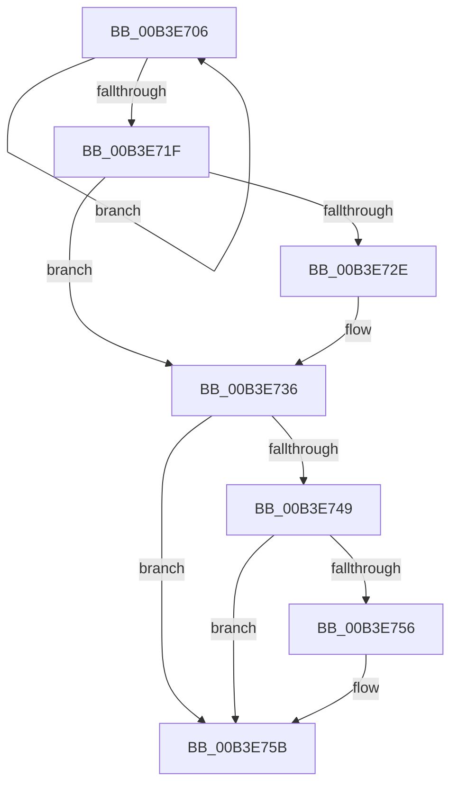

# sub_00B3E706

- RVA: `0x00B3E706`–`0x00B3E76D` (길이 `103` bytes)
- VA: `0x0000000140B3E706`
- 실행 섹션: `PAGE`
- PDB 이름 있음: `아니요`; PDB Function 태그: `아니요`
- unwind 정보 RVA: `0x000B39CC`
- 디코드: `28`개 명령, `103/103` bytes 표시
- 미해석 바이트: `0` (있으면 어셈블리에 `.byte`로 보존)

> 이 문서는 커널 이미지의 기계어와 PDB 기호를 분석해 생성했습니다. 4번과 5번은 함수 원형과 자료형을 바이너리 사용 방식에서 추정한 C 해석이며 원본 소스 복구 결과는 아닙니다.

## 1. Dependencies

- 직접 호출 지점: **5**; 고유 호출 대상: **5**
- 직접 호출자로 확인된 함수: **0**
- RIP 상대 이미지 참조: **0**

### Outgoing calls
- `0x00B3E711` → [MiDereferenceSubsectionProtos](../A2/MiDereferenceSubsectionProtos_function_00A2EEE4.md) (function, `0x00A2EEE4`)
- `0x00B3E731` → [ExfTryToWakePushLock](../../text/26/ExfTryToWakePushLock_function_00265DD0.md) (function, `0x00265DD0`)
- `0x00B3E739` → [KeAbPostRelease](../../text/2E/KeAbPostRelease_function_002E1600.md) (function, `0x002E1600`)
- `0x00B3E756` → [KiCheckForKernelApcDelivery](../../text/2E/KiCheckForKernelApcDelivery_function_002E2C80.md) (function, `0x002E2C80`)
- `0x00B3E760` → [MiFreeSubsectionProtos](../AA/MiFreeSubsectionProtos_function_00AA18F8.md) (function, `0x00AA18F8`)

### Direct callers
- 이 함수 시작 RVA로 연결되는 직접 call은 확인되지 않았습니다. 간접 호출은 완전히 역산할 수 없습니다.

### Static image references
- 디코드된 RIP-relative 메모리 참조가 없습니다.

## 2. Other-region calls and transfers

- 다른 실행 섹션으로 향하는 call: **3**
  - `0x00B3E731` → [ExfTryToWakePushLock](../../text/26/ExfTryToWakePushLock_function_00265DD0.md) (`PAGE` → `.text`)
  - `0x00B3E739` → [KeAbPostRelease](../../text/2E/KeAbPostRelease_function_002E1600.md) (`PAGE` → `.text`)
  - `0x00B3E756` → [KiCheckForKernelApcDelivery](../../text/2E/KiCheckForKernelApcDelivery_function_002E2C80.md) (`PAGE` → `.text`)
- call이 아닌 외부 분기/꼬리 이동: **1**
  - `0x00B3E768` → [MiCreatePerSessionProtos + 0xD2](../A6/MiCreatePerSessionProtos_function_00A666D8.md) (`tail-transfer`)

## 3. Assembly (complete function range)

```asm
00B3E706  4C 8D 44 24 78                  lea r8, [rsp + 0x78]
00B3E70B  41 8B D6                        mov edx, r14d
00B3E70E  48 8B CD                        mov rcx, rbp
00B3E711  E8 CE 07 EF FF                  call 0x140a2eee4
00B3E716  48 8B 6D 10                     mov rbp, qword ptr [rbp + 0x10]
00B3E71A  48 3B EF                        cmp rbp, rdi
00B3E71D  75 E7                           jne 0x140b3e706
00B3E71F  48 83 C8 FF                     or rax, 0xffffffffffffffff
00B3E723  F0 48 0F C1 03                  lock xadd qword ptr [rbx], rax
00B3E728  24 06                           and al, 6
00B3E72A  3C 02                           cmp al, 2
00B3E72C  75 08                           jne 0x140b3e736
00B3E72E  48 8B CB                        mov rcx, rbx
00B3E731  E8 9A 76 72 FF                  call 0x140265dd0
00B3E736  48 8B CB                        mov rcx, rbx
00B3E739  E8 C2 2E 7A FF                  call 0x1402e1600
00B3E73E  90                              nop
00B3E73F  66 44 01 AE E6 01 00 00         add word ptr [rsi + 0x1e6], r13w
00B3E747  75 12                           jne 0x140b3e75b
00B3E749  48 8D 86 98 00 00 00            lea rax, [rsi + 0x98]
00B3E750  90                              nop
00B3E751  48 39 00                        cmp qword ptr [rax], rax
00B3E754  74 05                           je 0x140b3e75b
00B3E756  E8 25 45 7A FF                  call 0x1402e2c80
00B3E75B  48 8D 4C 24 78                  lea rcx, [rsp + 0x78]
00B3E760  E8 93 31 F6 FF                  call 0x140aa18f8
00B3E765  41 8B C7                        mov eax, r15d
00B3E768  E9 3D 80 F2 FF                  jmp 0x140a667aa
```

## 4. C-style interpretation (structured pseudocode)

```c
__int64 __fastcall sub_00B3E706(__int64 a1, __int64 a2, __int64 a3, __int64 a4, __int64 a5, __int64 a6, __int64 a7, __int64 a8, __int64 a9, __int64 a10, __int64 a11, __int64 a12, __int64 a13, __int64 a14, __int64 a15)
{
    __int64 result;

    result = MiDereferenceSubsectionProtos(v_rbp, (unsigned int)((unsigned int)(v_r14)), a15, a4);
    if ((*(unsigned __int64 *)(v_rbp + 16)) != v_rdi) goto loc_00B3E706;
    result = (result) | (-1);
    result = (unsigned __int8)((result) & (6));
    if (((unsigned __int8)(result)) == 2) {
        a1 = v_rbx;
        result = ExfTryToWakePushLock(a1, (unsigned int)((unsigned int)(v_r14)), a15, a4);
    }
    result = KeAbPostRelease(v_rbx, (unsigned int)((unsigned int)(v_r14)), a15, a4);
    if (((unsigned __int8)(result)) != 2) goto loc_00B3E75B;
    result = v_rsi + 152;
    if ((*(unsigned __int64 *)(v_rsi + 152)) != (v_rsi + 152)) {
        result = KiCheckForKernelApcDelivery(v_rbx, (unsigned int)((unsigned int)(v_r14)), a15, a4);
    }
    result = MiFreeSubsectionProtos(a15, (unsigned int)((unsigned int)(v_r14)), a15, a4);
}
```

## 5. (Beta) C Style

```c
int64_t sub_00B3E706(int64_t Arg1, int64_t Arg2, int64_t Arg3, int64_t Arg4, uint64_t Arg5, uint64_t Arg6, uint64_t Arg7, uint64_t Arg8, uint64_t Arg9, uint64_t Arg10, uint64_t Arg11, uint64_t Arg12, uint64_t Arg13, uint64_t Arg14, int64_t Arg15)
{
    int64_t result;

    result = MiDereferenceSubsectionProtos(local_rbp, (uint32_t)((uint32_t)(local_r14)), Arg15, Arg4);
    if ((*(uint64_t *)(local_rbp + 0x10)) != local_rdi) goto loc_00B3E706;
    result = (result) | (-1);
    result = (uint8_t)((result) & (6));
    if (((uint8_t)(result)) == 2) {
        Arg1 = local_rbx;
        result = ExfTryToWakePushLock(Arg1, (uint32_t)((uint32_t)(local_r14)), Arg15, Arg4);
    }
    result = KeAbPostRelease(local_rbx, (uint32_t)((uint32_t)(local_r14)), Arg15, Arg4);
    if (((uint8_t)(result)) != 2) goto loc_00B3E75B;
    result = local_rsi + 152;
    if ((*(uint64_t *)(local_rsi + 0x98)) != (local_rsi + 152)) {
        result = KiCheckForKernelApcDelivery(local_rbx, (uint32_t)((uint32_t)(local_r14)), Arg15, Arg4);
    }
    result = MiFreeSubsectionProtos(Arg15, (uint32_t)((uint32_t)(local_r14)), Arg15, Arg4);
}
```

## 6. Execution-region graph

[열기: 2D/3D 그래프와 함수 탐색 컨트롤 패널](../../../control-panel.html?section=page&rva=0x00B3E706&view=graph)

- 2D 그래프는 위에서 아래로 흐르고, 3D 그래프는 빈 공간을 드래그해 회전합니다. Shift+드래그는 이동, 휠은 확대·축소, 함수 노드 선택은 대상 보고서 이동입니다.

### Static fallback


