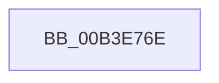

# sub_00B3E76E

- RVA: `0x00B3E76E`–`0x00B3E78C` (길이 `30` bytes)
- VA: `0x0000000140B3E76E`
- 실행 섹션: `PAGE`
- PDB 이름 있음: `아니요`; PDB Function 태그: `아니요`
- unwind 정보 RVA: `0x000B39DC`
- 디코드: `9`개 명령, `30/30` bytes 표시
- 미해석 바이트: `0` (있으면 어셈블리에 `.byte`로 보존)

> 이 문서는 커널 이미지의 기계어와 PDB 기호를 분석해 생성했습니다. 4번과 5번은 함수 원형과 자료형을 바이너리 사용 방식에서 추정한 C 해석이며 원본 소스 복구 결과는 아닙니다.

## 1. Dependencies

- 직접 호출 지점: **2**; 고유 호출 대상: **2**
- 직접 호출자로 확인된 함수: **0**
- RIP 상대 이미지 참조: **0**

### Outgoing calls
- `0x00B3E773` → [ExFreePoolWithTag](../../poolcode/B8/ExFreePoolWithTag_function_00B82870.md) (function, `0x00B82870`)
- `0x00B3E781` → [MiReturnCommit](../../text/24/MiReturnCommit_function_00248410.md) (function, `0x00248410`)

### Direct callers
- 이 함수 시작 RVA로 연결되는 직접 call은 확인되지 않았습니다. 간접 호출은 완전히 역산할 수 없습니다.

### Static image references
- 디코드된 RIP-relative 메모리 참조가 없습니다.

## 2. Other-region calls and transfers

- 다른 실행 섹션으로 향하는 call: **2**
  - `0x00B3E773` → [ExFreePoolWithTag](../../poolcode/B8/ExFreePoolWithTag_function_00B82870.md) (`PAGE` → `POOLCODE`)
  - `0x00B3E781` → [MiReturnCommit](../../text/24/MiReturnCommit_function_00248410.md) (`PAGE` → `.text`)
- call이 아닌 외부 분기/꼬리 이동: **1**
  - `0x00B3E787` → [MiAllocatePerSessionProtos + 0x10F](../A6/MiAllocatePerSessionProtos_function_00A66830.md) (`tail-transfer`)

## 3. Assembly (complete function range)

```asm
00B3E76E  33 D2                           xor edx, edx
00B3E770  48 8B CF                        mov rcx, rdi
00B3E773  E8 F8 40 04 00                  call 0x140b82870
00B3E778  8B 56 2C                        mov edx, dword ptr [rsi + 0x2c]
00B3E77B  45 33 C0                        xor r8d, r8d
00B3E77E  48 8B CD                        mov rcx, rbp
00B3E781  E8 8A 9C 70 FF                  call 0x140248410
00B3E786  90                              nop
00B3E787  E9 B3 81 F2 FF                  jmp 0x140a6693f
```

## 4. C-style interpretation (structured pseudocode)

```c
__int64 __fastcall sub_00B3E76E(__int64 a1, int a2, int a3)
{
    __int64 result;

    a2 = 0;
    result = ExFreePoolWithTag(v_rdi, a2, a3, a4);
    a3 = 0;
    result = MiReturnCommit(v_rbp, (unsigned int)(*(unsigned int *)(v_rsi + 44)), a3, a4);
}
```

## 5. (Beta) C Style

```c
int64_t sub_00B3E76E(int64_t Arg1, int32_t Arg2, int32_t Arg3)
{
    int64_t result;

    Arg2 = 0;
    result = ExFreePoolWithTag(local_rdi, Arg2, Arg3, a4);
    Arg3 = 0;
    result = MiReturnCommit(local_rbp, (uint32_t)(*(uint32_t *)(local_rsi + 0x2C)), Arg3, a4);
}
```

## 6. Execution-region graph

[열기: 2D/3D 그래프와 함수 탐색 컨트롤 패널](../../../control-panel.html?section=page&rva=0x00B3E76E&view=graph)

- 2D 그래프는 위에서 아래로 흐르고, 3D 그래프는 빈 공간을 드래그해 회전합니다. Shift+드래그는 이동, 휠은 확대·축소, 함수 노드 선택은 대상 보고서 이동입니다.

### Static fallback


