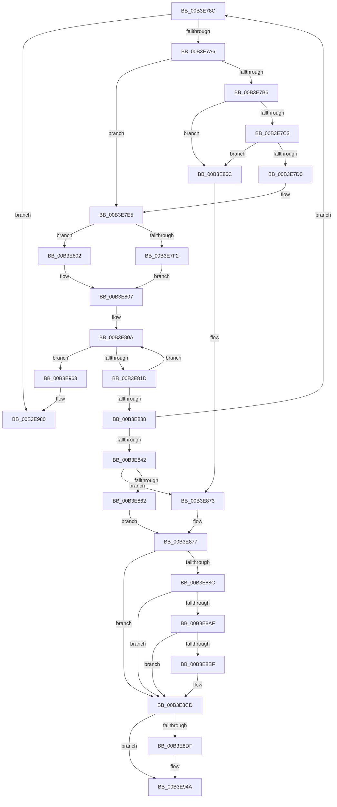

# sub_00B3E78C

- RVA: `0x00B3E78C`–`0x00B3E99D` (길이 `529` bytes)
- VA: `0x0000000140B3E78C`
- 실행 섹션: `PAGE`
- PDB 이름 있음: `아니요`; PDB Function 태그: `아니요`
- unwind 정보 RVA: `0x000B3A54`
- 디코드: `138`개 명령, `529/529` bytes 표시
- 미해석 바이트: `0` (있으면 어셈블리에 `.byte`로 보존)

> 이 문서는 커널 이미지의 기계어와 PDB 기호를 분석해 생성했습니다. 4번과 5번은 함수 원형과 자료형을 바이너리 사용 방식에서 추정한 C 해석이며 원본 소스 복구 결과는 아닙니다.

## 1. Dependencies

- 직접 호출 지점: **16**; 고유 호출 대상: **12**
- 직접 호출자로 확인된 함수: **0**
- RIP 상대 이미지 참조: **1**

### Outgoing calls
- `0x00B3E795` → [HvpGetCellMap](../../pagecmrc/BC/HvpGetCellMap_function_00BC9710.md) (function, `0x00BC9710`)
- `0x00B3E7A9` → [HvpMapEntryGetFreeBin](../9B/HvpMapEntryGetFreeBin_function_009B5A40.md) (function, `0x009B5A40`)
- `0x00B3E7E0` → [guard_dispatch_icall](../../text/6B/guard_dispatch_icall_function_006BAAD0.md) (function, `0x006BAAD0`)
- `0x00B3E7FB` → [HvpFreeBin](../A8/HvpFreeBin_function_00A8158C.md) (function, `0x00A8158C`)
- `0x00B3E802` → [CmpReleaseGlobalQuota](../84/CmpReleaseGlobalQuota_function_0084DB40.md) (function, `0x0084DB40`)
- `0x00B3E80F` → [HvpGetCellMap](../../pagecmrc/BC/HvpGetCellMap_function_00BC9710.md) (function, `0x00BC9710`)
- `0x00B3E87D` → [HvpFreeMap](../A6/HvpFreeMap_function_00A68674.md) (function, `0x00A68674`)
- `0x00B3E89E` → [CmpUpdateSystemHiveHysteresis](../A7/CmpUpdateSystemHiveHysteresis_function_00A720C4.md) (function, `0x00A720C4`)
- `0x00B3E8C8` → [HvpViewMapShrinkStorage](../7E/HvpViewMapShrinkStorage_function_007EEE1C.md) (function, `0x007EEE1C`)
- `0x00B3E8F5` → [RtlClearBits](../../text/3E/RtlClearBits_function_003E1A90.md) (function, `0x003E1A90`)
- `0x00B3E907` → [RtlClearBits](../../text/3E/RtlClearBits_function_003E1A90.md) (function, `0x003E1A90`)
- `0x00B3E928` → [RtlNumberOfSetBits](../../text/43/RtlNumberOfSetBits_function_00433F70.md) (function, `0x00433F70`)
- `0x00B3E933` → [RtlNumberOfSetBits](../../text/43/RtlNumberOfSetBits_function_00433F70.md) (function, `0x00433F70`)
- `0x00B3E958` → [HvpAdjustHiveFreeDisplay](../84/HvpAdjustHiveFreeDisplay_function_0084DB80.md) (function, `0x0084DB80`)
- `0x00B3E97A` → [KeBugCheckEx](../../text/4F/KeBugCheckEx_function_004FD660.md) (function, `0x004FD660`)
- `0x00B3E997` → [KeBugCheckEx](../../text/4F/KeBugCheckEx_function_004FD660.md) (function, `0x004FD660`)

### Direct callers
- 이 함수 시작 RVA로 연결되는 직접 call은 확인되지 않았습니다. 간접 호출은 완전히 역산할 수 없습니다.

### Static image references
- `0x00B3E943` → RVA `0x00EF554C` (`.data`; read/write)

## 2. Other-region calls and transfers

- 다른 실행 섹션으로 향하는 call: **9**
  - `0x00B3E795` → [HvpGetCellMap](../../pagecmrc/BC/HvpGetCellMap_function_00BC9710.md) (`PAGE` → `PAGECMRC`)
  - `0x00B3E7E0` → [guard_dispatch_icall](../../text/6B/guard_dispatch_icall_function_006BAAD0.md) (`PAGE` → `.text`)
  - `0x00B3E80F` → [HvpGetCellMap](../../pagecmrc/BC/HvpGetCellMap_function_00BC9710.md) (`PAGE` → `PAGECMRC`)
  - `0x00B3E8F5` → [RtlClearBits](../../text/3E/RtlClearBits_function_003E1A90.md) (`PAGE` → `.text`)
  - `0x00B3E907` → [RtlClearBits](../../text/3E/RtlClearBits_function_003E1A90.md) (`PAGE` → `.text`)
  - `0x00B3E928` → [RtlNumberOfSetBits](../../text/43/RtlNumberOfSetBits_function_00433F70.md) (`PAGE` → `.text`)
  - `0x00B3E933` → [RtlNumberOfSetBits](../../text/43/RtlNumberOfSetBits_function_00433F70.md) (`PAGE` → `.text`)
  - `0x00B3E97A` → [KeBugCheckEx](../../text/4F/KeBugCheckEx_function_004FD660.md) (`PAGE` → `.text`)
  - `0x00B3E997` → [KeBugCheckEx](../../text/4F/KeBugCheckEx_function_004FD660.md) (`PAGE` → `.text`)
- call이 아닌 외부 분기/꼬리 이동: **1**
  - `0x00B3E95E` → [HvFreeHivePartial + 0x3E](../A6/HvFreeHivePartial_function_00A66994.md) (`tail-transfer`)

## 3. Assembly (complete function range)

```asm
00B3E78C  42 8D 1C 2E                     lea ebx, [rsi + r13]
00B3E790  48 8B CD                        mov rcx, rbp
00B3E793  8B D3                           mov edx, ebx
00B3E795  E8 76 AF 08 00                  call 0x140bc9710
00B3E79A  48 8B F8                        mov rdi, rax
00B3E79D  48 85 C0                        test rax, rax
00B3E7A0  0F 84 DA 01 00 00               je 0x140b3e980
00B3E7A6  48 8B C8                        mov rcx, rax
00B3E7A9  E8 92 72 E7 FF                  call 0x1409b5a40
00B3E7AE  48 8B C8                        mov rcx, rax
00B3E7B1  48 85 C0                        test rax, rax
00B3E7B4  74 2F                           je 0x140b3e7e5
00B3E7B6  48 8B 10                        mov rdx, qword ptr [rax]
00B3E7B9  48 39 42 08                     cmp qword ptr [rdx + 8], rax
00B3E7BD  0F 85 A9 00 00 00               jne 0x140b3e86c
00B3E7C3  48 8B 40 08                     mov rax, qword ptr [rax + 8]
00B3E7C7  48 39 08                        cmp qword ptr [rax], rcx
00B3E7CA  0F 85 9C 00 00 00               jne 0x140b3e86c
00B3E7D0  48 89 10                        mov qword ptr [rax], rdx
00B3E7D3  48 89 42 08                     mov qword ptr [rdx + 8], rax
00B3E7D7  BA 18 00 00 00                  mov edx, 0x18
00B3E7DC  48 8B 45 20                     mov rax, qword ptr [rbp + 0x20]
00B3E7E0  E8 EB C2 B7 FF                  call 0x1406baad0
00B3E7E5  4C 8B 47 08                     mov r8, qword ptr [rdi + 8]
00B3E7E9  8B 4F 10                        mov ecx, dword ptr [rdi + 0x10]
00B3E7EC  41 F6 C0 08                     test r8b, 8
00B3E7F0  74 10                           je 0x140b3e802
00B3E7F2  8B D1                           mov edx, ecx
00B3E7F4  49 83 E0 F0                     and r8, 0xfffffffffffffff0
00B3E7F8  48 8B CD                        mov rcx, rbp
00B3E7FB  E8 8C 2D F4 FF                  call 0x140a8158c
00B3E800  EB 05                           jmp 0x140b3e807
00B3E802  E8 39 F3 D0 FF                  call 0x14084db40
00B3E807  03 77 10                        add esi, dword ptr [rdi + 0x10]
00B3E80A  8B D3                           mov edx, ebx
00B3E80C  48 8B CD                        mov rcx, rbp
00B3E80F  E8 FC AE 08 00                  call 0x140bc9710
00B3E814  48 85 C0                        test rax, rax
00B3E817  0F 84 46 01 00 00               je 0x140b3e963
00B3E81D  33 C9                           xor ecx, ecx
00B3E81F  81 C3 00 10 00 00               add ebx, 0x1000
00B3E825  0F 57 C0                        xorps xmm0, xmm0
00B3E828  0F 11 00                        movups xmmword ptr [rax], xmm0
00B3E82B  48 89 48 10                     mov qword ptr [rax + 0x10], rcx
00B3E82F  8B C3                           mov eax, ebx
00B3E831  41 2B C5                        sub eax, r13d
00B3E834  3B C6                           cmp eax, esi
00B3E836  72 D2                           jb 0x140b3e80a
00B3E838  3B 74 24 68                     cmp esi, dword ptr [rsp + 0x68]
00B3E83C  0F 82 4A FF FF FF               jb 0x140b3e78c
00B3E842  45 8B 8C 2F 18 01 00 00         mov r9d, dword ptr [r15 + rbp + 0x118]
00B3E84A  49 8B 94 2F 20 01 00 00         mov rdx, qword ptr [r15 + rbp + 0x120]
00B3E852  41 C1 E9 0C                     shr r9d, 0xc
00B3E856  41 FF C9                        dec r9d
00B3E859  41 C1 E9 09                     shr r9d, 9
00B3E85D  45 85 F6                        test r14d, r14d
00B3E860  74 11                           je 0x140b3e873
00B3E862  45 8D 46 FF                     lea r8d, [r14 - 1]
00B3E866  41 C1 E8 15                     shr r8d, 0x15
00B3E86A  EB 0B                           jmp 0x140b3e877
00B3E86C  B9 03 00 00 00                  mov ecx, 3
00B3E871  CD 29                           int 0x29
00B3E873  41 83 C8 FF                     or r8d, 0xffffffff
00B3E877  41 FF C0                        inc r8d
00B3E87A  48 8B CD                        mov rcx, rbp
00B3E87D  E8 F2 9D F2 FF                  call 0x140a68674
00B3E882  BF FF FF FF 7F                  mov edi, 0x7fffffff
00B3E887  45 85 E4                        test r12d, r12d
00B3E88A  75 41                           jne 0x140b3e8cd
00B3E88C  45 8B 84 2F 18 01 00 00         mov r8d, dword ptr [r15 + rbp + 0x118]
00B3E894  41 8B DE                        mov ebx, r14d
00B3E897  23 DF                           and ebx, edi
00B3E899  48 8B CD                        mov rcx, rbp
00B3E89C  8B D3                           mov edx, ebx
00B3E89E  E8 21 38 F3 FF                  call 0x140a720c4
00B3E8A3  F7 85 A0 00 00 00 00 00 02 00   test dword ptr [rbp + 0xa0], 0x20000
00B3E8AD  74 1E                           je 0x140b3e8cd
00B3E8AF  8B 85 E8 00 00 00               mov eax, dword ptr [rbp + 0xe8]
00B3E8B5  2D 00 10 00 00                  sub eax, 0x1000
00B3E8BA  44 3B F0                        cmp r14d, eax
00B3E8BD  73 0E                           jae 0x140b3e8cd
00B3E8BF  48 8D 8D E0 00 00 00            lea rcx, [rbp + 0xe0]
00B3E8C6  8B D3                           mov edx, ebx
00B3E8C8  E8 4F 05 CB FF                  call 0x1407eee1c
00B3E8CD  41 8B C6                        mov eax, r14d
00B3E8D0  23 C7                           and eax, edi
00B3E8D2  41 89 84 2F 18 01 00 00         mov dword ptr [r15 + rbp + 0x118], eax
00B3E8DA  45 85 E4                        test r12d, r12d
00B3E8DD  75 6B                           jne 0x140b3e94a
00B3E8DF  48 8D 75 58                     lea rsi, [rbp + 0x58]
00B3E8E3  41 C1 EE 09                     shr r14d, 9
00B3E8E7  8B 1E                           mov ebx, dword ptr [rsi]
00B3E8E9  41 8B D6                        mov edx, r14d
00B3E8EC  41 2B DE                        sub ebx, r14d
00B3E8EF  48 8B CE                        mov rcx, rsi
00B3E8F2  44 8B C3                        mov r8d, ebx
00B3E8F5  E8 96 31 8A FF                  call 0x1403e1a90
00B3E8FA  48 8D 7D 70                     lea rdi, [rbp + 0x70]
00B3E8FE  44 8B C3                        mov r8d, ebx
00B3E901  48 8B CF                        mov rcx, rdi
00B3E904  41 8B D6                        mov edx, r14d
00B3E907  E8 84 31 8A FF                  call 0x1403e1a90
00B3E90C  48 8B 45 60                     mov rax, qword ptr [rbp + 0x60]
00B3E910  48 8B CE                        mov rcx, rsi
00B3E913  48 89 46 08                     mov qword ptr [rsi + 8], rax
00B3E917  44 89 36                        mov dword ptr [rsi], r14d
00B3E91A  48 8B 45 78                     mov rax, qword ptr [rbp + 0x78]
00B3E91E  48 89 47 08                     mov qword ptr [rdi + 8], rax
00B3E922  44 89 37                        mov dword ptr [rdi], r14d
00B3E925  8B 5D 68                        mov ebx, dword ptr [rbp + 0x68]
00B3E928  E8 43 56 8F FF                  call 0x140433f70
00B3E92D  48 8B CF                        mov rcx, rdi
00B3E930  89 45 68                        mov dword ptr [rbp + 0x68], eax
00B3E933  E8 38 56 8F FF                  call 0x140433f70
00B3E938  89 85 80 00 00 00               mov dword ptr [rbp + 0x80], eax
00B3E93E  8B 45 68                        mov eax, dword ptr [rbp + 0x68]
00B3E941  2B C3                           sub eax, ebx
00B3E943  F0 01 05 02 6C 3B 00            lock add dword ptr [rip + 0x3b6c02], eax
00B3E94A  41 8B 94 2F 18 01 00 00         mov edx, dword ptr [r15 + rbp + 0x118]
00B3E952  45 8B C4                        mov r8d, r12d
00B3E955  48 8B CD                        mov rcx, rbp
00B3E958  E8 23 F2 D0 FF                  call 0x14084db80
00B3E95D  90                              nop
00B3E95E  E9 6F 80 F2 FF                  jmp 0x140a669d2
00B3E963  BA 01 00 00 00                  mov edx, 1
00B3E968  44 8B CB                        mov r9d, ebx
00B3E96B  4C 8B C5                        mov r8, rbp
00B3E96E  48 C7 44 24 20 9E 01 00 00      mov qword ptr [rsp + 0x20], 0x19e
00B3E977  8D 4A 50                        lea ecx, [rdx + 0x50]
00B3E97A  E8 E1 EC 9B FF                  call 0x1404fd660
00B3E97F  CC                              int3
00B3E980  BA 01 00 00 00                  mov edx, 1
00B3E985  44 8B CB                        mov r9d, ebx
00B3E988  4C 8B C5                        mov r8, rbp
00B3E98B  48 C7 44 24 20 65 01 00 00      mov qword ptr [rsp + 0x20], 0x165
00B3E994  8D 4A 50                        lea ecx, [rdx + 0x50]
00B3E997  E8 C4 EC 9B FF                  call 0x1404fd660
00B3E99C  CC                              int3
```

## 4. C-style interpretation (structured pseudocode)

```c
__int64 __fastcall sub_00B3E78C(__int64 a1, __int64 a2, __int64 a3, __int64 a4, __int64 a5, __int64 a6, __int64 a7, __int64 a8, __int64 a9, __int64 a10, __int64 a11, __int64 a12, unsigned int a13)
{
    __int64 result;
    __int64 v_r14;
    __int64 v_rbx;
    __int64 v_rdi;
    __int64 v_rsi;
    unsigned __int64 v_stack_p20;

    result = HvpGetCellMap(v_rbp, (unsigned int)((unsigned int)(v_rsi + v_r13 * 1)), a3, a4);
    if (result == 0) goto loc_00B3E980;
    result = HvpMapEntryGetFreeBin(result, (unsigned int)((unsigned int)(v_rsi + v_r13 * 1)), a3, a4);
    if (result == 0) goto loc_00B3E7E5;
    if ((*(unsigned __int64 *)(*(unsigned __int64 *)(result) + 8)) != result) goto loc_00B3E86C;
    if ((*(unsigned __int64 *)(*(unsigned __int64 *)(result + 8))) != result) goto loc_00B3E86C;
    *(unsigned __int64 *)(*(unsigned __int64 *)(result + 8)) = *(unsigned __int64 *)(result);
    *(unsigned __int64 *)(*(unsigned __int64 *)(result) + 8) = *(unsigned __int64 *)(result + 8);
    result = guard_dispatch_icall(result, 24, a3, a4);
loc_00B3E7E5:
    if ((((unsigned __int8)(*(unsigned __int64 *)(result + 8))) & (8)) == 0) goto loc_00B3E802;
    a3 = (*(unsigned __int64 *)(result + 8)) & (-16);
    result = HvpFreeBin(v_rbp, (unsigned int)((unsigned int)((unsigned int)(*(unsigned int *)(result + 16)))), a3, a4);
    goto loc_00B3E807;
loc_00B3E802:
    result = CmpReleaseGlobalQuota(v_rbp, (unsigned int)((unsigned int)((unsigned int)(*(unsigned int *)(result + 16)))), a3, a4);
loc_00B3E807:
    v_rsi = (unsigned int)((v_rsi) + (*(unsigned int *)(result + 16)));
loc_00B3E80A:
    result = HvpGetCellMap(v_rbp, (unsigned int)((unsigned int)(v_rsi + v_r13 * 1)), a3, a4);
    if (result == 0) goto loc_00B3E963;
    a1 = 0;
    v_rbx = (unsigned int)((v_rsi + v_r13 * 1) + (0x1000ULL));
    *(unsigned __int64 *)(result) = v_xmm0;
    *(unsigned __int64 *)(result + 16) = 0;
    result = (unsigned int)(((unsigned int)((unsigned int)(v_rbx))) - ((unsigned int)(v_r13)));
    if (((unsigned int)(result)) < ((unsigned int)(v_rsi))) goto loc_00B3E80A;
    if (((unsigned int)(v_rsi)) < a13) goto loc_00B3E78C;
    a4 = (unsigned int)(((unsigned int)(*(unsigned int *)(v_r15 + v_rbp * 1 + 280))) >> (12));
    a4 = (unsigned int)((a4) - 1);
    a4 = (unsigned int)((a4) >> (9));
    if ((unsigned int)(v_r14) == 0) goto loc_00B3E873;
    a3 = (unsigned int)((v_r14 - 1) >> (21));
    goto loc_00B3E877;
loc_00B3E86C:
loc_00B3E873:
    a3 = (unsigned int)((a3) | (0xFFFFFFFFULL));
loc_00B3E877:
    a3 = (unsigned int)((a3) + 1);
    result = HvpFreeMap(v_rbp, *(unsigned __int64 *)(v_r15 + v_rbp * 1 + 288), a3, a4);
    if ((unsigned int)(v_r12) != 0) goto loc_00B3E8CD;
    v_rbx = (unsigned int)(((unsigned int)((unsigned int)(v_r14))) & ((unsigned int)((unsigned int)(0x7FFFFFFFULL))));
    result = CmpUpdateSystemHiveHysteresis(v_rbp, (unsigned int)((unsigned int)(v_rbx)), (unsigned int)(*(unsigned int *)(v_r15 + v_rbp * 1 + 280)), a4);
    if (((*(unsigned int *)(v_rbp + 160)) & (0x20000ULL)) == 0) goto loc_00B3E8CD;
    result = (unsigned int)(((unsigned int)(*(unsigned int *)(v_rbp + 232))) - (0x1000ULL));
    if (((unsigned int)(v_r14)) < ((unsigned int)(result))) {
        a1 = v_rbp + 224;
        a2 = (unsigned int)(v_rbx);
        result = HvpViewMapShrinkStorage(a1, a2, (unsigned int)(*(unsigned int *)(v_r15 + v_rbp * 1 + 280)), a4);
    }
    result = (unsigned int)(((unsigned int)((unsigned int)(v_r14))) & ((unsigned int)((unsigned int)(0x7FFFFFFFULL))));
    *(unsigned int *)(v_r15 + v_rbp * 1 + 280) = (unsigned int)(result);
    v_rdi = (unsigned int)(0x7FFFFFFFULL);
    if ((unsigned int)(v_r12) == 0) {
        v_rsi = v_rbp + 88;
        v_r14 = (unsigned int)((v_r14) >> (9));
        v_rbx = *(unsigned int *)(v_rsi);
        a2 = (unsigned int)(v_r14);
        v_rbx = (unsigned int)((v_rbx) - ((unsigned int)(v_r14)));
        a1 = v_rsi;
        a3 = (unsigned int)(v_rbx);
        result = RtlClearBits(a1, a2, a3, a4);
        v_rdi = v_rbp + 112;
        a3 = (unsigned int)(v_rbx);
        a1 = v_rdi;
        a2 = (unsigned int)(v_r14);
        result = RtlClearBits(a1, a2, a3, a4);
        result = *(unsigned __int64 *)(v_rbp + 96);
        a1 = v_rsi;
        *(unsigned __int64 *)(v_rsi + 8) = result;
        *(unsigned int *)(v_rsi) = (unsigned int)(v_r14);
        result = *(unsigned __int64 *)(v_rbp + 120);
        *(unsigned __int64 *)(v_rdi + 8) = result;
        *(unsigned int *)(v_rdi) = (unsigned int)(v_r14);
        v_rbx = *(unsigned int *)(v_rbp + 104);
        result = RtlNumberOfSetBits(a1, a2, a3, a4);
        a1 = v_rdi;
        *(unsigned int *)(v_rbp + 104) = (unsigned int)(result);
        result = RtlNumberOfSetBits(a1, a2, a3, a4);
        *(unsigned int *)(v_rbp + 128) = (unsigned int)(result);
        result = *(unsigned int *)(v_rbp + 104);
        result = (unsigned int)((result) - ((unsigned int)(v_rbx)));
    }
    result = HvpAdjustHiveFreeDisplay(v_rbp, (unsigned int)(*(unsigned int *)(v_r15 + v_rbp * 1 + 280)), (unsigned int)((unsigned int)(v_r12)), a4);
loc_00B3E963:
    v_stack_p20 = 414;
    result = KeBugCheckEx(1 + 80, 1, v_rbp, (unsigned int)((unsigned int)(v_rbx)));
loc_00B3E980:
    v_stack_p20 = 357;
    result = KeBugCheckEx(1 + 80, 1, v_rbp, (unsigned int)((unsigned int)(v_rbx)));
    return result;
}
```

## 5. (Beta) C Style

```c
int64_t sub_00B3E78C(int64_t Arg1, int64_t Arg2, int64_t Arg3, int64_t Arg4, uint64_t Arg5, uint64_t Arg6, uint64_t Arg7, uint64_t Arg8, uint64_t Arg9, uint64_t Arg10, uint64_t Arg11, uint64_t Arg12, uint32_t Arg13)
{
    int64_t result;
    int64_t local_r14;
    int64_t local_rbx;
    int64_t local_rdi;
    int64_t local_rsi;
    uint64_t v_stack_p20;

    result = HvpGetCellMap(local_rbp, (uint32_t)((uint32_t)(local_rsi + local_r13 * 1)), Arg3, Arg4);
    if (result == 0) goto loc_00B3E980;
    result = HvpMapEntryGetFreeBin(result, (uint32_t)((uint32_t)(local_rsi + local_r13 * 1)), Arg3, Arg4);
    if (result == 0) goto loc_00B3E7E5;
    if ((*(uint64_t *)(*(uint64_t *)(result) + 0x8)) != result) goto loc_00B3E86C;
    if ((*(uint64_t *)(*(uint64_t *)(result + 0x8))) != result) goto loc_00B3E86C;
    *(uint64_t *)(*(uint64_t *)(result + 0x8)) = *(uint64_t *)(result);
    *(uint64_t *)(*(uint64_t *)(result) + 0x8) = *(uint64_t *)(result + 0x8);
    result = guard_dispatch_icall(result, 24, Arg3, Arg4);
loc_00B3E7E5:
    if ((((uint8_t)(*(uint64_t *)(result + 0x8))) & (8)) == 0) goto loc_00B3E802;
    Arg3 = (*(uint64_t *)(result + 0x8)) & (-16);
    result = HvpFreeBin(local_rbp, (uint32_t)((uint32_t)((uint32_t)(*(uint32_t *)(result + 0x10)))), Arg3, Arg4);
    goto loc_00B3E807;
loc_00B3E802:
    result = CmpReleaseGlobalQuota(local_rbp, (uint32_t)((uint32_t)((uint32_t)(*(uint32_t *)(result + 0x10)))), Arg3, Arg4);
loc_00B3E807:
    local_rsi = (uint32_t)((local_rsi) + (*(uint32_t *)(result + 0x10)));
loc_00B3E80A:
    result = HvpGetCellMap(local_rbp, (uint32_t)((uint32_t)(local_rsi + local_r13 * 1)), Arg3, Arg4);
    if (result == 0) goto loc_00B3E963;
    Arg1 = 0;
    local_rbx = (uint32_t)((local_rsi + local_r13 * 1) + (0x1000ULL));
    *(uint64_t *)(result) = v_xmm0;
    *(uint64_t *)(result + 0x10) = 0;
    result = (uint32_t)(((uint32_t)((uint32_t)(local_rbx))) - ((uint32_t)(local_r13)));
    if (((uint32_t)(result)) < ((uint32_t)(local_rsi))) goto loc_00B3E80A;
    if (((uint32_t)(local_rsi)) < Arg13) goto loc_00B3E78C;
    Arg4 = (uint32_t)(((uint32_t)(*(uint32_t *)(local_r15 + local_rbp * 1 + 0x118))) >> (12));
    Arg4 = (uint32_t)((Arg4) - 1);
    Arg4 = (uint32_t)((Arg4) >> (9));
    if ((uint32_t)(local_r14) == 0) goto loc_00B3E873;
    Arg3 = (uint32_t)((local_r14 - 1) >> (21));
    goto loc_00B3E877;
loc_00B3E86C:
loc_00B3E873:
    Arg3 = (uint32_t)((Arg3) | (0xFFFFFFFFULL));
loc_00B3E877:
    Arg3 = (uint32_t)((Arg3) + 1);
    result = HvpFreeMap(local_rbp, *(uint64_t *)(local_r15 + local_rbp * 1 + 0x120), Arg3, Arg4);
    if ((uint32_t)(local_r12) != 0) goto loc_00B3E8CD;
    local_rbx = (uint32_t)(((uint32_t)((uint32_t)(local_r14))) & ((uint32_t)((uint32_t)(0x7FFFFFFFULL))));
    result = CmpUpdateSystemHiveHysteresis(local_rbp, (uint32_t)((uint32_t)(local_rbx)), (uint32_t)(*(uint32_t *)(local_r15 + local_rbp * 1 + 0x118)), Arg4);
    if (((*(uint32_t *)(local_rbp + 0xA0)) & (0x20000ULL)) == 0) goto loc_00B3E8CD;
    result = (uint32_t)(((uint32_t)(*(uint32_t *)(local_rbp + 0xE8))) - (0x1000ULL));
    if (((uint32_t)(local_r14)) < ((uint32_t)(result))) {
        Arg1 = local_rbp + 224;
        Arg2 = (uint32_t)(local_rbx);
        result = HvpViewMapShrinkStorage(Arg1, Arg2, (uint32_t)(*(uint32_t *)(local_r15 + local_rbp * 1 + 0x118)), Arg4);
    }
    result = (uint32_t)(((uint32_t)((uint32_t)(local_r14))) & ((uint32_t)((uint32_t)(0x7FFFFFFFULL))));
    *(uint32_t *)(local_r15 + local_rbp * 1 + 0x118) = (uint32_t)(result);
    local_rdi = (uint32_t)(0x7FFFFFFFULL);
    if ((uint32_t)(local_r12) == 0) {
        local_rsi = local_rbp + 88;
        local_r14 = (uint32_t)((local_r14) >> (9));
        local_rbx = *(uint32_t *)(local_rsi);
        Arg2 = (uint32_t)(local_r14);
        local_rbx = (uint32_t)((local_rbx) - ((uint32_t)(local_r14)));
        Arg1 = local_rsi;
        Arg3 = (uint32_t)(local_rbx);
        result = RtlClearBits(Arg1, Arg2, Arg3, Arg4);
        local_rdi = local_rbp + 112;
        Arg3 = (uint32_t)(local_rbx);
        Arg1 = local_rdi;
        Arg2 = (uint32_t)(local_r14);
        result = RtlClearBits(Arg1, Arg2, Arg3, Arg4);
        result = *(uint64_t *)(local_rbp + 0x60);
        Arg1 = local_rsi;
        *(uint64_t *)(local_rsi + 0x8) = result;
        *(uint32_t *)(local_rsi) = (uint32_t)(local_r14);
        result = *(uint64_t *)(local_rbp + 0x78);
        *(uint64_t *)(local_rdi + 0x8) = result;
        *(uint32_t *)(local_rdi) = (uint32_t)(local_r14);
        local_rbx = *(uint32_t *)(local_rbp + 0x68);
        result = RtlNumberOfSetBits(Arg1, Arg2, Arg3, Arg4);
        Arg1 = local_rdi;
        *(uint32_t *)(local_rbp + 0x68) = (uint32_t)(result);
        result = RtlNumberOfSetBits(Arg1, Arg2, Arg3, Arg4);
        *(uint32_t *)(local_rbp + 0x80) = (uint32_t)(result);
        result = *(uint32_t *)(local_rbp + 0x68);
        result = (uint32_t)((result) - ((uint32_t)(local_rbx)));
    }
    result = HvpAdjustHiveFreeDisplay(local_rbp, (uint32_t)(*(uint32_t *)(local_r15 + local_rbp * 1 + 0x118)), (uint32_t)((uint32_t)(local_r12)), Arg4);
loc_00B3E963:
    v_stack_p20 = 414;
    result = KeBugCheckEx(1 + 80, 1, local_rbp, (uint32_t)((uint32_t)(local_rbx)));
loc_00B3E980:
    v_stack_p20 = 357;
    result = KeBugCheckEx(1 + 80, 1, local_rbp, (uint32_t)((uint32_t)(local_rbx)));
    return result;
}
```

## 6. Execution-region graph

[열기: 2D/3D 그래프와 함수 탐색 컨트롤 패널](../../../control-panel.html?section=page&rva=0x00B3E78C&view=graph)

- 2D 그래프는 위에서 아래로 흐르고, 3D 그래프는 빈 공간을 드래그해 회전합니다. Shift+드래그는 이동, 휠은 확대·축소, 함수 노드 선택은 대상 보고서 이동입니다.

### Static fallback


