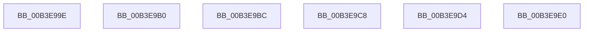

# sub_00B3E99E

- RVA: `0x00B3E99E`–`0x00B3E9EC` (길이 `78` bytes)
- VA: `0x0000000140B3E99E`
- 실행 섹션: `PAGE`
- PDB 이름 있음: `아니요`; PDB Function 태그: `아니요`
- unwind 정보 RVA: `0x000B3B6C`
- 디코드: `14`개 명령, `78/78` bytes 표시
- 미해석 바이트: `0` (있으면 어셈블리에 `.byte`로 보존)

> 이 문서는 커널 이미지의 기계어와 PDB 기호를 분석해 생성했습니다. 4번과 5번은 함수 원형과 자료형을 바이너리 사용 방식에서 추정한 C 해석이며 원본 소스 복구 결과는 아닙니다.

## 1. Dependencies

- 직접 호출 지점: **1**; 고유 호출 대상: **1**
- 직접 호출자로 확인된 함수: **0**
- RIP 상대 이미지 참조: **5**

### Outgoing calls
- `0x00B3E9A1` → [ObfDereferenceObject](../../text/2F/ObfDereferenceObject_function_002F9350.md) (function, `0x002F9350`)

### Direct callers
- 이 함수 시작 RVA로 연결되는 직접 call은 확인되지 않았습니다. 간접 호출은 완전히 역산할 수 없습니다.

### Static image references
- `0x00B3E9B0` → RVA `0x00026C10` (`.rdata`; read)
- `0x00B3E9BC` → RVA `0x00026C20` (`.rdata`; read)
- `0x00B3E9C8` → RVA `0x00026C60` (`.rdata`; read)
- `0x00B3E9D4` → RVA `0x00026C70` (`.rdata`; read)
- `0x00B3E9E0` → RVA `0x00026C50` (`.rdata`; read)

## 2. Other-region calls and transfers

- 다른 실행 섹션으로 향하는 call: **1**
  - `0x00B3E9A1` → [ObfDereferenceObject](../../text/2F/ObfDereferenceObject_function_002F9350.md) (`PAGE` → `.text`)
- call이 아닌 외부 분기/꼬리 이동: **6**
  - `0x00B3E9AB` → [FsRtlNotifyVolumeEventEx + 0x98](../A6/FsRtlNotifyVolumeEventEx_function_00A66DC0.md) (`tail-transfer`)
  - `0x00B3E9B7` → [FsRtlNotifyVolumeEventEx + 0x78](../A6/FsRtlNotifyVolumeEventEx_function_00A66DC0.md) (`tail-transfer`)
  - `0x00B3E9C3` → [FsRtlNotifyVolumeEventEx + 0x78](../A6/FsRtlNotifyVolumeEventEx_function_00A66DC0.md) (`tail-transfer`)
  - `0x00B3E9CF` → [FsRtlNotifyVolumeEventEx + 0x78](../A6/FsRtlNotifyVolumeEventEx_function_00A66DC0.md) (`tail-transfer`)
  - `0x00B3E9DB` → [FsRtlNotifyVolumeEventEx + 0x78](../A6/FsRtlNotifyVolumeEventEx_function_00A66DC0.md) (`tail-transfer`)
  - `0x00B3E9E7` → [FsRtlNotifyVolumeEventEx + 0x78](../A6/FsRtlNotifyVolumeEventEx_function_00A66DC0.md) (`tail-transfer`)

## 3. Assembly (complete function range)

```asm
00B3E99E  48 8B CE                        mov rcx, rsi
00B3E9A1  E8 AA A9 7B FF                  call 0x1402f9350
00B3E9A6  B8 0D 00 00 C0                  mov eax, 0xc000000d
00B3E9AB  E9 A8 84 F2 FF                  jmp 0x140a66e58
00B3E9B0  0F 10 05 59 82 4E FF            movups xmm0, xmmword ptr [rip - 0xb17da7]
00B3E9B7  E9 7C 84 F2 FF                  jmp 0x140a66e38
00B3E9BC  0F 10 05 5D 82 4E FF            movups xmm0, xmmword ptr [rip - 0xb17da3]
00B3E9C3  E9 70 84 F2 FF                  jmp 0x140a66e38
00B3E9C8  0F 10 05 91 82 4E FF            movups xmm0, xmmword ptr [rip - 0xb17d6f]
00B3E9CF  E9 64 84 F2 FF                  jmp 0x140a66e38
00B3E9D4  0F 10 05 95 82 4E FF            movups xmm0, xmmword ptr [rip - 0xb17d6b]
00B3E9DB  E9 58 84 F2 FF                  jmp 0x140a66e38
00B3E9E0  0F 10 05 69 82 4E FF            movups xmm0, xmmword ptr [rip - 0xb17d97]
00B3E9E7  E9 4C 84 F2 FF                  jmp 0x140a66e38
```

## 4. C-style interpretation (structured pseudocode)

```c
__int64 __fastcall sub_00B3E99E(void)
{
    __int64 result;

    result = ObfDereferenceObject(v_rsi, a2, a3, a4);
}
```

## 5. (Beta) C Style

```c
void sub_00B3E99E(void)
{
    int64_t result;

    result = ObfDereferenceObject(local_rsi, a2, a3, a4);
}
```

## 6. Execution-region graph

[열기: 2D/3D 그래프와 함수 탐색 컨트롤 패널](../../../control-panel.html?section=page&rva=0x00B3E99E&view=graph)

- 2D 그래프는 위에서 아래로 흐르고, 3D 그래프는 빈 공간을 드래그해 회전합니다. Shift+드래그는 이동, 휠은 확대·축소, 함수 노드 선택은 대상 보고서 이동입니다.

### Static fallback


