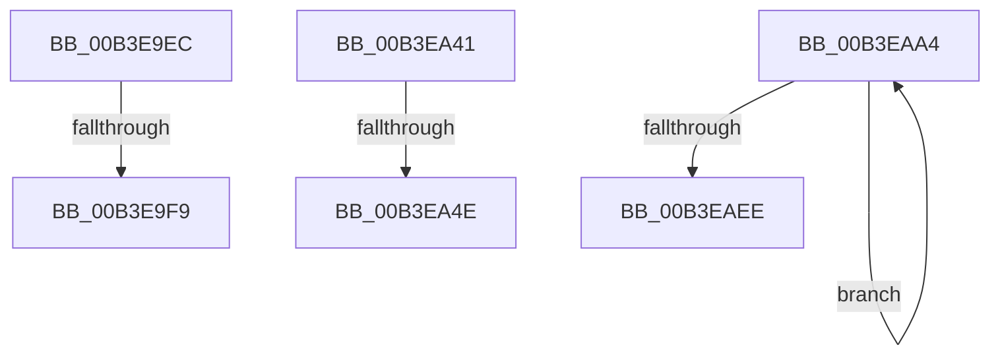

# sub_00B3E9EC

- RVA: `0x00B3E9EC`–`0x00B3EB10` (길이 `292` bytes)
- VA: `0x0000000140B3E9EC`
- 실행 섹션: `PAGE`
- PDB 이름 있음: `아니요`; PDB Function 태그: `아니요`
- unwind 정보 RVA: `0x000B3C2C`
- 디코드: `62`개 명령, `292/292` bytes 표시
- 미해석 바이트: `0` (있으면 어셈블리에 `.byte`로 보존)

> 이 문서는 커널 이미지의 기계어와 PDB 기호를 분석해 생성했습니다. 4번과 5번은 함수 원형과 자료형을 바이너리 사용 방식에서 추정한 C 해석이며 원본 소스 복구 결과는 아닙니다.

## 1. Dependencies

- 직접 호출 지점: **0**; 고유 호출 대상: **0**
- 직접 호출자로 확인된 함수: **0**
- RIP 상대 이미지 참조: **0**

### Outgoing calls
- 직접 디코드된 call 명령이 없습니다.

### Direct callers
- 이 함수 시작 RVA로 연결되는 직접 call은 확인되지 않았습니다. 간접 호출은 완전히 역산할 수 없습니다.

### Static image references
- 디코드된 RIP-relative 메모리 참조가 없습니다.

## 2. Other-region calls and transfers

- 다른 실행 섹션으로 향하는 call: **0**
- call이 아닌 외부 분기/꼬리 이동: **5**
  - `0x00B3E9F3` → [RtlpWow64CtxToAmd64 + 0x4D](../A6/RtlpWow64CtxToAmd64_function_00A67188.md) (`tail-transfer`)
  - `0x00B3EA3C` → [RtlpWow64CtxToAmd64 + 0x4D](../A6/RtlpWow64CtxToAmd64_function_00A67188.md) (`tail-transfer`)
  - `0x00B3EA48` → [RtlpWow64CtxToAmd64 + 0x5E](../A6/RtlpWow64CtxToAmd64_function_00A67188.md) (`tail-transfer`)
  - `0x00B3EA9F` → [RtlpWow64CtxToAmd64 + 0x5E](../A6/RtlpWow64CtxToAmd64_function_00A67188.md) (`tail-transfer`)
  - `0x00B3EB0B` → [RtlpWow64CtxToAmd64 + 0x6F](../A6/RtlpWow64CtxToAmd64_function_00A67188.md) (`tail-transfer`)

## 3. Assembly (complete function range)

```asm
00B3E9EC  41 8B C6                        mov eax, r14d
00B3E9EF  23 C1                           and eax, ecx
00B3E9F1  3B C1                           cmp eax, ecx
00B3E9F3  0F 85 DC 87 F2 FF               jne 0x140a671d5
00B3E9F9  66 41 89 50 38                  mov word ptr [r8 + 0x38], dx
00B3E9FE  81 CD 01 00 10 00               or ebp, 0x100001
00B3EA04  66 41 C7 40 42 2B 00            mov word ptr [r8 + 0x42], 0x2b
00B3EA0B  8B 87 B8 00 00 00               mov eax, dword ptr [rdi + 0xb8]
00B3EA11  49 89 80 F8 00 00 00            mov qword ptr [r8 + 0xf8], rax
00B3EA18  8B 87 B4 00 00 00               mov eax, dword ptr [rdi + 0xb4]
00B3EA1E  49 89 80 A0 00 00 00            mov qword ptr [r8 + 0xa0], rax
00B3EA25  8B 87 C4 00 00 00               mov eax, dword ptr [rdi + 0xc4]
00B3EA2B  49 89 80 98 00 00 00            mov qword ptr [r8 + 0x98], rax
00B3EA32  8B 87 C0 00 00 00               mov eax, dword ptr [rdi + 0xc0]
00B3EA38  41 89 40 44                     mov dword ptr [r8 + 0x44], eax
00B3EA3C  E9 94 87 F2 FF                  jmp 0x140a671d5
00B3EA41  41 8B C6                        mov eax, r14d
00B3EA44  23 C1                           and eax, ecx
00B3EA46  3B C1                           cmp eax, ecx
00B3EA48  0F 85 98 87 F2 FF               jne 0x140a671e6
00B3EA4E  8B 87 9C 00 00 00               mov eax, dword ptr [rdi + 0x9c]
00B3EA54  81 CD 02 00 10 00               or ebp, 0x100002
00B3EA5A  49 89 80 B0 00 00 00            mov qword ptr [r8 + 0xb0], rax
00B3EA61  8B 87 A0 00 00 00               mov eax, dword ptr [rdi + 0xa0]
00B3EA67  49 89 80 A8 00 00 00            mov qword ptr [r8 + 0xa8], rax
00B3EA6E  8B 87 A4 00 00 00               mov eax, dword ptr [rdi + 0xa4]
00B3EA74  49 89 80 90 00 00 00            mov qword ptr [r8 + 0x90], rax
00B3EA7B  8B 87 A8 00 00 00               mov eax, dword ptr [rdi + 0xa8]
00B3EA81  49 89 80 88 00 00 00            mov qword ptr [r8 + 0x88], rax
00B3EA88  8B 87 AC 00 00 00               mov eax, dword ptr [rdi + 0xac]
00B3EA8E  49 89 80 80 00 00 00            mov qword ptr [r8 + 0x80], rax
00B3EA95  8B 87 B0 00 00 00               mov eax, dword ptr [rdi + 0xb0]
00B3EA9B  49 89 40 78                     mov qword ptr [r8 + 0x78], rax
00B3EA9F  E9 42 87 F2 FF                  jmp 0x140a671e6
00B3EAA4  0F 10 01                        movups xmm0, xmmword ptr [rcx]
00B3EAA7  0F 11 00                        movups xmmword ptr [rax], xmm0
00B3EAAA  0F 10 49 10                     movups xmm1, xmmword ptr [rcx + 0x10]
00B3EAAE  0F 11 48 10                     movups xmmword ptr [rax + 0x10], xmm1
00B3EAB2  0F 10 41 20                     movups xmm0, xmmword ptr [rcx + 0x20]
00B3EAB6  0F 11 40 20                     movups xmmword ptr [rax + 0x20], xmm0
00B3EABA  0F 10 49 30                     movups xmm1, xmmword ptr [rcx + 0x30]
00B3EABE  0F 11 48 30                     movups xmmword ptr [rax + 0x30], xmm1
00B3EAC2  0F 10 41 40                     movups xmm0, xmmword ptr [rcx + 0x40]
00B3EAC6  0F 11 40 40                     movups xmmword ptr [rax + 0x40], xmm0
00B3EACA  0F 10 49 50                     movups xmm1, xmmword ptr [rcx + 0x50]
00B3EACE  0F 11 48 50                     movups xmmword ptr [rax + 0x50], xmm1
00B3EAD2  0F 10 41 60                     movups xmm0, xmmword ptr [rcx + 0x60]
00B3EAD6  0F 11 40 60                     movups xmmword ptr [rax + 0x60], xmm0
00B3EADA  49 03 C0                        add rax, r8
00B3EADD  0F 10 49 70                     movups xmm1, xmmword ptr [rcx + 0x70]
00B3EAE1  49 03 C8                        add rcx, r8
00B3EAE4  0F 11 48 F0                     movups xmmword ptr [rax - 0x10], xmm1
00B3EAE8  48 83 EA 01                     sub rdx, 1
00B3EAEC  75 B6                           jne 0x140b3eaa4
00B3EAEE  0F 10 01                        movups xmm0, xmmword ptr [rcx]
00B3EAF1  81 CD 08 00 10 00               or ebp, 0x100008
00B3EAF7  0F 11 00                        movups xmmword ptr [rax], xmm0
00B3EAFA  0F 10 49 10                     movups xmm1, xmmword ptr [rcx + 0x10]
00B3EAFE  0F 11 48 10                     movups xmmword ptr [rax + 0x10], xmm1
00B3EB02  8B 83 18 01 00 00               mov eax, dword ptr [rbx + 0x118]
00B3EB08  89 43 34                        mov dword ptr [rbx + 0x34], eax
00B3EB0B  E9 E7 86 F2 FF                  jmp 0x140a671f7
```

## 4. C-style interpretation (structured pseudocode)

```c
__int64 __fastcall sub_00B3E9EC(__int64 a1, __int64 a2, __int64 a3)
{
    __int64 result;
    __int64 v_rbp;

    result = (unsigned int)(((unsigned int)((unsigned int)(v_r14))) & ((unsigned int)(a1)));
    *(unsigned __int16 *)(a3 + 56) = (unsigned __int16)(a2);
    v_rbp = (unsigned int)((v_rbp) | (0x100001ULL));
    *(unsigned __int16 *)(a3 + 66) = 43;
    *(unsigned __int64 *)(a3 + 248) = (unsigned int)(*(unsigned int *)(v_rdi + 184));
    *(unsigned __int64 *)(a3 + 160) = (unsigned int)(*(unsigned int *)(v_rdi + 180));
    *(unsigned __int64 *)(a3 + 152) = (unsigned int)(*(unsigned int *)(v_rdi + 196));
    *(unsigned int *)(a3 + 68) = (unsigned int)((unsigned int)(*(unsigned int *)(v_rdi + 192)));
}
```

## 5. (Beta) C Style

```c
int64_t sub_00B3E9EC(int64_t Arg1, int64_t Arg2, void *Arg3)
{
    uint8_t *arg3 = (uint8_t *)Arg3;

    int64_t result;
    int64_t local_rbp;

    result = (uint32_t)(((uint32_t)((uint32_t)(local_r14))) & ((uint32_t)(Arg1)));
    *(uint16_t *)(arg3 + 0x38) = (uint16_t)(Arg2);
    local_rbp = (uint32_t)((local_rbp) | (0x100001ULL));
    *(uint16_t *)(arg3 + 0x42) = 43;
    *(uint64_t *)(arg3 + 0xF8) = (uint32_t)(*(uint32_t *)(local_rdi + 0xB8));
    *(uint64_t *)(arg3 + 0xA0) = (uint32_t)(*(uint32_t *)(local_rdi + 0xB4));
    *(uint64_t *)(arg3 + 0x98) = (uint32_t)(*(uint32_t *)(local_rdi + 0xC4));
    *(uint32_t *)(arg3 + 0x44) = (uint32_t)((uint32_t)(*(uint32_t *)(local_rdi + 0xC0)));
}
```

### 관측된 메모리 오프셋

구조체 형식이 확인되지 않은 접근은 인자 기준의 오프셋으로만 기록했습니다.

| 기준 인자 | 오프셋 표현 | 폭 (bit) | 접근 |
|---|---:|---:|---|
| `Arg3` | `+ 0x38` | `16` | `W` |
| `Arg3` | `+ 0x42` | `16` | `W` |
| `Arg3` | `+ 0x44` | `32` | `W` |
| `Arg3` | `+ 0x98` | `64` | `W` |
| `Arg3` | `+ 0xA0` | `64` | `W` |
| `Arg3` | `+ 0xF8` | `64` | `W` |

## 6. Execution-region graph

[열기: 2D/3D 그래프와 함수 탐색 컨트롤 패널](../../../control-panel.html?section=page&rva=0x00B3E9EC&view=graph)

- 2D 그래프는 위에서 아래로 흐르고, 3D 그래프는 빈 공간을 드래그해 회전합니다. Shift+드래그는 이동, 휠은 확대·축소, 함수 노드 선택은 대상 보고서 이동입니다.

### Static fallback


