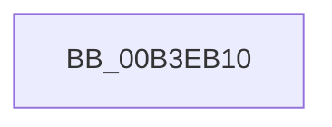

# sub_00B3EB10

- RVA: `0x00B3EB10`–`0x00B3EB2F` (길이 `31` bytes)
- VA: `0x0000000140B3EB10`
- 실행 섹션: `PAGE`
- PDB 이름 있음: `아니요`; PDB Function 태그: `아니요`
- unwind 정보 RVA: `0x000B3C7C`
- 디코드: `8`개 명령, `31/31` bytes 표시
- 미해석 바이트: `0` (있으면 어셈블리에 `.byte`로 보존)

> 이 문서는 커널 이미지의 기계어와 PDB 기호를 분석해 생성했습니다. 4번과 5번은 함수 원형과 자료형을 바이너리 사용 방식에서 추정한 C 해석이며 원본 소스 복구 결과는 아닙니다.

## 1. Dependencies

- 직접 호출 지점: **1**; 고유 호출 대상: **1**
- 직접 호출자로 확인된 함수: **0**
- RIP 상대 이미지 참조: **0**

### Outgoing calls
- `0x00B3EB22` → [EtwpEnableStackCaching](../A5/EtwpEnableStackCaching_function_00A53C6C.md) (function, `0x00A53C6C`)

### Direct callers
- 이 함수 시작 RVA로 연결되는 직접 call은 확인되지 않았습니다. 간접 호출은 완전히 역산할 수 없습니다.

### Static image references
- 디코드된 RIP-relative 메모리 참조가 없습니다.

## 2. Other-region calls and transfers

- 다른 실행 섹션으로 향하는 call: **0**
- call이 아닌 외부 분기/꼬리 이동: **1**
  - `0x00B3EB2A` → [EtwpCheckForStackTracingExtension + 0x77](../A6/EtwpCheckForStackTracingExtension_function_00A675F8.md) (`tail-transfer`)

## 3. Assembly (complete function range)

```asm
00B3EB10  41 8B 53 04                     mov edx, dword ptr [r11 + 4]
00B3EB14  48 85 C9                        test rcx, rcx
00B3EB17  45 8B 43 08                     mov r8d, dword ptr [r11 + 8]
00B3EB1B  48 8B CF                        mov rcx, rdi
00B3EB1E  41 0F 95 C1                     setne r9b
00B3EB22  E8 45 51 F1 FF                  call 0x140a53c6c
00B3EB27  44 8B D0                        mov r10d, eax
00B3EB2A  E9 40 8B F2 FF                  jmp 0x140a6766f
```

## 4. C-style interpretation (structured pseudocode)

```c
__int64 __fastcall sub_00B3EB10(__int64 a1)
{
    __int64 result;

    a4 = (a1 != 0) ? 1 : 0;
    result = EtwpEnableStackCaching(v_rdi, (unsigned int)(*(unsigned int *)(v_r11 + 4)), (unsigned int)(*(unsigned int *)(v_r11 + 8)), a4);
}
```

## 5. (Beta) C Style

```c
int64_t sub_00B3EB10(int64_t Arg1)
{
    int64_t result;

    a4 = (Arg1 != 0) ? 1 : 0;
    result = EtwpEnableStackCaching(local_rdi, (uint32_t)(*(uint32_t *)(local_r11 + 0x4)), (uint32_t)(*(uint32_t *)(local_r11 + 0x8)), a4);
}
```

## 6. Execution-region graph

[열기: 2D/3D 그래프와 함수 탐색 컨트롤 패널](../../../control-panel.html?section=page&rva=0x00B3EB10&view=graph)

- 2D 그래프는 위에서 아래로 흐르고, 3D 그래프는 빈 공간을 드래그해 회전합니다. Shift+드래그는 이동, 휠은 확대·축소, 함수 노드 선택은 대상 보고서 이동입니다.

### Static fallback


