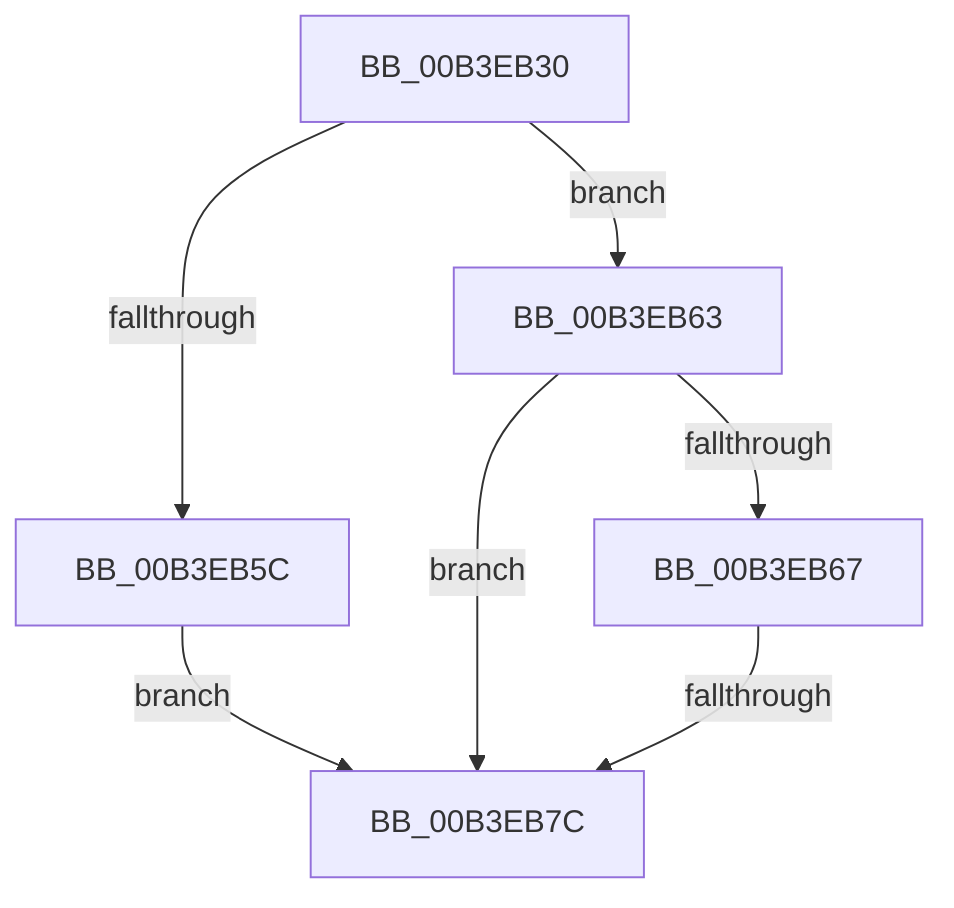

# sub_00B3EB30

- RVA: `0x00B3EB30`–`0x00B3EB8C` (길이 `92` bytes)
- VA: `0x0000000140B3EB30`
- 실행 섹션: `PAGE`
- PDB 이름 있음: `아니요`; PDB Function 태그: `아니요`
- unwind 정보 RVA: `0x000B3D00`
- 디코드: `27`개 명령, `92/92` bytes 표시
- 미해석 바이트: `0` (있으면 어셈블리에 `.byte`로 보존)

> 이 문서는 커널 이미지의 기계어와 PDB 기호를 분석해 생성했습니다. 4번과 5번은 함수 원형과 자료형을 바이너리 사용 방식에서 추정한 C 해석이며 원본 소스 복구 결과는 아닙니다.

## 1. Dependencies

- 직접 호출 지점: **3**; 고유 호출 대상: **3**
- 직접 호출자로 확인된 함수: **0**
- RIP 상대 이미지 참조: **0**

### Outgoing calls
- `0x00B3EB4E` → [RtlGetPersistedStateLocation](../8C/RtlGetPersistedStateLocation_function_008C8DE0.md) (function, `0x008C8DE0`)
- `0x00B3EB6D` → [RtlInitUnicodeStringEx](../../text/46/RtlInitUnicodeStringEx_function_00463960.md) (function, `0x00463960`)
- `0x00B3EB81` → [ExFreePoolWithTag](../../poolcode/B8/ExFreePoolWithTag_function_00B82870.md) (function, `0x00B82870`)

### Direct callers
- 이 함수 시작 RVA로 연결되는 직접 call은 확인되지 않았습니다. 간접 호출은 완전히 역산할 수 없습니다.

### Static image references
- 디코드된 RIP-relative 메모리 참조가 없습니다.

## 2. Other-region calls and transfers

- 다른 실행 섹션으로 향하는 call: **2**
  - `0x00B3EB6D` → [RtlInitUnicodeStringEx](../../text/46/RtlInitUnicodeStringEx_function_00463960.md) (`PAGE` → `.text`)
  - `0x00B3EB81` → [ExFreePoolWithTag](../../poolcode/B8/ExFreePoolWithTag_function_00B82870.md) (`PAGE` → `POOLCODE`)
- call이 아닌 외부 분기/꼬리 이동: **2**
  - `0x00B3EB76` → [PiGetStateRootPath + 0x5A](../A6/PiGetStateRootPath_function_00A67A70.md) (`tail-transfer`)
  - `0x00B3EB87` → [PiGetStateRootPath + 0x5A](../A6/PiGetStateRootPath_function_00A67A70.md) (`tail-transfer`)

## 3. Assembly (complete function range)

```asm
00B3EB30  48 8D 44 24 78                  lea rax, [rsp + 0x78]
00B3EB35  44 8B CD                        mov r9d, ebp
00B3EB38  48 89 44 24 30                  mov qword ptr [rsp + 0x30], rax
00B3EB3D  4D 8B C6                        mov r8, r14
00B3EB40  89 5C 24 28                     mov dword ptr [rsp + 0x28], ebx
00B3EB44  33 D2                           xor edx, edx
00B3EB46  49 8B CF                        mov rcx, r15
00B3EB49  48 89 7C 24 20                  mov qword ptr [rsp + 0x20], rdi
00B3EB4E  E8 8D A2 D8 FF                  call 0x1408c8de0
00B3EB53  8B D8                           mov ebx, eax
00B3EB55  3D 34 00 00 C0                  cmp eax, 0xc0000034
00B3EB5A  75 07                           jne 0x140b3eb63
00B3EB5C  BB E5 00 00 C0                  mov ebx, 0xc00000e5
00B3EB61  EB 19                           jmp 0x140b3eb7c
00B3EB63  85 C0                           test eax, eax
00B3EB65  78 15                           js 0x140b3eb7c
00B3EB67  48 8B D7                        mov rdx, rdi
00B3EB6A  48 8B CE                        mov rcx, rsi
00B3EB6D  E8 EE 4D 92 FF                  call 0x140463960
00B3EB72  8B D8                           mov ebx, eax
00B3EB74  85 C0                           test eax, eax
00B3EB76  0F 89 4E 8F F2 FF               jns 0x140a67aca
00B3EB7C  33 D2                           xor edx, edx
00B3EB7E  48 8B CF                        mov rcx, rdi
00B3EB81  E8 EA 3C 04 00                  call 0x140b82870
00B3EB86  90                              nop
00B3EB87  E9 3E 8F F2 FF                  jmp 0x140a67aca
```

## 4. C-style interpretation (structured pseudocode)

```c
__int64 __fastcall sub_00B3EB30(__int64 a1, int a2, __int64 a3, __int64 a4, __int64 a5, __int64 a6, __int64 a7, __int64 a8, __int64 a9, __int64 a10, __int64 a11, __int64 a12, __int64 a13, __int64 a14, __int64 a15)
{
    __int64 result;
    unsigned __int64 v_stack_p20;
    unsigned int v_stack_p28;
    unsigned __int64 v_stack_p30;

    v_stack_p30 = a15;
    v_stack_p28 = (unsigned int)(v_rbx);
    a2 = 0;
    v_stack_p20 = v_rdi;
    result = RtlGetPersistedStateLocation(v_r15, a2, v_r14, (unsigned int)((unsigned int)(v_rbp)));
    if (((unsigned int)(result)) != 0xC0000034ULL) goto loc_00B3EB63;
    goto loc_00B3EB7C;
loc_00B3EB63:
    if (sign_flag) goto loc_00B3EB7C;
    result = RtlInitUnicodeStringEx(v_rsi, v_rdi, v_r14, (unsigned int)((unsigned int)(v_rbp)));
loc_00B3EB7C:
    a2 = 0;
    result = ExFreePoolWithTag(v_rdi, a2, v_r14, (unsigned int)((unsigned int)(v_rbp)));
}
```

## 5. (Beta) C Style

```c
int64_t sub_00B3EB30(int64_t Arg1, int32_t Arg2, int64_t Arg3, int64_t Arg4, uint64_t Arg5, uint64_t Arg6, uint64_t Arg7, uint64_t Arg8, uint64_t Arg9, uint64_t Arg10, uint64_t Arg11, uint64_t Arg12, uint64_t Arg13, uint64_t Arg14, int64_t Arg15)
{
    int64_t result;
    uint64_t v_stack_p20;
    uint32_t v_stack_p28;
    uint64_t v_stack_p30;

    v_stack_p30 = Arg15;
    v_stack_p28 = (uint32_t)(local_rbx);
    Arg2 = 0;
    v_stack_p20 = local_rdi;
    result = RtlGetPersistedStateLocation(local_r15, Arg2, local_r14, (uint32_t)((uint32_t)(local_rbp)));
    if (((uint32_t)(result)) != 0xC0000034ULL) goto loc_00B3EB63;
    goto loc_00B3EB7C;
loc_00B3EB63:
    if (sign_flag) goto loc_00B3EB7C;
    result = RtlInitUnicodeStringEx(local_rsi, local_rdi, local_r14, (uint32_t)((uint32_t)(local_rbp)));
loc_00B3EB7C:
    Arg2 = 0;
    result = ExFreePoolWithTag(local_rdi, Arg2, local_r14, (uint32_t)((uint32_t)(local_rbp)));
}
```

## 6. Execution-region graph

[열기: 2D/3D 그래프와 함수 탐색 컨트롤 패널](../../../control-panel.html?section=page&rva=0x00B3EB30&view=graph)

- 2D 그래프는 위에서 아래로 흐르고, 3D 그래프는 빈 공간을 드래그해 회전합니다. Shift+드래그는 이동, 휠은 확대·축소, 함수 노드 선택은 대상 보고서 이동입니다.

### Static fallback


