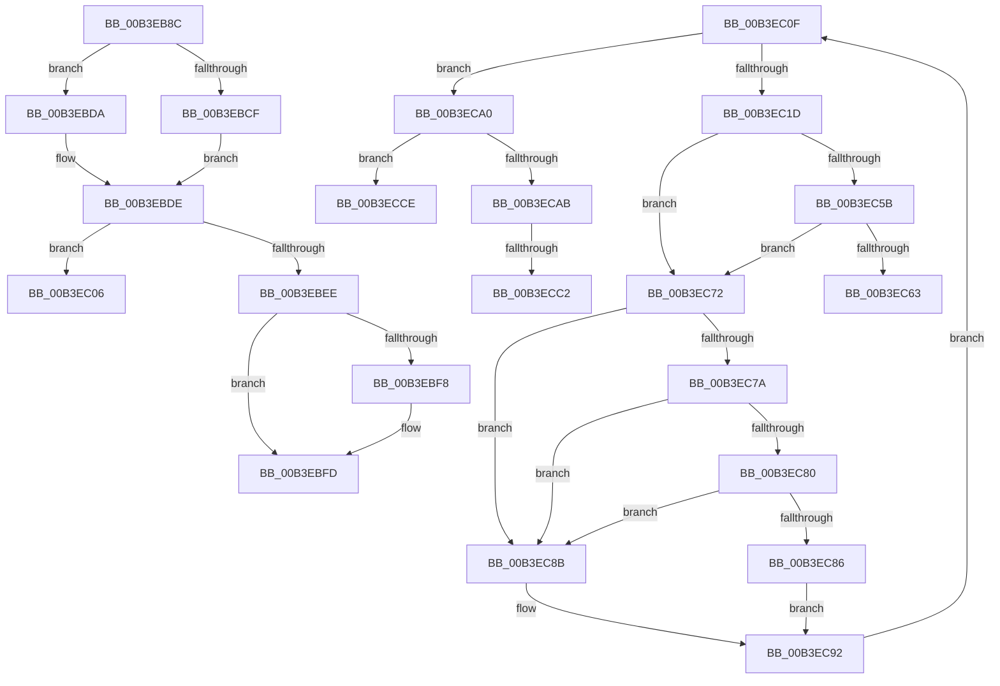

# sub_00B3EB8C

- RVA: `0x00B3EB8C`–`0x00B3ECD6` (길이 `330` bytes)
- VA: `0x0000000140B3EB8C`
- 실행 섹션: `PAGE`
- PDB 이름 있음: `아니요`; PDB Function 태그: `아니요`
- unwind 정보 RVA: `0x000B3DDC`
- 디코드: `85`개 명령, `330/330` bytes 표시
- 미해석 바이트: `0` (있으면 어셈블리에 `.byte`로 보존)

> 이 문서는 커널 이미지의 기계어와 PDB 기호를 분석해 생성했습니다. 4번과 5번은 함수 원형과 자료형을 바이너리 사용 방식에서 추정한 C 해석이며 원본 소스 복구 결과는 아닙니다.

## 1. Dependencies

- 직접 호출 지점: **6**; 고유 호출 대상: **4**
- 직접 호출자로 확인된 함수: **0**
- RIP 상대 이미지 참조: **3**

### Outgoing calls
- `0x00B3EBC6` → [ZwCreateKey](../../text/6A/ZwCreateKey_function_006AD470.md) (function, `0x006AD470`)
- `0x00B3EBF8` → [ZwClose](../../text/6A/ZwClose_function_006AD2B0.md) (function, `0x006AD2B0`)
- `0x00B3EC49` → [ZwQueryValueKey](../../text/6A/ZwQueryValueKey_function_006AD3B0.md) (function, `0x006AD3B0`)
- `0x00B3EC67` → [ZwClose](../../text/6A/ZwClose_function_006AD2B0.md) (function, `0x006AD2B0`)
- `0x00B3ECA0` → [ZwClose](../../text/6A/ZwClose_function_006AD2B0.md) (function, `0x006AD2B0`)
- `0x00B3ECB0` → [PspSanitizeResourceLimits](../78/PspSanitizeResourceLimits_function_0078108C.md) (function, `0x0078108C`)

### Direct callers
- 이 함수 시작 RVA로 연결되는 직접 call은 확인되지 않았습니다. 간접 호출은 완전히 역산할 수 없습니다.

### Static image references
- `0x00B3EB94` → RVA `0x00B4B7F0` (`PspQuotaKeyNames`; read)
- `0x00B3EBE0` → RVA `0x00FDA018` (`PAGEDATA`; read)
- `0x00B3EC1D` → RVA `0x00B4D580` (`PspDefaultResourceNames`; read)

## 2. Other-region calls and transfers

- 다른 실행 섹션으로 향하는 call: **5**
  - `0x00B3EBC6` → [ZwCreateKey](../../text/6A/ZwCreateKey_function_006AD470.md) (`PAGE` → `.text`)
  - `0x00B3EBF8` → [ZwClose](../../text/6A/ZwClose_function_006AD2B0.md) (`PAGE` → `.text`)
  - `0x00B3EC49` → [ZwQueryValueKey](../../text/6A/ZwQueryValueKey_function_006AD3B0.md) (`PAGE` → `.text`)
  - `0x00B3EC67` → [ZwClose](../../text/6A/ZwClose_function_006AD2B0.md) (`PAGE` → `.text`)
  - `0x00B3ECA0` → [ZwClose](../../text/6A/ZwClose_function_006AD2B0.md) (`PAGE` → `.text`)
- call이 아닌 외부 분기/꼬리 이동: **6**
  - `0x00B3EC01` → [PspReadUserQuotaLimits + 0x7E](../A6/PspReadUserQuotaLimits_function_00A68108.md) (`tail-transfer`)
  - `0x00B3EC0A` → [PspReadUserQuotaLimits + 0x7E](../A6/PspReadUserQuotaLimits_function_00A68108.md) (`tail-transfer`)
  - `0x00B3EC6D` → [PspReadUserQuotaLimits + 0xF1](../A6/PspReadUserQuotaLimits_function_00A68108.md) (`tail-transfer`)
  - `0x00B3ECBC` → [PspReadUserQuotaLimits + 0xF1](../A6/PspReadUserQuotaLimits_function_00A68108.md) (`tail-transfer`)
  - `0x00B3ECC9` → [PspReadUserQuotaLimits + 0xEE](../A6/PspReadUserQuotaLimits_function_00A68108.md) (`tail-transfer`)
  - `0x00B3ECD1` → [PspReadUserQuotaLimits + 0xEE](../A6/PspReadUserQuotaLimits_function_00A68108.md) (`tail-transfer`)

## 3. Assembly (complete function range)

```asm
00B3EB8C  45 33 C9                        xor r9d, r9d
00B3EB8F  4C 89 74 24 30                  mov qword ptr [rsp + 0x30], r14
00B3EB94  48 8D 05 55 CC 00 00            lea rax, [rip + 0xcc55]
00B3EB9B  44 89 74 24 28                  mov dword ptr [rsp + 0x28], r14d
00B3EBA0  4C 8D 45 BF                     lea r8, [rbp - 0x41]
00B3EBA4  44 89 7D BF                     mov dword ptr [rbp - 0x41], r15d
00B3EBA8  48 8D 4D A7                     lea rcx, [rbp - 0x59]
00B3EBAC  4C 89 75 C7                     mov qword ptr [rbp - 0x39], r14
00B3EBB0  41 8D 51 09                     lea edx, [r9 + 9]
00B3EBB4  44 89 65 D7                     mov dword ptr [rbp - 0x29], r12d
00B3EBB8  48 89 45 CF                     mov qword ptr [rbp - 0x31], rax
00B3EBBC  F3 0F 7F 45 DF                  movdqu xmmword ptr [rbp - 0x21], xmm0
00B3EBC1  4C 89 74 24 20                  mov qword ptr [rsp + 0x20], r14
00B3EBC6  E8 A5 E8 B6 FF                  call 0x1406ad470
00B3EBCB  85 C0                           test eax, eax
00B3EBCD  79 0B                           jns 0x140b3ebda
00B3EBCF  B9 01 00 00 00                  mov ecx, 1
00B3EBD4  48 89 4D A7                     mov qword ptr [rbp - 0x59], rcx
00B3EBD8  EB 04                           jmp 0x140b3ebde
00B3EBDA  48 8B 4D A7                     mov rcx, qword ptr [rbp - 0x59]
00B3EBDE  33 C0                           xor eax, eax
00B3EBE0  F0 48 0F B1 0D 2F B4 49 00      lock cmpxchg qword ptr [rip + 0x49b42f], rcx
00B3EBE9  48 8B D8                        mov rbx, rax
00B3EBEC  74 18                           je 0x140b3ec06
00B3EBEE  48 8B 4D A7                     mov rcx, qword ptr [rbp - 0x59]
00B3EBF2  48 83 F9 01                     cmp rcx, 1
00B3EBF6  74 05                           je 0x140b3ebfd
00B3EBF8  E8 B3 E6 B6 FF                  call 0x1406ad2b0
00B3EBFD  48 89 5D A7                     mov qword ptr [rbp - 0x59], rbx
00B3EC01  E9 80 95 F2 FF                  jmp 0x140a68186
00B3EC06  48 8B 5D A7                     mov rbx, qword ptr [rbp - 0x59]
00B3EC0A  E9 77 95 F2 FF                  jmp 0x140a68186
00B3EC0F  48 8B 4D AF                     mov rcx, qword ptr [rbp - 0x51]
00B3EC13  41 83 FE 04                     cmp r14d, 4
00B3EC17  0F 8D 83 00 00 00               jge 0x140b3eca0
00B3EC1D  48 8D 05 5C E9 00 00            lea rax, [rip + 0xe95c]
00B3EC24  49 63 D6                        movsxd rdx, r14d
00B3EC27  48 C1 E2 04                     shl rdx, 4
00B3EC2B  4C 8D 4D 07                     lea r9, [rbp + 7]
00B3EC2F  48 03 D0                        add rdx, rax
00B3EC32  41 B8 02 00 00 00               mov r8d, 2
00B3EC38  48 8D 45 B7                     lea rax, [rbp - 0x49]
00B3EC3C  48 89 44 24 28                  mov qword ptr [rsp + 0x28], rax
00B3EC41  C7 44 24 20 14 00 00 00         mov dword ptr [rsp + 0x20], 0x14
00B3EC49  E8 62 E7 B6 FF                  call 0x1406ad3b0
00B3EC4E  B9 00 00 00 80                  mov ecx, 0x80000000
00B3EC53  8B D8                           mov ebx, eax
00B3EC55  03 C1                           add eax, ecx
00B3EC57  85 C1                           test ecx, eax
00B3EC59  75 17                           jne 0x140b3ec72
00B3EC5B  81 FB 34 00 00 C0               cmp ebx, 0xc0000034
00B3EC61  74 0F                           je 0x140b3ec72
00B3EC63  48 8B 4D AF                     mov rcx, qword ptr [rbp - 0x51]
00B3EC67  E8 44 E6 B6 FF                  call 0x1406ad2b0
00B3EC6C  90                              nop
00B3EC6D  E9 87 95 F2 FF                  jmp 0x140a681f9
00B3EC72  81 FB 34 00 00 C0               cmp ebx, 0xc0000034
00B3EC78  74 11                           je 0x140b3ec8b
00B3EC7A  83 7D 0F 04                     cmp dword ptr [rbp + 0xf], 4
00B3EC7E  75 0B                           jne 0x140b3ec8b
00B3EC80  83 7D 0B 04                     cmp dword ptr [rbp + 0xb], 4
00B3EC84  75 05                           jne 0x140b3ec8b
00B3EC86  8B 45 13                        mov eax, dword ptr [rbp + 0x13]
00B3EC89  EB 07                           jmp 0x140b3ec92
00B3EC8B  41 8B 04 3C                     mov eax, dword ptr [r12 + rdi]
00B3EC8F  41 FF C7                        inc r15d
00B3EC92  41 FF C6                        inc r14d
00B3EC95  89 07                           mov dword ptr [rdi], eax
00B3EC97  48 83 C7 04                     add rdi, 4
00B3EC9B  E9 6F FF FF FF                  jmp 0x140b3ec0f
00B3ECA0  E8 0B E6 B6 FF                  call 0x1406ad2b0
00B3ECA5  41 83 FF 04                     cmp r15d, 4
00B3ECA9  73 23                           jae 0x140b3ecce
00B3ECAB  33 D2                           xor edx, edx
00B3ECAD  49 8B CD                        mov rcx, r13
00B3ECB0  E8 D7 23 C4 FF                  call 0x14078108c
00B3ECB5  45 33 F6                        xor r14d, r14d
00B3ECB8  8B D8                           mov ebx, eax
00B3ECBA  85 C0                           test eax, eax
00B3ECBC  0F 88 37 95 F2 FF               js 0x140a681f9
00B3ECC2  48 8B 45 FF                     mov rax, qword ptr [rbp - 1]
00B3ECC6  44 89 30                        mov dword ptr [rax], r14d
00B3ECC9  E9 28 95 F2 FF                  jmp 0x140a681f6
00B3ECCE  45 33 F6                        xor r14d, r14d
00B3ECD1  E9 20 95 F2 FF                  jmp 0x140a681f6
```

## 4. C-style interpretation (structured pseudocode)

```c
__int64 __fastcall sub_00B3EB8C(__int64 a1, __int64 a2, __int64 a3, int a4)
{
    __int64 result;
    unsigned __int64 v_stack_p20;
    unsigned int v_stack_p28;
    unsigned __int64 v_stack_p30;

    a4 = 0;
    v_stack_p30 = v_r14;
    v_stack_p28 = (unsigned int)(v_r14);
    *(unsigned int *)(v_rbp - 65) = (unsigned int)(v_r15);
    *(unsigned __int64 *)(v_rbp - 57) = v_r14;
    *(unsigned int *)(v_rbp - 41) = (unsigned int)(v_r12);
    *(unsigned __int64 *)(v_rbp - 49) = v_rip + 52309;
    *(unsigned __int64 *)(v_rbp - 33) = v_xmm0;
    v_stack_p20 = v_r14;
    result = ZwCreateKey(v_rbp - 89, a4 + 9, v_rbp - 65, a4);
    if (!sign_flag) goto loc_00B3EBDA;
    *(unsigned __int64 *)(v_rbp - 89) = 1;
    goto loc_00B3EBDE;
loc_00B3EBDA:
loc_00B3EBDE:
    result = 0;
    if (condition_is_equal) goto loc_00B3EC06;
    if ((*(unsigned __int64 *)(v_rbp - 89)) != 1) {
        result = ZwClose(*(unsigned __int64 *)(v_rbp - 89), a4 + 9, v_rbp - 65, a4);
    }
    *(unsigned __int64 *)(v_rbp - 89) = 0;
loc_00B3EC06:
}
```

## 5. (Beta) C Style

```c
int64_t sub_00B3EB8C(int64_t Arg1, int64_t Arg2, int64_t Arg3, int32_t Arg4)
{
    int64_t result;
    uint64_t v_stack_p20;
    uint32_t v_stack_p28;
    uint64_t v_stack_p30;

    Arg4 = 0;
    v_stack_p30 = local_r14;
    v_stack_p28 = (uint32_t)(local_r14);
    *(uint32_t *)(local_rbp - 0x41) = (uint32_t)(local_r15);
    *(uint64_t *)(local_rbp - 0x39) = local_r14;
    *(uint32_t *)(local_rbp - 0x29) = (uint32_t)(local_r12);
    *(uint64_t *)(local_rbp - 0x31) = v_rip + 52309;
    *(uint64_t *)(local_rbp - 0x21) = v_xmm0;
    v_stack_p20 = local_r14;
    result = ZwCreateKey(local_rbp - 89, Arg4 + 9, local_rbp - 65, Arg4);
    if (!sign_flag) goto loc_00B3EBDA;
    *(uint64_t *)(local_rbp - 0x59) = 1;
    goto loc_00B3EBDE;
loc_00B3EBDA:
loc_00B3EBDE:
    result = 0;
    if (condition_is_equal) goto loc_00B3EC06;
    if ((*(uint64_t *)(local_rbp - 0x59)) != 1) {
        result = ZwClose(*(uint64_t *)(local_rbp - 0x59), Arg4 + 9, local_rbp - 65, Arg4);
    }
    *(uint64_t *)(local_rbp - 0x59) = 0;
loc_00B3EC06:
}
```

## 6. Execution-region graph

[열기: 2D/3D 그래프와 함수 탐색 컨트롤 패널](../../../control-panel.html?section=page&rva=0x00B3EB8C&view=graph)

- 2D 그래프는 위에서 아래로 흐르고, 3D 그래프는 빈 공간을 드래그해 회전합니다. Shift+드래그는 이동, 휠은 확대·축소, 함수 노드 선택은 대상 보고서 이동입니다.

### Static fallback


