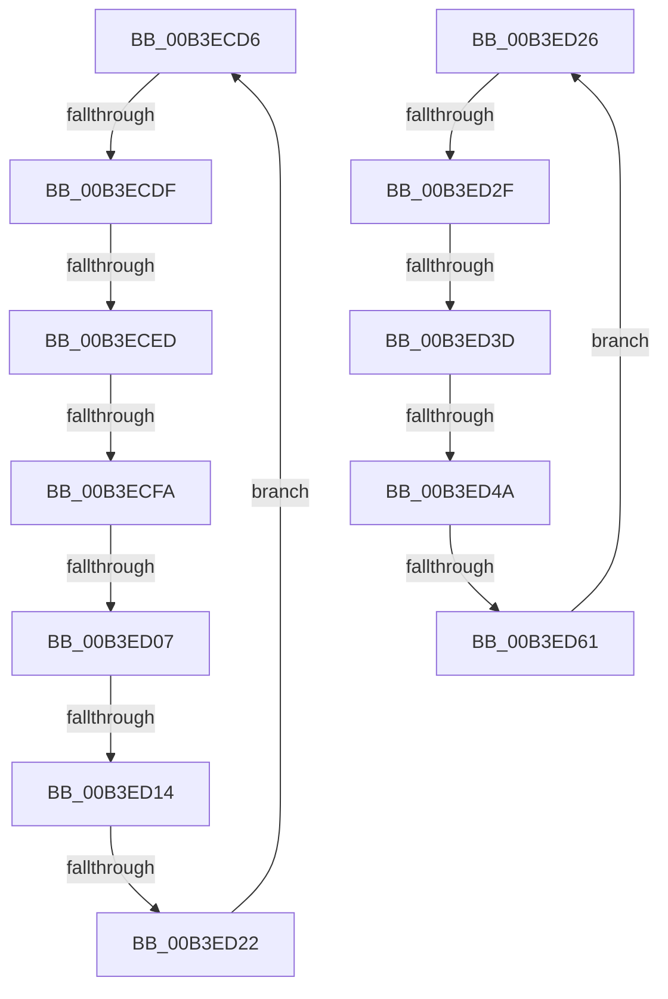

# sub_00B3ECD6

- RVA: `0x00B3ECD6`–`0x00B3ED65` (길이 `143` bytes)
- VA: `0x0000000140B3ECD6`
- 실행 섹션: `PAGE`
- PDB 이름 있음: `아니요`; PDB Function 태그: `아니요`
- unwind 정보 RVA: `0x000B3E60`
- 디코드: `40`개 명령, `143/143` bytes 표시
- 미해석 바이트: `0` (있으면 어셈블리에 `.byte`로 보존)

> 이 문서는 커널 이미지의 기계어와 PDB 기호를 분석해 생성했습니다. 4번과 5번은 함수 원형과 자료형을 바이너리 사용 방식에서 추정한 C 해석이며 원본 소스 복구 결과는 아닙니다.

## 1. Dependencies

- 직접 호출 지점: **1**; 고유 호출 대상: **1**
- 직접 호출자로 확인된 함수: **0**
- RIP 상대 이미지 참조: **0**

### Outgoing calls
- `0x00B3ED54` → [RtlStringCbLengthW](../../text/45/RtlStringCbLengthW_function_004575EC.md) (function, `0x004575EC`)

### Direct callers
- 이 함수 시작 RVA로 연결되는 직접 call은 확인되지 않았습니다. 간접 호출은 완전히 역산할 수 없습니다.

### Static image references
- 디코드된 RIP-relative 메모리 참조가 없습니다.

## 2. Other-region calls and transfers

- 다른 실행 섹션으로 향하는 call: **1**
  - `0x00B3ED54` → [RtlStringCbLengthW](../../text/45/RtlStringCbLengthW_function_004575EC.md) (`PAGE` → `.text`)
- call이 아닌 외부 분기/꼬리 이동: **10**
  - `0x00B3ECD9` → [RtlpValidRelativeAttribute + 0xB8](../A6/RtlpValidRelativeAttribute_function_00A68428.md) (`tail-transfer`)
  - `0x00B3ECE7` → [RtlpValidRelativeAttribute + 0x4E](../A6/RtlpValidRelativeAttribute_function_00A68428.md) (`tail-transfer`)
  - `0x00B3ECF4` → [RtlpValidRelativeAttribute + 0x4E](../A6/RtlpValidRelativeAttribute_function_00A68428.md) (`tail-transfer`)
  - `0x00B3ED01` → [RtlpValidRelativeAttribute + 0x4E](../A6/RtlpValidRelativeAttribute_function_00A68428.md) (`tail-transfer`)
  - `0x00B3ED0E` → [RtlpValidRelativeAttribute + 0x4E](../A6/RtlpValidRelativeAttribute_function_00A68428.md) (`tail-transfer`)
  - `0x00B3ED1C` → [RtlpValidRelativeAttribute + 0x4E](../A6/RtlpValidRelativeAttribute_function_00A68428.md) (`tail-transfer`)
  - `0x00B3ED29` → [RtlpValidRelativeAttribute + 0xB8](../A6/RtlpValidRelativeAttribute_function_00A68428.md) (`tail-transfer`)
  - `0x00B3ED37` → [RtlpValidRelativeAttribute + 0x4E](../A6/RtlpValidRelativeAttribute_function_00A68428.md) (`tail-transfer`)
  - `0x00B3ED44` → [RtlpValidRelativeAttribute + 0x4E](../A6/RtlpValidRelativeAttribute_function_00A68428.md) (`tail-transfer`)
  - `0x00B3ED5B` → [RtlpValidRelativeAttribute + 0x4E](../A6/RtlpValidRelativeAttribute_function_00A68428.md) (`tail-transfer`)

## 3. Assembly (complete function range)

```asm
00B3ECD6  41 3B D0                        cmp edx, r8d
00B3ECD9  0F 83 01 98 F2 FF               jae 0x140a684e0
00B3ECDF  8B C2                           mov eax, edx
00B3ECE1  8B 4C 83 10                     mov ecx, dword ptr [rbx + rax*4 + 0x10]
00B3ECE5  3B F9                           cmp edi, ecx
00B3ECE7  0F 82 89 97 F2 FF               jb 0x140a68476
00B3ECED  8B C7                           mov eax, edi
00B3ECEF  2B C1                           sub eax, ecx
00B3ECF1  83 F8 04                        cmp eax, 4
00B3ECF4  0F 82 7C 97 F2 FF               jb 0x140a68476
00B3ECFA  44 8B 14 19                     mov r10d, dword ptr [rcx + rbx]
00B3ECFE  45 85 D2                        test r10d, r10d
00B3ED01  0F 84 6F 97 F2 FF               je 0x140a68476
00B3ED07  44 8D 49 04                     lea r9d, [rcx + 4]
00B3ED0B  44 3B C9                        cmp r9d, ecx
00B3ED0E  0F 82 62 97 F2 FF               jb 0x140a68476
00B3ED14  8B C7                           mov eax, edi
00B3ED16  41 2B C1                        sub eax, r9d
00B3ED19  41 3B C2                        cmp eax, r10d
00B3ED1C  0F 82 54 97 F2 FF               jb 0x140a68476
00B3ED22  FF C2                           inc edx
00B3ED24  EB B0                           jmp 0x140b3ecd6
00B3ED26  3B 73 0C                        cmp esi, dword ptr [rbx + 0xc]
00B3ED29  0F 83 B1 97 F2 FF               jae 0x140a684e0
00B3ED2F  8B C6                           mov eax, esi
00B3ED31  8B 4C 83 10                     mov ecx, dword ptr [rbx + rax*4 + 0x10]
00B3ED35  3B F9                           cmp edi, ecx
00B3ED37  0F 82 39 97 F2 FF               jb 0x140a68476
00B3ED3D  8B C7                           mov eax, edi
00B3ED3F  2B C1                           sub eax, ecx
00B3ED41  83 F8 02                        cmp eax, 2
00B3ED44  0F 82 2C 97 F2 FF               jb 0x140a68476
00B3ED4A  8B D0                           mov edx, eax
00B3ED4C  4C 8D 44 24 30                  lea r8, [rsp + 0x30]
00B3ED51  48 03 CB                        add rcx, rbx
00B3ED54  E8 93 88 91 FF                  call 0x1404575ec
00B3ED59  85 C0                           test eax, eax
00B3ED5B  0F 88 15 97 F2 FF               js 0x140a68476
00B3ED61  FF C6                           inc esi
00B3ED63  EB C1                           jmp 0x140b3ed26
```

## 4. C-style interpretation (structured pseudocode)

```c
__int64 __fastcall sub_00B3ECD6(__int64 a1, int a2, int a3)
{
    __int64 result;
    unsigned __int64 v_stack_p30;

    result = (unsigned int)(((unsigned int)((unsigned int)(v_rdi))) - ((unsigned int)((unsigned int)(*(unsigned int *)(v_rbx + (unsigned int)(a2) * 4 + 16)))));
    result = (unsigned int)(((unsigned int)((unsigned int)(v_rdi))) - ((unsigned int)((unsigned int)(*(unsigned int *)(v_rbx + (unsigned int)(a2) * 4 + 16)) + 4)));
    a2 = (unsigned int)((a2) + 1);
    goto loc_00B3ECD6;
}
```

## 5. (Beta) C Style

```c
int64_t sub_00B3ECD6(int64_t Arg1, int32_t Arg2, int32_t Arg3)
{
    int64_t result;
    uint64_t v_stack_p30;

    result = (uint32_t)(((uint32_t)((uint32_t)(local_rdi))) - ((uint32_t)((uint32_t)(*(uint32_t *)(local_rbx + (uint32_t)(Arg2) * 4 + 0x10)))));
    result = (uint32_t)(((uint32_t)((uint32_t)(local_rdi))) - ((uint32_t)((uint32_t)(*(uint32_t *)(local_rbx + (uint32_t)(Arg2) * 4 + 0x10)) + 4)));
    Arg2 = (uint32_t)((Arg2) + 1);
    goto loc_00B3ECD6;
}
```

## 6. Execution-region graph

[열기: 2D/3D 그래프와 함수 탐색 컨트롤 패널](../../../control-panel.html?section=page&rva=0x00B3ECD6&view=graph)

- 2D 그래프는 위에서 아래로 흐르고, 3D 그래프는 빈 공간을 드래그해 회전합니다. Shift+드래그는 이동, 휠은 확대·축소, 함수 노드 선택은 대상 보고서 이동입니다.

### Static fallback


