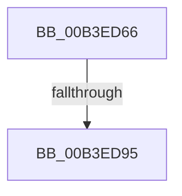

# sub_00B3ED66

- RVA: `0x00B3ED66`–`0x00B3EDC0` (길이 `90` bytes)
- VA: `0x0000000140B3ED66`
- 실행 섹션: `PAGE`
- PDB 이름 있음: `아니요`; PDB Function 태그: `아니요`
- unwind 정보 RVA: `0x000B3FEC`
- 디코드: `20`개 명령, `90/90` bytes 표시
- 미해석 바이트: `0` (있으면 어셈블리에 `.byte`로 보존)

> 이 문서는 커널 이미지의 기계어와 PDB 기호를 분석해 생성했습니다. 4번과 5번은 함수 원형과 자료형을 바이너리 사용 방식에서 추정한 C 해석이며 원본 소스 복구 결과는 아닙니다.

## 1. Dependencies

- 직접 호출 지점: **2**; 고유 호출 대상: **1**
- 직접 호출자로 확인된 함수: **0**
- RIP 상대 이미지 참조: **0**

### Outgoing calls
- `0x00B3ED86` → [PnpRequestDeviceAction](../../text/47/PnpRequestDeviceAction_function_00477FF8.md) (function, `0x00477FF8`)
- `0x00B3EDB5` → [PnpRequestDeviceAction](../../text/47/PnpRequestDeviceAction_function_00477FF8.md) (function, `0x00477FF8`)

### Direct callers
- 이 함수 시작 RVA로 연결되는 직접 call은 확인되지 않았습니다. 간접 호출은 완전히 역산할 수 없습니다.

### Static image references
- 디코드된 RIP-relative 메모리 참조가 없습니다.

## 2. Other-region calls and transfers

- 다른 실행 섹션으로 향하는 call: **2**
  - `0x00B3ED86` → [PnpRequestDeviceAction](../../text/47/PnpRequestDeviceAction_function_00477FF8.md) (`PAGE` → `.text`)
  - `0x00B3EDB5` → [PnpRequestDeviceAction](../../text/47/PnpRequestDeviceAction_function_00477FF8.md) (`PAGE` → `.text`)
- call이 아닌 외부 분기/꼬리 이동: **2**
  - `0x00B3ED8F` → [PiResetProblemDevicesWorker + 0x1C](../A6/PiResetProblemDevicesWorker_function_00A68BE0.md) (`tail-transfer`)
  - `0x00B3EDBB` → [PiResetProblemDevicesWorker + 0x1C](../A6/PiResetProblemDevicesWorker_function_00A68BE0.md) (`tail-transfer`)

## 3. Assembly (complete function range)

```asm
00B3ED66  48 83 64 24 30 00               and qword ptr [rsp + 0x30], 0
00B3ED6C  45 33 C9                        xor r9d, r9d
00B3ED6F  48 83 64 24 28 00               and qword ptr [rsp + 0x28], 0
00B3ED75  41 B0 01                        mov r8b, 1
00B3ED78  48 8B 4B 20                     mov rcx, qword ptr [rbx + 0x20]
00B3ED7C  48 83 64 24 20 00               and qword ptr [rsp + 0x20], 0
00B3ED82  41 8D 51 01                     lea edx, [r9 + 1]
00B3ED86  E8 6D 92 93 FF                  call 0x140477ff8
00B3ED8B  83 7F 04 00                     cmp dword ptr [rdi + 4], 0
00B3ED8F  0F 84 67 9E F2 FF               je 0x140a68bfc
00B3ED95  48 83 64 24 30 00               and qword ptr [rsp + 0x30], 0
00B3ED9B  45 33 C9                        xor r9d, r9d
00B3ED9E  48 83 64 24 28 00               and qword ptr [rsp + 0x28], 0
00B3EDA4  41 B0 01                        mov r8b, 1
00B3EDA7  48 83 64 24 20 00               and qword ptr [rsp + 0x20], 0
00B3EDAD  48 8B 4B 20                     mov rcx, qword ptr [rbx + 0x20]
00B3EDB1  41 8D 51 10                     lea edx, [r9 + 0x10]
00B3EDB5  E8 3E 92 93 FF                  call 0x140477ff8
00B3EDBA  90                              nop
00B3EDBB  E9 3C 9E F2 FF                  jmp 0x140a68bfc
```

## 4. C-style interpretation (structured pseudocode)

```c
__int64 __fastcall sub_00B3ED66(__int64 a1, __int64 a2, __int64 a3, int a4, __int64 a5, __int64 a6)
{
    __int64 result;
    unsigned __int64 v_stack_p20;

    a4 = 0;
    result = PnpRequestDeviceAction(*(unsigned __int64 *)(v_rbx + 32), a4 + 1, 1, a4);
    a4 = 0;
    result = PnpRequestDeviceAction(*(unsigned __int64 *)(v_rbx + 32), a4 + 16, 1, a4);
}
```

## 5. (Beta) C Style

```c
int64_t sub_00B3ED66(int64_t Arg1, int64_t Arg2, int64_t Arg3, int32_t Arg4, int64_t Arg5, int64_t Arg6)
{
    int64_t result;
    uint64_t v_stack_p20;

    Arg4 = 0;
    result = PnpRequestDeviceAction(*(uint64_t *)(local_rbx + 0x20), Arg4 + 1, 1, Arg4);
    Arg4 = 0;
    result = PnpRequestDeviceAction(*(uint64_t *)(local_rbx + 0x20), Arg4 + 16, 1, Arg4);
}
```

## 6. Execution-region graph

[열기: 2D/3D 그래프와 함수 탐색 컨트롤 패널](../../../control-panel.html?section=page&rva=0x00B3ED66&view=graph)

- 2D 그래프는 위에서 아래로 흐르고, 3D 그래프는 빈 공간을 드래그해 회전합니다. Shift+드래그는 이동, 휠은 확대·축소, 함수 노드 선택은 대상 보고서 이동입니다.

### Static fallback


