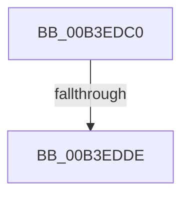

# sub_00B3EDC0

- RVA: `0x00B3EDC0`–`0x00B3F097` (길이 `727` bytes)
- VA: `0x0000000140B3EDC0`
- 실행 섹션: `PAGE`
- PDB 이름 있음: `아니요`; PDB Function 태그: `아니요`
- unwind 정보 RVA: `0x000B40B8`
- 디코드: `140`개 명령, `727/727` bytes 표시
- 미해석 바이트: `0` (있으면 어셈블리에 `.byte`로 보존)

> 이 문서는 커널 이미지의 기계어와 PDB 기호를 분석해 생성했습니다. 4번과 5번은 함수 원형과 자료형을 바이너리 사용 방식에서 추정한 C 해석이며 원본 소스 복구 결과는 아닙니다.

## 1. Dependencies

- 직접 호출 지점: **2**; 고유 호출 대상: **2**
- 직접 호출자로 확인된 함수: **0**
- RIP 상대 이미지 참조: **11**

### Outgoing calls
- `0x00B3EDD1` → [tlgKeywordOn](../../text/42/tlgKeywordOn_function_0042EAA0.md) (function, `0x0042EAA0`)
- `0x00B3F08C` → [_tlgWriteTemplate<long __cdecl(_tlgProvider_t const * __ptr64,void const * __ptr64,_GUID const * __ptr64,_GUID const * __ptr64,unsigned int,_EVENT_DATA_DESCRIPTOR * __ptr64),&_tlgWriteTransfer_EtwWriteTransfer,_GUID const * __ptr64,_GUID const * __ptr64>::Write<_tlgWrapperByVal<8>,_tlgWrapperByVal<4>,_tlgWrapperByVal<4>,_tlgWrapperByVal<1>,_tlgWrapperByRef<16>,_tlgWrapperBinary,_tlgWrapperByVal<8>,_tlgWrapperByVal<1>,_tlgWrapperBinary,_tlgWrapperByVal<8>,_tlgWrapperByVal<1>,_tlgWrapperBinary,_tlgWrapperByVal<8>,_tlgWrapperByVal<1>,_tlgWrapperBinary,_tlgWrapperByVal<8>,_tlgWrapperByVal<1>,_tlgWrapperBinary,_tlgWrapperByVal<8>,_tlgWrapperByVal<1>,_tlgWrapperBinary,_tlgWrapperByVal<8>,_tlgWrapperByVal<1>,_tlgWrapperBinary,_tlgWrapperByVal<8>,_tlgWrapperByVal<1>,_tlgWrapperBinary,_tlgWrapperByVal<8>,_tlgWrapperByVal<1>,_tlgWrapperBinary,_tlgWrapperByVal<4>,_tlgWrapperByVal<1> >](../../text/20/_tlgWriteTemplate_long___cdecl__tlgProvider_t_const___ptr64_void_const___ptr64__GUID_const___ptr64___function_00200008.md) (function, `0x00200008`)

### Direct callers
- 이 함수 시작 RVA로 연결되는 직접 call은 확인되지 않았습니다. 간접 호출은 완전히 역산할 수 없습니다.

### Static image references
- `0x00B3EDCA` → RVA `0x00E0A580` (`.data`; read)
- `0x00B3EDE7` → RVA `0x000429E8` (`.rdata`; read)
- `0x00B3EE09` → RVA `0x000429B8` (`.rdata`; read)
- `0x00B3EE1E` → RVA `0x00042A38` (`.rdata`; read)
- `0x00B3EE33` → RVA `0x00042A08` (`.rdata`; read)
- `0x00B3EE48` → RVA `0x00042A90` (`.rdata`; read)
- `0x00B3EE5D` → RVA `0x00042A68` (`.rdata`; read)
- `0x00B3EE68` → RVA `0x00042AE0` (`.rdata`; read)
- `0x00B3EEA4` → RVA `0x00042AB8` (`.rdata`; read)
- `0x00B3EEBA` → RVA `0x00042B08` (`.rdata`; read)
- `0x00B3EF89` → RVA `0x0005AE89` (`.rdata`; read)

## 2. Other-region calls and transfers

- 다른 실행 섹션으로 향하는 call: **2**
  - `0x00B3EDD1` → [tlgKeywordOn](../../text/42/tlgKeywordOn_function_0042EAA0.md) (`PAGE` → `.text`)
  - `0x00B3F08C` → [_tlgWriteTemplate<long __cdecl(_tlgProvider_t const * __ptr64,void const * __ptr64,_GUID const * __ptr64,_GUID const * __ptr64,unsigned int,_EVENT_DATA_DESCRIPTOR * __ptr64),&_tlgWriteTransfer_EtwWriteTransfer,_GUID const * __ptr64,_GUID const * __ptr64>::Write<_tlgWrapperByVal<8>,_tlgWrapperByVal<4>,_tlgWrapperByVal<4>,_tlgWrapperByVal<1>,_tlgWrapperByRef<16>,_tlgWrapperBinary,_tlgWrapperByVal<8>,_tlgWrapperByVal<1>,_tlgWrapperBinary,_tlgWrapperByVal<8>,_tlgWrapperByVal<1>,_tlgWrapperBinary,_tlgWrapperByVal<8>,_tlgWrapperByVal<1>,_tlgWrapperBinary,_tlgWrapperByVal<8>,_tlgWrapperByVal<1>,_tlgWrapperBinary,_tlgWrapperByVal<8>,_tlgWrapperByVal<1>,_tlgWrapperBinary,_tlgWrapperByVal<8>,_tlgWrapperByVal<1>,_tlgWrapperBinary,_tlgWrapperByVal<8>,_tlgWrapperByVal<1>,_tlgWrapperBinary,_tlgWrapperByVal<8>,_tlgWrapperByVal<1>,_tlgWrapperBinary,_tlgWrapperByVal<4>,_tlgWrapperByVal<1> >](../../text/20/_tlgWriteTemplate_long___cdecl__tlgProvider_t_const___ptr64_void_const___ptr64__GUID_const___ptr64___function_00200008.md) (`PAGE` → `.text`)
- call이 아닌 외부 분기/꼬리 이동: **2**
  - `0x00B3EDD8` → [LookUpTableFlushComplete + 0x8A](../A6/LookUpTableFlushComplete_function_00A6957C.md) (`tail-transfer`)
  - `0x00B3F092` → [LookUpTableFlushComplete + 0x8A](../A6/LookUpTableFlushComplete_function_00A6957C.md) (`tail-transfer`)

## 3. Assembly (complete function range)

```asm
00B3EDC0  48 BA 00 00 00 00 00 20 00 00   movabs rdx, 0x200000000000
00B3EDCA  48 8D 0D AF B7 2C 00            lea rcx, [rip + 0x2cb7af]
00B3EDD1  E8 CA FC 8E FF                  call 0x14042eaa0
00B3EDD6  84 C0                           test al, al
00B3EDD8  0F 84 28 A8 F2 FF               je 0x140a69606
00B3EDDE  B9 2A 00 00 00                  mov ecx, 0x2a
00B3EDE3  C6 45 80 04                     mov byte ptr [rbp - 0x80], 4
00B3EDE7  48 8D 05 FA 3B 50 FF            lea rax, [rip - 0xafc406]
00B3EDEE  66 89 4D 00                     mov word ptr [rbp], cx
00B3EDF2  48 89 45 E8                     mov qword ptr [rbp - 0x18], rax
00B3EDF6  B8 18 00 00 00                  mov eax, 0x18
00B3EDFB  66 89 45 F0                     mov word ptr [rbp - 0x10], ax
00B3EDFF  8B 83 44 01 00 00               mov eax, dword ptr [rbx + 0x144]
00B3EE05  48 89 45 98                     mov qword ptr [rbp - 0x68], rax
00B3EE09  48 8D 05 A8 3B 50 FF            lea rax, [rip - 0xafc458]
00B3EE10  48 89 45 F8                     mov qword ptr [rbp - 8], rax
00B3EE14  8B 83 40 01 00 00               mov eax, dword ptr [rbx + 0x140]
00B3EE1A  48 89 45 A0                     mov qword ptr [rbp - 0x60], rax
00B3EE1E  48 8D 05 13 3C 50 FF            lea rax, [rip - 0xafc3ed]
00B3EE25  48 89 45 08                     mov qword ptr [rbp + 8], rax
00B3EE29  8B 83 3C 01 00 00               mov eax, dword ptr [rbx + 0x13c]
00B3EE2F  48 89 45 A8                     mov qword ptr [rbp - 0x58], rax
00B3EE33  48 8D 05 CE 3B 50 FF            lea rax, [rip - 0xafc432]
00B3EE3A  48 89 45 18                     mov qword ptr [rbp + 0x18], rax
00B3EE3E  8B 83 38 01 00 00               mov eax, dword ptr [rbx + 0x138]
00B3EE44  48 89 45 B0                     mov qword ptr [rbp - 0x50], rax
00B3EE48  48 8D 05 41 3C 50 FF            lea rax, [rip - 0xafc3bf]
00B3EE4F  48 89 45 28                     mov qword ptr [rbp + 0x28], rax
00B3EE53  8B 83 34 01 00 00               mov eax, dword ptr [rbx + 0x134]
00B3EE59  48 89 45 B8                     mov qword ptr [rbp - 0x48], rax
00B3EE5D  48 8D 05 04 3C 50 FF            lea rax, [rip - 0xafc3fc]
00B3EE64  48 89 45 38                     mov qword ptr [rbp + 0x38], rax
00B3EE68  48 8D 05 71 3C 50 FF            lea rax, [rip - 0xafc38f]
00B3EE6F  48 89 45 48                     mov qword ptr [rbp + 0x48], rax
00B3EE73  66 89 4D 10                     mov word ptr [rbp + 0x10], cx
00B3EE77  66 89 4D 20                     mov word ptr [rbp + 0x20], cx
00B3EE7B  B9 22 00 00 00                  mov ecx, 0x22
00B3EE80  C7 45 8C 01 00 00 00            mov dword ptr [rbp - 0x74], 1
00B3EE87  C6 45 81 04                     mov byte ptr [rbp - 0x7f], 4
00B3EE8B  C6 45 82 04                     mov byte ptr [rbp - 0x7e], 4
00B3EE8F  8D 41 04                        lea eax, [rcx + 4]
00B3EE92  C6 45 83 04                     mov byte ptr [rbp - 0x7d], 4
00B3EE96  66 89 45 50                     mov word ptr [rbp + 0x50], ax
00B3EE9A  8B 83 30 01 00 00               mov eax, dword ptr [rbx + 0x130]
00B3EEA0  48 89 45 C8                     mov qword ptr [rbp - 0x38], rax
00B3EEA4  48 8D 05 0D 3C 50 FF            lea rax, [rip - 0xafc3f3]
00B3EEAB  48 89 45 58                     mov qword ptr [rbp + 0x58], rax
00B3EEAF  48 8B 83 28 01 00 00            mov rax, qword ptr [rbx + 0x128]
00B3EEB6  48 89 45 D0                     mov qword ptr [rbp - 0x30], rax
00B3EEBA  48 8D 05 47 3C 50 FF            lea rax, [rip - 0xafc3b9]
00B3EEC1  48 89 45 68                     mov qword ptr [rbp + 0x68], rax
00B3EEC5  8D 41 F2                        lea eax, [rcx - 0xe]
00B3EEC8  66 89 45 70                     mov word ptr [rbp + 0x70], ax
00B3EECC  48 8B 83 58 01 00 00            mov rax, qword ptr [rbx + 0x158]
00B3EED3  C6 45 84 04                     mov byte ptr [rbp - 0x7c], 4
00B3EED7  C6 45 85 04                     mov byte ptr [rbp - 0x7b], 4
00B3EEDB  C6 45 86 04                     mov byte ptr [rbp - 0x7a], 4
00B3EEDF  4C 89 45 C0                     mov qword ptr [rbp - 0x40], r8
00B3EEE3  C6 45 87 04                     mov byte ptr [rbp - 0x79], 4
00B3EEE7  C6 45 88 04                     mov byte ptr [rbp - 0x78], 4
00B3EEEB  66 89 4D 30                     mov word ptr [rbp + 0x30], cx
00B3EEEF  66 89 4D 40                     mov word ptr [rbp + 0x40], cx
00B3EEF3  48 8B 48 08                     mov rcx, qword ptr [rax + 8]
00B3EEF7  48 8D 85 A0 00 00 00            lea rax, [rbp + 0xa0]
00B3EEFE  48 89 45 D8                     mov qword ptr [rbp - 0x28], rax
00B3EF02  48 8D 45 80                     lea rax, [rbp - 0x80]
00B3EF06  48 89 84 24 18 01 00 00         mov qword ptr [rsp + 0x118], rax
00B3EF0E  48 8D 45 8C                     lea rax, [rbp - 0x74]
00B3EF12  48 89 84 24 10 01 00 00         mov qword ptr [rsp + 0x110], rax
00B3EF1A  48 8D 45 E8                     lea rax, [rbp - 0x18]
00B3EF1E  0F 10 41 F0                     movups xmm0, xmmword ptr [rcx - 0x10]
00B3EF22  83 4D 90 FF                     or dword ptr [rbp - 0x70], 0xffffffff
00B3EF26  48 89 84 24 08 01 00 00         mov qword ptr [rsp + 0x108], rax
00B3EF2E  48 8D 45 81                     lea rax, [rbp - 0x7f]
00B3EF32  48 89 84 24 00 01 00 00         mov qword ptr [rsp + 0x100], rax
00B3EF3A  48 8D 45 98                     lea rax, [rbp - 0x68]
00B3EF3E  48 89 84 24 F8 00 00 00         mov qword ptr [rsp + 0xf8], rax
00B3EF46  48 8D 45 F8                     lea rax, [rbp - 8]
00B3EF4A  48 89 84 24 F0 00 00 00         mov qword ptr [rsp + 0xf0], rax
00B3EF52  48 8D 45 82                     lea rax, [rbp - 0x7e]
00B3EF56  48 89 84 24 E8 00 00 00         mov qword ptr [rsp + 0xe8], rax
00B3EF5E  66 89 75 60                     mov word ptr [rbp + 0x60], si
00B3EF62  F3 0F 7F 85 A0 00 00 00         movdqu xmmword ptr [rbp + 0xa0], xmm0
00B3EF6A  40 88 7D 89                     mov byte ptr [rbp - 0x77], dil
00B3EF6E  C7 45 94 2C 01 00 00            mov dword ptr [rbp - 0x6c], 0x12c
00B3EF75  48 C7 45 E0 00 00 00 01         mov qword ptr [rbp - 0x20], 0x1000000
00B3EF7D  48 8D 45 A0                     lea rax, [rbp - 0x60]
00B3EF81  48 89 84 24 E0 00 00 00         mov qword ptr [rsp + 0xe0], rax
00B3EF89  48 8D 15 F9 BE 51 FF            lea rdx, [rip - 0xae4107]
00B3EF90  48 8D 45 08                     lea rax, [rbp + 8]
00B3EF94  48 89 84 24 D8 00 00 00         mov qword ptr [rsp + 0xd8], rax
00B3EF9C  48 8D 45 83                     lea rax, [rbp - 0x7d]
00B3EFA0  48 89 84 24 D0 00 00 00         mov qword ptr [rsp + 0xd0], rax
00B3EFA8  48 8D 45 A8                     lea rax, [rbp - 0x58]
00B3EFAC  48 89 84 24 C8 00 00 00         mov qword ptr [rsp + 0xc8], rax
00B3EFB4  48 8D 45 18                     lea rax, [rbp + 0x18]
00B3EFB8  48 89 84 24 C0 00 00 00         mov qword ptr [rsp + 0xc0], rax
00B3EFC0  48 8D 45 84                     lea rax, [rbp - 0x7c]
00B3EFC4  48 89 84 24 B8 00 00 00         mov qword ptr [rsp + 0xb8], rax
00B3EFCC  48 8D 45 B0                     lea rax, [rbp - 0x50]
00B3EFD0  48 89 84 24 B0 00 00 00         mov qword ptr [rsp + 0xb0], rax
00B3EFD8  48 8D 45 28                     lea rax, [rbp + 0x28]
00B3EFDC  48 89 84 24 A8 00 00 00         mov qword ptr [rsp + 0xa8], rax
00B3EFE4  48 8D 45 85                     lea rax, [rbp - 0x7b]
00B3EFE8  48 89 84 24 A0 00 00 00         mov qword ptr [rsp + 0xa0], rax
00B3EFF0  48 8D 45 B8                     lea rax, [rbp - 0x48]
00B3EFF4  48 89 84 24 98 00 00 00         mov qword ptr [rsp + 0x98], rax
00B3EFFC  48 8D 45 38                     lea rax, [rbp + 0x38]
00B3F000  48 89 84 24 90 00 00 00         mov qword ptr [rsp + 0x90], rax
00B3F008  48 8D 45 86                     lea rax, [rbp - 0x7a]
00B3F00C  48 89 84 24 88 00 00 00         mov qword ptr [rsp + 0x88], rax
00B3F014  48 8D 45 C0                     lea rax, [rbp - 0x40]
00B3F018  48 89 84 24 80 00 00 00         mov qword ptr [rsp + 0x80], rax
00B3F020  48 8D 45 48                     lea rax, [rbp + 0x48]
00B3F024  48 89 44 24 78                  mov qword ptr [rsp + 0x78], rax
00B3F029  48 8D 45 87                     lea rax, [rbp - 0x79]
00B3F02D  48 89 44 24 70                  mov qword ptr [rsp + 0x70], rax
00B3F032  48 8D 45 C8                     lea rax, [rbp - 0x38]
00B3F036  48 89 44 24 68                  mov qword ptr [rsp + 0x68], rax
00B3F03B  48 8D 45 58                     lea rax, [rbp + 0x58]
00B3F03F  48 89 44 24 60                  mov qword ptr [rsp + 0x60], rax
00B3F044  48 8D 45 88                     lea rax, [rbp - 0x78]
00B3F048  48 89 44 24 58                  mov qword ptr [rsp + 0x58], rax
00B3F04D  48 8D 45 D0                     lea rax, [rbp - 0x30]
00B3F051  48 89 44 24 50                  mov qword ptr [rsp + 0x50], rax
00B3F056  48 8D 45 68                     lea rax, [rbp + 0x68]
00B3F05A  48 89 44 24 48                  mov qword ptr [rsp + 0x48], rax
00B3F05F  48 8D 45 D8                     lea rax, [rbp - 0x28]
00B3F063  48 89 44 24 40                  mov qword ptr [rsp + 0x40], rax
00B3F068  48 8D 45 89                     lea rax, [rbp - 0x77]
00B3F06C  48 89 44 24 38                  mov qword ptr [rsp + 0x38], rax
00B3F071  48 8D 45 90                     lea rax, [rbp - 0x70]
00B3F075  48 89 44 24 30                  mov qword ptr [rsp + 0x30], rax
00B3F07A  48 8D 45 94                     lea rax, [rbp - 0x6c]
00B3F07E  48 89 44 24 28                  mov qword ptr [rsp + 0x28], rax
00B3F083  48 8D 45 E0                     lea rax, [rbp - 0x20]
00B3F087  48 89 44 24 20                  mov qword ptr [rsp + 0x20], rax
00B3F08C  E8 77 0F 6C FF                  call 0x140200008
00B3F091  90                              nop
00B3F092  E9 6F A5 F2 FF                  jmp 0x140a69606
```

## 4. C-style interpretation (structured pseudocode)

```c
__int64 __fastcall sub_00B3EDC0(__int64 a1, __int64 a2, __int64 a3)
{
    __int64 result;
    unsigned __int64 v_stack_p100;
    unsigned __int64 v_stack_p108;
    unsigned __int64 v_stack_p110;
    unsigned __int64 v_stack_p118;
    unsigned __int64 v_stack_p20;
    unsigned __int64 v_stack_p28;
    unsigned __int64 v_stack_p30;
    unsigned __int64 v_stack_p38;
    unsigned __int64 v_stack_p40;
    unsigned __int64 v_stack_p48;
    unsigned __int64 v_stack_p50;
    unsigned __int64 v_stack_p58;
    unsigned __int64 v_stack_p60;
    unsigned __int64 v_stack_p68;
    unsigned __int64 v_stack_p70;
    unsigned __int64 v_stack_p78;
    unsigned __int64 v_stack_p80;
    unsigned __int64 v_stack_p88;
    unsigned __int64 v_stack_p90;
    unsigned __int64 v_stack_p98;
    unsigned __int64 v_stack_pA0;
    unsigned __int64 v_stack_pA8;
    unsigned __int64 v_stack_pB0;
    unsigned __int64 v_stack_pB8;
    unsigned __int64 v_stack_pC0;
    unsigned __int64 v_stack_pC8;
    unsigned __int64 v_stack_pD0;
    unsigned __int64 v_stack_pD8;
    unsigned __int64 v_stack_pE0;
    unsigned __int64 v_stack_pE8;
    unsigned __int64 v_stack_pF0;
    unsigned __int64 v_stack_pF8;

    result = tlgKeywordOn(v_rip + 2930607, a2, a3, a4);
    *(unsigned __int8 *)(v_rbp - 128) = 4;
    *(unsigned __int16 *)(v_rbp) = 42;
    *(unsigned __int64 *)(v_rbp - 24) = v_rip - 11518982;
    *(unsigned __int16 *)(v_rbp - 16) = 24;
    *(unsigned __int64 *)(v_rbp - 104) = (unsigned int)(*(unsigned int *)(v_rbx + 324));
    *(unsigned __int64 *)(v_rbp - 8) = v_rip - 11519064;
    *(unsigned __int64 *)(v_rbp - 96) = (unsigned int)(*(unsigned int *)(v_rbx + 320));
    *(unsigned __int64 *)(v_rbp + 8) = v_rip - 11518957;
    *(unsigned __int64 *)(v_rbp - 88) = (unsigned int)(*(unsigned int *)(v_rbx + 316));
    *(unsigned __int64 *)(v_rbp + 24) = v_rip - 11519026;
    *(unsigned __int64 *)(v_rbp - 80) = (unsigned int)(*(unsigned int *)(v_rbx + 312));
    *(unsigned __int64 *)(v_rbp + 40) = v_rip - 11518911;
    *(unsigned __int64 *)(v_rbp - 72) = (unsigned int)(*(unsigned int *)(v_rbx + 308));
    *(unsigned __int64 *)(v_rbp + 56) = v_rip - 11518972;
    *(unsigned __int64 *)(v_rbp + 72) = v_rip - 11518863;
    *(unsigned __int16 *)(v_rbp + 16) = 42;
    *(unsigned __int16 *)(v_rbp + 32) = 42;
    *(unsigned int *)(v_rbp - 116) = 1;
    *(unsigned __int8 *)(v_rbp - 127) = 4;
    *(unsigned __int8 *)(v_rbp - 126) = 4;
    *(unsigned __int8 *)(v_rbp - 125) = 4;
    *(unsigned __int16 *)(v_rbp + 80) = (unsigned __int16)(34 + 4);
    *(unsigned __int64 *)(v_rbp - 56) = (unsigned int)(*(unsigned int *)(v_rbx + 304));
    *(unsigned __int64 *)(v_rbp + 88) = v_rip - 11518963;
    *(unsigned __int64 *)(v_rbp - 48) = *(unsigned __int64 *)(v_rbx + 296);
    *(unsigned __int64 *)(v_rbp + 104) = v_rip - 11518905;
    *(unsigned __int16 *)(v_rbp + 112) = (unsigned __int16)(34 - 14);
    *(unsigned __int8 *)(v_rbp - 124) = 4;
    *(unsigned __int8 *)(v_rbp - 123) = 4;
    *(unsigned __int8 *)(v_rbp - 122) = 4;
    *(unsigned __int64 *)(v_rbp - 64) = a3;
    *(unsigned __int8 *)(v_rbp - 121) = 4;
    *(unsigned __int8 *)(v_rbp - 120) = 4;
    *(unsigned __int16 *)(v_rbp + 48) = 34;
    *(unsigned __int16 *)(v_rbp + 64) = 34;
    *(unsigned __int64 *)(v_rbp - 40) = v_rbp + 160;
    v_stack_p118 = v_rbp - 128;
    v_stack_p110 = v_rbp - 116;
    v_stack_p108 = v_rbp - 24;
    v_stack_p100 = v_rbp - 127;
    v_stack_pF8 = v_rbp - 104;
    v_stack_pF0 = v_rbp - 8;
    v_stack_pE8 = v_rbp - 126;
    *(unsigned __int16 *)(v_rbp + 96) = (unsigned __int16)(v_rsi);
    *(unsigned __int64 *)(v_rbp + 160) = v_xmm0;
    *(unsigned __int8 *)(v_rbp - 119) = (unsigned __int8)(v_rdi);
    *(unsigned int *)(v_rbp - 108) = 300;
    *(unsigned __int64 *)(v_rbp - 32) = 0x1000000ULL;
    v_stack_pE0 = v_rbp - 96;
    v_stack_pD8 = v_rbp + 8;
    v_stack_pD0 = v_rbp - 125;
    v_stack_pC8 = v_rbp - 88;
    v_stack_pC0 = v_rbp + 24;
    v_stack_pB8 = v_rbp - 124;
    v_stack_pB0 = v_rbp - 80;
    v_stack_pA8 = v_rbp + 40;
    v_stack_pA0 = v_rbp - 123;
    v_stack_p98 = v_rbp - 72;
    v_stack_p90 = v_rbp + 56;
    v_stack_p88 = v_rbp - 122;
    v_stack_p80 = v_rbp - 64;
    v_stack_p78 = v_rbp + 72;
    v_stack_p70 = v_rbp - 121;
    v_stack_p68 = v_rbp - 56;
    v_stack_p60 = v_rbp + 88;
    v_stack_p58 = v_rbp - 120;
    v_stack_p50 = v_rbp - 48;
    v_stack_p48 = v_rbp + 104;
    v_stack_p40 = v_rbp - 40;
    v_stack_p38 = v_rbp - 119;
    v_stack_p30 = v_rbp - 112;
    v_stack_p28 = v_rbp - 108;
    v_stack_p20 = v_rbp - 32;
    result = _tlgWriteTemplate_long___cdecl__tlgProvider_t_const_____ptr64_void_const_____ptr64__GUID_const_____p(*(unsigned __int64 *)(*(unsigned __int64 *)(v_rbx + 344) + 8), v_rip - 11419911, a3, a4);
}
```

## 5. (Beta) C Style

```c
int64_t sub_00B3EDC0(int64_t Arg1, int64_t Arg2, int64_t Arg3)
{
    int64_t result;
    uint64_t v_stack_p100;
    uint64_t v_stack_p108;
    uint64_t v_stack_p110;
    uint64_t v_stack_p118;
    uint64_t v_stack_p20;
    uint64_t v_stack_p28;
    uint64_t v_stack_p30;
    uint64_t v_stack_p38;
    uint64_t v_stack_p40;
    uint64_t v_stack_p48;
    uint64_t v_stack_p50;
    uint64_t v_stack_p58;
    uint64_t v_stack_p60;
    uint64_t v_stack_p68;
    uint64_t v_stack_p70;
    uint64_t v_stack_p78;
    uint64_t v_stack_p80;
    uint64_t v_stack_p88;
    uint64_t v_stack_p90;
    uint64_t v_stack_p98;
    uint64_t v_stack_pA0;
    uint64_t v_stack_pA8;
    uint64_t v_stack_pB0;
    uint64_t v_stack_pB8;
    uint64_t v_stack_pC0;
    uint64_t v_stack_pC8;
    uint64_t v_stack_pD0;
    uint64_t v_stack_pD8;
    uint64_t v_stack_pE0;
    uint64_t v_stack_pE8;
    uint64_t v_stack_pF0;
    uint64_t v_stack_pF8;

    result = tlgKeywordOn(v_rip + 2930607, Arg2, Arg3, a4);
    *(uint8_t *)(local_rbp - 0x80) = 4;
    *(uint16_t *)(local_rbp) = 42;
    *(uint64_t *)(local_rbp - 0x18) = v_rip - 11518982;
    *(uint16_t *)(local_rbp - 0x10) = 24;
    *(uint64_t *)(local_rbp - 0x68) = (uint32_t)(*(uint32_t *)(local_rbx + 0x144));
    *(uint64_t *)(local_rbp - 0x8) = v_rip - 11519064;
    *(uint64_t *)(local_rbp - 0x60) = (uint32_t)(*(uint32_t *)(local_rbx + 0x140));
    *(uint64_t *)(local_rbp + 0x8) = v_rip - 11518957;
    *(uint64_t *)(local_rbp - 0x58) = (uint32_t)(*(uint32_t *)(local_rbx + 0x13C));
    *(uint64_t *)(local_rbp + 0x18) = v_rip - 11519026;
    *(uint64_t *)(local_rbp - 0x50) = (uint32_t)(*(uint32_t *)(local_rbx + 0x138));
    *(uint64_t *)(local_rbp + 0x28) = v_rip - 11518911;
    *(uint64_t *)(local_rbp - 0x48) = (uint32_t)(*(uint32_t *)(local_rbx + 0x134));
    *(uint64_t *)(local_rbp + 0x38) = v_rip - 11518972;
    *(uint64_t *)(local_rbp + 0x48) = v_rip - 11518863;
    *(uint16_t *)(local_rbp + 0x10) = 42;
    *(uint16_t *)(local_rbp + 0x20) = 42;
    *(uint32_t *)(local_rbp - 0x74) = 1;
    *(uint8_t *)(local_rbp - 0x7F) = 4;
    *(uint8_t *)(local_rbp - 0x7E) = 4;
    *(uint8_t *)(local_rbp - 0x7D) = 4;
    *(uint16_t *)(local_rbp + 0x50) = (uint16_t)(34 + 4);
    *(uint64_t *)(local_rbp - 0x38) = (uint32_t)(*(uint32_t *)(local_rbx + 0x130));
    *(uint64_t *)(local_rbp + 0x58) = v_rip - 11518963;
    *(uint64_t *)(local_rbp - 0x30) = *(uint64_t *)(local_rbx + 0x128);
    *(uint64_t *)(local_rbp + 0x68) = v_rip - 11518905;
    *(uint16_t *)(local_rbp + 0x70) = (uint16_t)(34 - 14);
    *(uint8_t *)(local_rbp - 0x7C) = 4;
    *(uint8_t *)(local_rbp - 0x7B) = 4;
    *(uint8_t *)(local_rbp - 0x7A) = 4;
    *(uint64_t *)(local_rbp - 0x40) = Arg3;
    *(uint8_t *)(local_rbp - 0x79) = 4;
    *(uint8_t *)(local_rbp - 0x78) = 4;
    *(uint16_t *)(local_rbp + 0x30) = 34;
    *(uint16_t *)(local_rbp + 0x40) = 34;
    *(uint64_t *)(local_rbp - 0x28) = local_rbp + 160;
    v_stack_p118 = local_rbp - 128;
    v_stack_p110 = local_rbp - 116;
    v_stack_p108 = local_rbp - 24;
    v_stack_p100 = local_rbp - 127;
    v_stack_pF8 = local_rbp - 104;
    v_stack_pF0 = local_rbp - 8;
    v_stack_pE8 = local_rbp - 126;
    *(uint16_t *)(local_rbp + 0x60) = (uint16_t)(local_rsi);
    *(uint64_t *)(local_rbp + 0xA0) = v_xmm0;
    *(uint8_t *)(local_rbp - 0x77) = (uint8_t)(local_rdi);
    *(uint32_t *)(local_rbp - 0x6C) = 300;
    *(uint64_t *)(local_rbp - 0x20) = 0x1000000ULL;
    v_stack_pE0 = local_rbp - 96;
    v_stack_pD8 = local_rbp + 8;
    v_stack_pD0 = local_rbp - 125;
    v_stack_pC8 = local_rbp - 88;
    v_stack_pC0 = local_rbp + 24;
    v_stack_pB8 = local_rbp - 124;
    v_stack_pB0 = local_rbp - 80;
    v_stack_pA8 = local_rbp + 40;
    v_stack_pA0 = local_rbp - 123;
    v_stack_p98 = local_rbp - 72;
    v_stack_p90 = local_rbp + 56;
    v_stack_p88 = local_rbp - 122;
    v_stack_p80 = local_rbp - 64;
    v_stack_p78 = local_rbp + 72;
    v_stack_p70 = local_rbp - 121;
    v_stack_p68 = local_rbp - 56;
    v_stack_p60 = local_rbp + 88;
    v_stack_p58 = local_rbp - 120;
    v_stack_p50 = local_rbp - 48;
    v_stack_p48 = local_rbp + 104;
    v_stack_p40 = local_rbp - 40;
    v_stack_p38 = local_rbp - 119;
    v_stack_p30 = local_rbp - 112;
    v_stack_p28 = local_rbp - 108;
    v_stack_p20 = local_rbp - 32;
    result = _tlgWriteTemplate_long___cdecl__tlgProvider_t_const_____ptr64_void_const_____ptr64__GUID_const_____p(*(uint64_t *)(*(uint64_t *)(local_rbx + 0x158) + 0x8), v_rip - 11419911, Arg3, a4);
}
```

## 6. Execution-region graph

[열기: 2D/3D 그래프와 함수 탐색 컨트롤 패널](../../../control-panel.html?section=page&rva=0x00B3EDC0&view=graph)

- 2D 그래프는 위에서 아래로 흐르고, 3D 그래프는 빈 공간을 드래그해 회전합니다. Shift+드래그는 이동, 휠은 확대·축소, 함수 노드 선택은 대상 보고서 이동입니다.

### Static fallback


