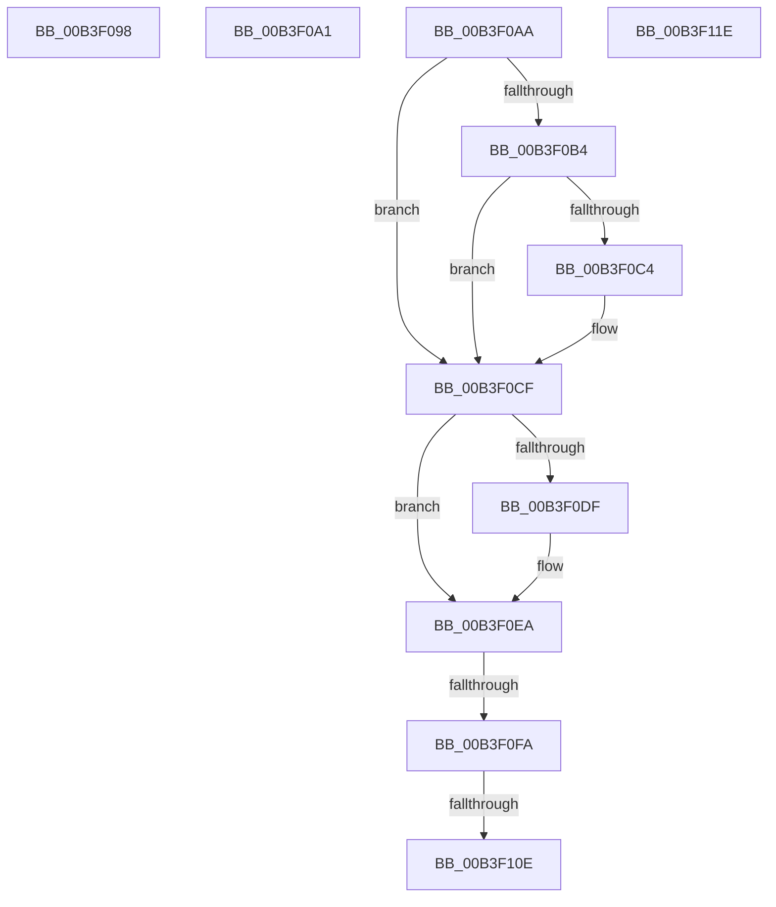

# sub_00B3F098

- RVA: `0x00B3F098`–`0x00B3F12C` (길이 `148` bytes)
- VA: `0x0000000140B3F098`
- 실행 섹션: `PAGE`
- PDB 이름 있음: `아니요`; PDB Function 태그: `아니요`
- unwind 정보 RVA: `0x000B4218`
- 디코드: `32`개 명령, `148/148` bytes 표시
- 미해석 바이트: `0` (있으면 어셈블리에 `.byte`로 보존)

> 이 문서는 커널 이미지의 기계어와 PDB 기호를 분석해 생성했습니다. 4번과 5번은 함수 원형과 자료형을 바이너리 사용 방식에서 추정한 C 해석이며 원본 소스 복구 결과는 아닙니다.

## 1. Dependencies

- 직접 호출 지점: **1**; 고유 호출 대상: **1**
- 직접 호출자로 확인된 함수: **0**
- RIP 상대 이미지 참조: **0**

### Outgoing calls
- `0x00B3F121` → [PspSetNoChildProcessRestrictedPolicy](../AB/PspSetNoChildProcessRestrictedPolicy_function_00AB1BE0.md) (function, `0x00AB1BE0`)

### Direct callers
- 이 함수 시작 RVA로 연결되는 직접 call은 확인되지 않았습니다. 간접 호출은 완전히 역산할 수 없습니다.

### Static image references
- 디코드된 RIP-relative 메모리 참조가 없습니다.

## 2. Other-region calls and transfers

- 다른 실행 섹션으로 향하는 call: **0**
- call이 아닌 외부 분기/꼬리 이동: **6**
  - `0x00B3F09C` → [PspApplyMitigationOptions + 0x23E](../A6/PspApplyMitigationOptions_function_00A699AC.md) (`tail-transfer`)
  - `0x00B3F0A5` → [PspApplyMitigationOptions + 0x29B](../A6/PspApplyMitigationOptions_function_00A699AC.md) (`tail-transfer`)
  - `0x00B3F0F4` → [PspApplyMitigationOptions + 0x46B](../A6/PspApplyMitigationOptions_function_00A699AC.md) (`tail-transfer`)
  - `0x00B3F108` → [PspApplyMitigationOptions + 0x46B](../A6/PspApplyMitigationOptions_function_00A699AC.md) (`tail-transfer`)
  - `0x00B3F119` → [PspApplyMitigationOptions + 0x46B](../A6/PspApplyMitigationOptions_function_00A699AC.md) (`tail-transfer`)
  - `0x00B3F127` → [PspApplyMitigationOptions + 0x48D](../A6/PspApplyMitigationOptions_function_00A699AC.md) (`tail-transfer`)

## 3. Assembly (complete function range)

```asm
00B3F098  48 8B 75 C0                     mov rsi, qword ptr [rbp - 0x40]
00B3F09C  E9 49 AB F2 FF                  jmp 0x140a69bea
00B3F0A1  48 8B 75 C0                     mov rsi, qword ptr [rbp - 0x40]
00B3F0A5  E9 9D AB F2 FF                  jmp 0x140a69c47
00B3F0AA  8B 87 54 07 00 00               mov eax, dword ptr [rdi + 0x754]
00B3F0B0  A8 40                           test al, 0x40
00B3F0B2  75 1B                           jne 0x140b3f0cf
00B3F0B4  48 8B 4D E0                     mov rcx, qword ptr [rbp - 0x20]
00B3F0B8  48 C1 E9 14                     shr rcx, 0x14
00B3F0BC  41 23 CD                        and ecx, r13d
00B3F0BF  83 F9 01                        cmp ecx, 1
00B3F0C2  75 0B                           jne 0x140b3f0cf
00B3F0C4  F0 81 8F 54 07 00 00 80 00 00 00  lock or dword ptr [rdi + 0x754], 0x80
00B3F0CF  48 8B 4D C8                     mov rcx, qword ptr [rbp - 0x38]
00B3F0D3  48 C1 E9 18                     shr rcx, 0x18
00B3F0D7  41 23 CD                        and ecx, r13d
00B3F0DA  83 F9 01                        cmp ecx, 1
00B3F0DD  75 0B                           jne 0x140b3f0ea
00B3F0DF  F0 81 8F 54 07 00 00 00 01 00 00  lock or dword ptr [rdi + 0x754], 0x100
00B3F0EA  F7 87 54 07 00 00 00 01 00 00   test dword ptr [rdi + 0x754], 0x100
00B3F0F4  0F 85 1D AD F2 FF               jne 0x140a69e17
00B3F0FA  48 8B 4D E0                     mov rcx, qword ptr [rbp - 0x20]
00B3F0FE  48 C1 E9 18                     shr rcx, 0x18
00B3F102  41 23 CD                        and ecx, r13d
00B3F105  83 F9 01                        cmp ecx, 1
00B3F108  0F 85 09 AD F2 FF               jne 0x140a69e17
00B3F10E  F0 81 8F 54 07 00 00 00 02 00 00  lock or dword ptr [rdi + 0x754], 0x200
00B3F119  E9 F9 AC F2 FF                  jmp 0x140a69e17
00B3F11E  48 8B CF                        mov rcx, rdi
00B3F121  E8 BA 2A F7 FF                  call 0x140ab1be0
00B3F126  90                              nop
00B3F127  E9 0D AD F2 FF                  jmp 0x140a69e39
```

## 4. C-style interpretation (structured pseudocode)

```c
__int64 __fastcall sub_00B3F098(void)
{
}
```

## 5. (Beta) C Style

```c
void sub_00B3F098(void)
{
}
```

## 6. Execution-region graph

[열기: 2D/3D 그래프와 함수 탐색 컨트롤 패널](../../../control-panel.html?section=page&rva=0x00B3F098&view=graph)

- 2D 그래프는 위에서 아래로 흐르고, 3D 그래프는 빈 공간을 드래그해 회전합니다. Shift+드래그는 이동, 휠은 확대·축소, 함수 노드 선택은 대상 보고서 이동입니다.

### Static fallback


