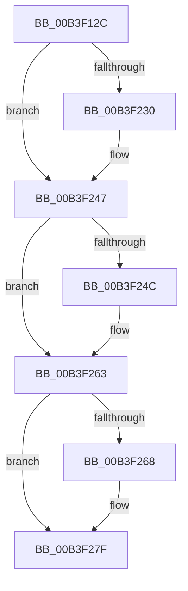

# sub_00B3F12C

- RVA: `0x00B3F12C`–`0x00B3F297` (길이 `363` bytes)
- VA: `0x0000000140B3F12C`
- 실행 섹션: `PAGE`
- PDB 이름 있음: `아니요`; PDB Function 태그: `아니요`
- unwind 정보 RVA: `0x000B4254`
- 디코드: `81`개 명령, `363/363` bytes 표시
- 미해석 바이트: `0` (있으면 어셈블리에 `.byte`로 보존)

> 이 문서는 커널 이미지의 기계어와 PDB 기호를 분석해 생성했습니다. 4번과 5번은 함수 원형과 자료형을 바이너리 사용 방식에서 추정한 C 해석이며 원본 소스 복구 결과는 아닙니다.

## 1. Dependencies

- 직접 호출 지점: **14**; 고유 호출 대상: **7**
- 직접 호출자로 확인된 함수: **0**
- RIP 상대 이미지 참조: **9**

### Outgoing calls
- `0x00B3F161` → [KeInitializeEvent](../../text/40/KeInitializeEvent_function_0040DD10.md) (function, `0x0040DD10`)
- `0x00B3F170` → [KeInitializeEvent](../../text/40/KeInitializeEvent_function_0040DD10.md) (function, `0x0040DD10`)
- `0x00B3F17F` → [KeInitializeEvent](../../text/40/KeInitializeEvent_function_0040DD10.md) (function, `0x0040DD10`)
- `0x00B3F19E` → [ExAcquireResourceExclusiveLite](../../text/21/ExAcquireResourceExclusiveLite_function_00214E20.md) (function, `0x00214E20`)
- `0x00B3F1C7` → [ExReleaseResourceLite](../../text/25/ExReleaseResourceLite_function_0025FA10.md) (function, `0x0025FA10`)
- `0x00B3F1CC` → [KeLeaveCriticalRegion](../../text/25/KeLeaveCriticalRegion_function_0025D8B0.md) (function, `0x0025D8B0`)
- `0x00B3F1D6` → [SepAdtInitLsaDeadEventForNonPagedList](../../text/60/SepAdtInitLsaDeadEventForNonPagedList_function_0060647C.md) (function, `0x0060647C`)
- `0x00B3F1F8` → [ExAcquireResourceExclusiveLite](../../text/21/ExAcquireResourceExclusiveLite_function_00214E20.md) (function, `0x00214E20`)
- `0x00B3F222` → [ExReleaseResourceLite](../../text/25/ExReleaseResourceLite_function_0025FA10.md) (function, `0x0025FA10`)
- `0x00B3F227` → [KeLeaveCriticalRegion](../../text/25/KeLeaveCriticalRegion_function_0025D8B0.md) (function, `0x0025D8B0`)
- `0x00B3F242` → [KeWaitForSingleObject](../../text/20/KeWaitForSingleObject_function_0020E6B0.md) (function, `0x0020E6B0`)
- `0x00B3F25E` → [KeWaitForSingleObject](../../text/20/KeWaitForSingleObject_function_0020E6B0.md) (function, `0x0020E6B0`)
- `0x00B3F27A` → [KeWaitForSingleObject](../../text/20/KeWaitForSingleObject_function_0020E6B0.md) (function, `0x0020E6B0`)
- `0x00B3F286` → [ZwClose](../../text/6A/ZwClose_function_006AD2B0.md) (function, `0x006AD2B0`)

### Direct callers
- 이 함수 시작 RVA로 연결되는 직접 call은 확인되지 않았습니다. 간접 호출은 완전히 역산할 수 없습니다.

### Static image references
- `0x00B3F133` → RVA `0x00F04AC8` (`.data`; read/write)
- `0x00B3F18D` → RVA `0x00E67E50` (`.data`; read)
- `0x00B3F1A8` → RVA `0x00E67EF0` (`.data`; write)
- `0x00B3F1B6` → RVA `0x00E67E30` (`.data`; read)
- `0x00B3F1F0` → RVA `0x00E67C20` (`.data`; read)
- `0x00B3F202` → RVA `0x00E67CC0` (`.data`; write)
- `0x00B3F210` → RVA `0x00E67C00` (`.data`; read)
- `0x00B3F27F` → RVA `0x00FD9F18` (`PAGEDATA`; read)
- `0x00B3F28B` → RVA `0x00FD9F18` (`PAGEDATA`; read/write)

## 2. Other-region calls and transfers

- 다른 실행 섹션으로 향하는 call: **14**
  - `0x00B3F161` → [KeInitializeEvent](../../text/40/KeInitializeEvent_function_0040DD10.md) (`PAGE` → `.text`)
  - `0x00B3F170` → [KeInitializeEvent](../../text/40/KeInitializeEvent_function_0040DD10.md) (`PAGE` → `.text`)
  - `0x00B3F17F` → [KeInitializeEvent](../../text/40/KeInitializeEvent_function_0040DD10.md) (`PAGE` → `.text`)
  - `0x00B3F19E` → [ExAcquireResourceExclusiveLite](../../text/21/ExAcquireResourceExclusiveLite_function_00214E20.md) (`PAGE` → `.text`)
  - `0x00B3F1C7` → [ExReleaseResourceLite](../../text/25/ExReleaseResourceLite_function_0025FA10.md) (`PAGE` → `.text`)
  - `0x00B3F1CC` → [KeLeaveCriticalRegion](../../text/25/KeLeaveCriticalRegion_function_0025D8B0.md) (`PAGE` → `.text`)
  - `0x00B3F1D6` → [SepAdtInitLsaDeadEventForNonPagedList](../../text/60/SepAdtInitLsaDeadEventForNonPagedList_function_0060647C.md) (`PAGE` → `.text`)
  - `0x00B3F1F8` → [ExAcquireResourceExclusiveLite](../../text/21/ExAcquireResourceExclusiveLite_function_00214E20.md) (`PAGE` → `.text`)
  - `0x00B3F222` → [ExReleaseResourceLite](../../text/25/ExReleaseResourceLite_function_0025FA10.md) (`PAGE` → `.text`)
  - `0x00B3F227` → [KeLeaveCriticalRegion](../../text/25/KeLeaveCriticalRegion_function_0025D8B0.md) (`PAGE` → `.text`)
  - `0x00B3F242` → [KeWaitForSingleObject](../../text/20/KeWaitForSingleObject_function_0020E6B0.md) (`PAGE` → `.text`)
  - `0x00B3F25E` → [KeWaitForSingleObject](../../text/20/KeWaitForSingleObject_function_0020E6B0.md) (`PAGE` → `.text`)
  - `0x00B3F27A` → [KeWaitForSingleObject](../../text/20/KeWaitForSingleObject_function_0020E6B0.md) (`PAGE` → `.text`)
  - `0x00B3F286` → [ZwClose](../../text/6A/ZwClose_function_006AD2B0.md) (`PAGE` → `.text`)
- call이 아닌 외부 분기/꼬리 이동: **1**
  - `0x00B3F292` → [SepRmCommandServerThread + 0x207](../A6/SepRmCommandServerThread_function_00A6A8D0.md) (`tail-transfer`)

## 3. Assembly (complete function range)

```asm
00B3F12C  33 C0                           xor eax, eax
00B3F12E  48 8D 4C 24 48                  lea rcx, [rsp + 0x48]
00B3F133  21 05 8F 59 3C 00               and dword ptr [rip + 0x3c598f], eax
00B3F139  0F 57 C0                        xorps xmm0, xmm0
00B3F13C  0F 57 C9                        xorps xmm1, xmm1
00B3F13F  48 89 44 24 58                  mov qword ptr [rsp + 0x58], rax
00B3F144  45 33 C0                        xor r8d, r8d
00B3F147  48 89 45 88                     mov qword ptr [rbp - 0x78], rax
00B3F14B  33 D2                           xor edx, edx
00B3F14D  48 89 44 24 70                  mov qword ptr [rsp + 0x70], rax
00B3F152  0F 11 44 24 48                  movups xmmword ptr [rsp + 0x48], xmm0
00B3F157  0F 11 4C 24 78                  movups xmmword ptr [rsp + 0x78], xmm1
00B3F15C  0F 11 44 24 60                  movups xmmword ptr [rsp + 0x60], xmm0
00B3F161  E8 AA EB 8C FF                  call 0x14040dd10
00B3F166  45 33 C0                        xor r8d, r8d
00B3F169  48 8D 4C 24 78                  lea rcx, [rsp + 0x78]
00B3F16E  33 D2                           xor edx, edx
00B3F170  E8 9B EB 8C FF                  call 0x14040dd10
00B3F175  45 33 C0                        xor r8d, r8d
00B3F178  48 8D 4C 24 60                  lea rcx, [rsp + 0x60]
00B3F17D  33 D2                           xor edx, edx
00B3F17F  E8 8C EB 8C FF                  call 0x14040dd10
00B3F184  65 48 8B 04 25 88 01 00 00      mov rax, qword ptr gs:[0x188]
00B3F18D  48 8D 0D BC 8C 32 00            lea rcx, [rip + 0x328cbc]
00B3F194  B2 01                           mov dl, 1
00B3F196  66 FF 88 E4 01 00 00            dec word ptr [rax + 0x1e4]
00B3F19D  90                              nop
00B3F19E  E8 7D 5C 6D FF                  call 0x140214e20
00B3F1A3  48 8D 44 24 48                  lea rax, [rsp + 0x48]
00B3F1A8  48 89 05 41 8D 32 00            mov qword ptr [rip + 0x328d41], rax
00B3F1AF  48 8D 0D 9A 8C 32 00            lea rcx, [rip + 0x328c9a]
00B3F1B6  48 8D 05 73 8C 32 00            lea rax, [rip + 0x328c73]
00B3F1BD  48 39 05 6C 8C 32 00            cmp qword ptr [rip + 0x328c6c], rax
00B3F1C4  0F 94 C3                        sete bl
00B3F1C7  E8 44 08 72 FF                  call 0x14025fa10
00B3F1CC  E8 DF E6 71 FF                  call 0x14025d8b0
00B3F1D1  48 8D 4C 24 60                  lea rcx, [rsp + 0x60]
00B3F1D6  E8 A1 72 AC FF                  call 0x14060647c
00B3F1DB  65 48 8B 0C 25 88 01 00 00      mov rcx, qword ptr gs:[0x188]
00B3F1E4  B2 01                           mov dl, 1
00B3F1E6  44 8A F8                        mov r15b, al
00B3F1E9  66 FF 89 E4 01 00 00            dec word ptr [rcx + 0x1e4]
00B3F1F0  48 8D 0D 29 8A 32 00            lea rcx, [rip + 0x328a29]
00B3F1F7  90                              nop
00B3F1F8  E8 23 5C 6D FF                  call 0x140214e20
00B3F1FD  48 8D 44 24 78                  lea rax, [rsp + 0x78]
00B3F202  48 89 05 B7 8A 32 00            mov qword ptr [rip + 0x328ab7], rax
00B3F209  48 8D 0D 10 8A 32 00            lea rcx, [rip + 0x328a10]
00B3F210  48 8D 05 E9 89 32 00            lea rax, [rip + 0x3289e9]
00B3F217  48 39 05 E2 89 32 00            cmp qword ptr [rip + 0x3289e2], rax
00B3F21E  41 0F 94 C4                     sete r12b
00B3F222  E8 E9 07 72 FF                  call 0x14025fa10
00B3F227  E8 84 E6 71 FF                  call 0x14025d8b0
00B3F22C  84 DB                           test bl, bl
00B3F22E  75 17                           jne 0x140b3f247
00B3F230  48 21 74 24 20                  and qword ptr [rsp + 0x20], rsi
00B3F235  48 8D 4C 24 48                  lea rcx, [rsp + 0x48]
00B3F23A  45 33 C9                        xor r9d, r9d
00B3F23D  45 33 C0                        xor r8d, r8d
00B3F240  33 D2                           xor edx, edx
00B3F242  E8 69 F4 6C FF                  call 0x14020e6b0
00B3F247  45 84 FF                        test r15b, r15b
00B3F24A  74 17                           je 0x140b3f263
00B3F24C  48 21 74 24 20                  and qword ptr [rsp + 0x20], rsi
00B3F251  48 8D 4C 24 60                  lea rcx, [rsp + 0x60]
00B3F256  45 33 C9                        xor r9d, r9d
00B3F259  45 33 C0                        xor r8d, r8d
00B3F25C  33 D2                           xor edx, edx
00B3F25E  E8 4D F4 6C FF                  call 0x14020e6b0
00B3F263  45 84 E4                        test r12b, r12b
00B3F266  75 17                           jne 0x140b3f27f
00B3F268  48 21 74 24 20                  and qword ptr [rsp + 0x20], rsi
00B3F26D  48 8D 4C 24 78                  lea rcx, [rsp + 0x78]
00B3F272  45 33 C9                        xor r9d, r9d
00B3F275  45 33 C0                        xor r8d, r8d
00B3F278  33 D2                           xor edx, edx
00B3F27A  E8 31 F4 6C FF                  call 0x14020e6b0
00B3F27F  48 8B 0D 92 AC 49 00            mov rcx, qword ptr [rip + 0x49ac92]
00B3F286  E8 25 E0 B6 FF                  call 0x1406ad2b0
00B3F28B  48 21 35 86 AC 49 00            and qword ptr [rip + 0x49ac86], rsi
00B3F292  E9 40 B8 F2 FF                  jmp 0x140a6aad7
```

## 4. C-style interpretation (structured pseudocode)

```c
__int64 __fastcall sub_00B3F12C(__int64 a1, int a2, int a3, int a4, __int64 a5, __int64 a6, __int64 a7, __int64 a8, __int64 a9, __int64 a10, __int64 a11, __int64 a12, __int64 a13, __int64 a14, __int64 a15)
{
    __int64 result;
    __int64 v_r12;
    __int64 v_rbx;
    unsigned __int64 v_stack_p20;
    unsigned __int64 v_stack_p58;
    unsigned __int64 v_stack_p70;

    result = 0;
    v_stack_p58 = 0;
    a3 = 0;
    *(unsigned __int64 *)(v_rbp - 120) = 0;
    a2 = 0;
    v_stack_p70 = 0;
    a9 = v_xmm0;
    a15 = v_xmm1;
    a12 = v_xmm0;
    result = KeInitializeEvent(a9, a2, a3, a4);
    a3 = 0;
    a2 = 0;
    result = KeInitializeEvent(a15, a2, a3, a4);
    a3 = 0;
    a2 = 0;
    result = KeInitializeEvent(a12, a2, a3, a4);
    result = ExAcquireResourceExclusiveLite(v_rip + 3312828, 1, a3, a4);
    *(unsigned __int64 *)(v_rip + 3312961) = a9;
    v_rbx = ((*(unsigned __int64 *)(v_rip + 3312748)) == (v_rip + 3312755)) ? 1 : 0;
    result = ExReleaseResourceLite(v_rip + 3312794, 1, a3, a4);
    result = KeLeaveCriticalRegion(v_rip + 3312794, 1, a3, a4);
    result = SepAdtInitLsaDeadEventForNonPagedList(a12, 1, a3, a4);
    result = ExAcquireResourceExclusiveLite(v_rip + 3312169, 1, a3, a4);
    *(unsigned __int64 *)(v_rip + 3312311) = a15;
    v_r12 = ((*(unsigned __int64 *)(v_rip + 3312098)) == (v_rip + 3312105)) ? 1 : 0;
    result = ExReleaseResourceLite(v_rip + 3312144, 1, a3, a4);
    result = KeLeaveCriticalRegion(v_rip + 3312144, 1, a3, a4);
    if ((unsigned __int8)(v_rbx) == 0) {
        a1 = a9;
        a4 = 0;
        a3 = 0;
        a2 = 0;
        result = KeWaitForSingleObject(a1, a2, a3, a4);
    }
    if ((unsigned __int8)((unsigned __int8)(result)) != 0) {
        a1 = a12;
        a4 = 0;
        a3 = 0;
        a2 = 0;
        result = KeWaitForSingleObject(a1, a2, a3, a4);
    }
    if ((unsigned __int8)(v_r12) == 0) {
        a1 = a15;
        a4 = 0;
        a3 = 0;
        a2 = 0;
        result = KeWaitForSingleObject(a1, a2, a3, a4);
    }
    result = ZwClose(*(unsigned __int64 *)(v_rip + 4828306), a2, a3, a4);
}
```

## 5. (Beta) C Style

```c
int64_t sub_00B3F12C(int64_t Arg1, int32_t Arg2, int32_t Arg3, int32_t Arg4, uint64_t Arg5, uint64_t Arg6, uint64_t Arg7, uint64_t Arg8, int64_t Arg9, uint64_t Arg10, uint64_t Arg11, int64_t Arg12, uint64_t Arg13, uint64_t Arg14, int64_t Arg15)
{
    int64_t result;
    int64_t local_r12;
    int64_t local_rbx;
    uint64_t v_stack_p20;
    uint64_t v_stack_p58;
    uint64_t v_stack_p70;

    result = 0;
    v_stack_p58 = 0;
    Arg3 = 0;
    *(uint64_t *)(local_rbp - 0x78) = 0;
    Arg2 = 0;
    v_stack_p70 = 0;
    Arg9 = v_xmm0;
    Arg15 = v_xmm1;
    Arg12 = v_xmm0;
    result = KeInitializeEvent(Arg9, Arg2, Arg3, Arg4);
    Arg3 = 0;
    Arg2 = 0;
    result = KeInitializeEvent(Arg15, Arg2, Arg3, Arg4);
    Arg3 = 0;
    Arg2 = 0;
    result = KeInitializeEvent(Arg12, Arg2, Arg3, Arg4);
    result = ExAcquireResourceExclusiveLite(v_rip + 3312828, 1, Arg3, Arg4);
    *(uint64_t *)(v_rip + 0x328D41) = Arg9;
    local_rbx = ((*(uint64_t *)(v_rip + 0x328C6C)) == (v_rip + 3312755)) ? 1 : 0;
    result = ExReleaseResourceLite(v_rip + 3312794, 1, Arg3, Arg4);
    result = KeLeaveCriticalRegion(v_rip + 3312794, 1, Arg3, Arg4);
    result = SepAdtInitLsaDeadEventForNonPagedList(Arg12, 1, Arg3, Arg4);
    result = ExAcquireResourceExclusiveLite(v_rip + 3312169, 1, Arg3, Arg4);
    *(uint64_t *)(v_rip + 0x328AB7) = Arg15;
    local_r12 = ((*(uint64_t *)(v_rip + 0x3289E2)) == (v_rip + 3312105)) ? 1 : 0;
    result = ExReleaseResourceLite(v_rip + 3312144, 1, Arg3, Arg4);
    result = KeLeaveCriticalRegion(v_rip + 3312144, 1, Arg3, Arg4);
    if ((uint8_t)(local_rbx) == 0) {
        Arg1 = Arg9;
        Arg4 = 0;
        Arg3 = 0;
        Arg2 = 0;
        result = KeWaitForSingleObject(Arg1, Arg2, Arg3, Arg4);
    }
    if ((uint8_t)((uint8_t)(result)) != 0) {
        Arg1 = Arg12;
        Arg4 = 0;
        Arg3 = 0;
        Arg2 = 0;
        result = KeWaitForSingleObject(Arg1, Arg2, Arg3, Arg4);
    }
    if ((uint8_t)(local_r12) == 0) {
        Arg1 = Arg15;
        Arg4 = 0;
        Arg3 = 0;
        Arg2 = 0;
        result = KeWaitForSingleObject(Arg1, Arg2, Arg3, Arg4);
    }
    result = ZwClose(*(uint64_t *)(v_rip + 0x49AC92), Arg2, Arg3, Arg4);
}
```

## 6. Execution-region graph

[열기: 2D/3D 그래프와 함수 탐색 컨트롤 패널](../../../control-panel.html?section=page&rva=0x00B3F12C&view=graph)

- 2D 그래프는 위에서 아래로 흐르고, 3D 그래프는 빈 공간을 드래그해 회전합니다. Shift+드래그는 이동, 휠은 확대·축소, 함수 노드 선택은 대상 보고서 이동입니다.

### Static fallback


