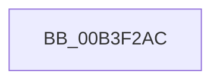

# sub_00B3F2AC

- RVA: `0x00B3F2AC`–`0x00B3F319` (길이 `109` bytes)
- VA: `0x0000000140B3F2AC`
- 실행 섹션: `PAGE`
- PDB 이름 있음: `아니요`; PDB Function 태그: `아니요`
- unwind 정보 RVA: `0x000B4390`
- 디코드: `17`개 명령, `109/109` bytes 표시
- 미해석 바이트: `0` (있으면 어셈블리에 `.byte`로 보존)

> 이 문서는 커널 이미지의 기계어와 PDB 기호를 분석해 생성했습니다. 4번과 5번은 함수 원형과 자료형을 바이너리 사용 방식에서 추정한 C 해석이며 원본 소스 복구 결과는 아닙니다.

## 1. Dependencies

- 직접 호출 지점: **0**; 고유 호출 대상: **0**
- 직접 호출자로 확인된 함수: **0**
- RIP 상대 이미지 참조: **3**

### Outgoing calls
- 직접 디코드된 call 명령이 없습니다.

### Direct callers
- 이 함수 시작 RVA로 연결되는 직접 call은 확인되지 않았습니다. 간접 호출은 완전히 역산할 수 없습니다.

### Static image references
- `0x00B3F2BD` → RVA `0x0078FE40` (`RtlpQueryTimeZoneKeyNameRoutine`; read)
- `0x00B3F2CB` → RVA `0x00B4B7B0` (`szTimeZoneKeyName`; read)
- `0x00B3F2E5` → RVA `0x00B4C110` (`szDynamicDaylightDisabled`; read)

## 2. Other-region calls and transfers

- 다른 실행 섹션으로 향하는 call: **0**
- call이 아닌 외부 분기/꼬리 이동: **1**
  - `0x00B3F314` → [RtlpQueryTimeZoneInformationWorker + 0x1AA](../A6/RtlpQueryTimeZoneInformationWorker_function_00A6BB6C.md) (`tail-transfer`)

## 3. Assembly (complete function range)

```asm
00B3F2AC  48 8D 83 AC 00 00 00            lea rax, [rbx + 0xac]
00B3F2B3  44 89 44 24 60                  mov dword ptr [rsp + 0x60], r8d
00B3F2B8  48 89 44 24 68                  mov qword ptr [rsp + 0x68], rax
00B3F2BD  48 8D 05 7C 0B C5 FF            lea rax, [rip - 0x3af484]
00B3F2C4  48 89 85 F8 00 00 00            mov qword ptr [rbp + 0xf8], rax
00B3F2CB  48 8D 05 DE C4 00 00            lea rax, [rip + 0xc4de]
00B3F2D2  48 89 85 08 01 00 00            mov qword ptr [rbp + 0x108], rax
00B3F2D9  48 8D 44 24 60                  lea rax, [rsp + 0x60]
00B3F2DE  48 89 85 10 01 00 00            mov qword ptr [rbp + 0x110], rax
00B3F2E5  48 8D 05 24 CE 00 00            lea rax, [rip + 0xce24]
00B3F2EC  48 89 85 40 01 00 00            mov qword ptr [rbp + 0x140], rax
00B3F2F3  48 8D 44 24 30                  lea rax, [rsp + 0x30]
00B3F2F8  48 89 85 48 01 00 00            mov qword ptr [rbp + 0x148], rax
00B3F2FF  44 89 B5 18 01 00 00            mov dword ptr [rbp + 0x118], r14d
00B3F306  44 89 95 38 01 00 00            mov dword ptr [rbp + 0x138], r10d
00B3F30D  44 89 9D 50 01 00 00            mov dword ptr [rbp + 0x150], r11d
00B3F314  E9 FD C9 F2 FF                  jmp 0x140a6bd16
```

## 4. C-style interpretation (structured pseudocode)

```c
__int64 __fastcall sub_00B3F2AC(__int64 a1, __int64 a2, int a3, __int64 a4, __int64 a5, __int64 a6, __int64 a7, __int64 a8, __int64 a9, __int64 a10, __int64 a11, __int64 a12)
{
    unsigned int v_stack_p60;
    unsigned __int64 v_stack_p68;

    v_stack_p60 = a3;
    v_stack_p68 = v_rbx + 172;
    *(unsigned __int64 *)(v_rbp + 248) = v_rip - 3863684;
    *(unsigned __int64 *)(v_rbp + 264) = v_rip + 50398;
    *(unsigned __int64 *)(v_rbp + 272) = a12;
    *(unsigned __int64 *)(v_rbp + 320) = v_rip + 52772;
    *(unsigned __int64 *)(v_rbp + 328) = a6;
    *(unsigned int *)(v_rbp + 280) = (unsigned int)(v_r14);
    *(unsigned int *)(v_rbp + 312) = (unsigned int)(v_r10);
    *(unsigned int *)(v_rbp + 336) = (unsigned int)(v_r11);
}
```

## 5. (Beta) C Style

```c
int64_t sub_00B3F2AC(int64_t Arg1, int64_t Arg2, int32_t Arg3, int64_t Arg4, uint64_t Arg5, int64_t Arg6, uint64_t Arg7, uint64_t Arg8, uint64_t Arg9, uint64_t Arg10, uint64_t Arg11, int64_t Arg12)
{
    uint32_t v_stack_p60;
    uint64_t v_stack_p68;

    v_stack_p60 = Arg3;
    v_stack_p68 = local_rbx + 172;
    *(uint64_t *)(local_rbp + 0xF8) = v_rip - 3863684;
    *(uint64_t *)(local_rbp + 0x108) = v_rip + 50398;
    *(uint64_t *)(local_rbp + 0x110) = Arg12;
    *(uint64_t *)(local_rbp + 0x140) = v_rip + 52772;
    *(uint64_t *)(local_rbp + 0x148) = Arg6;
    *(uint32_t *)(local_rbp + 0x118) = (uint32_t)(local_r14);
    *(uint32_t *)(local_rbp + 0x138) = (uint32_t)(local_r10);
    *(uint32_t *)(local_rbp + 0x150) = (uint32_t)(local_r11);
}
```

## 6. Execution-region graph

[열기: 2D/3D 그래프와 함수 탐색 컨트롤 패널](../../../control-panel.html?section=page&rva=0x00B3F2AC&view=graph)

- 2D 그래프는 위에서 아래로 흐르고, 3D 그래프는 빈 공간을 드래그해 회전합니다. Shift+드래그는 이동, 휠은 확대·축소, 함수 노드 선택은 대상 보고서 이동입니다.

### Static fallback


