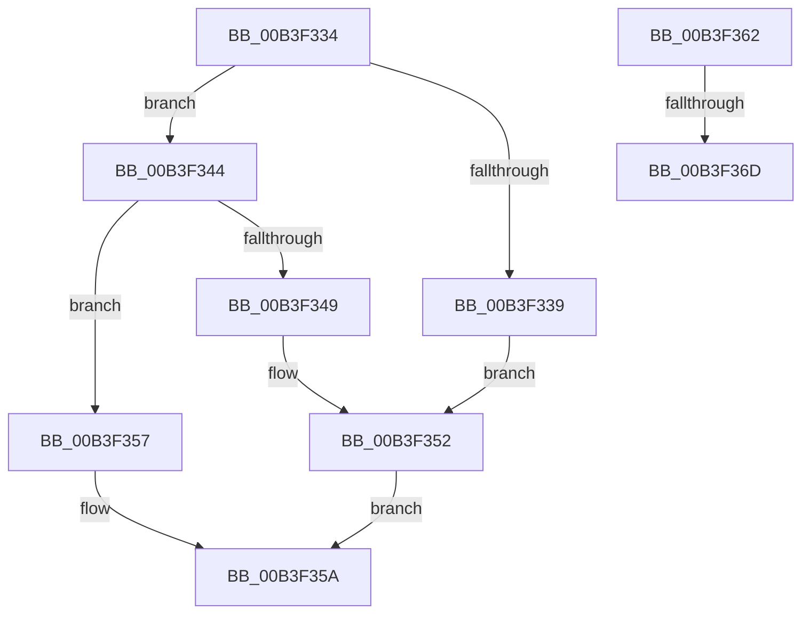

# sub_00B3F334

- RVA: `0x00B3F334`–`0x00B3F378` (길이 `68` bytes)
- VA: `0x0000000140B3F334`
- 실행 섹션: `PAGE`
- PDB 이름 있음: `아니요`; PDB Function 태그: `아니요`
- unwind 정보 RVA: `0x000B447C`
- 디코드: `20`개 명령, `68/68` bytes 표시
- 미해석 바이트: `0` (있으면 어셈블리에 `.byte`로 보존)

> 이 문서는 커널 이미지의 기계어와 PDB 기호를 분석해 생성했습니다. 4번과 5번은 함수 원형과 자료형을 바이너리 사용 방식에서 추정한 C 해석이며 원본 소스 복구 결과는 아닙니다.

## 1. Dependencies

- 직접 호출 지점: **0**; 고유 호출 대상: **0**
- 직접 호출자로 확인된 함수: **0**
- RIP 상대 이미지 참조: **0**

### Outgoing calls
- 직접 디코드된 call 명령이 없습니다.

### Direct callers
- 이 함수 시작 RVA로 연결되는 직접 call은 확인되지 않았습니다. 간접 호출은 완전히 역산할 수 없습니다.

### Static image references
- 디코드된 RIP-relative 메모리 참조가 없습니다.

## 2. Other-region calls and transfers

- 다른 실행 섹션으로 향하는 call: **0**
- call이 아닌 외부 분기/꼬리 이동: **3**
  - `0x00B3F35D` → [RtlCharToInteger + 0x41](../A6/RtlCharToInteger_function_00A6C4E0.md) (`tail-transfer`)
  - `0x00B3F367` → [RtlCharToInteger + 0x75](../A6/RtlCharToInteger_function_00A6C4E0.md) (`tail-transfer`)
  - `0x00B3F373` → [RtlCharToInteger + 0x57](../A6/RtlCharToInteger_function_00A6C4E0.md) (`tail-transfer`)

## 3. Assembly (complete function range)

```asm
00B3F334  80 F9 6F                        cmp cl, 0x6f
00B3F337  75 0B                           jne 0x140b3f344
00B3F339  BA 03 00 00 00                  mov edx, 3
00B3F33E  44 8D 52 05                     lea r10d, [rdx + 5]
00B3F342  EB 0E                           jmp 0x140b3f352
00B3F344  80 F9 62                        cmp cl, 0x62
00B3F347  75 0E                           jne 0x140b3f357
00B3F349  BA 01 00 00 00                  mov edx, 1
00B3F34E  44 8D 52 01                     lea r10d, [rdx + 1]
00B3F352  41 8A 09                        mov cl, byte ptr [r9]
00B3F355  EB 03                           jmp 0x140b3f35a
00B3F357  4C 8B C8                        mov r9, rax
00B3F35A  49 FF C1                        inc r9
00B3F35D  E9 BF D1 F2 FF                  jmp 0x140a6c521
00B3F362  8D 41 9F                        lea eax, [rcx - 0x61]
00B3F365  3C 05                           cmp al, 5
00B3F367  0F 87 E8 D1 F2 FF               ja 0x140a6c555
00B3F36D  0F BE C1                        movsx eax, cl
00B3F370  83 E8 57                        sub eax, 0x57
00B3F373  E9 BF D1 F2 FF                  jmp 0x140a6c537
```

## 4. C-style interpretation (structured pseudocode)

```c
__int64 __fastcall sub_00B3F334(unsigned __int8 a1, __int64 a2, __int64 a3, __int64 a4)
{
    if (a1 != 111) goto loc_00B3F344;
    goto loc_00B3F352;
loc_00B3F344:
    if (a1 != 98) goto loc_00B3F357;
loc_00B3F352:
    goto loc_00B3F35A;
loc_00B3F357:
loc_00B3F35A:
    a4 = (result) + 1;
}
```

## 5. (Beta) C Style

```c
int64_t sub_00B3F334(uint8_t Arg1, int64_t Arg2, int64_t Arg3, void *Arg4)
{
    uint8_t *arg4 = (uint8_t *)Arg4;

    if (Arg1 != 111) goto loc_00B3F344;
    goto loc_00B3F352;
loc_00B3F344:
    if (Arg1 != 98) goto loc_00B3F357;
loc_00B3F352:
    goto loc_00B3F35A;
loc_00B3F357:
loc_00B3F35A:
    Arg4 = (result) + 1;
}
```

### 관측된 메모리 오프셋

구조체 형식이 확인되지 않은 접근은 인자 기준의 오프셋으로만 기록했습니다.

| 기준 인자 | 오프셋 표현 | 폭 (bit) | 접근 |
|---|---:|---:|---|
| `Arg4` | `+ 0x0` | `8` | `R` |

## 6. Execution-region graph

[열기: 2D/3D 그래프와 함수 탐색 컨트롤 패널](../../../control-panel.html?section=page&rva=0x00B3F334&view=graph)

- 2D 그래프는 위에서 아래로 흐르고, 3D 그래프는 빈 공간을 드래그해 회전합니다. Shift+드래그는 이동, 휠은 확대·축소, 함수 노드 선택은 대상 보고서 이동입니다.

### Static fallback


