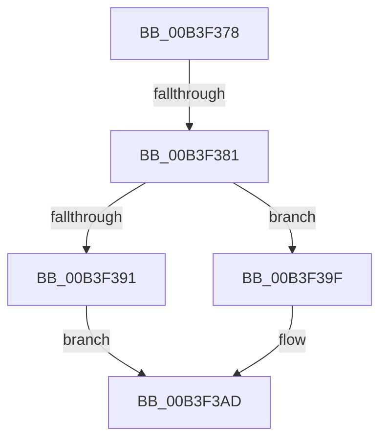

# sub_00B3F378

- RVA: `0x00B3F378`–`0x00B3F3B4` (길이 `60` bytes)
- VA: `0x0000000140B3F378`
- 실행 섹션: `PAGE`
- PDB 이름 있음: `아니요`; PDB Function 태그: `아니요`
- unwind 정보 RVA: `0x000B4588`
- 디코드: `16`개 명령, `60/60` bytes 표시
- 미해석 바이트: `0` (있으면 어셈블리에 `.byte`로 보존)

> 이 문서는 커널 이미지의 기계어와 PDB 기호를 분석해 생성했습니다. 4번과 5번은 함수 원형과 자료형을 바이너리 사용 방식에서 추정한 C 해석이며 원본 소스 복구 결과는 아닙니다.

## 1. Dependencies

- 직접 호출 지점: **2**; 고유 호출 대상: **2**
- 직접 호출자로 확인된 함수: **0**
- RIP 상대 이미지 참조: **0**

### Outgoing calls
- `0x00B3F386` → [IopFindSystemDevice](../72/IopFindSystemDevice_function_007230E8.md) (function, `0x007230E8`)
- `0x00B3F398` → [ExFreePoolWithTag](../../poolcode/B8/ExFreePoolWithTag_function_00B82870.md) (function, `0x00B82870`)

### Direct callers
- 이 함수 시작 RVA로 연결되는 직접 call은 확인되지 않았습니다. 간접 호출은 완전히 역산할 수 없습니다.

### Static image references
- 디코드된 RIP-relative 메모리 참조가 없습니다.

## 2. Other-region calls and transfers

- 다른 실행 섹션으로 향하는 call: **1**
  - `0x00B3F398` → [ExFreePoolWithTag](../../poolcode/B8/ExFreePoolWithTag_function_00B82870.md) (`PAGE` → `POOLCODE`)
- call이 아닌 외부 분기/꼬리 이동: **2**
  - `0x00B3F37B` → [IoQuerySystemDeviceName + 0x47](../A6/IoQuerySystemDeviceName_function_00A6CB24.md) (`tail-transfer`)
  - `0x00B3F3AF` → [IoQuerySystemDeviceName + 0x47](../A6/IoQuerySystemDeviceName_function_00A6CB24.md) (`tail-transfer`)

## 3. Assembly (complete function range)

```asm
00B3F378  83 FF 62                        cmp edi, 0x62
00B3F37B  0F 85 EA D7 F2 FF               jne 0x140a6cb6b
00B3F381  48 8D 54 24 20                  lea rdx, [rsp + 0x20]
00B3F386  E8 5D 3D BE FF                  call 0x1407230e8
00B3F38B  8B C8                           mov ecx, eax
00B3F38D  85 C0                           test eax, eax
00B3F38F  78 0E                           js 0x140b3f39f
00B3F391  48 8B 4C 24 20                  mov rcx, qword ptr [rsp + 0x20]
00B3F396  33 D2                           xor edx, edx
00B3F398  E8 D3 34 04 00                  call 0x140b82870
00B3F39D  EB 0E                           jmp 0x140b3f3ad
00B3F39F  81 F9 52 04 00 C0               cmp ecx, 0xc0000452
00B3F3A5  B8 51 04 00 C0                  mov eax, 0xc0000451
00B3F3AA  0F 44 D8                        cmove ebx, eax
00B3F3AD  8B C3                           mov eax, ebx
00B3F3AF  E9 B7 D7 F2 FF                  jmp 0x140a6cb6b
```

## 4. C-style interpretation (structured pseudocode)

```c
__int64 __fastcall sub_00B3F378(void)
{
    __int64 result;
    __int64 v_rbx;
    unsigned __int64 v_stack_p20;

    result = IopFindSystemDevice(a1, v_stack_p20, a3, a4);
    if (sign_flag) goto loc_00B3F39F;
    a2 = 0;
    result = ExFreePoolWithTag(v_stack_p20, a2, a3, a4);
    goto loc_00B3F3AD;
loc_00B3F39F:
    if (((unsigned int)(v_stack_p20)) == 0xC0000452ULL) { v_rbx = (unsigned int)((unsigned int)(0xC0000451ULL)); }
loc_00B3F3AD:
}
```

## 5. (Beta) C Style

```c
void sub_00B3F378(void)
{
    int64_t result;
    int64_t local_rbx;
    uint64_t v_stack_p20;

    result = IopFindSystemDevice(a1, v_stack_p20, a3, a4);
    if (sign_flag) goto loc_00B3F39F;
    a2 = 0;
    result = ExFreePoolWithTag(v_stack_p20, a2, a3, a4);
    goto loc_00B3F3AD;
loc_00B3F39F:
    if (((uint32_t)(v_stack_p20)) == 0xC0000452ULL) { local_rbx = (uint32_t)((uint32_t)(0xC0000451ULL)); }
loc_00B3F3AD:
}
```

## 6. Execution-region graph

[열기: 2D/3D 그래프와 함수 탐색 컨트롤 패널](../../../control-panel.html?section=page&rva=0x00B3F378&view=graph)

- 2D 그래프는 위에서 아래로 흐르고, 3D 그래프는 빈 공간을 드래그해 회전합니다. Shift+드래그는 이동, 휠은 확대·축소, 함수 노드 선택은 대상 보고서 이동입니다.

### Static fallback


