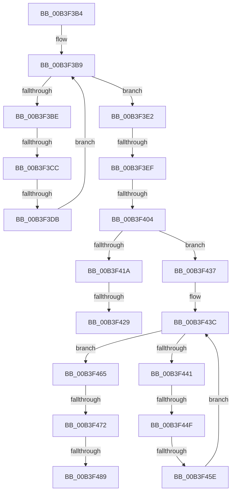

# sub_00B3F3B4

- RVA: `0x00B3F3B4`–`0x00B3F497` (길이 `227` bytes)
- VA: `0x0000000140B3F3B4`
- 실행 섹션: `PAGE`
- PDB 이름 있음: `아니요`; PDB Function 태그: `아니요`
- unwind 정보 RVA: `0x000B460C`
- 디코드: `66`개 명령, `227/227` bytes 표시
- 미해석 바이트: `0` (있으면 어셈블리에 `.byte`로 보존)

> 이 문서는 커널 이미지의 기계어와 PDB 기호를 분석해 생성했습니다. 4번과 5번은 함수 원형과 자료형을 바이너리 사용 방식에서 추정한 C 해석이며 원본 소스 복구 결과는 아닙니다.

## 1. Dependencies

- 직접 호출 지점: **0**; 고유 호출 대상: **0**
- 직접 호출자로 확인된 함수: **0**
- RIP 상대 이미지 참조: **0**

### Outgoing calls
- 직접 디코드된 call 명령이 없습니다.

### Direct callers
- 이 함수 시작 RVA로 연결되는 직접 call은 확인되지 않았습니다. 간접 호출은 완전히 역산할 수 없습니다.

### Static image references
- 디코드된 RIP-relative 메모리 참조가 없습니다.

## 2. Other-region calls and transfers

- 다른 실행 섹션으로 향하는 call: **0**
- call이 아닌 외부 분기/꼬리 이동: **11**
  - `0x00B3F3C6` → [SPCallServerHandleGetAppPolicyValue + 0x454](../A6/SPCallServerHandleGetAppPolicyValue_function_00A6CCD0.md) (`tail-transfer`)
  - `0x00B3F3D5` → [SPCallServerHandleGetAppPolicyValue + 0x454](../A6/SPCallServerHandleGetAppPolicyValue_function_00A6CCD0.md) (`tail-transfer`)
  - `0x00B3F3E9` → [SPCallServerHandleGetAppPolicyValue + 0x454](../A6/SPCallServerHandleGetAppPolicyValue_function_00A6CCD0.md) (`tail-transfer`)
  - `0x00B3F3FE` → [SPCallServerHandleGetAppPolicyValue + 0x745](../A6/SPCallServerHandleGetAppPolicyValue_function_00A6CCD0.md) (`tail-transfer`)
  - `0x00B3F423` → [SPCallServerHandleGetAppPolicyValue + 0x6DC](../A6/SPCallServerHandleGetAppPolicyValue_function_00A6CCD0.md) (`tail-transfer`)
  - `0x00B3F432` → [SPCallServerHandleGetAppPolicyValue + 0x2CD](../A6/SPCallServerHandleGetAppPolicyValue_function_00A6CCD0.md) (`tail-transfer`)
  - `0x00B3F449` → [SPCallServerHandleGetAppPolicyValue + 0x454](../A6/SPCallServerHandleGetAppPolicyValue_function_00A6CCD0.md) (`tail-transfer`)
  - `0x00B3F458` → [SPCallServerHandleGetAppPolicyValue + 0x454](../A6/SPCallServerHandleGetAppPolicyValue_function_00A6CCD0.md) (`tail-transfer`)
  - `0x00B3F46C` → [SPCallServerHandleGetAppPolicyValue + 0x454](../A6/SPCallServerHandleGetAppPolicyValue_function_00A6CCD0.md) (`tail-transfer`)
  - `0x00B3F483` → [SPCallServerHandleGetAppPolicyValue + 0x745](../A6/SPCallServerHandleGetAppPolicyValue_function_00A6CCD0.md) (`tail-transfer`)
  - `0x00B3F492` → [SPCallServerHandleGetAppPolicyValue + 0x2CD](../A6/SPCallServerHandleGetAppPolicyValue_function_00A6CCD0.md) (`tail-transfer`)

## 3. Assembly (complete function range)

```asm
00B3F3B4  45 8B 16                        mov r10d, dword ptr [r14]
00B3F3B7  33 C9                           xor ecx, ecx
00B3F3B9  41 3B CA                        cmp ecx, r10d
00B3F3BC  73 24                           jae 0x140b3f3e2
00B3F3BE  8B 02                           mov eax, dword ptr [rdx]
00B3F3C0  83 C0 04                        add eax, 4
00B3F3C3  41 3B C3                        cmp eax, r11d
00B3F3C6  0F 82 58 DD F2 FF               jb 0x140a6d124
00B3F3CC  44 8B C8                        mov r9d, eax
00B3F3CF  4C 03 CA                        add r9, rdx
00B3F3D2  4C 3B CA                        cmp r9, rdx
00B3F3D5  0F 82 49 DD F2 FF               jb 0x140a6d124
00B3F3DB  49 8B D1                        mov rdx, r9
00B3F3DE  FF C1                           inc ecx
00B3F3E0  EB D7                           jmp 0x140b3f3b9
00B3F3E2  4C 8D 4A 04                     lea r9, [rdx + 4]
00B3F3E6  4C 3B CA                        cmp r9, rdx
00B3F3E9  0F 82 35 DD F2 FF               jb 0x140a6d124
00B3F3EF  41 8B 4E 04                     mov ecx, dword ptr [r14 + 4]
00B3F3F3  48 8D 42 08                     lea rax, [rdx + 8]
00B3F3F7  49 03 4E 08                     add rcx, qword ptr [r14 + 8]
00B3F3FB  48 3B C1                        cmp rax, rcx
00B3F3FE  0F 87 11 E0 F2 FF               ja 0x140a6d415
00B3F404  44 89 1A                        mov dword ptr [rdx], r11d
00B3F407  45 89 01                        mov dword ptr [r9], r8d
00B3F40A  41 FF 06                        inc dword ptr [r14]
00B3F40D  49 8B 56 08                     mov rdx, qword ptr [r14 + 8]
00B3F411  44 8B 45 E8                     mov r8d, dword ptr [rbp - 0x18]
00B3F415  48 85 D2                        test rdx, rdx
00B3F418  75 1D                           jne 0x140b3f437
00B3F41A  41 8B 46 04                     mov eax, dword ptr [r14 + 4]
00B3F41E  8D 48 08                        lea ecx, [rax + 8]
00B3F421  3B C8                           cmp ecx, eax
00B3F423  0F 82 83 DF F2 FF               jb 0x140a6d3ac
00B3F429  41 FF 06                        inc dword ptr [r14]
00B3F42C  33 DB                           xor ebx, ebx
00B3F42E  41 89 4E 04                     mov dword ptr [r14 + 4], ecx
00B3F432  E9 66 DB F2 FF                  jmp 0x140a6cf9d
00B3F437  45 8B 16                        mov r10d, dword ptr [r14]
00B3F43A  33 C9                           xor ecx, ecx
00B3F43C  41 3B CA                        cmp ecx, r10d
00B3F43F  73 24                           jae 0x140b3f465
00B3F441  8B 02                           mov eax, dword ptr [rdx]
00B3F443  83 C0 04                        add eax, 4
00B3F446  41 3B C3                        cmp eax, r11d
00B3F449  0F 82 D5 DC F2 FF               jb 0x140a6d124
00B3F44F  44 8B C8                        mov r9d, eax
00B3F452  4C 03 CA                        add r9, rdx
00B3F455  4C 3B CA                        cmp r9, rdx
00B3F458  0F 82 C6 DC F2 FF               jb 0x140a6d124
00B3F45E  49 8B D1                        mov rdx, r9
00B3F461  FF C1                           inc ecx
00B3F463  EB D7                           jmp 0x140b3f43c
00B3F465  4C 8D 4A 04                     lea r9, [rdx + 4]
00B3F469  4C 3B CA                        cmp r9, rdx
00B3F46C  0F 82 B2 DC F2 FF               jb 0x140a6d124
00B3F472  41 8B 4E 04                     mov ecx, dword ptr [r14 + 4]
00B3F476  48 8D 42 08                     lea rax, [rdx + 8]
00B3F47A  49 03 4E 08                     add rcx, qword ptr [r14 + 8]
00B3F47E  33 DB                           xor ebx, ebx
00B3F480  48 3B C1                        cmp rax, rcx
00B3F483  0F 87 8C DF F2 FF               ja 0x140a6d415
00B3F489  44 89 1A                        mov dword ptr [rdx], r11d
00B3F48C  45 89 01                        mov dword ptr [r9], r8d
00B3F48F  41 FF 06                        inc dword ptr [r14]
00B3F492  E9 06 DB F2 FF                  jmp 0x140a6cf9d
```

## 4. C-style interpretation (structured pseudocode)

```c
__int64 __fastcall sub_00B3F3B4(int a1, __int64 a2, int a3)
{
    __int64 result;
    __int64 v_rbx;

    a1 = 0;
loc_00B3F3B9:
    if (0 >= ((unsigned int)((unsigned int)(*(unsigned int *)(v_r14))))) goto loc_00B3F3E2;
    result = (unsigned int)(((unsigned int)(*(unsigned int *)(a2))) + (4));
    a4 = ((unsigned int)((unsigned int)(result))) + (a2);
    a1 = (unsigned int)((a1) + 1);
    goto loc_00B3F3B9;
loc_00B3F3E2:
    a1 = ((unsigned int)(*(unsigned int *)(v_r14 + 4))) + (*(unsigned __int64 *)(v_r14 + 8));
    *(unsigned int *)(a4) = (unsigned int)(v_r11);
    *(unsigned int *)(a4 + 4) = a3;
    if (*(unsigned __int64 *)(v_r14 + 8) != 0) goto loc_00B3F437;
    v_rbx = 0;
    *(unsigned int *)(v_r14 + 4) = (unsigned int)((unsigned int)(*(unsigned int *)(v_r14 + 4)) + 8);
loc_00B3F437:
    a1 = 0;
loc_00B3F43C:
    if (0 >= ((unsigned int)((unsigned int)(*(unsigned int *)(v_r14))))) goto loc_00B3F465;
    result = (unsigned int)(((unsigned int)(*(unsigned int *)(*(unsigned __int64 *)(v_r14 + 8)))) + (4));
    a4 = ((unsigned int)((unsigned int)(result))) + (*(unsigned __int64 *)(v_r14 + 8));
    a1 = (unsigned int)((a1) + 1);
    goto loc_00B3F43C;
loc_00B3F465:
    a1 = ((unsigned int)(*(unsigned int *)(v_r14 + 4))) + (*(unsigned __int64 *)(v_r14 + 8));
    v_rbx = 0;
    *(unsigned int *)(a4) = (unsigned int)(v_r11);
    *(unsigned int *)(a4 + 4) = (unsigned int)((unsigned int)(*(unsigned int *)(v_rbp - 24)));
}
```

## 5. (Beta) C Style

```c
int64_t sub_00B3F3B4(int32_t Arg1, int64_t Arg2, int32_t Arg3)
{
    int64_t result;
    int64_t local_rbx;

    Arg1 = 0;
loc_00B3F3B9:
    if (0 >= ((uint32_t)((uint32_t)(*(uint32_t *)(local_r14))))) goto loc_00B3F3E2;
    result = (uint32_t)(((uint32_t)(*(uint32_t *)(Arg2))) + (4));
    a4 = ((uint32_t)((uint32_t)(result))) + (Arg2);
    Arg1 = (uint32_t)((Arg1) + 1);
    goto loc_00B3F3B9;
loc_00B3F3E2:
    Arg1 = ((uint32_t)(*(uint32_t *)(local_r14 + 0x4))) + (*(uint64_t *)(local_r14 + 0x8));
    *(uint32_t *)(a4) = (uint32_t)(local_r11);
    *(uint32_t *)(a4 + 0x4) = Arg3;
    if (*(uint64_t *)(local_r14 + 0x8) != 0) goto loc_00B3F437;
    local_rbx = 0;
    *(uint32_t *)(local_r14 + 0x4) = (uint32_t)((uint32_t)(*(uint32_t *)(local_r14 + 0x4)) + 8);
loc_00B3F437:
    Arg1 = 0;
loc_00B3F43C:
    if (0 >= ((uint32_t)((uint32_t)(*(uint32_t *)(local_r14))))) goto loc_00B3F465;
    result = (uint32_t)(((uint32_t)(*(uint32_t *)(*(uint64_t *)(local_r14 + 0x8)))) + (4));
    a4 = ((uint32_t)((uint32_t)(result))) + (*(uint64_t *)(local_r14 + 0x8));
    Arg1 = (uint32_t)((Arg1) + 1);
    goto loc_00B3F43C;
loc_00B3F465:
    Arg1 = ((uint32_t)(*(uint32_t *)(local_r14 + 0x4))) + (*(uint64_t *)(local_r14 + 0x8));
    local_rbx = 0;
    *(uint32_t *)(a4) = (uint32_t)(local_r11);
    *(uint32_t *)(a4 + 0x4) = (uint32_t)((uint32_t)(*(uint32_t *)(local_rbp - 0x18)));
}
```

## 6. Execution-region graph

[열기: 2D/3D 그래프와 함수 탐색 컨트롤 패널](../../../control-panel.html?section=page&rva=0x00B3F3B4&view=graph)

- 2D 그래프는 위에서 아래로 흐르고, 3D 그래프는 빈 공간을 드래그해 회전합니다. Shift+드래그는 이동, 휠은 확대·축소, 함수 노드 선택은 대상 보고서 이동입니다.

### Static fallback


