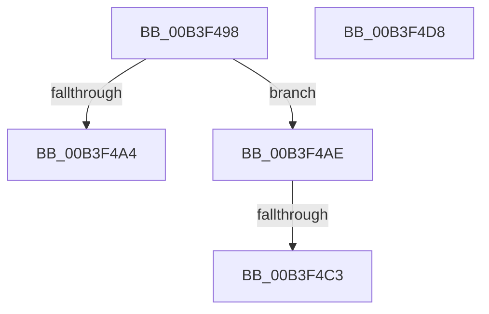

# sub_00B3F498

- RVA: `0x00B3F498`–`0x00B3F4DF` (길이 `71` bytes)
- VA: `0x0000000140B3F498`
- 실행 섹션: `PAGE`
- PDB 이름 있음: `아니요`; PDB Function 태그: `아니요`
- unwind 정보 RVA: `0x000B4698`
- 디코드: `18`개 명령, `71/71` bytes 표시
- 미해석 바이트: `0` (있으면 어셈블리에 `.byte`로 보존)

> 이 문서는 커널 이미지의 기계어와 PDB 기호를 분석해 생성했습니다. 4번과 5번은 함수 원형과 자료형을 바이너리 사용 방식에서 추정한 C 해석이며 원본 소스 복구 결과는 아닙니다.

## 1. Dependencies

- 직접 호출 지점: **1**; 고유 호출 대상: **1**
- 직접 호출자로 확인된 함수: **0**
- RIP 상대 이미지 참조: **2**

### Outgoing calls
- `0x00B3F4CD` → [memcpy](../../text/6C/memcpy_function_006C6840.md) (function, `0x006C6840`)

### Direct callers
- 이 함수 시작 RVA로 연결되는 직접 call은 확인되지 않았습니다. 간접 호출은 완전히 역산할 수 없습니다.

### Static image references
- `0x00B3F498` → RVA `0x00F04E20` (`.data`; read)
- `0x00B3F4AE` → RVA `0x00F04E18` (`.data`; read)

## 2. Other-region calls and transfers

- 다른 실행 섹션으로 향하는 call: **1**
  - `0x00B3F4CD` → [memcpy](../../text/6C/memcpy_function_006C6840.md) (`PAGE` → `.text`)
- call이 아닌 외부 분기/꼬리 이동: **4**
  - `0x00B3F4A9` → [SeSecureBootQueryInformation + 0x7B](../A6/SeSecureBootQueryInformation_function_00A6D57C.md) (`tail-transfer`)
  - `0x00B3F4BD` → [SeSecureBootQueryInformation + 0x95](../A6/SeSecureBootQueryInformation_function_00A6D57C.md) (`tail-transfer`)
  - `0x00B3F4D3` → [SeSecureBootQueryInformation + 0x7B](../A6/SeSecureBootQueryInformation_function_00A6D57C.md) (`tail-transfer`)
  - `0x00B3F4DA` → [SeSecureBootQueryInformation + 0x7B](../A6/SeSecureBootQueryInformation_function_00A6D57C.md) (`tail-transfer`)

## 3. Assembly (complete function range)

```asm
00B3F498  4C 8B 15 81 59 3C 00            mov r10, qword ptr [rip + 0x3c5981]
00B3F49F  4D 85 D2                        test r10, r10
00B3F4A2  75 0A                           jne 0x140b3f4ae
00B3F4A4  BB 06 00 EB C0                  mov ebx, 0xc0eb0006
00B3F4A9  E9 49 E1 F2 FF                  jmp 0x140a6d5f7
00B3F4AE  8B 0D 64 59 3C 00               mov ecx, dword ptr [rip + 0x3c5964]
00B3F4B4  8D 41 04                        lea eax, [rcx + 4]
00B3F4B7  41 89 01                        mov dword ptr [r9], eax
00B3F4BA  44 3B C0                        cmp r8d, eax
00B3F4BD  0F 82 4E E1 F2 FF               jb 0x140a6d611
00B3F4C3  44 8B C1                        mov r8d, ecx
00B3F4C6  48 8D 4A 04                     lea rcx, [rdx + 4]
00B3F4CA  49 8B D2                        mov rdx, r10
00B3F4CD  E8 6E 73 B8 FF                  call 0x1406c6840
00B3F4D2  90                              nop
00B3F4D3  E9 1F E1 F2 FF                  jmp 0x140a6d5f7
00B3F4D8  8B D8                           mov ebx, eax
00B3F4DA  E9 18 E1 F2 FF                  jmp 0x140a6d5f7
```

## 4. C-style interpretation (structured pseudocode)

```c
__int64 __fastcall sub_00B3F498(__int64 a1, __int64 a2, int a3, __int64 a4)
{
    __int64 result;

    if (*(unsigned __int64 *)(v_rip + 3955073) != 0) goto loc_00B3F4AE;
loc_00B3F4AE:
    *(unsigned int *)(a4) = (unsigned int)((unsigned int)(*(unsigned int *)(v_rip + 3955044)) + 4);
    result = memcpy(a2 + 4, *(unsigned __int64 *)(v_rip + 3955073), (unsigned int)((unsigned int)((unsigned int)(*(unsigned int *)(v_rip + 3955044)))), a4);
}
```

## 5. (Beta) C Style

```c
int64_t sub_00B3F498(int64_t Arg1, void *Arg2, int32_t Arg3, void *Arg4)
{
    uint8_t *arg2 = (uint8_t *)Arg2;
    uint8_t *arg4 = (uint8_t *)Arg4;

    int64_t result;

    if (*(uint64_t *)(v_rip + 0x3C5981) != 0) goto loc_00B3F4AE;
loc_00B3F4AE:
    *(uint32_t *)(arg4) = (uint32_t)((uint32_t)(*(uint32_t *)(v_rip + 0x3C5964)) + 4);
    result = memcpy(Arg2 + 4, *(uint64_t *)(v_rip + 0x3C5981), (uint32_t)((uint32_t)((uint32_t)(*(uint32_t *)(v_rip + 0x3C5964)))), Arg4);
}
```

### 관측된 메모리 오프셋

구조체 형식이 확인되지 않은 접근은 인자 기준의 오프셋으로만 기록했습니다.

| 기준 인자 | 오프셋 표현 | 폭 (bit) | 접근 |
|---|---:|---:|---|
| `Arg2` | `+ 0x4` | `64` | `R` |
| `Arg4` | `+ 0x0` | `32` | `W` |

## 6. Execution-region graph

[열기: 2D/3D 그래프와 함수 탐색 컨트롤 패널](../../../control-panel.html?section=page&rva=0x00B3F498&view=graph)

- 2D 그래프는 위에서 아래로 흐르고, 3D 그래프는 빈 공간을 드래그해 회전합니다. Shift+드래그는 이동, 휠은 확대·축소, 함수 노드 선택은 대상 보고서 이동입니다.

### Static fallback


